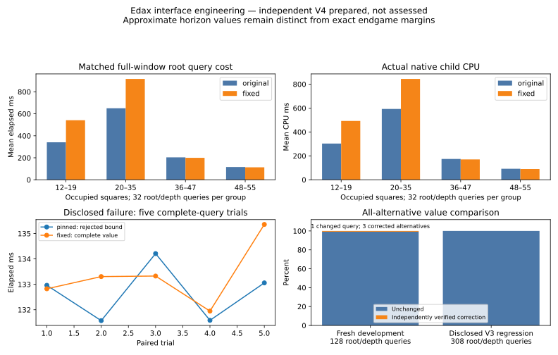

# Edax bounded-value resolution — 2026-10-28

The interface repair passed its engineering preflight. A **separate experimental Edax build** now returns complete values for the disclosed `assessment-154` failure at the requested horizon. The original executable and every V3 artifact are preserved. **V4 is prepared with 352 fresh, jointly reserved roots, but no calibration or assessment labels have been collected.** Qualification remains incomplete; production B and the playing engine are unchanged.

Audited evidence: [compact receipts, identities and measurements](data/edax-bound-resolution-20261028.json). Local raw evidence remains under `.local-research/edax-bound-20261028`, `bound-benchmark-20261028-native`, and `edax-bound-final-20261028`. These engineering positions are excluded from future qualification. This work does not establish that Edax supplies useful strategic supervision; V4 must answer that question independently.



## Failure mechanism

The original transcript was reproduced using the pinned upstream commit `713a434f13b3d15fb69c61b9ba3641aed82c496c`, its unchanged evaluation data, one native task, selectivity 5 (nonselective), and the original OBF child interface. At the White-to-move, 41-occupied root, the four legal alternatives are e1, g5, g6 and g7. D12 means searching each resulting child at eleven remaining placements. The first child prints `>+63`; the remaining child scores are +61, +63 and +63. The original adapter correctly rejected the entire query.

`search.c::result_print` prints `>` when the score equals the inclusive lower bound and the upper bound is larger. Thus:

| Native output | Proven information |
| --- | --- |
| exact-window `+63` | Requested search value is 63 |
| exact-window `+64` | Requested search value is 64 |
| `>+63` | Requested value is at least 63; 63 and 64 remain possible |
| `>+64` | Value is 64, using the independently known global maximum of 64 |
| `<-64` | Value is −64, using the independently known global minimum of −64 |

An exact terminal **raw-disc** margin of 63 is possible with one unplayed empty. Winner-awarded-empty terminal margins are even, so that terminal position scores 64 under Edax's convention. A **heuristic horizon** estimate of 63 is also valid. Terminal parity cannot turn an unresolved heuristic `>+63` into a proof of 64.

Source inspection and separate ablation builds found several interacting issues:

1. The OBF request does supply the outer full window. `options.c` clamps it to [−64,+64], so requesting [−65,+65] does not widen native search. `root.c::aspiration_search` introduces narrower internal windows anyway and can stop after a repeated numeric score while bounds remain unresolved. This is native search/report behavior, not an OBF text-parsing error.
2. `midgame.c` null-window search and `search.c::search_ETC_NWS` use stable-disc bounds on **terminal** outcomes to prune **heuristic horizon** estimates. Those estimates need not obey terminal stable-disc bounds. The failure child can return incompatible lower/upper claims under different windows. Restricting these cutoffs to terminal-reaching searches resolves this particular saturation failure.
3. That restriction alone is insufficient. A fresh development child (`cost-14`, child index 1, depth 11) still produced full-window +32 versus an inclusive narrow-window lower bound of +33 on the warmed iterative path. Disabling probabilistic cuts and hash-related optimizations in separate probes did not establish a single remaining cause. We do **not** claim a particular transposition-table defect has been proved. The selected path avoids iterative/aspiration warm-up altogether; its independent window checks pass.
4. The optimized leaf routines also mishandle early termination: the original depth-zero evaluator can return a heuristic for a terminal board with empties, and its depth-one shortcut can stop at 63 before discovering a true terminal 64. A fresh, independently solved forced-pass fixture returns −63 originally and −64 after repair at D1. This is an actual terminal-scoring correction, separate from the original bound.

The investigated command/Cassio entry paths ultimately use the same native search machinery. No verified stock query was found that reliably fixes all these cases while preserving the requested horizon, nonselectivity and complete alternative coverage. The evidence therefore supports a separate native correction, rather than a retry that interprets or replaces a bound.

## Selected correction and its search problem

[The GPL-3.0 patch](../scripts/teacher/edax-bound.patch), [license/notice](../scripts/teacher/EDAX_PATCH_NOTICE.md), and [separate build script](../scripts/teacher/bound-setup.py) preserve the pinned installation. Build metadata records the compiler, command, patch, every source file and executable hash. Probe builds have separate source/binary receipts in the published diagnosis.

The experimental `edax-fixed-window-v2` path:

- Calls `PVS_root` directly at the requested placement depth with nonselectivity 5 and the requested full window. It performs no iterative deepening, aspiration warm-up or PV depth extension. It retains ordinary alpha-beta/TT pruning; it does not substitute a deeper result.
- Uses stable-disc pruning internally only when search reaches terminal depth. It retains upstream's **root-conditioned** stable-score clamp, explicitly part of this query's definition.
- Detects terminal boards before depth-zero static evaluation. At a nonterminal zero-depth cutoff, it preserves the original static-evaluation policy. At positive depth a forced pass preserves the placement depth. Depth-one search now uses explicit make/evaluate/unmake with those same rules, without the beta=63 shortcut.
- Leaves static evaluator weights and rounding unchanged. Every legal alternative uses a separate child root at the same remaining depth and full window; score perspective is negated coherently. Already terminal children are independently scored.

This is a declared V4 horizon clarification/correction, frozen **before** collecting its outcomes. It is not a claim that all upstream iterative-search internals have been repaired. A parent-root query need not equal a decomposition into separately root-clamped child queries; a synthetic development position demonstrates that distinction. The independent horizon oracle implements the same declared root clamp rather than using that invalid decomposition as a proof.

There is no exceptional fallback or retry query. A bound that still cannot be proved exact, a malformed PV, missing alternative, selective result, wrong depth, invalid score or failed process remains fatal. In particular `>+63`, `<-63`, `<+64`, `>-64` and `?+64` are rejected. Only a correctly directed bound at a proven global endpoint is admitted as an exact endpoint. Pass normalization also reverses bound direction when reversing score perspective. Native process CPU/RSS evidence survives a parsing rejection.

| Selected identity | SHA-256 |
| --- | --- |
| Patch | `36555b54c837b39fcd60af0b91266d2b4db882ae16519678adee5f3db0a2ced9` |
| Experimental source tree | `c6e78436cb62e4f44644f1230c093e06bed6ce0228ece4f3a81ac8e442a186d7` |
| Experimental executable | `fe7d2c6ad3db0bf57f1a15d99de141b0527b02aadd65b8301104543c96236921` |
| Unchanged original executable | `23f8808166ed97af3a0ea43705374a8847b258c9ea1e4ed2861e48ad2f6ccf9c` |
| Unchanged evaluation data | `f8b2299612d9fa4414157e70e932636e33111c2602d0c2fc382a7d90ef21b792` |

## Independent verification

The [independent optimized exact solver](../scripts/teacher/exact.mjs) remains Edax-free. It verifies both raw-disc and winner-awarded-empty values under the unchanged ten-second combined cap. A separate [mailbox horizon oracle](../scripts/teacher/bound-horizon-oracle.c) implements its own rules, passes, terminal handling and alpha-beta traversal. That oracle **shares Edax's static evaluator** and reproduces the declared root clamp, so it checks search correctness, not evaluator independence. Its linked GPL code is engineering-only; it is never imported into our exact solver or player.

| Check | Result |
| --- | --- |
| Original disclosed failure, five paired trials | Original rejected every time; fixed D12 root alternatives **−63, −61, −63, −63** |
| Complete disclosed V3 regression | All alternatives unchanged in all **308** D10/D12 queries across 154 roots |
| Fresh development cohort | 64 roots, 16 per occupied stratum; equal B1/12% and B4/2% policies; 128 D10/D12 queries, **1,074 alternatives** |
| Fresh exact development cohort | 16 roots, eight each at ten/twelve empties; **115 alternatives** agree with independently exact awarded values; raw values retained separately |
| Window consistency | **2,148** child comparisons across 256 narrow-window batches contain the fixed full-window values |
| Independent horizon oracle | Six fresh six-empty roots at truncated D3 and exact D6; four ten-empty terminal searches; all five alternatives of the changed D10 query |
| Independent adapter preflight | 35 standard fixtures, seven extrema/pass/terminal fixtures, the early-terminal leaf, native ±63, and color/turn/rotation transformations passed |
| Parser/safety | Exact ±63/±64, directed endpoint bounds, unresolved bounds, malformed PVs, wrong depths and out-of-range scores tested |

Only one fresh root/depth query changed: `cost-59`, D10, 53 occupied, eleven empties. Three of its five alternative estimates changed: b2 −8→−12, h7 −15→−18, b8 −15→−16. The independent horizon oracle confirmed **all five** repaired values in about 97 ms / 11,208 nodes. These are exact values of the specified **truncated heuristic search problem**, not mathematical endgame margins. For example b8's fully solved awarded result is −20, not its D10 estimate of −16. Every changed result has explicit independent evidence; no valid earlier V3 label changed.

All 64 fresh roots produced complete outputs in both builds: zero observed bounded roots. With only 64 independent roots, the 95% Wilson upper limit for an unobserved event is approximately 5.7%; the 128 correlated depth queries are not 128 independent positions. The 154 regression roots are disclosed evidence, not new reliability-assessment data.

## Cost and operational evidence

Measurements below are paired **whole all-alternative root queries**, including native startup/evaluation loading. Native CPU is measured child user+system time, not Edax's rounded printed search time. One low-priority teacher worker was used. Peak native memory comes from OS child usage; it excludes the coordinator's much larger historical-exclusion index.

| 128 matched development queries | Original | Fixed |
| --- | ---: | ---: |
| Mean elapsed | 327.7 ms | 442.8 ms |
| Median elapsed | 224.3 ms | 270.2 ms |
| 95th percentile elapsed | 884.6 ms | 1,235.0 ms |
| Slowest elapsed | 1,677.3 ms | 2,785.0 ms |
| Total native CPU | 37.175 s | 51.051 s |
| CPU / summed query elapsed | 88.6% | 90.1% |
| Search nodes | 858,903,058 | 1,157,139,119 |
| Peak native RSS | 57.13 MiB | 57.15 MiB |

Median paired elapsed overhead is **12.9%**; the ratio of mean elapsed times is **35.1%**, native CPU rises **37.3%**, and nodes rise **34.7%**. Opening and middlegame queries account for the extra cost; later queries are slightly faster in this sample. On the disclosed failure, five original/fixed trial means are approximately 132.7/133.3 ms: resolving that particular failure adds about 0.6 ms, with no extra process. The broader conservative search correction, rather than a rare retry, drives the cohort overhead.

The initial characterization took 328.5 active seconds. Final confirmation executed another 265.8 active seconds / 237.3 native CPU seconds, reusing 238 explicitly hash-verified engineering receipts from the same selected build instead of recomputing them. Those figures exclude earlier ablation/build/preflight work and are not a total for the entire engineering session. Final window checks took 54.4 seconds; fresh V4 admission/preflight took 73.0 seconds. Each engineering runner has a bounded budget; no multi-hour assessment was run to investigate this failure.

An initial characterization resource pause preserved 41 receipts; its resource-interruption summary was archived before safe resumption. Final confirmation reused measurements only after input, source, build and receipt identity checks. Detailed native telemetry and raw transcripts are separate from readable stage/throughput/checkpoint logs. Existing Windows/WSL memory checks remained active; V4 preparation had about 3.19 GiB limiting available headroom and used one worker. Temporary Windows keep-awake was released; no saved power settings, applications or unrelated processes were changed.

**Forecast implication:** do not reuse V3's speed forecast. Repeat calibration with the new frozen executable, measure the whole required sample, then apply the existing **35% allowance plus final 20-minute reserve**. The measured mean slowdown is material and concentrated in early phases. No V4 runtime forecast or forecast accuracy can yet be claimed because its calibration has not run. If the complete fixed assessment cannot fit the 120-minute active cap, stop before opening it.

## Prepared independent V4

Local executable configuration: `.local-research/teacher-qualification-v4-20261028`. It has status `prepared` and only `validation.json` and `reservation.json` task receipts. **Zero cost, exact-cost, reliability or exact-assessment labels exist.** The independent preflight binds the repaired executable, patch, adapter, fixtures, oracle and evidence hashes; it is reverified on resumption.

All 352 roots were jointly reserved afresh: 24 calibration, eight exact calibration, 256 reliability assessment (64 per occupied stratum), and 64 independent exact assessment (32 each at ten/twelve empties). The fixed 32 odd-depth checks are predetermined within the new assessment. No favorable V3 outcomes or old reservations are imported. Full trajectories, source policies, pass histories, board/turn and canonical identities are verified; historical research, all V3 reservations/trajectories, the disclosed failure and every new engineering trajectory are excluded. Admission required 1,120 attempts; no difficulty-based replacement was permitted.

The original D10/D12/D14 calibration, fixed D13 checks, optional complete-sample D16 condition, depth-selection rule, statistical gates, regret/sign/reversal/useful-disagreement thresholds, independent exact scoring conventions, ten-second combined exact cap, worker/resource rules and scheduling margins remain unchanged. No teacher/reference depth is selected for V4. The only substantive search-definition change is the explicit corrected fixed horizon described above, declared before any outcomes.

| Frozen preparation | Identity |
| --- | --- |
| Source snapshot SHA-256 | `4397bc71347c373905cae64e06db2d7c343e1733f10a17c83661fb26b36e6f89` |
| Run identity | `581c62d0f388a73223509045177a3081cd23941395952c7e92669cdc1854e38c` |
| Reservation digest | `77efd57b14b5c4289b63c1bad204b048c2defe7311342056456716bc0f00519a` |
| Protocol file SHA-256 | `11023b22bfabd6c3ac0cfd0cdbc4d23b13936fb6e79b948a007078b80f717d4f` |
| Ready preflight file SHA-256 | `a6c9f7977b12393c555881d84b2024219762ee09ef12978ade3bee92db196028` |

**Recommended next action:** launch this prepared V4 once, using its frozen source and new calibration. Do not resume scientifically stopped V3. This command is supplied for the next authorized experiment and was **not executed** during engineering:

```bash
python3 scripts/teacher/qualification-launch.py \
  --output .local-research/teacher-qualification-v4-20261028 --resume
```

The launcher restores the frozen build/preflight configuration, reruns resource checks and preserves completed-run/fatal-query safety rules. Its `--prepare` mechanism allows independent admission without opening calibration/assessment. B-preserving residual learning remains deferred until an independent qualification passes.

## Reproduction, tests and limits

```bash
npm test
REVERSI_NATIVE_TEST=1 REVERSI_BOUND_TEST=1 node --test \
  tests/teacher-bound.test.mjs tests/teacher-qualification.test.mjs tests/exact-solver.test.mjs
python3 -m unittest discover -s tests -p 'test_*.py'

node scripts/teacher/bound-publish.mjs \
  .local-research/bound-benchmark-20261028-native \
  .local-research/edax-bound-final-20261028 \
  .local-research/edax-bound-20261028/final-windows \
  /tmp/reversi-edax-bound.json .local-research/teacher-qualification-v4-20261028
cmp docs/data/edax-bound-resolution-20261028.json /tmp/reversi-edax-bound.json
python3 scripts/teacher/bound-plots.py \
  docs/data/edax-bound-resolution-20261028.json /tmp/reversi-edax-bound.svg
cmp docs/edax-bound-resolution-20261028.svg /tmp/reversi-edax-bound.svg
```

Final checks pass: **93 JavaScript tests, 28 explicit native/exact tests, and 18 Python acceptance tests**. The Python resume test initially exhausted its five-second cumulative allowance during the second correctness suite; its test-only allowance is now ten seconds. Detached smoke cleanup also waits for writer-lock release. These changes affect no experimental budget or frozen V4 file. Existing detached-launch tests emit nonfatal Python subprocess resource warnings.

All **1,680 V3 files** match the pre-engineering hash inventory. The original V2 and V3 compact publications reproduce byte for byte, as do the new evidence JSON and figure. V3's stopped-run launcher refuses resumption with exit 2 before writing. Frozen V4 source, run/protocol/reservation identities and its absence of assessment receipts pass the read-only publication audit. The original pinned binary/source commit and evaluation-data hashes remain intact; no `src/` or browser file changed. The original user-request ledger prefix is unchanged, with the new request appended verbatim.

Figure generation uses optional matplotlib; playing remains dependency-free. A new experimental build can be reproduced with `python3 scripts/teacher/bound-setup.py --output .local-research/teacher/edax-fixed-reproduction`; existing build directories are deliberately refused.

Native checks were performed on this Windows 11 WSL2/Linux x86-64 host. No macOS hardware or browser-launch acceptance was exercised for these offline changes. The search correction has substantial differential and independent evidence, not a formal proof of all Edax internals. The secondary warmed-path inconsistency is bypassed rather than fully localized. The horizon oracle shares the static evaluator, so it cannot demonstrate strategic evaluator quality. Approximate values remain estimates of eventual game outcomes even when their fixed-horizon search is complete. Future unresolved native outputs must still stop qualification; no threshold, sample target or parser protection is relaxed.
