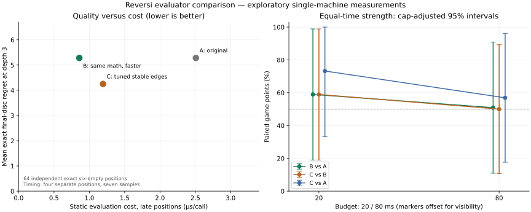

# Three evaluator strategies: quality, cost, depth, and strength

This round starts at `4576ace` on `main` and builds on [the previous experiments](EVALUATION_EXPERIMENTS.md). It does not repeat the random/greedy comparisons or smooth-phase pilot. The original evaluator and all weights in `src/features.js` are unchanged.

## Strategies and decision rule

| Strategy | Mathematical evaluation | Implementation |
|---|---|---|
| A: original | Original seven positional features and phase weights | Original `evaluate`, retained as a reference |
| B: faster baseline | Exactly the same values as A | Fused ray scanning; allocation-light mobility; reuse of already computed own mobility; no contribution objects in scalar evaluation |
| C: stable edges | B plus a selected stable-edge weight | Same fast baseline, plus existing conservative corner-anchored edge count |

B is eligible as the implementation default only with exact feature/score equivalence, identical fixed-depth choices and work counts, and measured speed benefit. This changes no positional knowledge or saved-model format. C requires stronger equal-time play against B at **both** 20 and 80 ms: at least 32 complete opening pairs per condition and a conservative pair-level 95% lower bound above 50%. Even then, results are exploratory rather than a simultaneous multiple-comparison guarantee; fresh confirmation and Mac hardware acceptance remain necessary. Position-label accuracy alone cannot promote C.

## Budget and reserved datasets

The timed experiment has a **720-second global allowance**, targeting **32 opening pairs per condition**, both colors, and three comparisons (B/A, C/B, C/A) at 20/80 ms. Complete pairs are interleaved across conditions; color order alternates by global pair index. No new pair starts after the allowance expires. Finishing the current pair can exceed the allowance, which is reported. This expands the former six-pair timed samples without silently extending the budget. JSON is checkpointed after every completed pair.

The protocol was fixed in `scripts/evaluator-protocol.mjs` before tuning or inspecting final results:

| Stage | Seed | Sample / use |
|---|---:|---|
| Development | 31027011 | 64 six-empty positions; independent exact labels; rank nonzero edge weights |
| Selection | 31027103 | 16 opening pairs; depth-3 games of shortlisted candidates against B |
| Final quality | 31027991 / +1 / +2 | 12 opening, 12 middle, 64 six-empty positions |
| Final games | 31028033 | 32 reserved eight-placement opening positions, paired colors |
| Cost measurements | 31028517 through +3 | Four positions per phase, separately generated |

The generator rejects duplicate/symmetry-equivalent boards across development, selection, final quality and final games, and excludes earlier published tournament and solved holdouts plus tactical examples. Final board keys were saved in the selection artifact before their labels/results were evaluated. The compact evidence file preserves those keys. After this report these final datasets are disclosed and cannot be presented as a fresh confirmation for subsequent tuning.

All positions are generated by seeded legal random play; representativeness is a limitation. There is no expert-opening corpus or human-strength calibration. Early/middle reference searches share the original evaluator and can favor it; those labels are expressly **estimates**, not game-theoretic truth. Final quality labels are not used in selection.

## Result-preserving speed engineering

Sampling ordinary depth-5 playing searches on the same workload (418,240 recursive nodes, 325,270 actual heuristic calls) found:

| Sampled function | A: 3,652 total samples | B: 1,987 total samples |
|---|---:|---:|
| `flipsFor` | 1,879 | 758 |
| Reference feature extraction / fast fused scan | 563 | 352 |
| `legalMoves` | 197 | 105 |
| Board-string TT key | 271 | 242 |
| Garbage collector | 192 | 116 |

Sampling proportions are diagnostic, not precise function timings. The workload is identical, so lower total sampled duration is meaningful; individual counts still contain sampling noise.

The original mobility calculation calls full `legalMoves` for both players, which constructs flip/line arrays for empty candidates even though evaluation needs only counts. Search has already generated the side-to-move's moves before evaluating a leaf. B fuses two-sided ray tests with potential mobility, frontier and disc counting, reuses that known count, and precomputes geometry once. It retains the original normalization, phase boundaries and summation order. Scalar evaluation omits the immediate-contribution object; coaching's detailed breakdown still uses the original implementation. No mutable-board cache, incremental board state, native dependency or bitboard rewrite was needed.

Tests compare every feature and exact floating-point score throughout 40 independent legal games, for both players and custom weights, with and without known mobility. Fixed-depth comparisons retain identical moves, scores, nodes, evaluator calls and solved values. The default search now uses B; callers can still select A. C remains optional and experimental.

### Static cost

Median microseconds per call: seven rotated-order samples of 8,000 calls after warmup, averaging four separately seeded positions per phase. Cost includes full extraction and weighted summation. B-reuse excludes computing the already available own-mobility count; search supplies it. Mobility-only rows are one player's count, not a whole evaluation.

| Random placements | A | B standalone | B with known mobility | C, selected weight 60 | Mobility A | Mobility fast |
|---:|---:|---:|---:|---:|---:|---:|
| 8 | 6.256 | 0.982 | 0.855 | 1.064 | 2.482 | 0.571 |
| 28 | 4.998 | 0.957 | 0.811 | 1.014 | 1.843 | 0.327 |
| 52 | 2.507 | 0.859 | 0.814 | 1.193 | 0.617 | 0.102 |

Whole depth-5 search improves by **1.24–1.89×, median 1.76×** over the 12 matched positions. A and B have identical node/evaluation counts; this is reduced cost, not a change in pruning or accuracy. C's leaf values can change favored TT moves and cutoffs, so C's search size must be assessed separately from its extra per-call cost. Full matched depth-4/5 measurements are retained in the compact evidence file.

The remaining major cost is the original allocating move generator used inside search and again when applying moves; board-string TT keys also remain visible. An allocation-light legal-move list using the already tested ray predicate is the next small optimization to measure, before a larger board representation change.

## Bounded stable-edge tuning

Development grid weights 15/30/60/90 multiply the existing normalized net anchored-edge count (`net discs / 24`). Corners remain excluded and overlap deduplicated. Lower mean exact disc regret at depth 1 shortlists two **nonzero** candidates; B remains the zero-weight reference regardless of this ranking.

| Weight | Development mean disc regret |
|---:|---:|
| 15 | 4.0625 |
| 30 | 3.5938 |
| 60 | 3.5000 |
| 90 | 3.4375 |

On separate 16-pair selection games, weight 60 scores 19 wins / 0 draws / 13 losses (59.4%) against B; weight 90 scores 18 / 0 / 14 (56.3%). The prespecified highest-points rule selects **60**, with lower weight as the tie-break. This happens to match the old pilot constant; it is not a selection using its old holdout. The candidate is frozen before final quality/timed results. No phase-pattern table was fitted: a second model and tuning search would dilute this bounded, separated experiment without a sufficient calibration corpus.

## Quality measured separately from playing strength

The six-empty final set is solved exhaustively by the independent sentinel-board oracle. Regret is the difference between the best and selected move's exact final disc margin, decoding terminal search sentinels. Spearman correlation ranks all legal alternatives with ties; it does not compare raw score scales. The means below are per-position means, excluding undefined rank correlations when all reference values tie.

| Final late positions | Evaluator | Exact-optimal choices / 64 | Mean disc regret | Mean Spearman |
|---|---|---:|---:|---:|
| Depth 1 | A / B | 21 | 6.9375 | 0.234 |
| Depth 1 | C | 25 | 6.0625 | 0.278 |
| Depth 3 | A / B | 30 | 5.2813 | 0.480 |
| Depth 3 | C | 33 | 4.2500 | 0.430 |

C improves top-choice regret here but has worse depth-3 rank correlation. Those metrics answer different questions; a better mean rank correlation need not give a better first choice. The sample alone does not establish stronger play. A and B match exactly at either depth.

Earlier labels use full-window depth-5 baseline search. Their regret units are **baseline heuristic estimate points**, never final discs. At depth 3, A/B choose a reference-optimal move in 10/12 openings and 8/12 middlegames; C gives 10/12 and 6/12. Middle estimated regret rises from 1.112 for A/B to 2.087 for C; mean rank correlation falls from 0.894 to 0.816. These shared-evaluator estimates can be biased toward A/B and are not an independent strength verdict. Full depth-1/3 quality summaries are retained in the evidence file.

In a separate final depth-3 game comparison, C vs B scores 33 wins / 2 draws / 29 losses: **53.1%, conservative 95% interval 29.1–77.1%**, on 32 opening pairs. There is no convincing fixed-depth game advantage. Raw heuristic prediction error in discs is deliberately not reported without a calibrated score-to-margin model.

## Expanded equal-time results

The 720-second allowance stopped the run at **724.0 seconds**, after finishing the current pair. It completed **340 games / 170 opening pairs** across six conditions. Every condition is incomplete relative to the 32-pair target; counts are 28–29, versus six previously. No further games were added after examining results. C therefore fails the prespecified promotion rule, even before considering uncertainty.

| Comparison | ms / move | Pairs | W / D / L | Points | Nominal pair-level 95% | Cap + comparisons 95% |
|---|---:|---:|---|---:|---|---|
| B vs A | 20 | 28 | 32 / 2 / 22 | 58.9% | 33.3–84.6% | 19.0–98.9% |
| C vs B | 20 | 28 | 31 / 4 / 21 | 58.9% | 33.3–84.6% | 19.0–98.9% |
| C vs A | 20 | 28 | 40 / 2 / 14 | 73.2% | 47.5–98.9% | 33.2–100.0% |
| B vs A | 80 | 28 | 28 / 1 / 27 | 50.9% | 25.2–76.6% | 10.9–90.9% |
| C vs B | 80 | 29 | 27 / 4 / 27 | 50.0% | 24.8–75.2% | 10.7–89.3% |
| C vs A | 80 | 29 | 32 / 2 / 24 | 56.9% | 31.7–82.1% | 17.6–96.2% |

Nominal bounds use opening-pair mean points, not independent color games. Wall-clock stopping can depend on game duration and hence outcomes. The second bounds conservatively cover all possible 1–32 prefix counts and all six conditions using a Hoeffding/union bound at familywise alpha 0.05. They still assume representative independent opening-pair sampling; host drift and the random-opening distribution remain limitations. They are deliberately wide. No comparison establishes a confirmed winner.

The point estimates favor C at 20 ms, but C vs B is exactly 50% at 80 ms. B gains a median ply against A at both budgets, yet its points rate is 58.9% at 20 ms and 50.9% at 80 ms. More depth is useful capacity, not a guarantee of monotonic strength with this horizon-limited evaluator. These games do not prove why a particular depth change helped or hurt.

### Work, actual time and depth

| Comparison / budget | Side | Median depth | Search nodes | Static calls | Static calls/s | Mean ms/move | p95 overrun ms | Max overrun ms |
|---|---|---:|---:|---:|---:|---:|---:|---:|
| B/A / 20 ms | B | 5 | 5,795,158 | 3,767,702 | 155,723 | 16.65 | 0.022 | 0.635 |
| B/A / 20 ms | A | 4 | 3,546,387 | 2,236,519 | 91,862 | 16.69 | 0.024 | 2.846 |
| C/B / 20 ms | C | 5 | 5,627,758 | 3,653,093 | 150,202 | 16.56 | 0.022 | 1.189 |
| C/B / 20 ms | B | 5 | 5,725,023 | 3,704,424 | 153,973 | 16.70 | 0.021 | 0.692 |
| C/A / 20 ms | C | 5 | 5,700,942 | 3,717,187 | 152,654 | 16.62 | 0.019 | 2.335 |
| C/A / 20 ms | A | 4 | 3,523,684 | 2,234,356 | 92,465 | 16.76 | 0.023 | 0.858 |
| B/A / 80 ms | B | 6 | 22,445,779 | 14,217,024 | 151,590 | 64.77 | 0.025 | 1.702 |
| B/A / 80 ms | A | 5 | 13,870,920 | 8,579,495 | 90,841 | 64.60 | 0.025 | 0.533 |
| C/B / 80 ms | C | 6 | 22,537,756 | 14,345,693 | 147,462 | 64.68 | 0.023 | 2.196 |
| C/B / 80 ms | B | 6 | 23,154,717 | 14,683,429 | 151,588 | 64.06 | 0.022 | 0.591 |
| C/A / 80 ms | C | 6 | 22,404,285 | 14,357,798 | 147,769 | 65.04 | 0.021 | 2.041 |
| C/A / 80 ms | A | 5 | 14,352,600 | 8,942,546 | 91,302 | 64.56 | 0.027 | 2.627 |

Counts include interrupted-iteration work; terminal values and transposition hits are not static calls. Means are below the requested limits because solved positions stop early. No unsearched depth-0 fallbacks occurred. Deadlines are soft; maximum overruns reached 2.85 ms. Actual per-move time is reported rather than assumed equal to the nominal limit. Comparing counts in games alone cannot isolate pruning, since the engines reach different boards. On matched fixed positions, A/B work counts are identical; C/B node ratios range from 0.59 to 1.41 with unchanged search/ordering algorithms but different leaf values and resulting cutoff/TT choices.

Completed-depth distributions for B/A illustrate the gain; the evidence JSON retains **every condition and side** as full depth histograms, plus actual time totals and rates.

| Budget | Side | Depth ≤3 | Depth 4 | Depth 5 | Depth 6 | Depth ≥7 |
|---:|---|---:|---:|---:|---:|---:|
| 20 ms | B | 92 | 561 | 367 | 178 | 255 |
| 20 ms | A | 215 | 636 | 256 | 133 | 219 |
| 80 ms | B | 76 | 59 | 461 | 394 | 458 |
| 80 ms | A | 90 | 205 | 521 | 281 | 365 |

For the late-position regret comparison, a paired 4,000-resample bootstrap gives C minus B mean disc regret −0.875 at depth 1 (95% descriptive interval −2.063 to −0.031) and −1.031 at depth 3 (−2.750 to +0.375). These positional intervals are not game-strength intervals and are not adjusted for all exploratory position metrics.

### Decision and next experiment

Keep **B** as the result-preserving implementation default, retain **A** as the reference, and keep **C** as an optional evaluator factory/benchmark option. Neither a stronger overall equal-depth player nor a stronger equal-time evaluator has been established conclusively. C has the best late-position regret and short-budget point estimates; the moderate-budget result does not confirm a gain. A/B tie mathematically at any fixed depth.

The next performance optimization is an allocation-light legal-move list based on the already verified ray predicate, while retaining the original rule implementation as an oracle. Then measure whether preserving ordering-only hints across iterative-deepening passes helps, without mixing TT bound depths. For evaluation knowledge, try a small phase-dependent stable-edge weight grid before fitting pattern tables; its middlegame estimate regressions suggest that one global edge weight may be too crude. Reserve new development/selection/holdout seeds before any further tuning.

We still lack an independent strong-engine or reasonably skilled human comparison. Beating weak reference opponents in the earlier round and trading wins among these related engines cannot establish human-level strength or an Elo rating. Actual Mac throughput and interactive behavior remain physically unverified.

## Methods considered after reading Egaroucid

The requested [technical explanation](https://www.egaroucid.nyanyan.dev/en/technology/explanation/) discusses the following ideas. The implementation choices are our judgments for this repository, not claims of reproducing its performance.

| Technique | Intended benefit | Decision here |
|---|---|---|
| Small corner/edge pattern tables | Evaluation quality; potentially ordering | Defer fitting until there is a larger separated calibration corpus |
| Differential pattern indices | Lower cost by updating changed squares | Useful after patterns exist; unnecessary for the current scalar features |
| Bitboards | Faster board operations and less state | Benchmark as a later alternative; native speed claims do not establish JavaScript speed |
| Cheap ordering evaluator / previous-search hints | More pruning, rather than better leaf labels | Promising after allocation-light move generation; retain ordering-only hints without reusing bounds at the wrong depth |
| Accuracy/speed tradeoff | Stronger complete player | Measure actual timed games; accurate position labels alone do not decide |

## Reproduction and platform limits

The graph is a standalone artifact, [evaluator-comparison.svg](evaluator-comparison.svg), with a compact machine-readable evidence file at [data/evaluator-comparison.json](data/evaluator-comparison.json). Static-cost points and exact-regret points come from separate reserved sets; plotting them together illustrates the measured tradeoff rather than asserting a causal fit between individual boards. The game panel uses intervals adjusted for all possible capped sample counts and all six comparisons.



Run all cost/profile/timed tasks **serially**, on an otherwise idle machine:

```bash
node scripts/compare-evaluators.mjs select > /tmp/reversi-r3-selection.json
node scripts/compare-evaluators.mjs cost /tmp/reversi-r3-selection.json > /tmp/reversi-r3-cost.json
node scripts/compare-evaluators.mjs quality /tmp/reversi-r3-selection.json > /tmp/reversi-r3-quality.json
node scripts/compare-evaluators.mjs fixed /tmp/reversi-r3-selection.json > /tmp/reversi-r3-fixed.json
node scripts/compare-evaluators.mjs timed /tmp/reversi-r3-selection.json /tmp/reversi-r3-timed.json
node --cpu-prof --cpu-prof-dir=/tmp scripts/profile-evaluator.mjs A
node --cpu-prof --cpu-prof-dir=/tmp scripts/profile-evaluator.mjs B
```

With Matplotlib available in a developer Python environment, reproduce the summary and figure after the timed run finishes:

```bash
MPLCONFIGDIR=/tmp/reversi-plot-cache python3 scripts/summarize-comparison.py /tmp/reversi-r3 docs/data/evaluator-comparison.json docs/evaluator-comparison.svg
```

This optional plotting dependency is not used by the application or correctness tests. Raw tournament trajectories/checkpoints and profiler output remain outside Git; the compact evidence includes aggregate move statistics, depth histograms, pair outcomes, quality summaries, cost samples and frozen board keys, without personal browser models.

Fixed-depth choices and label metrics are seeded/reproducible. Wall-clock stopping and game results vary with host scheduling. Measurements use WSL2 Ubuntu 22.04.5, Node 24.16.0, Intel i7-14700F. There is no new play-time dependency; optional Matplotlib produces the standalone graph. Actual macOS Apple Silicon and Intel hardware remain unavailable and untested. Platform-specific throughput claims are not inferred from WSL2.

## Verification and delivery scope

All **40 named JavaScript tests** in eleven files and **six Python tests** pass. The new tests include exact feature and score equivalence over more than 4,000 side-to-move positions from 40 independent games, custom weights, mobility reuse, fixed-depth node/move equality, independent exact endings, stable-edge value preservation, color-order offsets, and report aggregation of actual time/work/tails. Relevant commands:

```bash
node --test tests/*.test.mjs
node --test --test-isolation=none tests/*.test.mjs
python3 -m unittest discover -s tests -p 'test_*.py'
git diff --check
```

The socket-restricted sandbox required execution approval for HTTP/browser checks. Full Chromium 153.0.8010.12 acceptance passed with the faster default, including coaching comparisons, both colors, computer moves, training, export/reload and completed-game review. Actual Windows 11 Home 10.0.26300 / Chrome 155.0.8059.40 verified coaching and a playing-worker reply through WSL2 localhost; PowerShell default-browser launch returned success. Mac hardware was unavailable. The graph was rendered and visually inspected. No other repository was modified, and no personal models, browser caches, archives or raw profiler files are committed.

The timed cap prevented completion of the 32-pair target. Larger pattern tables, independent strong-engine calibration, human games and Mac measurements were not completed in this round. None is implied by these self-play results.
