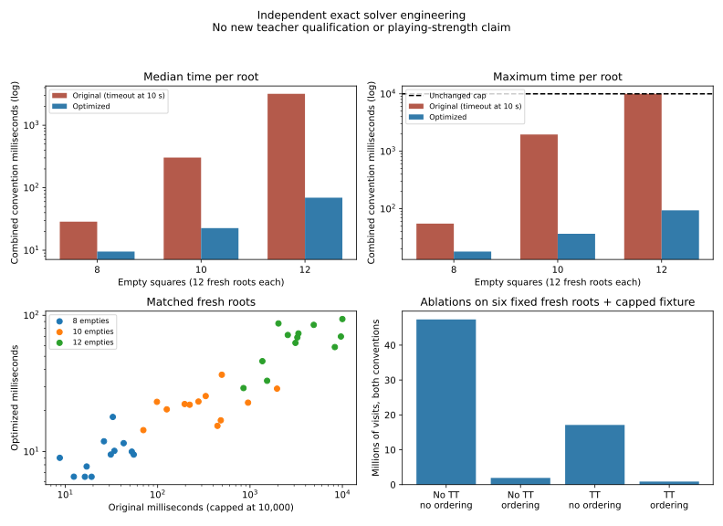

# Independent exact-endgame solver optimization

28 October 2026. **The measured bottleneck is removed on the tested positions.** The previously capped twelve-empty board finished both scoring conventions in **64.08 ms** under the unchanged combined ten-second deadline. All 44 engineering roots completed with the optimized solver; the slowest took **159.60 ms**. The prior teacher qualification remains stopped and scientifically incomplete. No assessment, training, production-B change or production-search change occurred.

## 1. Diagnosis and measured costs

The old `solve` in `scripts/teacher/validate.mjs` recursively called the independent `oracleChildren` implementation. Each call rebuilt a 100-cell mailbox, scanned 64 possible squares, allocated flip arrays, and constructed a complete 64-cell child board for **every** legal move, including moves alpha-beta would never visit. Every legal root alternative received a full-window search, but different alternatives shared no transposition information. Raw-disc and awarded-empty conventions repeated that work independently. There was no useful move ordering beyond row-major order.

The straightforward implementation is retained in [reference-exact.mjs](../scripts/teacher/reference-exact.mjs), with the same recurrence and optional instrumentation. It remains a correctness reference rather than silently becoming an alias of the optimized implementation. The independent rules in `tests/oracle.mjs` are unchanged.

A bounded instrumented profile used a seeded ten-empty engineering root and the disclosed capped twelve-empty root. Each convention had a two-second diagnostic ceiling. On the first convention of the capped root, it observed **454,040 child-generation calls**, **2,332,615 logical array allocations**, and **276,889 repeated board/turn calls** among 177,151 tracked unique positions. Scan/key-tracking work occupied about **1,020 ms** and legal-child board copying/application about **938 ms**. The unique-position set had a declared 200,000-entry limit; these are generator-call observations, not a precise count of search-tree transpositions.

V8 sampling over the whole diagnostic attributed about **4,139 ms** to the instrumented child generator, **134 ms** to garbage collection, and **100 ms** to the recursive visitor. Allocation counts include known mailbox/result/flip/child arrays; they are a lower bound on logical allocations, not total allocated bytes. The profile's timing, repeated-position key construction and heap/CPU profilers add substantial overhead. Those times are diagnostic and are not used as benchmark speedups. Profile counters are cumulative within a root across conventions; the figures above deliberately use its first convention.

A second stratified diagnostic used the first two fresh benchmark roots at each empty count plus the disclosed fixture, with the same two-second per-convention profiling limit. First-convention (raw) observations were:

| Fixed diagnostic root | Child-generation calls | Scan/key ms | Child-copy/application ms | Logical arrays | Repeated board/turn calls |
|---|---:|---:|---:|---:|---:|
| fresh-8-0 | 5,071 | 12 | 11 | 25,229 | 2,041 |
| fresh-8-1 | 2,524 | 10 | 6 | 12,983 | 721 |
| fresh-10-0 | 97,209 | 188 | 173 | 482,104 | 74,444 |
| fresh-10-1 | 114,344 | 257 | 206 | 559,374 | 60,205 |
| fresh-12-0, capped profile | 518,942 | 1,053 | 903 | 2,564,234 | 335,353 |
| fresh-12-1, capped profile | 531,442 | 1,072 | 885 | 2,524,742 | 326,546 |
| disclosed fixture, capped profile | 507,339 | 999 | 963 | 2,611,231 | 311,954 |

This checks the cost diagnosis across all three requested empty counts. Instrumented cutoffs truncate the difficult profiles; they are not failed ten-second benchmark results.

Twelve empties alone is a poor cost predictor. In the fresh sample, two roots with six legal alternatives took approximately **0.85 and 9.64 seconds** with the old solver. Deeper branching, forced passes, equivalent positions reached through different move sequences, and pruning order matter. Generating and copying all legal children before knowing which ones will be pruned makes bad ordering particularly expensive.

## 2. Implemented optimizations and exact semantics

The new [exact.mjs](../scripts/teacher/exact.mjs) is an inspectable JavaScript solver with no imports from production rules/search/evaluation or from Edax. It implements independent sentinel-board rules and adds:

* **One mutable 100-cell board.** Make/unmake records use reusable flip buffers; each selected move is undone in `finally`, including on cancellation. The board supplied by the caller is unchanged.
* **Reusable move storage per placement depth.** Only the root's initially empty cells are scanned. No mailbox or child board is allocated for every visited node. Flip lists are computed once for that node and applied only to searched children.
* **Cheap ordering.** Prefer a compatible cached move, corners, isolated orthogonal empty cells, then fewer flips. This is ordering only, not a pruning assumption, stability claim or heuristic leaf value.
* **Bounded transposition storage.** Default 2^18 slots use 4,980,736 bytes, plus 557,440 bytes of move/flip scratch. Four complete 32-bit occupancy words, player to move and terminal convention must match before a cache entry is accepted. An index-hash collision causes replacement or a miss, never a false score match.
* **Explicit exact/lower/upper flags.** Compatible bounds can tighten the search window; only exact entries return an unqualified cached value. Writes classify results against the incoming window. Every legal root alternative still receives the full `[-65,+65]` window independently; root alpha does not carry between alternatives.
* **Safe reuse.** Completed entries and ordering information can help other alternatives and subsequent solves. Raw and awarded conventions have separate tags. No scores or bounds are converted between conventions. A board's empties are determined by its full occupancy, so there is no incompatible horizon entry in this terminal-only table.

The board words are cache keys, not a bitboard move generator. Profiling justified removing allocation and redundant search; a native rewrite or a second bitboard rule implementation was unnecessary.

A forced pass changes player without consuming an empty square or placement depth. Two players with no move terminate even with unoccupied squares. A terminal utility is the occupied-disc margin for the side to move; awarded-empty scoring adds remaining empties to the winner and adds none for a draw. The conventions remain mathematically distinct. A live fixture with multiple legal alternatives has optimal values **63 raw versus 64 awarded**, and is tested repeatedly through the same cache.

`solveBoth` enforces one absolute deadline covering construction and both conventions. It checks before roots, periodically during recursion and before returning. Deadline/cancellation errors return no partial object labeled exact. The qualification worker uses this API while retaining its outer termination safeguard. Cache entries completed before an interruption remain valid; incomplete recursive calls do not store a result. Terminal root rows remain empty when no placement exists, matching the original reference API.

## 3. Bounded benchmark protocol

The engineering namespace was `exact-engineering-20261028`. Before timing, the runner reserved **12 fresh roots each at 8, 10 and 12 empties**, each from a distinct random trajectory, plus the **eight disclosed exact-cost roots** from the stopped qualification. It did not sample the 256 reliability roots or 64 exact-assessment roots. Fresh roots had at least two legal moves and were admitted against complete historical trajectories, qualification reservations and cross-trajectory canonical exclusions. Admission took 108 attempts. These are engineering positions, not independent playing-strength assessment data.

The program used the existing physical-memory/CPU/swap preflight, progress/profiling facilities, atomic immutable receipts and source identities. Available limiting physical memory was about **4.57 GiB** at the initial engineering check; swap traffic was zero. It used **one reduced-priority worker process at a time** for reliable matched timing and Windows responsiveness. No application or saved setting was changed.

Each original/optimized trial ran in a new Node process, alternating order by root index. Both implementations had the same **ten-second combined-convention cap**. Reported search time includes construction and cold-process JIT during the call, but excludes process startup/imports. CPU is isolated **process** CPU and can include V8 helper threads. Maximum RSS is process-lifetime RSS, including Node and common benchmark imports, not solver-table memory alone. Heap deltas are not allocation totals.

Six fixed fresh roots (the first two per empty count) plus the capped fixture were chosen for four ablations and three optimized repetitions. Selection did not depend on observed speed. The benchmark had a 15-minute ceiling with three minutes reserved, and a clear failure exit if fixed work could not finish. Actual active runner duration was **151.49 seconds**, including admission/preflight, paired searches, native cross-checks, ablations and repetitions. Raw logs/profiles remain ignored locally.

## 4. Before/after results

All times below cover both conventions.

| Empty squares | Fresh roots | Original median ms | Optimized median ms | Median paired speedup | Original maximum ms | Optimized maximum ms |
|---|---:|---:|---:|---:|---:|---:|
| 8 | 12 | 28.66 | 9.51 | **2.72×** | 55.10 | 17.96 |
| 10 | 12 | 303.95 | 22.59 | **12.42×** | 1,960.88 | 36.63 |
| 12 | 12 | 3,179.51 | 69.33 | **46.28×** | ≥10,000, capped | 93.86 |

Paired speedup is the median of individual original/optimized ratios, not the ratio of marginal medians. The twelve-empty ratio uses **11 completed original pairs**, excluding its one censored timeout. It is not an estimate obtained by treating 10,000 ms as the unknown completion time. One eight-empty root was slightly slower with the optimized solver; fixed table/initialization overhead matters for tiny searches. These are local timing observations, not confidence intervals or guarantees on all positions.

| Empty squares | Original median completed visits | Optimized median visits | Original total process CPU ms | Optimized total process CPU ms | Max RSS MiB, original / optimized |
|---|---:|---:|---:|---:|---:|
| 8 | 8,210 | 4,122 | 419 | 187 | 71.46 / 71.46 |
| 10 | 102,545 | 28,941 | 5,513 | 514 | 75.42 / 71.46 |
| 12 | 1,088,138 (11 completions) | 277,086 (12) | 47,894, including cap | 1,119 | 125.53 / 71.46 |

Visit counts differ slightly in definition: the optimized search explicitly visits the pass leading to terminal detection, while the old oracle checks the other player's legal moves before recursing. They are not identical-node performance comparisons. Within the optimized ablations the counting convention is identical.

Separate median convention costs, original versus optimized, were approximately 15.80/4.94 ms awarded and 12.58/3.71 ms raw at eight empties; 155.69/11.24 and 148.12/8.84 at ten; 1,550.64/37.25 and 1,554.01/30.88 at twelve. Original twelve-empty convention medians use completed roots. The first convention bears more cold JIT overhead; this is not evidence that its scoring rule is inherently slower.

### Attribution through ablations

Seven fixed roots, sums over both conventions:

| Mutable mailbox configuration | Wall ms | Visits | Timeouts |
|---|---:|---:|---:|
| No TT, no ordering | 5,781.90 | 47,372,526 | 0 |
| No TT, ordering | 338.54 | 1,935,164 | 0 |
| TT, no ordering | 3,104.73 | 17,115,992 | 0 |
| TT and ordering | **274.52** | **889,245** | 0 |

Ordering delivered the larger incremental benefit on this fixed set; the table reduced repeated work further. Neither is a claim of improved game-playing evaluation. The allocation-light solver without either addition already completes difficult trees that were expensive for the original generator. No search/evaluation knowledge was copied from Edax.

On the capped fixture's awarded search, the full solver recorded **41,553 alpha-beta cutoffs**, **38,342 on the first searched move**, plus **11,779 TT cutoffs**. Both lower-bound and upper-bound hits occurred. The counter named `ttCollisions` includes key/tag mismatches, including incompatible scoring conventions, rather than only mathematical hash collisions.



## 5. Previously capped position

The disclosed engineering fixture is old `exact-cost-5`, Black to move, seed **3963490259**, generation index 824. Rank one first:

```text
.......B
BB.WW.BB
BBBWBBBB
BWWBBBWB
BWWBBWBB
BWBBBWWB
BWBBBB..
BWBBBBB.
```

The eight-column rendering is checked against the machine-readable board in the evidence. Every legal root alternative has the following exact values for Black:

| Move | Raw | Awarded |
|---|---:|---:|
| c1 | −2 | −2 |
| d1 | −6 | −6 |
| e1 | −8 | −8 |
| f1 | −2 | −2 |
| c2 | −2 | −2 |
| g7 | −8 | −8 |
| h7 | +8 | +8 |

The optimized combined call took **64.08 ms**, approximately **90.36 ms process CPU**, and **256,228 visits**. Awarded and raw portions took **33.86 and 29.43 ms**. Three further isolated-process trials took **65.76, 69.75 and 72.86 ms**. All completed under the original ten-second combined cap. The original again timed out at about ten seconds, so the matched improvement is **greater than 156×**, not an exact measured old/new completion ratio.

All eight disclosed exact-cost roots now complete both conventions: approximately 21.89, 22.64, 13.92, 26.19, 58.62, 64.08, 84.72 and **159.60 ms**. The final root had never been evaluated in the stopped calibration; evaluating it here makes it a disclosed engineering fixture, not a new assessment sample. It is also the slowest optimized root among all 44, still over 60× inside the ten-second allowance.

## 6. Correctness evidence and limitations

The retained original reference and optimized solver agree for **every root alternative under both conventions** on 80 randomized four/six-empty cases. Sixteen four-empty cases also compare each alternative with the independent exhaustive solver. Other tests cover forced passes, consecutive terminal passes, terminal empties, wins/draws/losses, all eight board symmetries, color/turn exchange, distinct-turn cache identities, differently valued root choices and legal independent optimal-continuation witnesses.

Cache tests exercise exact/lower/upper entries, reused full-window results, and deliberate one-slot tables forcing collisions. Tests reuse one cache between raw and awarded conventions, interrupt a search and reuse its valid entries, enforce expired/combined deadlines, and terminate an expensive worker without receiving a partial exact result. Input boards are checked unchanged.

The existing **35 native validation fixtures and two transformation checks** passed again. Their every-alternative values also matched the retained original under both conventions, preserving the earlier six-empty validation examples.

Across the 44 engineering roots, all **282 awarded-empty alternatives** matched Edax exact searches. The original completed **42 roots** and matched every alternative under **both** conventions. It capped on one fresh twelve-empty root and the disclosed difficult root. Those two raw-convention vectors therefore lack a completed large-board original cross-check; Edax's awarded values cannot be converted into an independent raw-disc proof. A supplementary attempt to obtain a separate original-convention reference on the fresh hard root also hit its unchanged ten-second limit; it was stopped without further attempts. That additional diagnostic is not part of the paired performance sample. No incomplete comparison is reported as a pass.

The optimized algorithm is exact by its terminal minimax recurrence and verified bound handling; finite regression tests do not prove the absence of every implementation error. Random generation, historical exclusion and 44 engineering cases do not cover every reachable twelve-empty board. Heavier endings may still hit the cap. A bounded table can lose useful entries through replacement, affecting cost but not result validity. Hash-table sizing and small-root setup costs remain possible engineering refinements; further complexity is unnecessary for the next qualification.

**The engineering timing prerequisite is now supported; the teacher's scientific exact-calibration gate remains untested.** All 64 exact assessment roots, their monotonic truncated-search comparison, and the 256/32 reliability/odd-horizon requirements still need completion in a newly identified qualification.

## 7. Preservation and safe next qualification

SHA-256 checks confirm **all 749 files** in the previous stopped qualification directory are byte-identical to the preservation baseline, including its source, raw transcripts, receipts, reservations, manifest and results. This includes the 256 reliability and 64 exact-assessment identities. None received a new search in this work. Benchmark admission excluded their full trajectories. Future historical loading recognizes this engineering publication and its complete local benchmark trajectories, preventing their reuse as undisclosed fresh evidence.

The benchmark's executable snapshot is preserved under its own `source/`. It was assembled after the run and its full digest was verified equal to the pre-run recorded source digest, `ec360f3a90c575053ce471e1fbe726e1922e3e19c6cd514258b325b087b9d274`. Extra later tests, publication and runner hardening did not change measured solver inputs or raw results. The old qualification snapshot was never modified.

Recommended next round:

1. **Obtain explicit authorization for a new qualification.** This task does not launch it. Use Sol High for the limited integration/run; no new strategy review is required by these engineering results.
2. Freeze a **new source/protocol identity** incorporating the improved worker and a new cost namespace, such as `teacher-v3-20261028`. Keep every threshold, sample count, ten-second convention cap, stage allocation, 35% forecast allowance and 20-minute final reserve unchanged.
3. Prefer an explicit reservation-import feature for the old **untouched 256 reliability roots, fixed 32 odd-check identities and 64 exact roots**. Before any label, verify their board/turn/canonical identities and the original reservation digest. Record `reused untouched assessment` and the old/new source identities in the new manifest. The current launcher refuses the stopped run; **do not remove that guard or use `--resume` to change its solver**.
4. Reserve **24 new cost roots and eight new exact-cost roots**, excluded from all disclosed fixtures/benchmark trajectories and the reused assessment sources. The old eight exact-cost boards are engineering data now. Cost-based decisions must never inspect the imported assessment outcomes.
5. Implement and test that explicit import/migration path before launching. The present driver cannot safely achieve it just by changing the output directory. An entirely fresh 256/64 reservation is also scientifically valid if declared in advance; do not replace only inconvenient individual positions.
6. Run the ordinary validation and cost ladder D10/D12/D14, fixed D13 checks, and optional full D16 sample under the original rule. Select the lowest qualifying horizon/reference pair before assessment. D10/R12 remains the provisional choice, not a newly qualified configuration.
7. Start with **two single-threaded native/reference workers**, only after fresh Windows/WSL preflight and a renewed concurrency check. The solver's roughly 5.3 MiB of typed buffers per instance is modest; historical admission and host/Node memory still dominate. The existing teacher benchmark supported roughly 1.95× concurrent throughput, not unlimited scaling.
8. Retain the **120-active-minute ceiling**, not a two-hour target. At the observed worst 159.60 ms, 64 combined-convention reference solves would require about 10.2 serial solver seconds; even a tenfold slowdown is under two minutes. This sensitivity estimate excludes Edax truncated/exact queries, startup, admission and B searches. The original ten-second cap still limits each root, and its fixed worst-case aggregate is about 10.7 serial minutes for 64. Recompute the full frozen conservative forecast from new calibration. There is no need to lower sample counts or extend the allowance.

Proceeding to full teacher qualification is appropriate once that narrow reservation/source integration is verified and the new calibration passes. Passing engineering benchmarks does not authorize learning or predict equal-time strength. No major solver-speed obstacle remains **on measured workloads**, but teacher reliability and useful-disagreement yield are still open scientific questions.

## 8. Commands, evidence and verification

Raw engineering artifacts are in `.local-research/exact-benchmark-20261028/`; initial CPU/heap profiles and preservation hashes are in `.local-research/exact-optimization-20261028/`. All remain Git-ignored. The [compact audited evidence](data/exact-solver-optimization-20261028.json) records source/protocol/native identities, exact scores, per-alternative timings/stats, process memory/CPU, censored original results, ablations, repetitions and receipt hashes. No third-party engine code, binary or evaluation data is redistributed.

Read-only reproduction:

```bash
node scripts/teacher/exact-publish.mjs \
  .local-research/exact-benchmark-20261028 \
  /tmp/reversi-exact-optimization.json
cmp docs/data/exact-solver-optimization-20261028.json \
  /tmp/reversi-exact-optimization.json
python3 scripts/teacher/exact-plots.py \
  docs/data/exact-solver-optimization-20261028.json \
  /tmp/reversi-exact-optimization.svg
```

A separately desired engineering rerun uses a **new** output directory:

```bash
nice -n 10 node scripts/teacher/exact-benchmark.mjs \
  .local-research/exact-benchmark-repeat
```

The command performs preflight, reserves inputs, runs bounded isolated processes, checkpoints receipts and stops. It cannot launch qualification/training. Current historical exclusions may generate different roots; preserved `inputs.json` and the audited receipts define the exact published sample. Source/protocol changes refuse receipt reuse. Completed outputs are read-only guarded. Post-run hardening adds persistent completed-task budget accounting with conservative interruption charges and distinguishes ablation/repetition work in logs; these changes were not used to revise the completed measurements.

Correctness commands, copyable in WSL2 bash and macOS shells (native integration assumes the configured Edax binary path; the measured path is Linux x86-64):

```bash
node --test tests/*.test.mjs
REVERSI_NATIVE_TEST=1 node --test tests/teacher-qualification.test.mjs tests/exact-solver.test.mjs
python3 -m unittest discover -s tests -p 'test_*.py'
```

The benchmark and native validation were actually run on Windows 11 WSL2. Current Intel/Apple Silicon macOS hardware was unavailable, and browser/Windows-launch acceptance was not repeated because production behavior did not change. Plot generation uses optional developer matplotlib; browser play retains its original dependency requirements. The baseline passed 74/74 JavaScript tests; the final expanded suite passed **82/82**, and the explicit native/solver integration run passed **17/17**. Eighteen Python tests passed with the existing subprocess-lifecycle warnings. The 35 native fixtures passed again. Evidence/hash checks, board rendering, graph inspection, request-ledger preservation and production-source preservation were verified; Git outcome is recorded at completion.
