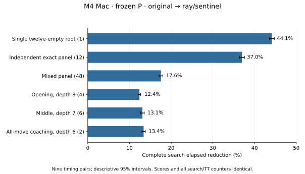

# Faster disc flipping — M4 Mac experiment

**Subsequent production status:** actual [WSL2 PC qualification](FLIP_OPTIMIZATION_PC.md)
is complete, and [production acceptance](FAST_FLIPS_PRODUCTION_ACCEPTANCE.md)
records promotion and the rebuilt distribution. The report below preserves the
original Mac experiment's measurements and then-pending handoff.

**Phase 1 complete; Mac measurements only.** Retain the portable geometry-table
kernel with the single sentinel refinement on `perf/fast-flips`, pending actual
WSL2/x86-64 qualification. Do not merge it into `main` yet.

The selected kernel takes about **3.28 ns** per complete
flip calculation in the disclosed legal-phase mixture, versus
**13.29 ns** for the original (4.05× throughput).
Complete searches save **37% on twelve distinct exact roots**, **18–21% on the
mixed 48-root panel**, and **12–15% on opening/middle/coaching panels**. The
separately disclosed twelve-empty profiling root saves **44%**. Scores, moves,
search/TT counters and frozen model behavior remain identical at fixed work.
These are performance results, not new playing-strength or learning evidence.

## Environment, source identity and audit

Apple M4 iMac, Mac16,3, ten cores, 24 GiB RAM; macOS 27.2 (26B123),
Apple Clang 21.0.0, Xcode/xctrace 27.2, Node 24.22.1 and the existing project
Python 3.14.10. The shell's unrelated Python 3.13 installation was not selected.
Emscripten 4.0.22 builds the experimental Wasm. No toolchain was installed.

The checkout initially had no local modifications. `git fetch origin` verified
local `main` and `origin/main` at the same complete baseline SHA below, and
`git switch -c perf/fast-flips` isolated the experiment. Baseline source/binaries
were copied into ignored storage before editing. Other work was not reset or
stashed. No merge into `main`, application termination, power/security setting
change, or Processor Trace enablement occurred.

Initial memory pressure was normal, allocated swap about 0.38 MiB and disk free
about 510 GiB. Periodic snapshots record cache-based reclaimable headroom,
pressure, swap counters and competing desktop processes. This was a working
desktop, not an isolated machine; XProtect, WindowServer and backup services
were left running. Read the [resource ledger](data/fast-flips-mac/resources.json)
for exact snapshots and the estimator's limitations. No competing Reversi
campaign was found; closing process checks found no remaining owned runs.
The charged measurement/profiling budget was **18.21 minutes**,
including pilots, calibration, warmups, collector launches and saving. Ordinary
compilation, correctness, offline exports and reporting are separate.

| Source | Complete revision |
| --- | --- |
| Latest verified main / original loop, including retained tiny-endgame optimization | `1058f013581e0566277586f857b0a2884be260f6` |
| Bounded standalone/integrated candidate kernels | `b794ed22bd6214ce0cbb33cbace36f816ef8d832` |
| First production table form, subsequently rejected compiler layout | `c2f0295631c3b6228cd9e171b69797cc3df9f480` |
| Portable deterministic micro-corpus harness | `b38c6c1dcf8851f64befd44c850e0464d8e9a899` |
| Final tested native/Wasm algorithm | `9357d4b3510d7931b3ea4b8739b7c8e693414f33` |

The [manifest](data/fast-flips-mac/manifest.json) records complete source,
header/model, driver, compiler/flags and actual measured binary SHA-256 values.
It also records exact workload/corpus identities. All timing builds use
`-O3 -std=c++17 -ffp-contract=off -fno-fast-math -g` plus the same warning flags,
with no LTO, host-specific tuning, forced frame pointers or `NATIVE_PROFILE`.
Engine text with/without `-g` was verified identical. A common separately
compiled driver object is linked with each separately compiled engine object.
The original engine, evaluator, TT policy and final-one/two-empty helper remain
inspectable. Only capture calculation changes in the final shared C++ source.

## Hypotheses and bounded candidates

1. **Original:** eight masked directional ray loops. Correctness is the control.
2. **Masked loop:** remove edge opponents once, then propagate with raw shifts
   and fewer repeated edge masks. Short rays might benefit; extra branches/code
   growth could offset that gain.
3. **Six-step unrolled propagation:** fixed union/shift expansions followed by
   an own-disc bracket test. It avoids loop branches but does unnecessary work
   on short rays.
4. **Pair/doubling propagation:** grow lengths 1 → 2 → 4 → 6 with a reused
   opponent-pair mask. No data-dependent loop; ordinary compiler vectorization.
5. **Compact ray geometry:** 64 squares × eight 64-bit rays = **4096 bytes**.
   Select the first non-opponent square with low-bit isolation or leading-zero
   count, require that endpoint to be ours, and return the intervening ray bits.
   This is a geometry table, not an occupancy lookup table.
6. **Helper-only placement:** retain general flips and use the guarded geometry
   kernel only inside the existing final-one/two-empty helper. This separately
   measures a narrow endgame substitution; existing capture reuse stays intact.

Masked-loop and six-step forms lost clearly to the table in microbenchmarks and
were not expanded into full-search campaigns. Doubling, guarded table and
helper-only placement received integrated qualification. A larger ternary
rank/file/diagonal occupancy lookup was considered but not implemented: portable
gathering and a larger footprint had no demonstrated advantage over the small
geometry scheme. BMI2/ARM intrinsics and a new final-empty counting algorithm
were not introduced. Skipping bracket checks on completely occupied rays is
possible in a one-empty-only method, but was not another tested candidate.

### One profile-directed refinement

The first clean production table form generated **124 ARM64 instructions and
15 conditional branches**, versus 108/9 for the experimental wrapper. Fine
hardware samples landed in its zero-ray return blocks as well as loads and
endpoint operations. This was observed code/sample placement, not proof of a
branch-misprediction penalty. Its actual microbenchmark was slower on several
classes, so it was not silently treated as equivalent performance.

The one additional refinement removes empty-stop branches. On increasing rays,
isolating a bit from zero yields zero and cannot match our discs. On decreasing
rays, `stops | 1` defines leading-zero count even when no stop exists; requiring
the selected bit in **both own and actual stops** prevents a false sentinel
bracket. This preserves empty-square stops, board-edge stops and all passes.
ASan/UBSan and the complete independent qualification were repeated. No second
post-profile algorithm refinement was attempted. Whole searches, rather than
the small difference in weighted microbenchmarks, selected this final form.

## Independent correctness

The C++ reference scans 64 mailbox cells directly in eight `(row,column)`
directions; it shares no propagation or endpoint kernel. All four complete line
orientations through every move square exhaust ternary patterns where practical.
Explicit rays of length 0–6, unbracketed edge chains, corners, wrapping, several
simultaneous directions, arbitrary sparse/dense disjoint boards and 128 seeded
legal histories supplement that enumeration. Both colored resulting `Board`
values are checked, not merely popcounts. All six linked implementations pass
**1,260,090 case checks** including the exact-search corpus.
The sanitizer-only version checks 1,258,311
cases without timed work. These are case checks, not that many independent games.

The separate JS reference uses a 10×10 sentinel mailbox and exhaustive minimax.
The final native qualification checks **221 boards**, including every
possible sole empty square and arbitrary one/two/three-empty boards, both turns,
B/L/P, truncated horizons, forced passes and terminal boards with unused squares.
It passes **7,956 root queries** across original/final builds,
**732 independently checked depth-3 coaching rows**,
**2,196 PV steps**, **126 additional depth-6 rows/PVs**,
and **270 deterministic interrupted publications**.
Initial integrated candidates separately passed 15,912 queries.
The same 221-board pool is reused across builds; it is not a new learning holdout.

All **324 actual 80/300-ms publications** were subsequently checked
against complete baseline searches at their stated horizons, including the
chosen child's full-window value and independent legality. Final compiled Wasm
passes **3,708 searches**, **1,236 static queries**,
303 coaching rows and 909 verified PV steps with zero numerical error.
Full closing suites pass **182 Node tests, 16 sanitizer groups and 46 Python
tests**. Frozen Float32 cells/weights, evaluator values, bounds, TT collisions,
generation rollover, pass/depth handling and completed-iteration behavior remain
qualified. See [the exact commands and receipts](data/fast-flips-mac/qualification.json).

## Flip microbenchmark — Mac only

Cases are generated before clocks start, then shuffled with a specified integer
generator/Fisher-Yates order, independent of libc++ versus libstdc++. The exact
corpus takes one-in-97 real baseline flip inputs by remaining-empty count from
the disclosed exact tree. No random positions are generated inside timing.
Separate translation units, no LTO, external function calls, consumed checksums,
equal boundaries, warmups and seven rotated/reversed trials prevent folding or
elimination. Each timed class/algorithm trial processes about twenty million
calls. Nanoseconds below are whole-block elapsed divided by calls, not per-call
timer readings. Full CPU times, trial variation and checksums are in
[the micro data](data/fast-flips-mac/micro.json).


| Class / cases | Original ns | Masked ns | Six-step ns | Doubling ns | Guarded table ns | Final sentinel ns |
| --- | --- | --- | --- | --- | --- | --- |
| opening / 25,686 | 10.64 | 9.72 | 5.78 | 5.03 | 3.09 | 3.27 |
| middle / 33,195 | 16.40 | 14.82 | 5.87 | 4.99 | 3.43 | 3.26 |
| late / 6,418 | 8.33 | 6.72 | 5.93 | 5.06 | 3.58 | 3.39 |
| last-two / 276 | 5.76 | 4.72 | 5.92 | 5.04 | 3.19 | 3.25 |
| last-one / 156 | 5.78 | 4.62 | 5.89 | 4.98 | 2.98 | 3.24 |
| edge-corner / 30,820 | 13.89 | 12.95 | 5.90 | 5.02 | 4.74 | 3.24 |
| controlled / 7,680 | 7.41 | 5.79 | 5.99 | 5.00 | 3.34 | 3.31 |
| search-tail / 1,779 | 6.36 | 5.39 | 5.89 | 5.03 | 3.39 | 3.22 |


The disjoint legal-phase mixture contains **65,731 cases**;
it excludes the overlapping edge subset and controlled stress. Its final rate
is about **305.0 million calls/s**, versus
75.2 million originally. The weighted paired elapsed
effect is **-75.45% [-76.26, -74.60]** (seven timing pairs).
The quoted 4.05× point ratio uses case-weighted class medians; the interval uses
per-repetition weighted log ratios, so they need not coincide exactly.
Guarded table's weighted point is 3.31 ns; it remains faster
on some short-ray classes. The separate exact-search sample improves
6.36 → 3.22 ns
(1.98×), not the 4.05× legal-mixture result.
This demonstrates why a microbenchmark mixture cannot predict every search.

## Complete native searches — decision gate

All blocks execute production search objects without a profiler. Two full warmup
batches precede a fixed repetition count chosen to give about 0.35 seconds of
baseline work. Nine repetitions rotate/reverse engine order and rotate workload
order. The final comparison includes original, guarded table and final sentinel
in the **same campaign**. No source/binary is rebuilt during measurement.

The independent exact panel contains twelve distinct roots with **8–12 empties**;
it does not contain twelve twelve-empty roots. The profiling root is separately
`native-engineering-10`, searched through all twelve empties. The mixed panel
contains all 48 disclosed roots, including those twelve plus the legacy 36.
Its legacy horizons are D8 below 28 occupied, D7 below 52, otherwise min(10,
empties); added exact roots reach all empties. Thus the disclosed board's mixed
horizon D10 differs from its separate exact D12 workload. Opening uses four
roots at D8, middle six at D7, coaching two at D6 with full root windows and
verified lines. TT is the existing 10,485,760 actual bytes; native ordering hints
are disabled consistently. This does not retest the old 43e52d2-versus-final-empty
legacy comparison as though it were the present baseline.

Intervals are descriptive 95% Student-t intervals on nine paired log elapsed
ratios. They quantify run variation on these fixed panels, not uncertainty over
all Reversi positions; no multiplicity/drift correction is claimed. Desktop
variation and order/thermal effects remain possible. Wall/CPU columns are
medians per complete batch; percent effects use mean paired log ratios, so
dividing medians need not reproduce the reported effect exactly.

### Initial candidate campaign (all elapsed changes versus its own original)


| Panel / model | Original ms | Doubling | Guarded table | Helper-only table |
| --- | --- | --- | --- | --- |
| mixed48/B | 78.283 | -8.85% [-9.95, -7.74] | -17.34% [-18.29, -16.37] | -5.15% [-6.26, -4.03] |
| exact12/B | 21.993 | -18.92% [-19.35, -18.49] | -28.95% [-29.72, -28.18] | -16.82% [-17.48, -16.16] |
| profile-root/B | 3.830 | -25.53% [-26.13, -24.93] | -41.21% [-41.58, -40.84] | -22.40% [-23.00, -21.79] |
| opening/B | 33.108 | -3.58% [-4.27, -2.88] | -11.17% [-11.81, -10.53] | +0.35% [-0.15, +0.86] |
| middle/B | 9.574 | -4.90% [-5.04, -4.75] | -9.98% [-10.42, -9.54] | +0.19% [-0.05, +0.43] |
| coaching/B | 7.272 | -6.18% [-6.77, -5.58] | -12.96% [-13.46, -12.46] | +0.60% [+0.36, +0.83] |
| mixed48/L | 88.684 | -7.74% [-8.26, -7.21] | -16.32% [-16.65, -16.00] | -3.78% [-4.26, -3.30] |
| exact12/L | 22.053 | -19.28% [-19.78, -18.77] | -29.78% [-30.40, -29.15] | -17.01% [-17.68, -16.33] |
| profile-root/L | 3.806 | -24.49% [-25.12, -23.86] | -40.77% [-41.13, -40.41] | -21.99% [-22.34, -21.64] |
| opening/L | 38.420 | -3.32% [-3.87, -2.76] | -11.46% [-12.02, -10.89] | -0.10% [-0.70, +0.50] |
| middle/L | 12.423 | -5.17% [-5.65, -4.69] | -10.53% [-10.97, -10.09] | +0.22% [-0.15, +0.58] |
| coaching/L | 8.901 | -4.69% [-5.00, -4.38] | -11.61% [-11.99, -11.21] | +0.28% [-0.02, +0.58] |
| mixed48/P | 121.682 | -4.97% [-6.60, -3.31] | -13.40% [-15.20, -11.55] | -1.02% [-3.38, +1.40] |
| exact12/P | 22.015 | -19.32% [-20.42, -18.21] | -29.63% [-30.44, -28.80] | -16.05% [-17.57, -14.51] |
| profile-root/P | 3.822 | -25.07% [-26.32, -23.79] | -40.59% [-41.76, -39.39] | -22.18% [-22.91, -21.44] |
| opening/P | 64.763 | -2.55% [-3.20, -1.90] | -10.83% [-11.61, -10.04] | +1.57% [+1.08, +2.07] |
| middle/P | 18.039 | -2.97% [-3.63, -2.30] | -9.73% [-10.11, -9.34] | -0.59% [-1.57, +0.41] |
| coaching/P | 11.191 | -2.52% [-2.82, -2.22] | -10.53% [-10.72, -10.34] | +0.75% [+0.53, +0.97] |


Helper-only substitution establishes a narrower independent benefit (about
16–17% on twelve exact roots, 22% on the single root), but does not improve
opening/middle/coaching consistently. Its small unfavorable nonterminal results
are retained; no cache/layout mechanism was established for them. The general
table beats doubling and the narrow substitution. Rejected kernels remain in
the experiment header/build recipe, not in production dispatch.

### Final campaign (original → sentinel)


| Panel / model | Complete wall ms | Thread CPU ms | Elapsed change [95%] | Nodes / evals per batch | New M nodes/s / M evals/s |
| --- | --- | --- | --- | --- | --- |
| mixed48/B | 77.004 → 61.042 | 77.003 → 61.039 | -20.87% [-21.52, -20.21] | 1,780,838 / 841,839 | 29.17 / 13.79 |
| exact12/B | 21.590 → 13.487 | 21.590 → 13.487 | -37.22% [-37.88, -36.56] | 551,969 / 0 | 40.93 / 0.00 |
| profile-root/B | 3.736 → 2.082 | 3.736 → 2.082 | -44.21% [-44.80, -43.61] | 104,996 / 0 | 50.43 / 0.00 |
| opening/B | 32.636 → 28.460 | 32.636 → 28.460 | -12.18% [-13.04, -11.32] | 682,869 / 494,133 | 23.99 / 17.36 |
| middle/B | 9.437 → 8.126 | 9.437 → 8.126 | -13.98% [-14.38, -13.58] | 205,607 / 150,300 | 25.30 / 18.50 |
| coaching/B | 7.183 → 6.075 | 7.183 → 6.075 | -14.90% [-15.37, -14.43] | 152,950 / 109,151 | 25.18 / 17.97 |
| mixed48/L | 87.430 → 70.123 | 87.429 → 70.123 | -20.14% [-20.73, -19.55] | 2,018,500 / 1,023,170 | 28.78 / 14.59 |
| exact12/L | 21.487 → 13.471 | 21.487 → 13.471 | -37.20% [-37.77, -36.63] | 551,969 / 0 | 40.97 / 0.00 |
| profile-root/L | 3.732 → 2.085 | 3.732 → 2.085 | -43.95% [-44.59, -43.31] | 104,996 / 0 | 50.36 / 0.00 |
| opening/L | 37.898 → 32.987 | 37.897 → 32.987 | -12.65% [-13.32, -11.97] | 794,754 / 581,968 | 24.09 / 17.64 |
| middle/L | 12.197 → 10.535 | 12.197 → 10.535 | -13.53% [-14.12, -12.93] | 264,071 / 195,756 | 25.07 / 18.58 |
| coaching/L | 8.784 → 7.497 | 8.784 → 7.497 | -14.32% [-14.72, -13.91] | 188,884 / 138,097 | 25.19 / 18.42 |
| mixed48/P | 119.943 → 98.756 | 119.942 → 98.754 | -17.55% [-18.01, -17.09] | 2,578,323 / 1,438,599 | 26.11 / 14.57 |
| exact12/P | 21.412 → 13.571 | 21.412 → 13.571 | -36.98% [-37.58, -36.37] | 551,969 / 0 | 40.67 / 0.00 |
| profile-root/P | 3.727 → 2.083 | 3.727 → 2.083 | -44.15% [-44.73, -43.56] | 104,996 / 0 | 50.41 / 0.00 |
| opening/P | 64.065 → 56.095 | 64.064 → 56.094 | -12.39% [-12.70, -12.08] | 1,247,297 / 923,034 | 22.24 / 16.45 |
| middle/P | 17.805 → 15.537 | 17.805 → 15.537 | -13.10% [-13.55, -12.65] | 348,867 / 258,750 | 22.45 / 16.65 |
| coaching/P | 11.095 → 9.634 | 11.095 → 9.634 | -13.40% [-13.81, -12.98] | 218,363 / 164,000 | 22.67 / 17.02 |




Every fixed call has identical score, move, exactness, completed horizon and all
13 search/TT counters across builds. Full batch elapsed/CPU/counters,
per-root API elapsed means and complete result-signature hashes are retained in
[final data](data/fast-flips-mac/final-search.json); initial results are
[separate](data/fast-flips-mac/initial-search.json). This isolates flip cost from
tree reduction. No favorable single-root result is substituted for the panel.

Per-root exact P comparisons below use average API search elapsed within each
block, paired across nine trials; they are secondary to complete batch time.


| Distinct exact root | Empties | Original → final ms | Elapsed change [95%] |
| --- | --- | --- | --- |
| mac-exact-0 | 12 | 14.990 → 9.421 | -37.46% [-38.04, -36.87] |
| mac-exact-1 | 11 | 0.427 → 0.263 | -38.75% [-39.18, -38.31] |
| mac-exact-2 | 10 | 0.290 → 0.185 | -36.33% [-37.01, -35.65] |
| mac-exact-3 | 9 | 0.127 → 0.069 | -45.40% [-46.07, -44.71] |
| mac-exact-4 | 8 | 0.031 → 0.018 | -40.88% [-41.67, -40.08] |
| mac-exact-5 | 12 | 1.223 → 0.821 | -33.02% [-33.75, -32.28] |
| mac-exact-6 | 11 | 1.353 → 0.845 | -37.68% [-38.32, -37.04] |
| mac-exact-7 | 10 | 0.199 → 0.126 | -36.88% [-37.73, -36.03] |
| mac-exact-8 | 9 | 0.202 → 0.118 | -41.62% [-42.50, -40.72] |
| mac-exact-9 | 8 | 0.038 → 0.023 | -41.23% [-42.12, -40.34] |
| mac-exact-10 | 12 | 1.417 → 0.954 | -33.04% [-33.85, -32.23] |
| mac-exact-11 | 11 | 1.119 → 0.710 | -36.69% [-37.49, -35.87] |

All twelve roots improve individually. The slowest root contributes about 70% of this small panel’s original time; the aggregate is not an estimate over all endgames. The table exposes that weighting rather than treating twelve roots as equal-duration work.


### Timed native searches (supplementary)

Each cell has six opening/middle roots × three repetitions, with one full warmup
batch. Times below are native core requests, excluding process startup and
transport. All published horizons/moves passed the later complete-search audit.
These are not games and do not establish greater playing strength.


| Model | Budget ms | Mean completed depth | Median depth | Max overrun ms, old → new |
| --- | --- | --- | --- | --- |
| B | 80 | 10.333 → 10.667 | 10.0 → 10.0 | 0.053 → 0.037 |
| B | 300 | 11.833 → 12.000 | 11.0 → 11.0 | 0.047 → 0.048 |
| L | 80 | 10.000 → 10.167 | 10.0 → 10.0 | 0.041 → 0.037 |
| L | 300 | 11.333 → 11.667 | 11.0 → 11.0 | 0.043 → 0.055 |
| P | 80 | 9.667 → 9.833 | 9.5 → 9.5 | 0.036 → 0.035 |
| P | 300 | 11.000 → 11.000 | 10.5 → 10.5 | 0.044 → 0.046 |


## Assembly, sampling and caller evidence

All `flipsIn<D>()` bodies inline into `flips`. The original M4 loops execute
six instructions per iteration for E/W/SE/SW/NE/NW and five for S/N, plus setup,
endpoint tests and result combination. A direction with L adjacent opponents
executes L+1 such machine-code iterations, including the final stop (L can be
seven on an unbracketed ray). Each iteration carries the old run forward, shifts,
optionally masks, accumulates, tests and branches. The compiler shares move-bit
creation, shifts destination edge masks, and uses conditional selects for own
endpoints. Register pressure saves/restores a callee pair. Capturing requires
far more instructions than applying the returned mask with OR/BIC operations;
in search, board application can be inlined into the caller.

The final kernel uses seven scalar operations per increasing direction and ten
per decreasing direction, two shared constants, four paired ray loads, shared
address setup and result combination. It has no loop or conditional branch and
no register-save spill. Masks are precomputed geometry. Four scalar `clz`
instructions and ordinary shifts/selects need no ARM/BMI2-specific intrinsic.
The general recursion/root/tiny-helper instruction counts remain 462/216/291;
both compared disassemblies retain twelve direct `flips` call sites. This is not
a new inlined flip body hidden inside general recursion.


| Compiled form | flips instructions | Bytes | Static conditional branches | Load instructions | Geometry bytes |
| --- | --- | --- | --- | --- | --- |
| original | 89 | 356 | 8 | 1 | 0 |
| masked-loop | 113 | 452 | 23 | 0 | 0 |
| unrolled | 120 | 480 | 0 | 5 | 0 |
| doubling | 112 | 448 | 0 | 10 | 0 |
| ray-table | 108 | 432 | 9 | 9 | 4096 |
| late-ray | 89 | 356 | 8 | 1 | 4096 |
| selected | 124 | 496 | 15 | 15 | 4096 |
| refined | 86 | 344 | 0 | 4 | 4096 |


Load counts are static instructions, including the original stack restore;
four final `ldp`s read eight ray words. Propagation alternatives have compiler
vector literal pools as well, even though they have no geometry table. Clang
SLP-vectorizes parts of those alternatives; more branchless propagation was not
automatically faster. The helper-only row describes its unchanged general
flips body; it also emits a separate guarded lateFlips body. The final selected
implementation retains just one kernel. Its physical body is **356 → 344 bytes**, plus the
4 KiB readonly table. Full-search P results include interference with pattern
tables/TT and show a net benefit; no cache-miss rate was measured.

The qualified collector supplied **26 captures**: 18 initial captures to compare
forms/callers and eight final coarse/fine captures. Minimal IP collection requests
`CORE_ACTIVE_CYCLE` at 10,000,000 or 1,000,000 cycles with empty user/kernel stacks;
the existing package also configures/reads the named counter every 10,000 µs.
Only PMI rows locate instructions. Every IP row and exported table requirement
was checked for hidden stack collection. No per-call production timers,
software-IP substitute, cache/branch-miss event or Processor Trace was used.
Actual stack and CPU Profiler captures supply caller evidence separately.


| Final exact-root IP capture | Accepted samples | Physical flips share | Unknown leaf samples |
| --- | --- | --- | --- |
| original / ip-10000000 | 1,841 | 57.41% | 1 |
| refined / ip-10000000 | 988 | 29.86% | 0 |
| original / ip-1000000 | 18,437 | 58.05% | 5 |
| refined / ip-1000000 | 9,969 | 29.96% | 12 |


At one million cycles, sampled flip weight per identical fixed root falls
**9.063 → 2.529 million cycle-weight units**,
about **72.1% less**. That removes approximately **41.9% of the original
total accepted cycle weight per root**. Complete unprofiled elapsed falls
44.15%. This answers how much of this root's old
~59% hotspot was improvable; it is not a universal flip fraction or an exact
wall-time attribution. The final share is 29.96%, not zero.

Old fine-profile hotspots include loop-entry/setup and loop-carried `mov` sites (e.g. module offsets
0x8dc/0x8c4) and the restore/return region. The final profile emphasizes endpoint
loads/bit operations and 0x9e4's final OR/return region. These addresses refer to
the **profiled fixed-work binary**, not the differently linked protocol adapter.
Skid and interrupt placement mean a sampled MOV/OR is not proof of that
instruction's intrinsic latency. The [complete flip IP aggregates](data/fast-flips-mac/profiles.json)
retain instructions, addresses, source mapping, event/period, denominators,
unknown mass and export hashes. Unknown lost records stay null, not zero.

On the exact root, non-flip sampled cycle weight per root also decreases about
9.7%. Opening/middle coarse captures have non-flip point estimates about 9%/7%
higher, despite lower complete elapsed/total sampled cycles. One coarse capture
does not establish a cache regression or a causal transfer of work: layout,
cache/stall overlap, skid and core scheduling remain possible. No added
search/evaluation work appears in counters or source; remaining search/control
becomes a larger fraction. Those component observations do not override the
repeated whole-search gains, and their cause remains an explicit mechanism limit.

### General moves versus specialized endgame

The separate counting-only build records **171,939 flips**, of which **107,588
(62.57%)** originate in the one/two-empty helper. Counts by empties, final score,
nodes and sampled inputs are byte-identical before/after. This is a call fraction,
not a time fraction. The original CPU Profiler's genuine reconstructed stacks
put about **54.5% of flip cycle weight through lastEmpties**, the rest through
play/general search. Raw hardware frame-chain stacks expose that helper on only
24.2% of flip weight and omit helper/play ancestry on the remainder. Therefore
missing raw helper frames cannot be counted as general-move work. See the actual
contexts in the profile data and [ancestry limitations](PROFILING_METHODS_AND_VIEWS.md).

The endgame helper remains separate and gated to exact horizons. Its precomputed
two-square captures, reuse, passes and unplayed-square margins are preserved.
The helper-only integrated experiment above independently confirms a narrower
benefit; the final general kernel additionally improves ordinary move application.
Processor Trace was unnecessary for these conclusions; its disabled OS setting
was left unchanged. No exact dynamic branch history or misprediction rate is claimed.

## Actual Chrome Wasm qualification — Mac only

Candidate Emscripten build `6e2607a0b60e5ce802556fb3cb5d5c8ca43949dd940b3438b1ecebbe94822913` was built and tested in
ignored storage; distributed `src/wasm` binaries/manifest remain unchanged.
Actual Chrome **156.0.8078.74** loaded the candidate build identity, compared fixed
scores/complete counters and passed 7 UI checks with zero page errors:
B/L/P coaching, verified-line display, a timed reply, undo, rapid cancellation/
model changes and reload. It used disposable contexts; ordinary profiles were
untouched. Safari, Intel Mac and Windows were not newly tested in this experiment.

The following are complete actual-worker batch wall times, including normal
adapter/JSON costs (and JS coaching work), one full warmup, three batches per
block, seven alternating pairs. CPU time is unavailable. Browser coaching uses
its ordinary adapter's ordering hints; native coaching above disables hints, so
absolute cross-backend coaching times are not a matched-work comparison.


| Wasm panel / model | Complete worker batch ms | Elapsed change [95%] |
| --- | --- | --- |
| mixed48/B | 92.867 → 77.833 | -16.35% [-17.57, -15.12] |
| mixed48/P | 148.067 → 126.967 | -14.56% [-15.25, -13.87] |
| exact12/B | 23.667 → 16.600 | -30.95% [-34.10, -27.64] |
| exact12/P | 23.600 → 16.633 | -29.40% [-30.50, -28.27] |
| opening/B | 37.867 → 33.467 | -11.66% [-12.73, -10.58] |
| opening/P | 78.033 → 68.267 | -11.76% [-12.53, -10.98] |
| middle/B | 10.867 → 9.633 | -11.52% [-12.27, -10.77] |
| middle/P | 21.233 → 18.833 | -11.58% [-12.15, -11.01] |
| coaching/B | 4.767 → 4.233 | -12.11% [-13.91, -10.26] |
| coaching/P | 5.933 → 5.300 | -10.77% [-11.95, -9.59] |


No browser-game tournament or training was needed for a rules-preserving flip
kernel. Fixed-time depths are supplementary, not a playing-strength claim.

## Answers to the twelve requested questions

| Question | Mac finding |
| --- | --- |
| 1. Algorithms actually tested? | Original loop; masked loop; six-step propagation; pair/doubling; guarded 4 KiB ray geometry; helper-only table placement; one sentinel refinement of the table. |
| 2. Fastest microbenchmark? | Sentinel's weighted point 3.28 ns versus 13.29 ns, 4.05×. Guarded table wins some short-ray classes; weighted table-form differences are small. |
| 3. Complete exact searches? | About 37% less elapsed across twelve distinct 8–12-empty roots; separate one-root D12 gain about 44%. |
| 4. Opening/middle/coaching? | All three models improve approximately 12–15% on the disclosed native panels. |
| 5. Original 59% improvable? | About 72.1% less sampled flip cycle weight per fixed root, equivalent to 41.9% of old total accepted cycle weight; separate unprofiled root elapsed saves 44%. Not all searches. |
| 6. Hardware result? | Real cycle-triggered IPs move from ray-loop control to fixed endpoint/load/select work; final fine flips share 58.05% → 29.96%. |
| 7. Shifted elsewhere? | No added tree/evaluator work or hidden inlined flip body. Exact residual sampled weight decreases; coarse opening/middle residual point estimates rise, with cause unresolved. Whole-search time improves. |
| 8. Compiler output? | 89 → 86 instructions, eight loop branches → no conditional branches, stack restore removed, four paired table loads, 356 → 344 text bytes plus 4096 data bytes. |
| 9. Tiny helper independently? | Guarded helper-only substitution saves 16–17% on the exact panel and ~22% on the single root; existing specialization/reuse remains intact. |
| 10. Correctness preserved? | Independent mailbox/minimax, exact and heuristic B/L/P scores, all-move/PV checks, full counters, sanitizers, timed-publication audit and actual Wasm/Chrome checks pass. |
| 11. Same on WSL2 x86-64? | **Pending actual PC measurements. None inferred from this Mac.** |
| 12. Keep it? | Keep the selected portable kernel provisionally on the experimental branch. Decide shared versus architecture-specific retention only after PC qualification; no merge yet. |

## Evidence and publication

All compact datasets are under [data/fast-flips-mac](data/fast-flips-mac/manifest.json).
They preserve every complete batch clock/counter and timed publication, per-root
references/elapsed means and full-signature hashes. Repetitive raw fixed-call
rows, native/Wasm binaries, raw Instruments traces and exports stay ignored in
`.local-research/fast-flips-m4-20261031/`. No SDK, venv, cache, archive or personal
model export is committed. Reproduction/collection commands are in the
[experiment README](../scripts/fast-flips/README.md).

Actual local source checkpoints used:

```bash
git commit -m 'Add independently qualified bounded flip-kernel experiment'
git commit -m 'Select portable ray-endpoint flipping for Mac qualification'
git commit -m 'Qualify experimental Wasm and make flip corpus order portable'
git commit -m 'Remove empty-ray branches with a guarded sentinel refinement'
```

Final reporting is published with:

```bash
git commit -m 'Publish M4 fast-flip results and reproducible PC handoff'
git push -u origin perf/fast-flips
git ls-remote origin refs/heads/perf/fast-flips
```

The final publication SHA/remote verification is returned in the completion
message; embedding a report's own commit SHA is self-referential. The exact
tested native source revision below is immutable and present in that history.
No command merges or pushes to `main`.

## PC Handoff

**Branch:** `perf/fast-flips`. **Exact tested final source:**
`9357d4b3510d7931b3ea4b8739b7c8e693414f33`. **Original baseline:**
`1058f013581e0566277586f857b0a2884be260f6`. The publication follow-up changes only reporting,
tests/harness bookkeeping, and documentation; the engine bytes must match the
source SHA below. All performance results above are **Mac-only**.

| Required identity | SHA-256 |
| --- | --- |
| native/engine.cpp | `b97d526697e68aa04186b67d2e13dc0f4eab21fb086921532e8b9b63cf47e7a5` |
| native/engine.hpp | `f84153d587755542b6006150100e55e5ceb0b1f0e79111a8f91faa8fe4c784d6` |
| Frozen generated header | `1b286ed8371f0a2cd957b06b679e7422b68b3699cb7c8fe7c9f50968d27ceba1` |
| positions.json, exact byte order | `a8deadc89f811e02da19910a702b073de12707ef19895a10f7d9861d088dcfee` |
| search-cases.txt | `014873c3a35eae87a03e99c65a855931c95246ebfd16e65b692853948efd660b` |

Preserve existing PC work. Fetch without resetting it and use a fresh worktree
(if this branch/worktree already exists, inspect/resume it instead of deleting
or overwriting it):

```bash
git fetch origin perf/fast-flips
git worktree add -b perf/fast-flips ../reversi-fast-flips FETCH_HEAD
cd ../reversi-fast-flips
git rev-parse HEAD
git merge-base --is-ancestor 9357d4b3510d7931b3ea4b8739b7c8e693414f33 HEAD
git diff --exit-code 9357d4b3510d7931b3ea4b8739b7c8e693414f33 -- native/engine.cpp native/engine.hpp
```

Read this handoff at fetched HEAD, verify the actual Linux/WSL2 x86-64 machine,
CPU/memory/swap/disk/contention, and activate the **existing qualified Python
3.14** environment. Use the actual GCC 15/Ubuntu installation; do not install
older tools. Run the exact common-native build/test/micro/integrated commands
in [scripts/fast-flips/README.md](../scripts/fast-flips/README.md). They rebuild
both original and selected sources with the same portable flags, and also
preserve the guarded table for a controlled architecture comparison. Match the
micro `corpus` counts/ordered checksums against the committed manifest before
timing interpretation. Use a fresh output directory for a separate
`FLIP_NATIVE=1` / `-march=native` campaign, comparing algorithms **within** each
configuration. Do not attribute a tuning-flag change to the algorithm.

Probe hardware PMU availability once with existing `perf`, e.g.:

```bash
uname -a
perf --version
cat /proc/sys/kernel/perf_event_paranoid
perf stat -e cycles,instructions -- sleep 0.2
```

If unsupported or inaccessible, report that mechanism/permission limitation and
use disassembly and repeated unprofiled timing. Do not change privileges,
kernel/hypervisor configuration or install old perf versions. If PMU sampling
works, capture representative fixed-work baseline/candidate searches and label
the actual event. The builder already saves x86 `objdump -Cd` output. Check how
GCC lowers leading-zero/variable-shift operations and eight ray loads; ARM's four
paired loads/conditional selects need not translate similarly. Investigate
cache/layout or residual-control effects only when a concrete PC result warrants it.

Selection rule for PC: any rule/score/PV/counter mismatch blocks retention.
A repeatable **>2% elapsed regression whose descriptive interval excludes zero**
on an important complete panel is material and needs explanation; do not excuse
it with a microbenchmark win. Small noisy changes are unresolved, not success.
Require meaningful repeatable complete-search benefit without important
unexplained regressions, with compiler configuration and denominators separate.
If portable x86 loses while Mac wins, consider an optional ARM implementation
with a correct portable fallback only after compatibility is requalified.

Create `docs/FLIP_OPTIMIZATION_PC.md`, update
`docs/FLIP_OPTIMIZATION_RESULTS.md`, commit/push PC evidence to this experimental
branch and verify its remote commit. Do not merge into main. Resolve the pending
x86 questions from actual PC evidence; cross-machine absolute timings are
confounded by hardware, OS and compiler and remain secondary.
