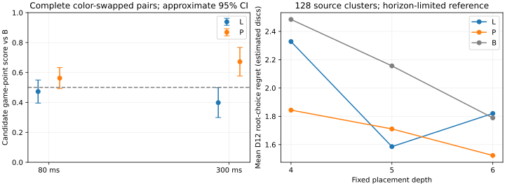

# Frozen B/L/P playing-strength screen

29 October 2026, native M4 iMac. **P is the nominated candidate for a separately powered confirmation; this screen does not establish primary 80 ms superiority.** L scored below B at both controls. P scored above B at both controls, especially at 300 ms. B remains production. No new scientific fit, coefficient change or promotion occurred.

[Frozen protocol](FROZEN_PLAYER_SCREEN_PROTOCOL.md) · [registration published before games](data/frozen-player-registration-20261029.json) · [complete numerical evidence](data/frozen-player-screen-20261029.json) · [prelaunch qualification](data/frozen-player-prelaunch-qualification-20261029.json) · [detailed overlap adjudication](data/frozen-player-overlap-role-audit-20261029.json). The numerical file contains every game move/final board, color-pair score, root alternative/search counters, teacher PV, independent exact solution, source summary and changed-decision witness. Private historical corpora and raw checkpoints remain ignored locally.

## Actual games: the primary measurement

All **384 games / 192 comparison pairs** completed, regardless of positional results. Each observation is a complete color-swapped opening pair. The 64 families at 80 ms are shared across L/B and P/B; a disjoint 32 families supply 300 ms. These are indirect comparisons against B, with no P/L matches.

| Candidate / limit | Pairs | W–D–L | Game-point score | Approximate paired 95% interval | Bootstrap 95% sensitivity | Mean candidate disc margin |
| --- | ---: | --- | ---: | --- | --- | ---: |
| L/B, 80 ms | 64 | 58–5–65 | 47.27% | 39.55–54.98% | 39.84–54.69% | -0.523 |
| P/B, 80 ms | 64 | 70–4–54 | 56.25% | 49.21–63.29% | 49.22–62.89% | +4.125 |
| L/B, 300 ms | 32 | 24–3–37 | 39.84% | 29.90–49.79% | 30.47–49.22% | -4.703 |
| P/B, 300 ms | 32 | 42–2–20 | 67.19% | 57.63–76.75% | 58.59–76.56% | +9.344 |

**L did not win more games:** 58 versus 65 losses at 80 ms, and 24 versus 37 at 300 ms. **P did:** 70 versus 54 and 42 versus 20. Winning more in this sample is distinct from establishing a population advantage. L’s 80 ms interval includes 50%; its adverse 300 ms interval is descriptive evidence, not a registered confirmatory inferiority test.

The two primary exploratory 80 ms superiority tests use one-sided α=.025 each (Bonferroni familywise .05). L’s approximate p is **.7592**; P’s is **.04038**, above .025 (Bonferroni-adjusted .08076). Neither primary comparison passes. P’s 300 ms interval excludes 50%, but 300 ms was a descriptive durability check, not an alternative primary endpoint selected after seeing results. The direction is the same at both limits; the apparent effect is larger at 300 ms. Different opening families and the smaller 300 ms sample prevent a clean paired causal estimate of a time-control interaction.

| Candidate / limit | Conservative one-sided 97.5% bounded-score lower bound |
| --- | ---: |
| L/B, 80 ms | 30.29% |
| P/B, 80 ms | 39.27% |
| L/B, 300 ms | 15.84% |
| P/B, 300 ms | 43.18% |

These use `mean − sqrt(log(1/.025)/(2*n))`, with radii .169763 at 64 pairs and .240081 at 32. None exceeds .5. The bounded inference is less encouraging than the approximate 300 ms interval; it is not omitted or reinterpreted. Bootstrap sensitivity uses 10,000 whole-family resamples, jointly across candidates, with the frozen seed. Indirect P-minus-L score differences are +8.98 percentage points at 80 ms (bootstrap −1.95 to +19.92) and +27.34 at 300 ms (+14.84 to +40.63); neither is a direct P/L match.

P meets the unchanged nomination rule: 80 ms mean ≥.55 and 300 ms mean ≥.50. L does not. This nominates **P only for future confirmation**, without changing B or extending this sample.



## Cost, search depth and phase behavior

Five rotated engineering repetitions on the same 16 disclosed roots measured complete static evaluation, including features. No per-leaf clocks were added to scored games.

| Evaluator | Standalone median μs | With known own mobility, median μs |
| --- | ---: | ---: |
| B | 1.227 | 1.168 |
| L | 1.229 | 1.164 |
| P | 1.372 | 1.279 |

P costs **9.92%** more than L with mobility reuse. Its sampled net playing results therefore suggest that its positional knowledge can compensate for the overhead; the primary 80 ms uncertainty still prevents a confirmed strength claim. L has essentially B’s static cost yet unfavorable game results, so evaluator overhead alone cannot explain the learned players. Actual tree shape, pruning and visited-node counts also change.

| Limit / opponent panel | Evaluator | Mean opening completed depth | Mean middle completed depth |
| --- | --- | ---: | ---: |
| 80 ms, L/B | B | 5.497 | 6.975 |
| 80 ms, L/B | L | 5.480 | 6.951 |
| 80 ms, P/B | B | 5.468 | 6.955 |
| 80 ms, P/B | P | 5.362 | 6.775 |
| 300 ms, L/B | B | 6.611 | 8.444 |
| 300 ms, L/B | L | 6.573 | 8.379 |
| 300 ms, P/B | B | 6.562 | 8.456 |
| 300 ms, P/B | P | 6.423 | 8.245 |

P generally completed less depth while earning higher point estimates. These are move telemetry from different played trees, not independent strength observations or a pure causal cost decomposition. Late mean depth is particularly misleading because remaining empties shrink and exact searches stop early: at 300 ms, 378/378 and 386/389 late B/L moves in L/B were exact; in P/B, 359/360 B and 404/406 P late moves were exact. All phase histograms, nodes, evaluations and times are in the numerical evidence.

## Independent root transfer

All 128 roots received qualified full-window Edax D10/D12 labels; all B/L/P alternatives were searched at depths 4, 5 and 6. Timed root choices used ordinary production search after draining workers. Main regret is D12-relative disc regret, estimated at unsolved horizons and terminal awarded-disc value where solved; independent raw exact diagnostics are kept separate. It is not a calibrated win probability.

| Condition | B mean regret | L | P | L−B paired source 95% interval | P−B paired source 95% interval |
| --- | ---: | ---: | ---: | --- | --- |
| 4 | 2.4844 | 2.3281 | 1.8438 | -0.8359 to +0.6172 | -1.3672 to +0.1016 |
| 5 | 2.1562 | 1.5859 | 1.7109 | -1.1016 to -0.0391 | -1.1328 to +0.2734 |
| 6 | 1.7891 | 1.8203 | 1.5234 | -0.7422 to +0.7891 | -0.9609 to +0.4062 |
| 80ms | 1.4531 | 1.6094 | 1.1797 | -0.2656 to +0.5859 | -0.7188 to +0.2109 |
| 300ms | 1.2188 | 1.2969 | 1.1016 | -0.3438 to +0.5312 | -0.4844 to +0.2734 |

Intervals use 10,000 paired whole-source resamples stratified over the original 16 cells, shared across contrasts. All root/depth analyses are descriptive. L’s favorable odd-depth result does not persist at depth six or equal time. P has favorable aggregate point estimates, but its paired intervals against B include zero. Fixed-depth research ties are row-major; ordinary production ties differed in seven of 1,152 main calls. Depth-six production regrets were B 1.7734, L 1.8047 and P 1.5234. No root-bound score was presented as a full alternative value.

| Root occupied stratum, depth six / 32 sources each | B | L | P |
| --- | ---: | ---: | ---: |
| 12–19 | 1.2500 | 1.4375 | 0.8750 |
| 20–35 | 1.2500 | 2.3438 | 1.0625 |
| 36–47 | 2.2188 | 2.4062 | 2.7500 |
| 48–55 | 2.4375 | 1.0938 | 1.4062 |

The phase pattern is heterogeneous: L helps the late stratum but hurts all three earlier strata; P improves early and late depth-six point estimates while worsening 36–47 occupied. Source strata differ from feature phases at occupied 28/52. These subgroup means do not establish phase-specific win probabilities. At elapsed limits P’s aggregate main-root advantage is smaller at 300 ms than at 80 ms, while its game advantage is larger. **Quantitative predictive accuracy is not estimable from this design.** Per-opening predictive correlation cannot be estimated: assessment and game families are disjoint and no game-position labels were budgeted. Only aggregate model/control alignment is available.

## Exact outcomes versus margin

The additional 32 ten-empty sources were independently solved under both raw and awarded-empty conventions. Keep this enriched panel separate from the 128-root mixture. Eighty independent solves also cover 12 feasible main roots and 36 union-frontier parents. A separate process verified 407 terminal teacher-alternative comparisons; these are correlated checks, not 407 independent sources.

| Condition on 32 ten-empty roots | Raw mean margin regret B / L / P | W/D/L error count B / L / P |
| --- | --- | --- |
| 4 | 1.6250 / 0.8125 / 1.3125 | 0 / 1 / 2 |
| 5 | 2.2500 / 1.2812 / 1.1875 | 1 / 2 / 2 |
| 6 | 1.0312 / 1.1562 / 0.9375 | 1 / 2 / 2 |
| 80ms | 0.0000 / 0.0000 / 0.0000 | 0 / 0 / 0 |
| 300ms | 0.0000 / 0.0000 / 0.0000 | 0 / 0 / 0 |

This is adverse evidence against a blanket “better late knowledge” story: P has two shallow W/D/L mistakes at each measured fixed depth, versus B’s zero/one/one. At depth six P’s mean margin regret is slightly better even though its outcome-error count is worse. At both elapsed limits all three players choose raw-margin-optimal moves on all 32 roots. Zero observed errors is not a guarantee for harder endings. The late exact panel therefore does not explain P’s game advantage by itself.

## Where sibling gains fail through minimax

The fixed 32-source panel produced 189 selector-parent occurrences / 152 distinct query parents. Its 2,338 supported preferences comprise 814 B-selected, 782 L-selected and 742 P-selected pairs. Every source remains in root/game assessments. There were **zero terminal-containing and zero box-incompatible preference pairs in this new panel**; no difficult pair was removed to obtain that count. All terminal continuations and exact errors remain retained.

| Selector | B / L / P bounded preference-error mass | B / L / P nonterminal logistic contribution |
| --- | --- | --- |
| B | 25.10% / 19.57% / 18.58% | 0.53181 / 0.44684 / 0.43956 |
| L | 18.11% / 18.83% / 19.36% | 0.46574 / 0.45056 / 0.40169 |
| P | 19.36% / 15.44% / 16.39% | 0.46203 / 0.37392 / 0.36955 |

Each informative source has unit preference mass within its selector panel; siblings are not independent observations. On B-selected frontiers, paired L−B error change is −5.53 percentage points (source 95% interval −9.03 to −2.00), and P−B is −6.52 (−9.54 to −3.52). On L-selected frontiers both learned players instead have slightly worse error point estimates despite lower logistic loss. On P-selected frontiers L’s error point estimate is lower than P’s. Offline positive scales .5/1/2 change logistic confidence losses without changing stored ordinal judgments; no scale was fitted or deployed. Within-root mean depth-six rank correlations are B .745, L .769 and P .801, without converting heuristic units into true disc expectations.

Immediate top-choice source-mean D12 regrets B/L/P are 4.3906/4.1719/4.3750 on B frontiers, 3.6406/4.0625/4.1406 on L frontiers and 4.0313/3.8125/3.8125 on P frontiers. Their paired source intervals remain broad and are supplied in the evidence. Lower logistic loss, bounded sibling error and top-choice regret are distinct quantities.

Seventeen changed root decisions have verified active-cutoff endpoints and full-window remaining-depth opponent alternatives: eight L and nine P. Every changed case changes its active endpoint. Better B-selector sibling-error mass accompanies *worse* root regret in two L and four P cases. For example, `assessment-24` at depth four corrects 13 P sibling preferences (two at B’s active parent), yet changes B’s A8 choice to D1 and raises D12 regret from zero to six estimated discs. `assessment-28` improves B-selector error mass by .400 for L and .375 for P, yet both change B1 to D1 and raise root regret from zero to five. These are actual continuation witnesses, not explanations inferred from immediate feature totals.

`assessment-20` also demonstrates coverage limits: B’s best two are A4/D2, while the unique D12-best move is C6. L/P place C6 second but still choose D2, losing two estimated discs. Thus merely including a teacher-favored branch does not ensure correct minimax comparison. The saved opponent alternatives/endpoints show the backed-up decisions; they do not uniquely identify which coefficient caused them. These cases support a cross-branch transfer/calibration problem for some decisions, without establishing a uniquely best new training objective or a general representation ceiling.

## Independence and historical preservation

The full imported PC archive remained read-only. Three inventories match byte-for-byte: **128,899 entries / 21,723,183,394 bytes**, inventory SHA-256 `df1d545dfe3bb88c42af9a0aeadf57b20832660aa59ea8df52cece260043e861`. The merged index contains 15,158,601 full-SHA identities and 33,724,618 provenance occurrences. Audits checked 29,673 historical receipt occurrences, 149,868 PV rows and 53,756 behavior-game occurrences, including duplicate/mirrored artifacts; those counts are not independent sample sizes. The complete original 1,600-training/400-development corpus hash and exact PC L/P artifacts match committed metadata. All 1,326 previously missing engineering-game keys are present. No additional PC data were needed.

Joint admission used 1,152 ascending attempts, accepting 256 complete source/family trajectories in 53.6 seconds; 896 attempts were rejected before outcomes. All 16 assessment cells have eight sources with balanced turn/parity; the exact panel has 16 sources per policy; openings balance policy and 12/13 occupied starts. Historical unused reservations were excluded. Known ancestry at occupied 12 and later is disjoint across every reserved source. Earlier common prefixes and conditioning on historical exclusions limit the population claim.

The automatic broad-role audit recorded **82 overlap occurrences / 34 historical keys**: 42 terminal played occurrences, 34 nonterminal played occurrences across four families, and six internal teacher-PV occurrences in two assessment sources. It conservatively set `gameClaim=false`, because generator-*intended* “training/assessment” roles and one derived game-key list were not yet proven actual use. That original summary and separate-process certificate are preserved, rather than silently changed.

An **outcome-blind provenance adjudication completed before inspecting the score summaries** then checked every nonterminal played key against all 2,000 actual L/P training/development panels (76,274 conservative direct-state keys), old accepted reservation registries and the complete occurrence locations. All five implicated generation attempts were rejected: old attempts 1517/1606/7231 and latest attempts 338/1307; 338 never had a root. The 17–22 occupied convergence in family 81 was therefore not reuse of a fitted training source. Family 86 touched hypothetical children of rejected roots, not old accepted unused openings. Families 48/91 reached one-empty convergence; family 91’s “unknown” encoded key was proved to belong to its own legally replayed historical confirmation game. **No prohibited direct-target reuse or unresolved played-key role remains under the frozen prospective policy.** The initial conservative flag, final adjudication, every location/key and the outcome-blind pre-score adjudication checksum remain published. A later correction changed only the forensic file-hash serialization; all role decisions were identical.

Internal teacher overlaps remain disclosed: source 112’s D10/D12 PVs touch a historical generated/behavior state at occupied 17; source 67’s D10 PV touches an older student-search cutoff at occupied 20. These were internal returned PV states, not new scored roots/children. Finite PV replay does not certify unreturned teacher nodes. The supported claim is **new source/family generalization with verified direct-state separation**, not novelty of every internal, rejected-generation or terminal board. Every game and source is retained. Previous strict-PV failures and failed loss gates remain unchanged; this adjudication does not rehabilitate them.

## Qualification, integrity, failures and resources

Source/protocol implementation was committed and pushed as `8845823`; full identities/order were published as `90f3d47` before the first game. Frozen scientific source is `9ffbe159b42d71be5a2f5e47525f1a6dba3b6c4ee36d0fe4f72c4bbb43acc3d7`; launch receipt is `e6982b625caadfc5daa459c4a3bcb58f33e03b9a3a2b5134b4086a098024acb0`. L is `ecf3fd376c680ced77d0b002ea2efb9fa4385737c4fffff734b901ab2968d97f`; P is `de4b84745589b0384ea3639f879e3c98990e802d176298ff8ef54f681520067f`. B/search/rules/phase boundaries and learned coefficients are unchanged.

Fresh native qualification took 184.42 seconds: 485 audited engineering receipts, 249 trajectory states, 5,784 symmetry checks, zero-residual controls, sparse/compiled pattern checks, all 144 full-window/production comparisons, 32 native D10/D12 PC references, eight independent/brute-force exact references, eight engineering games and a real process exit/restart. The ARM64 teacher pin is `643b4a39dea9d85f3a862c37510c90e70188f0b7f02b37bde693841746c8f1c2`; evaluation data retain their qualified SHA-256. Legacy PC-specific readiness flags were not silently changed: native acceptance uses the qualified Mac pin and actual numerical reference checks.

Engineering failures were diagnosed before scored work: PC snapshot symlinks required explicit non-following inventory; normalized root-pass metadata initially applied a pass twice; the first broad exporter overclassified unqueried neighbors and hit JavaScript’s 2²⁴-entry Set limit; a later hash hit the 2-GiB whole-file read limit. Sorted disk shards, stream hashing and a recovered committed gzip-member checkpoint retained completed extraction. Legacy behavior files with omitted passes were replayed using only independently proven forced passes. Test imports were corrected before qualification. Failed logs and partial engineering exports remain local; none altered historical evidence or admitted a favorable scored replacement. The 13.4-second export resume is not presented as total import cost.

After **all** 384 games and 960 timed probes completed, the audit stopped on JSON’s `-0` versus `0` representation for a drawn White result. An explicit analysis-only repair normalizes that equality in the two audit comparisons. Its allowlist verifies every other frozen input, the exact two replacements and unchanged statistical/model/search code. No game, label, solve or search was rerun. The original failure and repair certificate are preserved. Separate-process verification then replayed all games/PVs, verified 2,080 task receipts, exact terminal alternatives and recomputed the complete paired inference/nomination. Later role-label and forensic hash corrections affect provenance metadata only.

| Resource / useful work | Measured result |
| --- | --- |
| Complete conservative forecast | 128.01 raw minutes ×1.35 +15-minute reserve = **187.81 minutes (3.13 h)**; serial cost assumed |
| Checkpointed scientific coordinator, including analysis repair | **49.02 minutes**; post-run verification/provenance, tests, plotting/reporting separately logged |
| Isolated games | 43.11 elapsed minutes; 39.49 total clocked move-search minutes |
| Label/untimed search stage | 111.49 seconds; 2,080 complete mixed tasks, mean occupied task slots 5.07/6 |
| Complete D10/D12 query throughput | 560 tasks in 60.51 seconds = 33,317/hour, including native startup/receipts and exact-check gaps |
| Complete fixed B/L/P searches | 1,440 tasks in 50.86 seconds = 101,925/hour |
| Configured / admitted / actual pool | Six untimed workers; safe cap stayed six. Pool zero during games/timed probes; one serial search coordinator. Sampled native peak six |
| Memory and swap, 587 samples | Minimum physical headroom 6.17 GiB; swap-in/out **0/0 pages**; preexisting swap occupancy 0.25 MiB |
| Peak RSS | Node process including workers 1822.4 MiB; native child 58.0 MiB |
| CPU accounting | Node 2,932.34 CPU seconds across sessions, native teacher 259.68 separately measured CPU seconds; Python/OS overhead excluded |

The 35% allowance and separate reporting reserve were retained, not spent to fill four hours. There were no scored-game crashes or depth-zero fallbacks. Two moves exceeded their limit by more than 1 ms; both were B moves at 300 ms, with maximum overrun **1.113 ms**. The 80 ms maximum was .685 ms. Last incomplete iterative-deepening iterations occurred on 15,206 moves and are normal production deadline behavior, not partial games. Exact completion can return early; it was not padded with useless search. All moves, completed depths, node/evaluation counts and overrun timings are retained.

This is actual native Apple Silicon / Node 24.22.1 execution on the 24-GiB M4. No new Intel-Mac, WSL2, browser-UI or human-strength acceptance is claimed. Temporary `caffeinate` assertions ended with each command; no application, saved power setting or production option changed. Import, qualification and their engineering failures are separate from the four-hour scientific allowance. Even conservatively counting the full wall span from reservation through post-run verification remains below that ceiling.

## One scientific next step

**Run a fresh, separately powered P-versus-B confirmation before another learner or production promotion.** Keep these exact P/B identities and production timing, use new reserved opening families and both colors, retain a predefined 300 ms durability assessment, and decide the primary hypothesis, multiplicity, uncertainty method, smallest useful effect and sample size before any outcomes. Current primary 80 ms evidence remains inconclusive; the encouraging 300 ms result cannot replace it.

Planning must match the inference method. With observed 80 ms pair SD .282, detecting a true five-point gain at 80% power with a one-sided .025 approximate normal test takes about 250 pairs; variance/population uncertainty calls for margin. The registered distribution-free bound is much more demanding: even a sample mean .55 needs at least **738 pairs** just for its bound to exceed .5, not to guarantee adequate power. A convincing conservative confirmation needs a larger, explicitly powered design rather than recycling this exploratory interval. Current complete-game measurements supply its runtime forecast. No confirmation, new fit or automatic promotion starts here.

The evidence supports retaining P as a serious frozen candidate. It does not justify declaring the preference objective solved, blaming representation alone, or explaining L’s losses by static overhead. The most informative immediate expenditure is independent playing confirmation of the candidate that actually earned more points.

## Reproduction and regression checks

Frozen code/data registration and the original strict reports remain in Git. Local run directory: `.local-research/frozen-player-screen-v1-20261029/`; the PC archive is a separate read-only sibling. The signed-zero repair is explicitly checked against registration commit `90f3d47`. Post-run publication/provenance scripts are analysis artifacts, not replacements for frozen search inputs.

```bash
node scripts/frozen-player/verify-run.mjs \
  .local-research/frozen-player-screen-v1-20261029/scientific \
  .local-research/frozen-player-screen-v1-20261029/history-v2 \
  .local-research/frozen-player-screen-v1-20261029/preflight-final
node docs/data/frozen-player-overlap-role-audit-20261029.mjs \
  .local-research/pc-import-20261029 \
  .local-research/frozen-player-screen-v1-20261029/scientific \
  .local-research/frozen-player-screen-v1-20261029/history-v2 \
  /tmp/frozen-player-role-recheck.json
npm test
TMPDIR=/private/tmp python3 -m unittest discover -s tests -p 'test_*.py'
git diff --check
```

Plot/evidence reproduction for the retained local run uses the optional isolated Matplotlib environment, then the post-run evidence merger (which preserves the original automatic flags and adds their adjudication):

```bash
.local-research/frozen-player-screen-v1-20261029/plot-venv/bin/python \
  scripts/frozen-player/publish-results.py \
  .local-research/frozen-player-screen-v1-20261029/scientific
python3 docs/data/frozen-player-final-evidence-20261029.py
```

Final regression verification: **140 JavaScript and 38 Python tests passed**, plus native qualification, 384 complete-game replays, 560 returned-PV replays, 407 exact alternative comparisons, the separate-process paired-statistics audit, blinded role adjudication and three identical archive inventories. Python launcher tests retain their existing nonfatal subprocess ResourceWarnings. The standalone SVG was rendered and visually inspected. All large/private research data remain ignored.
