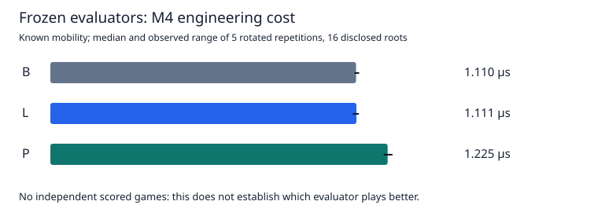

# Frozen B/L/P playing-strength screen: preparation and blocker

**Independent playing-strength experiment not started: essential PC historical provenance is absent on the M4.** No fresh assessment source or opening was reserved; no scored game or new fit occurred. All earlier scientific evidence remains unchanged. B remains production.

29 October 2026. [Scientific protocol](FROZEN_PLAYER_SCREEN_PROTOCOL.md) · [exact PC transfer specification](FROZEN_PLAYER_HISTORY_TRANSFER.md) · [audited machine-readable engineering evidence](data/frozen-player-engineering-20261029.json).

## Answers to the scientific questions

| Question | Supported answer |
| --- | --- |
| Does L win more games against B? | Unknown; 0 of 128+64 planned scored games played. |
| Does P win more games against B? | Unknown; 0 of 128+64 planned scored games played. |
| Does the answer change at 80 versus 300 ms? | Unknown. |
| Does P compensate for its evaluation overhead? | Unknown in play. P costs more per evaluation and completed less median depth on disclosed engineering roots. |
| Where do frontier gains fail through minimax? | No new independent transfer evidence. Engineering continuation witnesses passed; historical conclusions are unchanged. |
| Do root regrets predict game outcomes? | Unmeasured. Disjoint assessment and game panels cannot support per-opening predictive correlations without additional predeclared labels. |
| Are there systematic phase differences? | No independent phase claim. Engineering roots and all their timings are published by occupied count. |
| Confirmation, another objective or faster search? | No new strength evidence chooses among them. First complete this already authorized screen after provenance recovery. |

These are missing measurements, not evidence that the players are equal, successful or unsuccessful. No confidence interval, significance test or nomination is reported from engineering games.

## What completed on the actual M4

The isolated engineering run took **184.515 seconds** (3.075 minutes), separate from implementation, regression tests, auditing and publication. Scientific active time is **zero**; the four-hour allowance has not started. The complete scientific coordinator/independence and runtime qualification remains pending.

* Reconstructed L and P from complete committed coefficients/metadata. Both required checksums match exactly; no fit was run. Verified embedded L, exact weights/specification, support hash and unsupported zero coefficients.
* Used 16 previously disclosed roots, one from each original phase/policy/source-depth cell. They are engineering evidence only; the previous assessment and its outcome remain unchanged.
* Checked 249 disclosed trajectory states and 5784 board-symmetry comparisons, color/perspective transforms, pass/terminal behavior, boundaries 27/28 and 51/52, sparse versus compiled P and zero controls. Maximum sparse/Float32 discrepancy: 3.852701589e-07. Zero-table production move/score/node/evaluation/exactness counts match B/L on all 16 roots.
* All 144 full-window versus production fixed-depth comparisons passed at depths four, five and six. Reconstructed 48 selector frontiers, including P-selected ones; every nonterminal witness endpoint was observed in the corresponding root search. Independent shallow mailbox minimax also matched all three evaluators.
* Reverified the native ARM64 teacher: 35 adapter fixtures, seven extrema/pass/terminal fixtures and horizon/color/coordinate regressions; all 32 D10/D12 benchmark-root queries matched the frozen PC numerical references exactly. Eight ten/twelve-empty roots matched both the optimized independent solver and a separate straightforward mailbox reference under both raw/awarded conventions. No engineering fit from the hardware benchmark was rerun.
* Measured 146 D10/D12 queries over the engineering B/L/P frontier union and 96 ordinary timed-root searches. These reused disclosed boards solely to measure cost and verify replay, without independence claims.
* Completed four engineering opening pairs (eight games), one pair per candidate/time-control condition. All moves/final boards/outcomes independently replayed. A separate process exited with status 73 immediately after its first durable move; a new process resumed and completed that game. This verifies durable-prefix recovery, not recovery from every possible mid-filesystem-write or machine failure.
* Independently audited **485 immutable task receipts**, reconstructed every expected input identity, checked source bytes and model identities, numerical teacher/exact references and all game replays. Raw receipts/transcripts stay ignored locally.

The legacy adapter preflight records `readyForQualification=false` because that flag requires PC-specific deep engineering receipts bound to its x86 executable. It is not silently changed or treated as Mac failure: native acceptance here uses the previously qualified ARM64 pin, exact PC reference equality and the actual fresh adapter/exact checks. The binary/patch/data identities below bind that interpretation.

| Identity | SHA-256 |
| --- | --- |
| L | `ecf3fd376c680ced77d0b002ea2efb9fa4385737c4fffff734b901ab2968d97f` |
| P | `de4b84745589b0384ea3639f879e3c98990e802d176298ff8ef54f681520067f` |
| ARM64 teacher | `643b4a39dea9d85f3a862c37510c90e70188f0b7f02b37bde693841746c8f1c2` |
| Evaluation data | `f8b2299612d9fa4414157e70e932636e33111c2602d0c2fc382a7d90ef21b792` |
| Engineering source inventory | `dbdbd801d452463461147089836cb6838c86196be8b3eab4c6fb4ce6b6748f15` |
| Scientific design | `c808ef2787c8991a2cf75fc20d153deb00941ac9d456fd9efa29c9ccff749dc2` |

The exact executable/source inventory and every task result/file digest are in the compact evidence. New publication/audit code was added after timing; the timed input inventory still matches every original file. No production or historical numerical source was modified.

## Evaluation cost and search depth

Five rotated repetitions, complete static evaluation including features, on the 16 disclosed roots. Ranges are observed repetition ranges, not confidence intervals. Timing and JIT order can affect these short measurements.

| Evaluator | Standalone median μs (range) | Known-mobility median μs (range) |
| --- | ---: | ---: |
| B | 1.193 (1.135–1.206) | 1.110 (1.105–1.121) |
| L | 1.163 (1.157–1.197) | 1.111 (1.098–1.120) |
| P | 1.294 (1.283–1.314) | 1.225 (1.210–1.242) |

P adds **10.20%** known-mobility evaluation cost over L on this panel. Production depth-six totals across the same 16 roots were B 793.8 ms, L 934.4 ms and P 1159.8 ms. Learned searches visit different trees: total search-time differences cannot all be attributed to static-evaluation overhead.



| Evaluator | Budget ms | Median completed depth | Mean elapsed ms | Maximum elapsed ms |
| --- | ---: | ---: | ---: | ---: |
| B | 80 | 6.5 | 75.263 | 80.071 |
| B | 300 | 7.5 | 270.039 | 300.368 |
| L | 80 | 6.5 | 75.307 | 80.020 |
| L | 300 | 7.5 | 273.376 | 300.018 |
| P | 80 | 6.0 | 75.312 | 80.323 |
| P | 300 | 7.0 | 273.375 | 300.018 |

The eight engineering games contain 411 searched placements; maximum measured move overrun was 0.219 ms, with 0 moves beyond budget+1 ms. Incomplete iterative-deepening iterations: 317; depth-zero fallbacks: 0. These are telemetry, not independent scientific observations. All eight engineering game move histories, openings, margins, outcomes and counters are published for replay; their scores are excluded from strength inference.

## Resources and incomplete forecast

Actual host: macOS/Darwin ARM64, Node v24.22.1, M4 with 24 GiB. Engineering configured workers, conservative admitted safe cap and actual worker count were all **one**. No fitting or labeling competed with timed probes/games. Corrected independent occupancy samples observed at most **1 native search**, with histogram `{1: 7, 0: 24}` across 31 samples. Task IDs and full costs distinguish useful work from occupied slots; no six-worker speedup is assumed.

The free+inactive+speculative physical-memory estimate reached a sampled minimum of **7.205 GiB**; swap-in/out deltas were **0/0 pages** over the sampled window. Node peak RSS was **367.7 MiB**; metered native peak RSS was **56.6 MiB**. Sampled counters do not exclude unsampled transients or prior compression. Initial disk availability was about 606 GiB. Temporary `caffeinate -i -s` covered engineering only and exited; no saved settings or unrelated processes changed.

Node coordinator CPU was 117.80 seconds, excluding separate child/restart CPU. Accepted wait4-metered native tasks used 49.21 CPU seconds; unmetered adapter calls and Python wrapper CPU are excluded. Occupancy logging began after engineering started; its sample window is disclosed in JSON.

The first external monitor counted a Python resource wrapper as another active native search because it matched the executable anywhere in argv. The audit retained the raw samples and corrected classification using argv[0]; the corrected count never exceeds one. This was a telemetry classification defect, not concurrent teacher searches or game contention.

The conservative **measured-core component estimate** is 1.278 serial hours, or **1.975 hours with 35% contingency and a separate 15-minute reserve**. Games alone reserve 57.76 minutes: all possible 52 placements at the declared budgets, +1 ms/move and +1 second/game overhead. The JSON gives measured phase/tail assumptions for every included component. This is **not a qualified full forecast**: source admission/rejection under the missing index, complete reservation memory, the scientific coordinator/recovery/overlap pipeline and full analysis/audit/report cost are unmeasured. No scientific launch was authorized by this calculation.

## Provenance blocker and remaining implementation

None of the six required historical campaign directories is present. The old compact binary index and its inventory are also absent. Committed summaries contain model coefficients and disclosed roots, but lack the complete direct-target/source/family/role registry. The PC final coverage audit already established 1,326 additional engineering-game keys missing from its frozen index. Copying that old binary alone would repeat a known coverage defect.

The required transfer is a compact **audited new export** of full-SHA membership, all-occurrence roles/provenance, source-family ancestry, seeds and unused reservations, plus complete hashed inventory and legal-replay/coverage/preservation audits. The [transfer specification](FROZEN_PLAYER_HISTORY_TRANSFER.md) lists exact runs, receipt/checksum anchors, the missing-game digest, data fields and a read-only inventory command. No multi-gigabyte raw dataset or refitted model is needed on the Mac. Role metadata must be derived on the PC; it cannot be invented from published counts.

Prepared implementation covers exact model reconstruction, deep-frozen design/384-game schedule, complete-source slot balance, production game telemetry, independent prefix/full replay, atomic move checkpoints, immutable receipts, real subprocess restart, pair-level t/bounded inference and tested joint bootstrap/nomination primitives. Admission, compact role-index import, sealed result release, overlap classification, complete diagnostic/statistical coordinator and scientific launcher remain **unimplemented/unqualified pending inspection of the real PC provenance formats**. The historical gated runner is incompatible and must not be used as a substitute. Sample identities have deliberately not been claimed frozen.

## Failures, regression checks and reproduction

No native numerical mismatch, search correctness failure or engineering-game crash occurred. The intentional status-73 exit is a recorded restart probe. No old experiment was resumed or repaired. Windows/WSL2 and Intel macOS hardware were not exercised in this round; this is actual Apple Silicon engineering validation. Browser interaction was unchanged and not retested.

The first Python regression invocation failed the historical benchmark portability test: it assumed the live checkout inventory still differed from the old PC only in four portability files. New experiment scripts correctly invalidate that historical equivalence. The test now constructs the explicit historical portability-only inventory and still rejects new scientific/numerical files. The benchmark comparator and old published source inventories remain unchanged. Final test results are recorded below after a stable-source run.

```bash
caffeinate -i -s node scripts/frozen-player/qualify.mjs \
  .local-research/frozen-player-screen-v1-20261029/engineering
node scripts/frozen-player/audit-engineering.mjs
python3 scripts/frozen-player/publish.py
npm test
TMPDIR=/private/tmp python3 -m unittest discover -s tests -p 'test_*.py'
git diff --check
```

The engineering directory binds its original timed source inventory; later new audit/publication files make a fresh qualification directory necessary for a new full timed qualification. Existing completed receipts remain immutable and auditable. The commands are engineering tools, not a scientific launch command.

Final stable-source regression verification: **137 JavaScript tests and 36 Python tests passed**, plus the 485-receipt native/engineering audit, report-link/SVG checks, original ledger byte-prefix check and `git diff --check`. The historical launcher tests print nonfatal subprocess ResourceWarnings. These test-only temporary launches do not constitute a scientific campaign.

## One scientific next step

**Recover and verify the compact PC provenance package, then complete and execute this same frozen-player screen.** There is no new playing evidence that justifies choosing a candidate, paying for another learner, blaming the objective/representation/search cost, or starting a larger tournament. Once the fixed screen is actually complete, apply its unchanged nomination rule and use fresh separately powered confirmation if warranted. Until then the main question remains unanswered.
