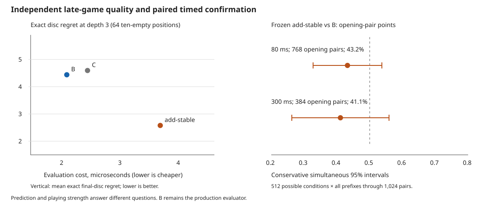

# Completed local evaluator research — 27 October 2026

**Keep B as the production evaluator.** The frozen learned stable-edge candidate improved independent late-position estimates but did not establish stronger play. Its confirmation points rate was **43.2% at 80 ms** and **41.1% at 300 ms** against B. Both predefined simultaneous uncertainty intervals include 50%; neither promotion nor a statistically established inferiority claim follows from those bounds. No model was installed in the browser.

The autonomous program completed **all 19 planned comparison conditions**, **1,544 opening pairs / 3,088 tournament games**, and **1,312 data-generation games**, with **zero failed tasks**. It finished its program in **4 h 26 min 22 s**, before the six-hour cap. This is a completed experiment, not the earlier smoke test.



Compact machine-readable evidence: [local-research-20261027.json](data/local-research-20261027.json). It includes condition-level game outcomes, confidence bounds, actual work/timing/depth histograms, generation index/seed pairs, reference/model hashes, learning history, ablations, and three diagnostic positions. Weights, full trajectories and raw logs remain Git-ignored on the original PC.

## Run identity and protocol

| Item | Recorded value |
|---|---|
| Framework commit | `65fd704fa8d8d7bc693ef460a9d9b24fd8386b93` |
| Framework/protocol | `local-research-v1`; [predefined plan](LOCAL_RESEARCH_PLAN.md) |
| Runtime input SHA-256 | `2d55d9dad01567bf06854bf70c238c5b6c02eaef5391cff1dbf2d0ef9d37453f` |
| Seed | `2026102751` |
| Start | 2026-10-27 05:26:39.825 UTC |
| Final checkpoint | 2026-10-27 09:53:01 UTC |
| Active elapsed / allowance | 15,982.154 s / 21,600 s |
| Process CPU | 16,380.426 s, coordinator plus worker threads; test subprocess CPU excluded |
| Platform | WSL2 Linux x64, kernel `6.18.33.2-microsoft-standard-WSL2`, Node `v24.16.0` |
| Machine | Intel i7-14700F, 28 logical CPUs |
| Workers | Two for generation/fitting; timed tournaments serial with other research workers stopped |
| Local artifacts | `.local-research/six-hour-20261027/` |

Resource checks selected two workers because Windows had only about 2.4–2.5 GiB of physical RAM available despite ample CPU headroom. Chrome remained open. An explicitly approved temporary Windows keep-awake request was released at 09:53:10 UTC; saved power settings were unchanged. The computation persisted independently of the conversation. The [handoff](LOCAL_RESEARCH_STATUS.md) retains the launch/resource record and local inspection commands.

The program used the existing alpha-beta engine. Calibration enabled its opt-in allocation-light move list and ordering-only iterative hints for **both** tournament sides. A remains the equivalence reference; B retains the original mathematical evaluator; C is the previous fixed weight-60 stable-edge comparator. Research search options were not promoted to browser defaults in this publication.

## What was actually computed

| Work | Result |
|---|---:|
| Accepted training / development / untouched confirmation-quality games | 1,024 / 192 / 96 |
| Rejected generated trajectories | 93 canonical collisions |
| Fitted candidates | 17, plus B and C references |
| Fitting rounds / recorded epoch rows | 23 / 458 |
| Training exact labels | 128 six-empty + 16 ten-empty positions |
| Development exact / approximate labels | 64 six-empty / 64 depth-4 B estimates |
| Untouched exact / approximate labels | 64 ten-empty / 64 depth-4 B estimates |
| Preliminary / serious selection opening pairs | 40 / 240 |
| Independent confirmation / depth-control opening pairs | 1,248 / 16 |
| Failed tasks / incomplete comparison conditions | 0 / 0 |

The exact mailbox solver was independent of production rules/search; each generated exact reference was checked against production exhaustive alpha-beta. Earlier references are explicitly approximate B estimates, including possible terminal sentinels in their search units. They are not final-disc labels. Development exact positions have six empties and final exact positions have ten: **do not interpret the difference between those sets' errors as a learning curve**.

Whole trajectories belonged to one split. Canonical D4/color-reversal keys and reserved opening roots excluded cross-split duplicates. The previous disclosed boards and available opening roots were excluded. Unpublished historical trajectories remain unavailable. The saved accepted generation indices/seeds permit regeneration without guessing which rejected trajectories occurred.

### Allocation differed substantially from the starting priorities

The six-hour allowance was a cap, not six hours of fitting. The predefined development-stagnation rule exhausted the fitting campaign quickly, and unused time expanded independent tournaments. These are **sums of task wall times**, which overlap during parallel work and are not a partition of active wall time or CPU:

| Category | Task-wall seconds |
|---|---:|
| Performance calibration | 2.741 |
| Generation and reference labeling | 69.483 |
| Fitting | 47.502 |
| Validation, selection, tournaments, reporting tasks | 15,770.656 |

Thus this run primarily tested playing strength; it did **not** deliver the starting aspiration of approximately 45% of computation on learning. That is a limitation of this campaign's bounded fitting/early-stopping policy, not evidence that additional learning is useless. No AI changed the rules or weights during the run.

## Selection and final independent confirmation

The development screen retained `hybrid`, `patterns`, `linear-smooth`, `add-stable`, and fixed comparator C. Eight-pair depth-2 preliminary scores were 43.8%, 37.5%, 50.0%, 56.3%, and 50.0%, respectively. These tiny selection samples do not establish feature-family rankings.

The two finalists were `add-stable` and `linear-smooth`. On selection-only openings, their mean points rates against B over depth 3 and 20/80/300 ms conditions were approximately **49.0%** and **40.4%**, respectively. `add-stable` also scored 59.4% in their 16-pair 80 ms head-to-head. The predefined rule selected the better challenger even though its average against B was below 50%; selection was not a promotion test.

At **05:51:56 UTC**, before any confirmation access, the program froze `add-stable`: supervised SGD, final-margin target, discrete three phases, original seven features plus anchored stable edges, learning rate 0.025, L2 0.0003, **10 saved epochs**. Its base feature weights were learned too, so this is **not merely C with a different edge coefficient**. Twenty-two epochs were attempted for this candidate; the preserved checkpoint was chosen on development error only.

Selection timings determined an expansion factor of six for the two main confirmation controls: **768 pairs at 80 ms** and **384 at 300 ms**. Those targets were saved before confirmation. No final outcome affected fitting, shortlist, model selection or target expansion.

All rows below are the frozen `add-stable` candidate against B, starting both color games from the same eight-placement opening. Draws count half a point; color-game order alternates by opening pair.

| Control | Opening pairs | W / D / L | Candidate points | Predefined simultaneous 95% interval |
|---|---:|---:|---:|---:|
| Depth 3 | 64 | 47 / 4 / 77 | 38.28% | 1.99–74.57% |
| 20 ms/move | 32 | 26 / 0 / 38 | 40.63% | 0–91.95% |
| 80 ms/move | 768 | 637 / 54 / 845 | 43.23% | 32.75–53.71% |
| 300 ms/move | 384 | 302 / 27 / 439 | 41.08% | 26.26–55.90% |

The interval unit is the **opening-pair mean**, not two independent color games. For mean pair score `m` and `n` pairs, the radius is `sqrt(log(2 * 512 * 1024 / 0.05) / (2*n))`, clipped to [0,1]. This conservative union bound covers 512 possible candidate/control conditions and all prefix lengths through 1,024 pairs, including adaptive duration-dependent stopping. It is deliberately wider than an unadjusted descriptive interval. The predefined promotion condition required lower bounds above 50% at both 80 and 300 ms and minimum sample sizes 128/64. Sample sizes were exceeded; **both strength bounds failed the rule**.

B has the higher observed score at every confirmation control. These results support retaining B, while the stated simultaneous bounds do not establish a universal ranking or quantify human strength/Elo. No post-result alternative statistical rule was substituted.

## Accuracy improved, while the complete player did not earn promotion

The untouched quality set consists of 96 independently generated completed games. One ten-empty position from each of the first 64 suitable games received exact labels. Scores predict fixed-Black `100 * final margin / 64`; B/C prediction-only phase calibration was fitted on training outcomes. Learned models fit that scale directly. These calibration factors never change playing/search scores.

| Model | Completed-outcome MSE, 96 games | Exact-target MSE, 64 positions | Optimal moves d1 / d3 | Exact disc regret d1 / d3 | Mean Spearman d1 / d3 | Static evaluation µs |
|---|---:|---:|---:|---:|---:|---:|
| B | 1,167.553 | 1,084.897 | 18 / 33 | 6.688 / 4.438 | 0.128 / 0.393 | 2.120 |
| C | 1,120.414 | 1,011.204 | 19 / 33 | 6.859 / 4.594 | 0.137 / 0.396 | 2.475 |
| Frozen add-stable | 1,067.577 | 807.207 | 27 / 37 | 4.688 / 2.578 | 0.347 / 0.542 | 3.722 |

Regret is actual final-disc loss relative to the exact-optimal legal move; MSE is in the **specified scaled prediction target squared**, not uncalibrated final-disc units. Completed-game outcomes are mixed-policy labels, not minimax truth. The per-game outcome-prediction error gives each game equal weight; correlated sampled positions are not treated as independent replicates. These positional summaries are descriptive; no adjusted superiority interval for every accuracy metric is claimed.

Among these three frozen models, `add-stable` has the best measured exact prediction, top-choice regret and move ranking. At depth 3 its exact mean regret is 2.578 versus B's 4.438, about 42% lower on this particular sample. The pattern and hybrid candidates were **not** reopened on final confirmation to find a new winner.

On the earlier 64 approximate depth-4 B references, depth-1 estimated regret is **2.710 for B, 2.894 for C, and 3.348 for add-stable**; optimal-choice counts are 31/30/26. Those labels share B's evaluator and can favor it; their units are B search estimates, not discs. Late exact accuracy alone is insufficient evidence about the opening/middlegame or actual games.

### Evaluation cost and search work

The static cost measurement above includes complete evaluation on a common mixed-phase sample of confirmation trajectories, with warmup and three timing samples. The generic learned feature-vector path adds overhead beyond the stable-edge feature itself. It is not a direct measurement of stability's isolated marginal cost.

| Control / side | Median completed depth | Nodes | Static calls | Static calls/s | Mean ms/move | p95 / maximum overrun ms |
|---|---:|---:|---:|---:|---:|---:|
| 80 ms, add-stable | 7 | 608,976,241 | 380,523,056 | 149,586 | 64.075 | 0.057 / 3.877 |
| 80 ms, B | 7 | 828,829,549 | 515,804,412 | 202,084 | 63.682 | 0.055 / 2.881 |
| 300 ms, add-stable | 8 | 1,084,824,466 | 672,953,088 | 146,817 | 231.309 | 0.061 / 5.406 |
| 300 ms, B | 8 | 1,469,654,493 | 893,192,273 | 193,722 | 229.788 | 0.060 / 4.278 |

The complete depth histograms, side-specific actual wall/CPU time and all comparison conditions are in the evidence JSON. No unsearched depth-0 fallbacks occurred. Interrupted iterative-deepening work is included in nodes and evaluation counts. Solved positions stop early, so mean move time can be below the allowance. Deadlines are soft.

Identical median depths hide distribution differences. Engines also visit different boards and get different cutoffs; these work counts do not isolate feature cost or prove why games were lost. `add-stable` was about **1.76 times as expensive per measured static call** and processed fewer leaves per second. Its negative fixed-depth point estimate also means cost alone cannot explain all of its game results. A faster representation with identical learned values is a plausible next test, not a demonstrated cure.

## Learning families, ablations and performance investigation

Development-only summaries for all candidates follow. Relative MSE divides by calibrated B error on the **same target**; margin and outcome target MSEs are not pooled. The ratios are screening metrics, not independent strength estimates. Exact regret here uses the 64 **six-empty development positions**, not the ten-empty final set.

| Candidate | Target | Saved epochs | Relative development MSE | Static µs | Exact regret d1 / d3 |
|---|---|---:|---:|---:|---:|
| linear-sgd | margin | 6 | 0.917 | 3.075 | 2.312 / 1.297 |
| linear-outcome | outcome | 18 | 0.945 | 3.318 | 2.781 / 1.312 |
| linear-coordinate | margin | 18 | 0.921 | 3.051 | 2.312 / 1.484 |
| linear-smooth | margin | 18 | 0.900 | 3.475 | 2.875 / 1.391 |
| td-lambda | margin | 4 | 0.927 | 12.705 | 2.094 / 1.406 |
| td-zero | margin | 10 | 0.904 | 12.554 | 2.031 / 1.391 |
| add-stable | margin | 10 | 0.902 | 3.561 | 2.031 / 1.344 |
| add-access | margin | 28 | 0.913 | 5.003 | 2.297 / 1.781 |
| add-danger | margin | 14 | 0.913 | 9.912 | 2.219 / 1.719 |
| add-edge | margin | 8 | 0.910 | 3.327 | 2.125 / 1.391 |
| add-parity | margin | 12 | 0.919 | 5.093 | 2.344 / 1.734 |
| remove-mobility | margin | 2 | 0.921 | 2.973 | 2.922 / 1.594 |
| remove-potential | margin | 14 | 0.917 | 3.771 | 2.125 / 1.516 |
| remove-frontier | margin | 18 | 0.932 | 2.973 | 2.000 / 1.172 |
| patterns | margin | 34 | 0.897 | 3.445 | 2.734 / 2.016 |
| patterns-outcome | outcome | 32 | 0.948 | 3.774 | 2.891 / 2.203 |
| hybrid | margin | 8 | 0.860 | 15.682 | 1.953 / 1.906 |

`hybrid` had the lowest development relative prediction error (0.860) but cost about 15.7 µs per call and scored 43.8% in its small depth-2 preliminary match. Pure patterns reached 0.897 relative error but scored 37.5% in that preliminary match. These are failures to advance under the screening rule, not proof that pattern evaluation cannot work. There was no serious timed or independent final game comparison of those rejected candidates.

TD(lambda=0.7) reached 0.927 development relative MSE versus TD(0)'s 0.904, with both costly because they include all optional hand features. This run provides no evidence that lambda improved playing strength. Coordinate fitting, SGD and other feature variants improved some descriptive development metrics; only the frozen selected model received full independent playing confirmation.

The JSON preserves all 458 epoch rows and per-model fitting task times. Patterns improved development MSE from 1,120.498 at the first recorded epoch to 987.491 at the saved epoch-34 checkpoint; frozen add-stable's saved epoch-10 MSE was 993.082. Saved-checkpoint selection occurs at two-epoch task boundaries; a lower intermediate epoch in a curve was not separately archived. Curves measure prediction error, not strength at every epoch. We did not measure an epoch-by-epoch strength curve.

Frozen-model ablations on development outcomes increased MSE by **211.228 when corners were removed, 145.545 for stable edges, 87.322 for discs, 24.538 for frontier, 17.603 for mobility, 15.410 for X exposure, 10.005 for C exposure, and 2.581 for potential mobility**. These are dependencies of the fitted model, with interactions; they are not refitted causal feature effects or evidence of equal-time benefit. The stable-edge ablation's positive prediction contribution did not guarantee stronger games.

The original-search sampled profile still put `flipsFor`, the feature scan, negamax, TT position-key construction and legal moves among the largest sampled functions; garbage collection remained visible. On nine matched calibration boards, three repetitions with iterative depth capped at 5 and a constant test clock, total measured times were **534.687 ms original, 323.828 ms fast moves, and 191.975 ms fast moves plus ordering hints**. Scores matched. These small warmed diagnostic timings justified enabling research options for this run; they are not a broad platform performance guarantee. A's equivalence implementation and the original allocating rule code remain available, and production defaults were preserved.

### Deeper search and instructive positions

On the same untouched ten-empty set, B's mean exact regret fell from 6.688 at depth 1 to 4.438 at depth 3; add-stable's fell from 4.688 to 2.578. A separate paired B depth-2 versus B depth-3 control gave the deeper side **20 wins / 0 draws / 12 losses**, 62.5% points on 16 opening pairs; its simultaneous interval is [0,1]. This is descriptive horizon evidence, not a general strength estimate.

The evidence JSON includes three ten-empty boards, all model/depth choices and independent exact continuations. For example, with Black to move:

```text
..BBBBB.
BWWBWB.B
BWWBBW.B
BWBBBWBB
BWWBBBBB
BWWWBWBB
B.WWWW.B
B..WWWW.
```

B depth 1 chooses **A1**, exact margin **+18**; frozen add-stable depth 1 chooses **G3**, exact margin **+46**. Both depth-3 searches choose **B1**, exact margin **+60**. An independently optimal continuation after B1 is `B1 G2 A1 pass C8 B8 B7 pass H1 pass G3 pass G7 pass H8`. These margins assume exact play after the chosen move, not a promise that a depth-limited player will achieve them. The continuation supports the individual move comparison, not a feature-by-feature explanation of the deeper minimax score.

## Reproduction, audit and remaining limits

Original launch on the WSL host:

```bash
python3 scripts/research-launch.py --mode full --hours 6 --workers 2 --seed 2026102751 --output .local-research/six-hour-20261027
```

For computational replication, use the original framework commit in a **separate checkout and new output directory**. The current publication adds files to the input digest, so an old completed run should not be resumed using the changed checkout. Fixed-depth generation/fitting is seeded; timed game results, expansion targets and durations can differ with host scheduling. Repeating these disclosed seeds is replication, not fresh confirmation.

Rebuild or verify the published aggregates from the retained local run, without playing any more games:

```bash
python3 scripts/summarize-local-research.py .local-research/six-hour-20261027
python3 scripts/summarize-local-research.py .local-research/six-hour-20261027 --check
```

The exporter independently checks every recorded pair's color order, W/D/L, paired mean, exact predefined uncertainty formula, margins, nodes, static calls, depth histograms/medians, actual wall/CPU totals and deadline tails against raw task artifacts. It also verifies quality-summary arithmetic and that confirmation tasks began after the durable freeze. The compact pair rows permit readers to recompute game statistics without trained models. Reference and frozen-model hashes identify the local inputs; accepted generation index/seed pairs support regeneration. Full local files are required to reproduce predictions or audit every trajectory.

All **48 named JavaScript tests** and **10 Python tests** pass; content verification uses `--check` above. No new engine, evaluator, optimizer or tournament rule was introduced for publication. No external engine or human benchmark was available, and macOS Intel/Apple Silicon remain physically untested. Windows application load was not controlled experimentally; local work remained at reduced priority.

**Future work, not started:** first address the tiny amount of actual learning computation and the generic learned evaluator's cost with a bounded, new-data study. Consider a stronger mix of accurately evaluated training targets and a more deliberate fitting/data budget before enlarging model complexity. Re-measure an identical-value faster learned evaluator at both equal depth and time; do not assume it will win. Any fresh confirmation must use new reserved data and exclude the newly disclosed roots/reference boards in this JSON. The v1 runner does **not** automatically read this new publication into its exclusions; that update is a prerequisite before a subsequent fresh-confirmation run. Unpublished historical trajectories remain a limitation. No follow-up experiment or production promotion was authorized by this results publication.
