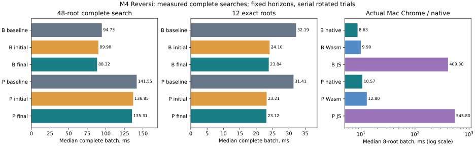
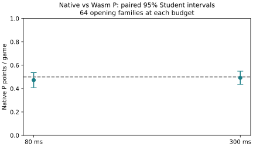

# M4 Mac native/Wasm modernization and optimization qualification

Current shared native/Wasm source is qualified on the M4 and actual Chrome.
The final-empty change improves complete exact solving by about 26% native /
33% Wasm; the compact TT experiment is rejected. All 352 final games pass
independent replay. No evaluator is trained or promoted; historical P/B results
and their provenance restrictions remain intact.

## Stage 1: environment and current-source qualification

The clean Mac checkout was fetched with `git fetch origin` and fast-forwarded
with `git merge --ff-only origin/main`, from `c605503` to `7dfb056`. There were
no unrelated working-tree changes. Both requested PC commits are present.

Actual hardware: iMac Mac16,3, Apple M4, ten cores (four performance, six
efficiency), 24 GiB RAM. macOS 27.2 / build 26B123; Xcode/Instruments 27.2,
Apple Clang 21.0.0. No GCC installation or OS upgrade was necessary. Initial
free disk was about 519 GiB. Spotlight and Time Machine were initially busy;
timing was deferred. Memory pressure was normal, estimated readily reclaimable
memory approximately 8.5–8.8 GiB and allocated swap 0.38 MiB. macOS provides no
Linux-style MemAvailable; the recorded estimate is explicitly described in
the resource certificate. Historical swap allocation is not a swapping rate.
No applications, services, power, security or browser preferences were changed.

| Tool | PC | Qualified Mac selection |
| --- | --- | --- |
| Python | 3.14.4 | **3.14.10**, `.venv/bin/python`, ARM64 |
| Node | 24.16.0 | **24.22.1**, existing MacPorts |
| npm | 12.0.2 | **12.2.1**, user-scoped, selected by `.venv` activation |
| Codex CLI | 0.166.0 | **0.166.0**, existing user installation |
| Playwright / WebSockets | 1.64.1 / 15.0.1 | Same versions |
| NumPy / Matplotlib | 2.5.4 / 3.11.2 | Same versions |
| Emscripten | qualified 4.0.22 artifacts | **4.0.22**, existing user SDK, LLVM 22 |
| Native compiler | GCC 15.2 | Apple Clang 21; features/numerics qualified independently |
| Actual browser | Chrome 156.0.8078.48 | Chrome **156.0.8078.74** |
| Safari | not applicable | 27.2, automation qualification pending |

MacPorts 2.12.7 offers Python 3.14.10, but installation requires an unavailable
administrator password. A single user-managed Astral standalone CPython was
installed with a local uv 0.13.6 bootstrap instead. Apple's Python and MacPorts
selections remain untouched. Existing research venvs retain their historical
Python 3.13 metadata; active project work selects `.venv`. Minimum supported
Python remains **3.13**. See [interpreter setup](PYTHON_ENVIRONMENT.md) and
[exact Mac developer dependencies](../requirements-dev-mac-20261030.txt).

`sys.executable`, `sys.version`, prefix/base prefix, PATH, dependency versions,
Node-to-Python selection and actual Emscripten Python subprocess observations
are recorded in the [Stage 1 certificate](data/mac-stage1-qualification-20261030.json).
All direct Python tests, browsers, reports and benchmark commands use `.venv`;
Python children use `sys.executable`. Node and SDK wrappers select that same
interpreter. No assumption is made from the shell's bare `python3` alone.
`pip check`, imports, Playwright startup and actual browser automation pass.

Two clean production Wasm compilations produce byte-identical manifests and
artifacts, including the current shared completed-iteration correction. An
additional Python-audited build is identical. Old build identity
`5dab45b8a8edfae11a0c9b3821f296a3ee6d06ed5f52c9394cef4e95d9cb1cef`
and its artifact hashes are preserved in the certificate. New build identity:
`2f1bd1d7fc0ce143969cb2cde9b1175aeb09c7b42e492f24b09d37f5f662dc37`.
B/L/P coefficients, model identities, ABI 1, numerical tolerance 1e-10,
floating-point restrictions and bounded memory remain unchanged.

The initial fast panel exposed a real Mac concurrent-build publication race:
separate temporary Mach-O link outputs can have different hashes. Atomic rename
alone did not make both client receipts coherent. Native builds now serialize
cache lookup/compilation/publication per output directory, reclaim only a
recorded dead owner's lock, and retain atomic output publication. A real
three-process fresh-build regression passes. No search mathematics changed.

Stage 1 passes **171 Node tests**, **39 Python 3.14 tests**, **15 ASan/UBSan
groups**, 23 targeted build/native/Wasm tests and the compiled-Wasm standalone
assertions. Broad native qualification checks **2,007 positions, 12,042 static
queries, 96,720 legal children, 96 fixed searches and 12 independent endgames**;
all recorded numerical errors are zero. Wasm qualification includes all B/L/P
cells/weights, full-window alternatives and optimal PV steps, terminal empties,
forced passes, horizons 15/16/64, interrupted iterations/null fallback,
collisions, generation rollover and bounds/model/horizon isolation.

Actual installed Chrome passes B/L/P coaching, complete B/P games and review,
timed play, undo/replay, cancellation/recreation, reload, fallback/refusal,
injected ABI failure/recovery, and the separate custom-weight persistence,
training/export/full-game/review check. SDKs, venvs, local binaries, browser
profiles, raw traces and personal exports are not committed. Existing nonfatal
Python HTTPError ResourceWarnings remain visible.

Reproduce Stage 1 from the repository, in macOS zsh/bash or WSL2 bash with
appropriate installed tools (these Mac results do not newly test WSL or Intel):

```bash
source .venv/bin/activate
python -m pip check
node scripts/native/build.mjs
node scripts/wasm/build.mjs
node --test tests/native-build.test.mjs tests/native-search.test.mjs tests/native-v2.test.mjs tests/wasm-engine.test.mjs
node scripts/wasm/internals.mjs
NATIVE_RUN=.local-research/mac-stage1 node scripts/native/qualify.mjs
npm test
python -m unittest discover -s tests -p 'test_*.py'
NATIVE_SANITIZE=1 node --test tests/native-search.test.mjs tests/native-v2.test.mjs
REVERSI_BROWSER_CHANNEL=chrome python tests/wasm_browser_check.py
REVERSI_BROWSER_CHANNEL=chrome python tests/browser_check.py
```

## Optimization experiments and independent candidate qualification

The reference is copied shared source from Checkpoint 1 (`43e52d2`), built with
identical Apple Clang production flags, frozen header and CPU target. Its local
executable/receipt remain reproducible, without using a research model export.
The panel contains the existing 36 phase/pass/terminal roots plus twelve new
seeded exact roots with 8–12 empties. Every board, seed, placement horizon, build
identity, repetition and counter is preserved in
[compact experiment matrices](data/mac-optimization-experiments-20261030.json).
Nine serial repetitions rotate/reverse build order after a complete warmup;
B/P order alternates. No other computational experiment runs concurrently.

| Initial complete-batch median ms | Baseline | Last one | Last two | Compact TT | Last two + compact |
| --- | ---: | ---: | ---: | ---: | ---: |
| B, all 48 roots | 96.763 | 90.100 | 89.613 | 98.184 | 91.676 |
| P, all 48 roots | 141.502 | 135.321 | 135.435 | 143.814 | 137.040 |
| B, twelve exact roots | 33.308 | 25.802 | 23.638 | 34.181 | 24.206 |
| P, twelve exact roots | 32.243 | 24.877 | 22.964 | 33.058 | 23.373 |

**Retain last-one/two handling.** One empty square needs at most two directional
flip checks and an exact raw-margin calculation. Two empties test the two
candidate flip masks, reuse captures when constructing children, and retain
alpha-beta/pass behavior. No unplayed square is awarded. Truncated horizons,
including two empties at depth one, preserve their original heuristic value.
Independent rules still determine terminal positions, including unused squares.
No general three-or-more-empty specialization was introduced.

**Reject the compact TT and its combination.** This is a new 32-byte direct
entry, not the previous two-way 80-byte bucket. Packing bound/solved metadata
into one byte retains both complete 64-bit bitboards, side to move, the full
double score, 32-bit generation, depth and move. A multiply-based range mapping
allows 327,680 entries in exactly the same **10,485,760 allocated bytes** as
262,144 forty-byte baseline entries; no inactive padding is counted as useful
capacity. Zero-MiB diagnostic tables have one 32-byte entry rather than forty.
Same-generation/same-horizon reuse, model isolation, solved metadata, replacement
and rollover remain correct. This concrete design is about 1.5–1.6% slower on
the mixed panel, and its combined version is slower than last-two alone.
More capacity/hits do not compensate for its execution cost. No cache-miss
explanation is claimed. Reproducible rejected patches are in `scripts/mac/variants/`.

All five candidates pass independent same-depth/exact comparisons under
ASan/UBSan: **11,088 root/window queries and 2,802 legal alternatives per build**,
with both turns, B/L/P, one-slot and ordinary TTs. Arbitrary occupancies cover
every final empty square; reachable small endings and forced-pass/terminal
fixtures add rules coverage. Each standalone sanitizer executable also checks
all 174,960 ordered pattern sums, generation rollover, verified all-move values,
interruption and depth storage. All 4,320 initial matched variant root results
have the same score. The initial qualification harness accidentally included
a twelve-empty exhaustive mailbox reference; that bounded engineering attempt
was stopped and corrected to the intended small independent references before
accepted qualification. Deeper 15/16-empty independent reference fixtures are
qualified separately, not silently replaced by a shallower engine oracle.

## Profiling, two small follow-ups, and repeated measurements

The first 8-root steady panel exposed approximately 2% opening/middle overhead
from placing the specialized tail directly in general recursion. Initial profiles
still concentrate CPU work in negamax, rules and TT/ordering control. Two bounded
changes were investigated, then the complete benchmark/profile campaign repeated:

1. Decide once per root/analysis/window whether its placement horizon reaches
   every remaining empty square. Truncated trees cannot reach the tiny exact
   tail. Gating removes unnecessary empty tests there; by itself its measured
   gain is less than 1%, so it is not presented as a major improvement.
2. Keep the specialized body in a separate, non-inlined shared C++ method.
   This recovers more general-search overhead. The combined final version saves
   1.84% B / 1.13% P against the initial last-two candidate on the matched
   48-root rerun, while preserving its node counts and values exactly.

The final focused tests additionally check horizon zero on fully occupied
terminal boards, both colors and all models. This edge case was explicitly
handled during helper code review before final qualification. Native and Wasm
retain the same final implementation. No third profile-driven search change,
move-ordering experiment, PVS, aspiration window or selective pruning was added.

| Matched repeated complete-batch median ms | Original qualified baseline | Initial last-two | Final |
| --- | ---: | ---: | ---: |
| B, all 48 | 94.728 | 89.975 | 88.323 |
| P, all 48 | 141.547 | 136.851 | 135.309 |
| B, twelve exact | 32.190 | 24.101 | 23.841 |
| P, twelve exact | 31.413 | 23.206 | 23.122 |

Cumulative elapsed reductions are **6.76% B / 4.41% P** on this disclosed mixed
panel, or **1.073× / 1.046×** speed. The independent exact-root batch takes
**25.94% / 26.39% less time**, or **1.350× / 1.359×** speed. These are workload
results, not a universal speed or playing-strength claim. The legacy 36-root
subset at its deeper horizons is still 2.58% B / 2.16% P slower than baseline;
its published matrix scope `nonexact` means "not one of the twelve added roots",
not that every legacy late root is heuristic. The gain is concentrated in exact
solving. The shorter 8-root steady workload below is essentially unchanged.
All initial, gate-only and final measurements are retained, including unfavorable
trials; differing cohort medians are not spliced into a causal speedup.



Separate diagnostic builds have symbols/frame pointers; span instrumentation
adds clocks and is never used for production throughput. Eight native recordings
cover baseline/final opening D8, middle D7, exact twelve-empty solving and actual
all-move/PV coaching D5. Each runs four seconds, with a three-second, 1-ms `sample`
recording. Compact self counts retain only the tool's collapsed >=5-sample table;
percentages below use that reported subset, include any blocked samples, and are
not hardware cycle fractions. The driver avoids repeated process IPC within its
work loop. Initial/gate/final data and exclusive legal/flips/features/patterns/
TT/ordering spans are in [profiles](data/mac-optimization-profiles-20261030.json).

| Final native self-sample share | Opening | Middle | Exact | Coaching |
| --- | ---: | ---: | ---: | ---: |
| General negamax / inlined TT and ordering | 39.2% | 32.4% | 29.0% | 27.5% |
| Separately visible flips | 26.1% | 26.0% | 57.9% | 17.5% |
| Separately visible legal generation | 15.7% | 20.0% | 4.3% | 25.3% |
| Tiny exact helper, outside general search | ~0 | ~0 | 8.9% | ~0 |
| Seven features / evaluator wrapper | 10.7% | 12.5% | ~0 | 16.8% |
| Patterns | 8.2% | 9.2% | ~0 | 12.4% |

Actual Chrome worker CDP profiles request 100-μs sampling during four separate
2.5-second workloads. Final playing profiles have 19,516–19,602 samples.
Opening/middle general search takes about 62.2% / 41.7%, separately visible
flips 5.9% / 18.6%, legal generation 15.1% / 18.3%, features 7.4% / 9.4%, and
patterns 8.6% / 10.7%. Exact solving takes approximately 56.4% in general search,
38.2% in flips and 4.6% in legal generation. Compiler inlining can fold the tiny
helper, ordering and TT work into negamax; native/Wasm symbol shares are not
identical scopes. The full coaching profile also exposes JS immediate
explanations, `flipsFor`, JSON/conversion, stack helpers and Wasm transitions.
Those adapter costs merit future batching work, rather than being mislabeled
as a new playing-search evaluator bottleneck.

Separate exclusive span instrumentation assigns TT operations **12.5% opening,
8.0% middle, 22.3% exact and 8.8% coaching** of the instrumented spans. These
fractions include instrumentation perturbation and exclude uninstrumented
control; they are not production CPU shares or measured cache-miss rates.
The complete six-component span times and call counts accompany self samples.

A separate Instruments **Time Profiler** capture/export succeeds. The bounded
**Allocations** recording times out; no allocation rate is reported from it.
No settings or profiling permissions were changed. Source inspection finds no
recursive per-node heap allocation; all-move/PV result vectors and request
formatting do allocate outside ordinary playing recursion. Neither sampling nor
these recordings establish cache misses, CPU frequencies or memory bandwidth.

The remaining exact-solving cost is chiefly flipping and control. Even halving
all of the native 57.9% separately visible flip work would imply at most about
1.41× under a fixed-work Amdahl estimate; a narrower final-square change affects
less. That is an upper-bound estimate, not a measured prospective gain.
There is no further sufficiently small, justified change within this round's
boundary. Engine source and performance settings are frozen before acceptance.

## Initial and final native / actual Chrome Wasm / original JS benchmarks

The browser comparison uses the same eight disclosed roots and placement depths
as the published PC/M4 study: D7 below 28 occupied, D6 below 52, otherwise
min(9, empties), at least one. Five single-batch trials rotate/reverse all four
backends after two complete warmups. Static batches perform 100,000 full
feature/evaluation calls per root. Seven additional serial blocks each contain
ten complete batches for baseline/native/Wasm; their results have a separate
scope. B/P order alternates. The JS reference is the original compiled P closure
and frozen Float32 tables, with its unchanged old TT/hint policies and depth-14
timed cap. No substitute P formula is introduced.

| Final primary 8-root panel | Baseline native | Final native | Chrome Wasm | Chrome JS |
| --- | ---: | ---: | ---: | ---: |
| B median complete ms | 8.659 | 8.634 | 9.900 | 409.300 |
| P median complete ms | 10.655 | 10.572 | 12.800 | 545.800 |
| B million nodes/s | 17.17 | 17.21 | 15.01 | .362 |
| P million nodes/s | 15.91 | 16.03 | 13.24 | .308 |
| B median static ns/evaluation | 19.35 | 19.52 | 25.00 | 1123.50 |
| P median static ns/evaluation | 26.16 | 26.67 | 33.00 | 1249.00 |

Wasm is **41.3× B / 42.6× P faster than JS**, while taking **14.7% / 21.1%**
more elapsed time than final native on this panel. The final C++/Wasm trees match:
148,608 B and 169,504 P nodes. The baseline visits 28 additional nodes per batch;
analytic tiny tails deliberately change visited-node counts. Different JS TT
policies produce 148,004 / 168,301 nodes with identical fixed scores. Every
static checksum agrees exactly. Same-model complete time, node count and NPS
remain separate quantities; static rates are not stronger-play evidence.

Steady median batch ms are baseline/final/Wasm **6.964/6.923/8.110 B** and
**8.701/8.699/10.560 P**. The final ordinary 8-root change is smaller than
plausible desktop variability, so no general opening/middle gain is claimed.
These longer blocks must not be compared with historical single-batch timings
as if they were a new optimization. Full core CPU/wall, IPC-inclusive wall,
alpha-beta first-move cutoffs, TT probes/useful cutoffs/collisions/replacements,
static calls, warmups and trial orders are in
[benchmark evidence](data/mac-optimization-benchmarks-20261030.json).
The default TT is the same actual 10 MiB in native and Wasm. Useful-hit rates
alone are not performance decisions.

Three repetitions of six roots at 80/300 ms give 18 observations per model/
budget/backend. Mean completed placement depths:

| Model/budget | Baseline native | Final native | Wasm | JS |
| --- | ---: | ---: | ---: | ---: |
| B / 80 | 9.500 | 9.500 | 9.000 | 6.167 |
| B / 300 | 10.333 | 10.333 | 9.833 | 7.056 |
| P / 80 | 8.833 | 8.833 | 8.667 | 6.167 |
| P / 300 | 9.500 | 9.500 | 9.333 | 7.333 |

Native/Wasm solve 6/18 in each cell; JS 3/18. This small repeated-root sample
shows no additional completed depth from the optimization; it is not a claim of
no possible game-level effect. Final native maximum core overrun is .052 ms;
Wasm .3 ms. Browser timers are quantized near .1 ms. These are core deadlines,
not UI delivery bounds. Full inspect/conversion/JSON boundary batches cost
approximately **14.2–16.9 μs per Wasm request**. They include static work and
children, not a bare ABI call. Actual application delivery/initialization,
process CPU scope, memory and game results follow below.

## Comparison with the upgraded PC and prior Mac

The previous same-M4 primary medians were 8.493/10.416 ms native and
9.8/12.6 ms Wasm. Current 8.634/10.572 and 9.9/12.8 ms are essentially the same
workload class with ordinary cohort/browser/layout variation; they do not show
a universal speedup. The stronger before/after evidence is the matched twelve
exact roots and 48-root panel above, not a favorable historical denominator.

The upgraded PC GCC 15 portable seven-block medians were **10.621 ms B /
14.489 ms P**, host 10.348/13.472 and POPCNT-only 10.302/13.050. Current M4
steady native is about **1.53× / 1.67×** faster than PC portable and
**1.49× / 1.50×** faster than PC POPCNT on the disclosed workload. Architecture,
compiler target, WSL virtualization, hybrid scheduling and desktop conditions
are confounded; this is an observed implementation comparison, not isolated
CPU/compiler causality. The new tiny tail changes 28 nodes out of about 150k,
without a value difference. PC Windows Chrome's later three-batch sanity
medians (12.367/15.300 ms) and M4 single/ten-batch results use different work-block
lengths and browser display modes; they support a faster observed M4 browser
here, not a precise controlled browser/platform ranking. The PC reports retain
all original GCC 11 and GCC 15 measurements and limitations.

## Frozen final campaign and feasibility

The measured unscored backend pilots take **3.194 s at 80 ms** and **10.727 s at
300 ms** per complete game from separate pilot openings. Eight balanced actual-
application pilot games take **47.729 s**. The pre-play forecast reserves 50%
game-time contingency, 300 seconds for audits/analysis/stress/lifecycle, and
**1,200 seconds for reporting** inside the four-hour active measurement ceiling.
Including measurements already completed, the complete conservative forecast
is **5,514 seconds (91.9 minutes)**. No sample reduction is necessary.

[Backend registration](data/mac-backend-registration-20261030.json) freezes
64 opening families, both colors at 80 and 300 ms: **128 games per budget,
256 total**, primarily/exclusively frozen P. All roots/seeds, complete schedule,
source/native/Wasm/model identities, 10 MiB allocation, same D3 warmup, hints,
statistics, stopping/reading policy and checksums are published before play.
Duplicate symmetry/color-equivalent roots are excluded before outcomes.
Each game gets a fresh native process and fresh actual Chrome Wasm worker;
requests run serially. Equal **core** elapsed budgets avoid charging Python/CDP
transport to only one backend; all interface, worker and outer-wall costs are
recorded separately. This is explicit engineering scope, not ordinary UI latency.
No score/outcome summary is opened until all 256 games pass independent replay,
small exact references, completed-horizon checks and source/artifact audits.
Opening families, not moves or color-swapped games, are the statistical units.

[Browser acceptance registration](data/mac-acceptance-registration-20261030.json)
freezes **96 full actual-application games**, twelve per B/P × 80/300 ms × human
color cell, with 96 deterministic human-policy seeds and depth-two full-window
coaching. These produce varied human opening choices through normal UI play;
arbitrary starting boards are not injected into application state. Custom
training/export/review is qualified separately. Checkpoint 2 is committed and
remote-verified before either substantial final campaign starts.

A direct historical-Wasm/current-Wasm worker comparison additionally runs the
same complete 48-root panel and nine alternating-order repetitions in one actual
Mac Chrome worker. The qualified Checkpoint 1 module is extracted from Git into
ignored storage and checked through its actual ABI build string; production
continues to load only the final shared implementation. Both builds have the
same 10 MiB TT and frozen identities. All 864 matched root scores agree.

| Matched Wasm median ms | Before, all 48 | Final, all 48 | Before, exact twelve | Final, exact twelve |
| --- | ---: | ---: | ---: | ---: |
| B | 117.3 | 105.1 | 41.3 | 27.9 |
| P | 178.6 | 166.9 | 40.9 | 27.5 |

Wasm complete-batch elapsed falls **10.40% B / 6.55% P** on the mixed panel,
and **32.45% / 32.76%** on the exact subset. The exact speed ratios are
**1.48× / 1.49×**. These measured gains are independent of native NPS or a
historical cross-browser denominator; they do not imply every timed move
completes another depth. The [experiment evidence](data/mac-optimization-experiments-20261030.json)
retains both ABI identities, original manifest, boards, orders and every result.
The additional check consumed under ten seconds of intensive time; the
pre-play forecast remains comfortably inside the allowance.

Checkpoint 2 validation passes **172 Node tests** (using project npm 12.2.1),
**39 Python tests**, **15 native sanitizer groups**, the extra focused
native/actual-Wasm sanitizer test, current-source standalone Wasm assertions,
23 targeted groups, 786 installed-Chrome numerical comparisons and final actual-
app integration/recovery checks. Both final Wasm compilations match exactly.
Final distribution identity:
`01ae1b4aec535cf2a2b431d0d4fe3d1b8e76c60b021cc80cf507bcd5f462bc2d`.
Its Wasm SHA-256 is
`924de12404edc637789ed705575c2b274070198666af5767157dd12d0de75150`.
Complete source/header/native executable/model hashes are in
[the results certificate](data/mac-optimization-results-20261030.json).

Reproduce the engineering measurements serially after activating `.venv`:

```bash
python scripts/mac/run.py experiments node scripts/mac/experiment.mjs
node scripts/mac/qualify-variants.mjs
python scripts/mac/run.py repeated node scripts/mac/recompare.mjs
python scripts/mac/run.py benchmarks python scripts/mac/benchmark.py
python scripts/mac/run.py native-profile node scripts/mac/profile.mjs
python scripts/mac/run.py wasm-profile python scripts/mac/wasm-profile.py
python scripts/mac/run.py wasm-compare python scripts/mac/wasm-compare.py
python scripts/mac/run.py instruments python scripts/mac/instruments.py
```

The experiment runner reconstructs the qualified reference from Git and compiles
all experimental copies into ignored storage. It does not apply rejected patches
to production. Use a separate ignored output directory or archive old local
outputs before rerunning, rather than overwriting the completed evidence. The
measurement wrapper records CPU/process/memory/disk snapshots, checks normal
pressure and a 4 GiB cache-headroom estimate, and stops on sustained swap output.
A cache estimate is not a guaranteed free-memory lower bound; pressure and
observed swap deltas constrain interpretation. No user process is terminated.

At Checkpoint 2, substantial final acceptance was still pending. Its complete
results follow; the engine and performance settings remained frozen.

## Final native/Wasm correctness and backend playing performance

Checkpoint 2 was pushed and remote-verified at
`8e8fde9787e01e194417e2080ace0fe990499e4b` before substantial final games.
The post-freeze suite again passes **172 Node tests, 39 Python tests and all
16 ASan/UBSan groups**, including the focused new-tail test against native and
actual compiled Wasm. The final broad native panel repeats 2,007 positions,
12,042 static queries, 96,720 independent legal children, 96 fixed searches and
twelve independent endings with zero observed numerical error. The current
Wasm standalone assertions pass, and actual Chrome repeats all 786 numerical
comparisons with maximum error zero. Forced passes, terminal empties, raw
margins/win-loss utility, bounds/collisions/replacement/rollover, changing models
and horizons, depth 15/16/64, interruption/fallback, full-window alternatives and
verified PVs remain covered. The fully occupied depth-zero case has explicit
new coverage. No performance setting or engine code changed after the freeze.

The complete registered backend campaign finishes in **1,772.0 seconds**.
Independent mailbox replay verifies **13,177 applied placements and 313 forced
passes**, final boards and actual raw margins. **1,529 small exact search
results** match exhaustive mailbox references; **512 first native/Wasm
completed-horizon scores** match fresh full-window native searches. The latter
are deterministic score rechecks, not an independently implemented large-horizon
minimax oracle. The separate exact/rules references provide independence.
All registered source/build/model and actual artifact hashes match. No outcome
summary was opened until this entire audit passed. No game was dropped,
replaced or selected from an interim result.

| Native P versus Wasm P | Native W–D–L | Native points | Paired Student 95% | Whole-family bootstrap 95% |
| --- | --- | ---: | --- | --- |
| 80 ms, 128 games / 64 families | 56–9–63 | 47.27% | 40.86–53.67% | 41.02–53.52% |
| 300 ms, 128 games / 64 families | 59–8–61 | 49.22% | 43.55–54.89% | 43.75–54.69% |

**This sample establishes no backend playing-strength advantage.** Both
intervals include 50%; native's higher throughput is not sufficient evidence
of stronger play. The paired unit is the complete opening family, with both
colors; moves and individual swapped games are not independent sample units.
Intervals are descriptive, conditional on these engineering openings, frozen P,
core-time policy and desktop scheduling. The same 64 families occur at both
budgets, so the budget results are correlated. These are marginal uncertainty
intervals, not a new evaluator superiority test or a P-versus-B confirmation.
P is not promoted and no training occurs.

| Budget/backend | Moves | Mean depth | Median / max | Million nodes/s | Mean nodes/move | Exact moves | Above D14 |
| --- | ---: | ---: | --- | ---: | ---: | ---: | ---: |
| 80 / native | 3,293 | 9.664 | 10 / 20 | 18.125 | 1,041,286 | 984 | 134 |
| 80 / Wasm | 3,294 | 9.524 | 10 / 19 | 13.651 | 787,610 | 982 | 115 |
| 300 / native | 3,293 | 10.389 | 11 / 20 | 18.936 | 3,920,358 | 1,074 | 281 |
| 300 / Wasm | 3,297 | 10.255 | 10 / 20 | 14.098 | 2,935,805 | 1,065 | 265 |

Native's whole-game search throughput is **1.328× / 1.343× Wasm** at 80/300 ms.
Mean completed depth is higher by only about .14 placements. Solved late moves
have smaller natural depths, so aggregate depth means do not directly measure
playing strength. **795 of 13,177 searches exceed depth 14**; both backends
complete depth 20 at 300 ms. There are **zero null-score fallbacks**. Game paths
can diverge because elapsed scheduling changes which iterative depth completes,
even though every checked fixed-horizon value is identical.

At 80 ms, native/Wasm accumulate **189.185 / 190.052 core seconds**; at 300 ms,
**681.747 / 686.573 seconds**. Native process CPU is **189.166 / 681.649 seconds**,
separately recorded from wall time. No per-search Wasm thread CPU is invented;
aggregate browser CPU is measured separately by the lifecycle probe. All alpha-
beta and TT probe/hit/useful-cutoff/collision/replacement/store/rejection counters
are retained per move in the compact evidence. More TT hits or a different tree
size is not substituted for elapsed throughput.

Mean core / Python-inclusive outer request ms are native **57.451/57.524** and
Wasm **57.697/58.877** at 80 ms; native **207.029/207.111** and Wasm
**208.242/209.527** at 300 ms. These averages include early exact completions.
The Wasm outer path includes test Python/CDP and worker messaging, which is
not the ordinary UI's transport. Maximum core overruns are native **.076/.083 ms**,
Wasm **.3/.4 ms** at 80/300; no core request overruns by more than 1 ms.
Maximum outer overruns are native **.184/.223 ms**, Wasm **2.126/2.210 ms**.
The full paired game runtimes sum to **385.64 seconds at 80 ms** and
**1,375.14 seconds at 300 ms**, including both players/startup/warmup/transport;
protocol/check/resource overhead explains the remainder of 1,772 seconds.

[Complete replayable backend evidence](data/mac-backend-games-20261030.json)
uses named column matrices to avoid repeating long per-move keys; no metric is
silently turned into a guessed value. Unknown per-search Wasm CPU remains null.
[Independent replay verification](data/mac-public-verification-20261030.json)
and [recomputed registered statistics](data/mac-statistical-verification-20261030.json)
make the complete public sample auditable without private research files or
another playing campaign.



## Final actual-browser acceptance

All **96 complete actual Chrome application games** pass in **576.2 seconds**,
versus 572.7 seconds forecast from the separate eight-game pilot. Every B/P ×
80/300 ms × human-color cell contains exactly twelve games. Independent mailbox
replay verifies **5,750 placements, 790 forced passes and ten terminal boards
with unused squares**. All **3,294 applied computer replies** are independently
legal and correspond to their actual game positions; **425 small exact search
results** agree with exhaustive references. There are **zero page errors and
zero depth-zero fallbacks**. Live full-window coaching checks compare **695
alternative scores** with native at selected first/late roots; every displayed
continuation is independently checked for legal moves/passes and placement
horizon. The separate numerical campaign verifies optimal reply values, rather
than treating legality alone as proof that a continuation is optimal.

| App condition | Games | Computer searches | Mean / max depth | Exact searches |
| --- | ---: | ---: | --- | ---: |
| B / 80 ms | 24 | 817 | 9.311 / 20 | 232 |
| P / 80 ms | 24 | 812 | 9.298 / 18 | 232 |
| B / 300 ms | 24 | 831 | 10.406 / 19 | 264 |
| P / 300 ms | 24 | 834 | 10.299 / 19 | 255 |

Different random-human game paths make these descriptive acceptance metrics,
not a B/P strength comparison. Maximum core overrun is **.2 ms**; maximum actual
worker-request overrun is **22.9 ms**, including initialization/message delivery.
The latter is retained rather than hidden behind the smaller core deadline.
All frame samples are retained in the per-game probe: maximum frame gap **18.8 ms**,
maximum per-game p95 **18.5 ms**. No stale response corrupts any replayed state.
The separate twenty rapid 300-ms cancellation/recreation trace has p95 frame
gap **17.8 ms** and maximum **125.6 ms**, with no observed main-thread long task
or main trace event above 20 ms. This does not prove perfectly hitch-free UI;
the occasional cancellation-frame tail remains a limitation.

Final integration checks exercise B/L/P selection and model identities,
full-window comparisons, verified lines, historical review, undo/replay, reload,
worker recreation, B fallback, refusal to substitute for P/L, custom recovery,
injected ABI mismatch and reload recovery. Separate actual custom-weight tests
pass keyboard comparison, bounded disposable training, JSON download/export,
persistence/reload, complete custom play and mistake review. Frozen coefficients
and ordinary browser profiles are not modified by this smoke test.
The real `start.sh` → macOS `open` path is also executed and its browser HTTP GET
observed. The computer-use host cannot access that ordinary browser tab for
cleanup; no user application or window is closed to work around this limitation.

[All 96 games and per-move telemetry](data/mac-browser-acceptance-20261030.json)
are committed in compact named-column form. The standard-library public audit
replays both the 96 UI games and all 256 backend games, checks **1,954 small
exact move results**, all 3,456 experimental cohort root rows, 240 fixed browser
benchmark rows, current source/artifact hashes and the registered schedule.
The additional Node audit independently reconstructs W/D/L, family means,
Student intervals and all registered 20,000-replicate bootstrap intervals from
public final boards/colors. Both public audits pass.

## Lifecycle, memory, resources and compatibility limits

Fresh-worker module initialization is **6.2–8.2 ms** across five separate
contexts in one browser process; navigation/worker/module readiness is
**29.3–43.9 ms**. These are not five disk-cold browser starts. Warmed test
Python→browser→worker inspect round trips have median **.654 ms**, including
CDP/automation transport, not a bare ABI call. A 2.505-second worker workload
consumes **2.637 aggregate owned-browser process CPU seconds**, including
transport/browser work, not exact per-search thread CPU.

The bounded stress suite passes **2,000 repeated native timed searches**,
**1,000 Wasm timed searches**, **50 explicit module reinitializations**, plus
the twenty actual UI cancellations/restarts. Native RSS rises from **11.91 to
12.02 MiB**, then remains at 12.02 MiB for searches 101–2,000. Each live Wasm
engine remains exactly **32 MiB linear memory**; its configured hard ceiling is
128 MiB. No unbounded per-node allocation is introduced. The default native and
Wasm TT allocations remain exactly 10 MiB. Native/Wasm standalone generation
rollover and one-slot collision stress also pass.

Across 96 application games, summed browser-process RSS rises from about
**1.16 GiB** to **1.21 GiB**, then fluctuates near that level (maximum sample
about 1.22 GiB). The separate fifty-module probe rises about **72 MiB** rather
than leveling completely within that short run. Both observations are retained.
A follow-up **64-reinitialization diagnostic**, forcing GC every eight cycles
inside its disposable worker, recovers roughly 21–32 MiB at each collection.
Post-GC V8 used heap is approximately 0.87–0.91 million bytes while each live
Wasm buffer remains 32 MiB. Post-GC aggregate process RSS still rises about
**35 MiB** over the diagnostic. Some retention is collectible, but allocator/code
cache high-water behavior versus smaller retained objects is **not resolved**.
The V8 heap API's backing-storage field does not measure all Wasm linear memory.
These finite probes find no large per-instance linear-memory accumulation;
they are not proof that every future leak is absent. Summed process RSS
includes shared pages and is never treated as unique allocated physical RAM.
The diagnostic is excluded from production performance comparisons.

Read-only resource samples occur before/after each intensive stage and roughly
every fifteen seconds during long runs. Across the main campaign the cache-based
headroom estimate stays at least **7.65 GiB**, pressure remains normal and both
cumulative swap-in and swap-out deltas are **zero**. Allocated swap stays
0.38 MiB. This cache estimate is not a guaranteed OS MemAvailable value; free
pages, resident file-backed pages, pressure and swap counters remain separately
recorded. After the main acceptance/cleanup, disk free is about **517.6 GiB**
and estimated cache headroom **8.73 GiB**. No power/thermal setting, service,
ordinary application or security preference is changed. All owned Playwright
browsers/native children are closed; raw traces/caches/SDKs/venvs stay ignored.

The intensive-stage ledger charges approximately **49.5 minutes**, including
pilots, all repeated benchmarks/profiles, games, independent replay/statistics,
stress and verification (plus a few seconds for the additional memory probe).
The allocated **20-minute reporting reserve** fits inside the four-hour ceiling;
combined use/reserve is about **70 minutes**, below the 91.9-minute conservative
forecast and far below 240 minutes. Setup, ordinary compilation and full unit
qualification are separate; some compilation/audit costs are conservatively
charged anyway. The backend audit itself takes 116.6 seconds, within the
predeclared 300-second replay/analysis/stress/lifecycle reserve.

This is a working desktop, not an isolated idle laboratory. Resource snapshots
show recurring OS background work: CoreSpotlight reaches 142.2% of one logical
CPU during the initial benchmark cohort; the final benchmark cohort's listed
XProtect peak is 1.6%. The short direct-Wasm comparison observes mds_stores at
92.1%. During backend games, sampled peaks include mds_stores 99.5%,
CoreSpotlight 139.1% and Time Machine backupd 53.6%; during UI acceptance,
CoreSpotlight reaches 160.4%. These are sampled process peaks, not sustained
stage averages or a measured CPU-frequency effect. No other project scientific
workload runs concurrently. Ordinary services are left alone. Rotated within-run
comparisons mitigate order bias but cannot remove desktop scheduling variability;
fine historical/platform differences and UI frame tails retain this limitation.

Actual **Safari 27.2** WebDriver cannot create a session because **Allow remote
automation is disabled**. It is left unchanged. Safari has **not** passed this
qualification. The actual Mac Chrome user-agent says MacIntel for compatibility;
the measured hardware is ARM64 M4, not an Intel execution test. No new Intel Mac,
Windows/WSL or native Windows execution is claimed for the final optimized
source. Earlier PC results remain their own qualified historical versions.
Instruments Allocations timed out, hardware cache/bandwidth/frequency attribution
is unavailable, and the modest residual module-probe RSS growth remains an
explicit diagnostic limit.

Supplemental inventory also records untouched Python.org frameworks 3.9.13,
3.10.2 and 3.11.0; MacPorts 3.10.22/3.11.18/3.13.18; Apple's 3.9.6; and an
existing, unselected Conda Python 3.14.7. Legacy Intel-only framework executables
cannot run directly here and are not project interpreters. Existing MacPorts
LLVM 20.1.8/22.1.8 and libgcc 15.3 runtime packages remain untouched. The pinned
SDK's compiler reports LLVM/Clang 22.0.0git. These inventory facts do not alter
the selected project Python **3.14.10**, native **Apple Clang 21**, Node **24.22.1**
and activated project npm **12.2.1**. Bare non-activated npm remains MacPorts
11.21.0; activation or `.venv/bin/npm` explicitly selects the qualified version.
No additional compiler installation or major OS upgrade is performed to satisfy a version number.

## Conclusions and ranked next work

1. **Final-square flipping remains the first narrow performance experiment.**
   Native exact samples now place about 58% of reported self samples in flips.
   Investigate cheap square/ray-specific handling before another general kernel.
   The full-flips Amdahl bound above overstates what a small final-square change
   could save; its actual subset fraction/benefit is unknown. Preserve all raw-
   margin/pass references and retain only whole-search improvement.
2. **Cheap move ordering may have broader playing impact.** Measure tree
   reduction against ranking cost on actual fixed/timed/coaching work. No PVS,
   aspiration or selective pruning is implied. Its benefit is unmeasured and
   correctness/re-search risk is higher than an isolated rules kernel.
3. **Batch immediate coaching facts if shallow coach latency matters.** Actual
   Wasm coaching samples show JS board/explanation/conversion transitions that
   playing avoids. Keep immediate evidence separate from causal minimax claims.
   This has little expected ordinary playing benefit and needs ABI/UI tests.
4. **Further TT layout work is lower priority.** Both the old eighty-byte bucket
   and this genuine thirty-two-byte equal-memory design failed to improve
   complete time. A future design needs a distinct reason and a small benchmark,
   not a prolonged rewrite or a hit-rate-only success criterion.
5. **Long-session memory retention diagnosis remains useful measurement work.**
   Use owned-worker GC/heap/allocator evidence if RSS growth persists. Current
   finite results do not justify claiming either a major leak or universal
   leak-freedom. Avoid altering ordinary browser/security preferences.

No additional easy change is sufficiently demonstrated to continue modifying
the engine now. Frozen B/L/P identities, previous P-versus-B results, the
published direct-development overlap and unresolved historical-role limitations
remain unchanged. This round neither repairs those provenance restrictions nor
provides another independent P confirmation. No evaluator is retrained,
promoted or substituted.

## Answers to the requested questions

| Question | Finding |
| --- | --- |
| Python 3.14.4 or newer stable 3.14.x? | **Yes: project CPython 3.14.10**, actually used by tests, browsers, Node-selected Python, SDK tooling and reports. Minimum remains 3.13. |
| Principal tools at least as current/capable as PC? | **Yes for selected project tools**: Node 24.22.1, npm 12.2.1, Codex 0.166.0, matching/newer dependencies, qualified Apple Clang and pinned Emscripten. Global legacy installations are retained. |
| Current-source native/Wasm qualified? | **Yes on M4 / actual Chrome**, including complete post-freeze suites and 352 replayed games. Safari/Intel/Windows final-source execution remain separate limits. |
| Specialized final-empty generation helpful? | **Yes:** exact-root elapsed falls about 26% native and 33% Wasm; rules and margins remain exact. |
| Compact TT helpful? | **No:** this equal-10-MiB, 25%-more-entry design has no reproducible elapsed benefit and is rejected. |
| What did profiling reveal? | Rules/control dominate; final exact work is chiefly flipping. Inlined TT/ordering cannot be cleanly isolated by self symbols; coaching exposes additional adapter/JS work. |
| Further worthwhile optimizations? | Root-horizon gating plus separating the tail body recover about 1–2% against the initial candidate. No further engine change is justified in this round. |
| Faster than previous Mac version? | Matched native exact **1.35–1.36×**, mixed **1.05–1.07×**; shorter opening-heavy work is essentially unchanged, and the deeper legacy subset is modestly slower. No universal speedup claim. |
| Mac Wasm versus native/JS? | Fixed Wasm is **41–43× faster than JS**, takes **15–21% more time than native**; real-game native NPS is about **33–34% higher**, but paired outcomes show no convincing strength difference. |
| Versus upgraded PC? | M4 steady native is about **1.53× B / 1.67× P** PC portable GCC 15, with architecture/OS/compiler/scheduling confounds. Browser aggregation/display differences limit a precise cross-platform ranking. |
| Problems from larger testing? | No numerical/game correctness discrepancy. The real Mac build-publication race was fixed. Safari automation remains blocked, cancellation has an occasional frame tail, and small module-probe RSS retention is unresolved. |
| Optimize next? | A bounded final-square flip experiment, then inexpensive ordering or shallow coaching batching if measurements justify them; lower priority for another TT rewrite or evaluator micro-optimization. |

## Final evidence, reproduction and publication

- [Environment and original/current-source qualification](data/mac-stage1-qualification-20261030.json).
- [Retained/rejected experiments and all repeated roots](data/mac-optimization-experiments-20261030.json).
- [Initial, gate-only and final fixed/timed benchmarks](data/mac-optimization-benchmarks-20261030.json).
- [Initial, gate-only and final native/Wasm profiles](data/mac-optimization-profiles-20261030.json).
- [Final identities, resources, stress, lifecycle and qualification certificate](data/mac-optimization-results-20261030.json).
- [All backend games](data/mac-backend-games-20261030.json), [all browser games](data/mac-browser-acceptance-20261030.json), [public replay](data/mac-public-verification-20261030.json), [public statistics](data/mac-statistical-verification-20261030.json).

Final native build fingerprint:
`65370a665d28b3286009ae1dd7194eb868ec32438eb00a3e62296a91150cc5d1`.
The final Wasm identity/artifact hashes above remain unchanged throughout final
acceptance. Full native executable/source/header/compiler flags and B/L/P
identities are in the certificate. Rebuilding a native Mach-O executable is not
claimed byte-deterministic; its actual receipt/hash and coherent cache are
verified. Two clean current-source Wasm generations are byte-deterministic.

Public verification requires no private data or SDK; use Python 3.13+ and Node
20+ for the optional statistical reproduction:

```bash
source .venv/bin/activate
python scripts/mac/verify.py
node scripts/mac/analyze-public.mjs
python scripts/mac/figure.py
```

The actual final campaign ran serially after Checkpoint 2 (new authorized runs
must preserve/archive completed local outputs first; never overwrite a scored
sample or reinterpret old registered outcomes as fresh confirmation):

```bash
npm test
NATIVE_SANITIZE=1 node --test tests/native-search.test.mjs tests/native-v2.test.mjs tests/mac-endgame.test.mjs
NATIVE_RUN=.local-research/mac-modernization-20261030/final-qualification node scripts/native/qualify.mjs
node scripts/wasm/internals.mjs
python -m unittest discover -s tests -p 'test_*.py'
python scripts/mac/browser-qualify.py
python scripts/mac/run.py backend-games python scripts/mac/backend-games.py play
python scripts/mac/run.py backend-audit python scripts/mac/audit.py backend
python scripts/mac/run.py backend-analysis node scripts/mac/analyze-games.mjs
REVERSI_BROWSER_CHANNEL=chrome REVERSI_WASM_OUTPUT=.local-research/mac-modernization-20261030 \
  REVERSI_ACCEPTANCE_REPS=12 REVERSI_ACCEPTANCE_SEED=0x4d344100 \
  python scripts/mac/run.py browser-acceptance python scripts/wasm/acceptance.py
python scripts/mac/audit.py acceptance
python scripts/mac/run.py bounded-stress python scripts/mac/stress.py
REVERSI_BROWSER_CHANNEL=chrome REVERSI_WASM_OUTPUT=.local-research/mac-modernization-20261030 \
  python scripts/wasm/lifecycle.py
REVERSI_BROWSER_CHANNEL=chrome REVERSI_WASM_OUTPUT=.local-research/mac-modernization-20261030 \
  python scripts/wasm/ui-stress.py
REVERSI_WASM_OUTPUT=.local-research/mac-modernization-20261030 python scripts/wasm/safari.py
REVERSI_BROWSER_CHANNEL=chrome python tests/browser_check.py
python scripts/mac/run.py worker-memory-diagnostic python scripts/mac/memory-diagnostic.py
python scripts/mac/publish.py --final
python scripts/mac/figure.py
python scripts/mac/verify.py
node scripts/mac/analyze-public.mjs
```

Actual Checkpoint 1 command:
`git commit -m 'Qualify M4 Python 3.14 and reproducible current-source Wasm'`,
then `git push origin main`; SHA
`43e52d2235c17670f302ab822636f11660e4f8b7`.
Checkpoint 2 command:
`git commit -m 'Optimize shared final-empty search and freeze M4 acceptance campaign'`,
then `git push origin main`; SHA
`8e8fde9787e01e194417e2080ace0fe990499e4b`.
Each was verified with `git ls-remote origin refs/heads/main` before proceeding.
The final report/evidence checkpoint uses
`git commit -m 'Publish comprehensive M4 native Wasm acceptance and performance results'`,
`git push origin main`, `git rev-parse HEAD` and the same `git ls-remote` check.
Its exact SHA is reported after publication to avoid a self-referential hash.
No venv, SDK, native executable, cache, raw profile trace, archive or private
research corpus is included in these commits.
