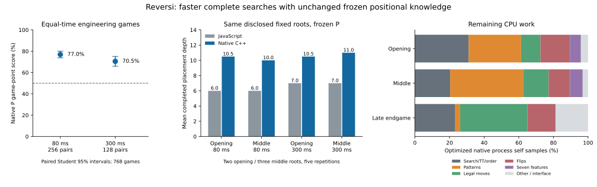

# Native Reversi search engine

The C++17 backend is implemented, numerically qualified and connected to actual
research playing. In the complete corrected 768-game screen, frozen P using
native search scored **76.95% at 80 ms** and **70.51% at 300 ms** against the same
P using production JavaScript search. Independent rules, statistical and public
telemetry audits passed. Native search is a tangible playing-strength improvement
on this engineering distribution. An initial timing-defective screen is archived
separately and is not pooled with the corrected sample.
The original JavaScript engine and dependency-free Python/browser application
remain available. **The browser is not accelerated in this release.**

[Prospective protocol](NATIVE_SEARCH_PROTOCOL.md) ·
[corrected registration](data/native-search-registration-r2-20261030.json) ·
[cumulative feasibility](data/native-search-feasibility-r2-20261030.json) ·
[numerical qualification](data/native-search-qualification-r2-20261030.json) ·
[complete benchmark trials](data/native-search-benchmarks-r2-20261030.json) ·
[optimization trials](data/native-search-optimization-20261030.json) ·
[compact profiles](data/native-search-profiles-20261030.json).

## Architecture and actual integration

`native/engine.hpp`/`engine.cpp` implement rules, full static evaluation and
complete searches. `main.cpp` is a persistent version-1, request-id-tagged process
interface: compact hexadecimal bitboards in, JSON results/errors out. It accepts
B, L and P, fixed placement depths 1–14, elapsed budgets, TT configuration and
qualification windows. No leaf evaluation crosses a language boundary.

`scripts/native/build.mjs` verifies and reconstructs the frozen models, exports a
generated header into ignored storage and invokes a C++17 compiler. Models are
embedded, so runtime has no JSON parsing or separate model-file loading. The
build receipt records model/source/header/executable SHA-256 identities,
compiler, flags and time. `native/CMakeLists.txt` supports the same generated
header as an optional alternative build; CMake is not required.

`scripts/native/client.mjs` supplies `NativeEngine.ready/inspect/search/windows`,
AbortSignal cancellation and recovery. A persistent child is shared across
complete searches. Cancellation terminates it, rejects its outstanding requests
and permits a fresh process on the next request. Response deadlines catch process
failure. Build once in the coordinator before starting parallel research workers and
pass the resulting receipt to each client. Use one client per serial research
worker; aborting a shared client
cancels all its outstanding requests. `scripts/native/client.py` supplies the
Python 3 standard-library equivalent for already-built engines. Model identities
are checked in responses; executable identity is checked before launch.

`choose` and `playGame` in `scripts/native/game.mjs` are the actual playing
integration. Either backend can search with the same frozen model; the native-P
versus JavaScript-P game runner uses this path, independent mailbox replay,
per-move durable checkpoints and checksummed complete-game receipts. A complete
ordinary research game is available with `npm run native:play -- 80 P SEED`.
Historical scientific runners and their source snapshots were not edited.
This release provides an opt-in backend; it does not silently change old
experiments, promote P or switch the browser opponent.

## Algorithms, data structures and externally observable differences

Black and White each occupy a `uint64_t`. Masked directional shifts generate
legal moves and flips, population counts count discs, and adjacency masks replace
array scans for frontier and potential mobility. A child consists of two words.
The recursive search uses fixed stack arrays, with no per-node heap allocation
or copying of 64-cell boards. Request parsing and result serialization allocate
outside the recursive core.

Negamax uses alpha-beta, iterative deepening, original corner/X/C ordering and
TT move priority. A 16-by-64 priority table indexes the four corner occupancy
bits, preserving the original priorities and ascending-square tie ordering.
No PVS, aspiration windows, selective pruning, history/killer machinery,
parallel search or replacement external engine was introduced.

The direct-mapped TT stores both full bitboards, actual player, double score,
placement depth, upper/lower/exact bound, best move, generation and conservative
endgame-solved metadata. Hashes select a slot; **both complete boards and player
must match** before reuse. Replacement prefers current-generation deeper
entries, while allowing a same-position re-search to strengthen a bound.
Generation rollover clears the table. Default requested memory is a 16 MiB
ceiling; power-of-two allocation yields 262,144 40-byte entries, exactly 10 MiB.
The client accepts ceilings from 0 to 1,024 MiB; zero is the deliberately
collision-heavy single-entry test configuration. Disable score/hint TT use with
`tt:false` when a table-free reference search is wanted.

Score bounds are reused only at the same depth and current iteration generation.
Previous iterations or requests can provide ordering hints, including across
model switches, but cannot supply old score bounds. Different-horizon values are
not interchangeable truncated minimax values. Window classification uses the
original caller window; tests exercise upper/lower/exact re-search sequences.
The solved bit is distinct from an exact depth-limited TT bound.

Passes preserve placement depth. A double no-move state returns the original
raw-disc utility: draw 0, otherwise `sign(margin)*10000 + margin`. Empty squares
are not awarded. Terminal checks precede heuristic horizon evaluation.
Only completed iterations publish move/score/depth/exactness. An interrupted
iteration still contributes work counters. An expired first iteration returns a
legal depth-zero fallback, null score and false exactness.

Native checks the steady clock every 64 nodes. The Node client transmits an
absolute elapsed deadline before board encoding; the process converts it once
to a remaining steady-clock duration, charging input transport to the budget.
The Node timestamp is fresh `Date.now()` on every request, with at most 1 ms
conservative timestamp quantization on this host. Python uses its fresh
wall-clock equivalent. A startup-anchored performance timestamp is deliberately
not used: realtime clock adjustment exposed cumulative drift in the first run. Output transport and OS scheduling can
still overrun; both engine and observed move times are recorded. A concurrent
wall-clock adjustment during this short conversion remains a limitation.

Ordering, ties, visited nodes, conservative solved labels and deadline-check
frequency can differ from JavaScript. Intended same-depth minimax values and
terminal utility are preserved. Root play carries alpha and returns one best
choice; its inferior bounds are never shown as comparable coaching values.

## Exact native B, L and P evaluation

B retains the original seven normalized features, weights and summation order:
mobility, potential mobility, occupied corners, X exposure, C exposure, frontier
and discs. Phase boundaries remain occupied `<28`, `<52`, otherwise endgame.
Own mobility is reused from search; opponent mobility is generated once during
feature extraction. Frontier masks intersect occupied discs with adjacency to
empties; potential mobility intersects empties with adjacency to opponent discs.
Corner exposure remains conditional on an empty associated corner.

L uses exactly its frozen three seven-weight vectors. P uses those same L
vectors plus the frozen six-square corner and eight-square edge tables, each
with all eight transformations in their original record order. Ternary digits
remain White=0, empty=1, Black=2. P's pattern sum is from Black's viewpoint and
is multiplied by actual player after accumulation. Table values are the original
Float32 values, promoted to doubles for the original ordered sum, then added to
the ordered linear score. There is no refit, clipping, changed normalization or
coefficient quantization. Compile flags include `-ffp-contract=off` and
`-fno-fast-math`. The two pattern families occupy 87,480 table bytes; the seven
feature weights occupy 168 bytes per evaluator.

Frozen identities:

- B: `original-production`.
- L: `ecf3fd376c680ced77d0b002ea2efb9fa4385737c4fffff734b901ab2968d97f`.
- P: `de4b84745589b0384ea3639f879e3c98990e802d176298ff8ef54f681520067f`.

The build reconstructs these identities from the committed coefficient evidence;
no private model export or historical corpus is needed to build or play.

## Numerical and functional correctness

The broad qualification follows 32 new seeded complete legal games: 2,007
positions, 12,042 static queries across all three models and both players, and
96,720 legal-child comparisons. Native children agree with the independently
implemented 10-by-10 mailbox rules. **Maximum observed feature and B/L/P static
error: zero.** Ninety-six full-window production-JavaScript depth-four
comparisons also have zero observed score error. Every one of the 180 stored fixed-depth native
choices was additionally re-evaluated with the original JavaScript search and
verified optimal with zero error ([certificate](data/native-search-move-check-20261030.json)).
Twelve independent exhaustive
eight-empty solutions agree for all three native models. The declared
cross-language score tolerance is absolute 1e-10; this is a regression tolerance,
not permission to change the evaluator. Symmetric summation ties can differ at
floating-point roundoff scale; choices must remain legal and optimal within the
same explicit tolerance.

Additional native regressions cover initial perft counts through depth five;
phase boundaries; every legal flip/resulting board; opening/middle/end positions;
forced passes; terminal empties, elimination and draws; raw margins versus win/loss
utility; D4, perspective and simultaneous color/turn transformations; TT disabled
and hints disabled; repeated horizon/model changes; narrow/full-window bound
sequences; a one-slot table forcing hundreds of index collisions; independent
optimal-choice verification; deterministic interrupted iterations; expired
fallbacks; real timed searches; process cancellation/restart; protocol errors;
corrupt checkpoints; complete-game recovery; and the complete paired schedule
and matched statistical design.

At corrected freeze, all **154 JavaScript tests**, **38 Python tests** and all
**11 native regression groups** passed, with the search core exercised under
ASan/UBSan. An exhaustive export test additionally compares every one of the
21,870 Float32 pattern cells (including signed zeros) and all 63 double weights
bit-for-bit with JavaScript. Clock-drift and positive Student-tail regressions
cover the two diagnosed numerical/transport repairs. Real Chromium 156.0.8078.4 on this Mac
passed colors, coaching comparison, keyboard play, undo/replay, rapid changes,
training, export/reload, a complete game and mistake review. Two old Python test
fixtures needed `.resolve()` for macOS `/var` versus `/private/var`; scientific
launcher code and old results were unchanged. Apple Silicon release and CMake
builds pass. Intel macOS cross-compiles but could not execute because Rosetta is
unavailable; no Intel hardware, WSL2 or native Windows execution is claimed.

## Complete performance comparisons on the M4

M4 iMac, 24 GiB, macOS 27.2, Apple Clang 21.0.0; optimized C++17, no fast-math,
contraction, native-only instruction flags or profiling instrumentation. Compare
the unchanged production JavaScript `findBestMove` and its normal rule generator,
not the old isolated prototype. Eighteen disclosed seeded roots span occupied
12–62; opening depth 6, middle depth 5 and endgame depth min(8, empties). Five
rotated repetitions warm both evaluators and alternate backend order. Timed
trials use nine of those roots, both 80 and 300 ms, five repetitions per model.
Full numerical equality is checked in every fixed-depth trial.

| Complete workload | B JavaScript | B native | P JavaScript | P native |
| --- | ---: | ---: | ---: | ---: |
| Static evaluation, mean-position median μs | 0.9116 | 0.01825 | 1.0875 | 0.04701 |
| Static evaluations/s | 1.097 M | 54.79 M | 0.920 M | 21.27 M |
| Fixed batch nodes/s, median | 0.326 M | 9.326 M | 0.292 M | 7.812 M |
| Fixed batch elapsed speedup, paired median | — | 83.26× | — | 98.58× |
| Speedup range across five complete batches | — | 40.89–88.58× | — | 48.08–101.85× |
| Including persistent interface, paired median | — | 63.75× | — | 82.69× |

These large ratios combine bitboards, low allocation, compact TT and ordering;
they are not a claim about programming language alone. B's median batch visits
101,524 JavaScript versus 33,695 native nodes; P visits 130,456 versus 34,402.
Persistent previous-request TT moves guide native ordering, whereas JavaScript
starts a fresh table for every call. Native score bounds still start fresh.
Repeated roots therefore benefit from ordering hints; the first complete
traversal is the lower end of the reported batch range. Do not generalize the
warm-batch upper ratios to every move. Native core time is lower in every fixed
trial, including the first traversal, but interface time reverses the advantage
on 14/90 B and 13/90 P trials of the final 2–4-empty tiny positions. Those are
microseconds of transport, not a meaningful 80/300 ms search-depth loss.

Standalone static trials include complete feature extraction and legal mobility,
not just table lookups. Their five aggregate μs ranges are B/JS
0.9104–0.9125, B/native 0.01807–0.01845, P/JS 1.0769–1.0905 and P/native
0.04660–0.04715. Standalone evaluations do not establish playing strength.

| Model / budget | Opening mean depth JS → native | Middle mean depth JS → native |
| --- | ---: | ---: |
| B / 80 ms | 6.0 → 10.0 | 6.0 → 10.73 |
| B / 300 ms | 7.0 → 11.0 | 7.8 → 12.33 |
| P / 80 ms | 6.0 → 10.5 | 6.0 → 10.0 |
| P / 300 ms | 7.0 → 10.5 | 7.0 → 11.0 |

Across the five non-endgame timed roots, P gains **4.2 completed plies at 80 ms**
and **3.8 at 300 ms** on average; B gains 4.44 and 4.32. These are repeated fixed
engineering roots, not independent strength samples. Native P searches roughly
14.441–15.148 million nodes/s on these timed opening/middle roots versus
0.240–0.303 million for JavaScript. Native B reaches
21.300–22.033 million versus 0.251–0.320 million. Completed depth is integer-valued and need not rise at every
position when the budget increases. Exact late searches stop early; averaging
their depth with unresolved middle-game depth can be misleading.

The persistent handshake/startup took 3.17 ms, including embedded-model and TT
initialization (excluding one-time Node model verification/export and compilation); there is no separate runtime model-file load. Fifty warm empty
round trips had median 0.01623 ms, range 0.01100–0.06429 ms. Complete search
requests also encode boards and return counters, so the full boundary cost is
larger. Transport is amortized across a whole search and is retained in the
end-to-end comparisons. The first benchmark overlapped ordinary regression
activity; its retained artifact is excluded from these final comparisons. The
clean repeat and final qualified executable have the same executable SHA-256.

## Profiling and measured optimization

Separate optimized sampling builds use `-g -fno-omit-frame-pointer`; separate
instrumented builds add exclusive named spans. Production throughput builds
contain neither profiling timers nor sampling/debug requirements. macOS `sample`
collected approximately eight seconds at 1 ms per phase, before and after
optimization. Native wall time, process CPU, nodes, evaluations, TT counters and
cutoffs are recorded independently. Repeated native requests can include IPC
waiting, especially tiny endgames; sampling percentages describe that disclosed
workload, not a universal engine distribution.

The initial opening/middle profiles placed about 37–41% of samples in evaluation,
16–18% in flips, and 6–13% in the original priority function. Two bounded changes
were retained: constant-geometry, branch-free ternary extraction specialized for
the 16 pattern records; and the corner-occupancy priority lookup. The pattern
sum still adds the 16 Float32 values in exactly their original order.
Seven matched repetitions across all 18 roots and both models required identical
scores **and node counts** before accepting the changes. B complete search time
fell from 330.63 to 300.27 ms in aggregate (1.101×); P from 740.76 to 577.81 ms
(1.282×). P static time fell from 176.03 to 123.40 ms (1.427×); B static time was
unchanged within noise. This is additional native optimization, separate from
the larger JavaScript/native comparison.

Instrumented exclusive spans distinguish legal moves, flips, the seven-feature
math, corner/edge patterns, TT and ordering. Timers substantially perturb this
very fast core, so their fractions are diagnostic, not production throughput.
Primary remaining-runtime fractions below use uninstrumented optimized sampling.
An eight-second Instruments `CPU Counters` trace also succeeded on a complete
middlegame search workload. Guided counter exports and P/E-core records remain
local; no unsupported raw cache-hit/miss or allocation-rate estimate is inferred
from the guided metric vectors. The recursive core has no heap allocation by
construction; per-request streams and protocol formatting do allocate.

## Corrected 768-game playing results

Both players use the same frozen P, complete color-swapped families, nominal
80/300 ms elapsed caps and maximum placement depth 14. The corrected sample has
256 families at 80 ms and the predetermined first 128 of those families at
300 ms. These are engineering results, not a new independent evaluator promotion
or human-strength rating. No coefficient, search algorithm or opening selection
was tuned from outcomes. The clock repair changes request timing only; the
entire C++ executable is byte-identical between the two runs.

[Complete results/receipt digests](data/native-search-results-20261030.json) ·
[every compact legal game](data/native-search-games-20261030.json) ·
[all per-move search metrics](data/native-search-move-telemetry-20261030.json) ·
[independent public audit](data/native-search-public-verification-20261030.json).

| Budget | Families / games | Native W–D–L | Native points | Paired Student 95% | Bootstrap 95% | Mean native disc margin |
| --- | ---: | --- | ---: | --- | --- | ---: |
| 80 ms | 256 / 512 | 388–12–112 | 76.95% | 73.81–80.10% | 73.83–80.18% | +18.668 |
| 300 ms | 128 / 256 | 178–5–73 | 70.51% | 65.87–75.15% | 66.02–75.20% | +15.016 |

The conservative one-sided 97.5% bounded-score lower bounds are **68.46%** and
**58.50%**, both above 50%. The same prespecified Student tests, computed by
positive survival-density quadrature, give one-sided p=1.0230e-43 and 5.5428e-15;
Bonferroni-adjusted values are 2.0460e-43 and 1.1086e-14. Whole-family bootstrap
uses 10,000 draws. Independent Python reproduces the exact seeded resampling,
confidence intervals, bounds, game outcomes and all public phase telemetry.

On the matched 128 families, the 300-minus-80 score difference is **−4.10
percentage points**, paired 95% interval **−10.13 to +1.93**, bootstrap
**−9.96 to +1.76**. This does not establish that the advantage changes with time
control. The two complete-control means must not be treated as independent
samples or directly differenced without the shared-family covariance.



| Budget / player | Mean / median completed depth | Total nodes | Static evaluations | Search nodes/s | Mean / median observed move ms |
| --- | ---: | ---: | ---: | ---: | ---: |
| 80 / native | 9.291 / 10 | 9,019,992,495 | 5,634,500,353 | 13.922 M | 53.170 / 79.317 |
| 80 / javascript | 6.365 / 6 | 246,415,527 | 157,011,429 | 0.333 M | 63.851 / 80.010 |
| 300 / native | 9.909 / 10 | 16,116,384,743 | 10,370,295,939 | 14.346 M | 185.624 / 299.301 |
| 300 / javascript | 7.261 / 7 | 442,634,933 | 278,849,337 | 0.331 M | 229.746 / 300.013 |

Native/JavaScript complete-search throughput ratios are **41.78× at 80 ms** and
**43.35× at 300 ms** in actual games. Trees and played positions differ, so these
rates describe work, not isolated language effects. Full game throughput was
20.30 games/minute at 80 ms and 6.08 at 300 ms, including both players and
per-game checkpoint work. Phase telemetry is descriptive; moves are not extra
independent strength observations.

| Budget / phase | JS mean / median depth | Native mean / median depth | JS / native million nodes/s |
| --- | ---: | ---: | ---: |
| 80 / opening | 5.325 / 5 | 9.105 / 9 | 0.258 / 13.313 |
| 80 / middle | 6.690 / 6 | 11.000 / 11 | 0.347 / 14.218 |
| 80 / endgame | 6.656 / 7 | 6.275 / 6 | 0.592 / 15.151 |
| 300 / opening | 6.218 / 6 | 9.748 / 10 | 0.260 / 13.784 |
| 300 / middle | 7.980 / 7 | 11.862 / 12 | 0.355 / 14.660 |
| 300 / endgame | 6.696 / 7 | 6.353 / 6 | 0.599 / 14.483 |

Every native endgame move in this screen was solved; late depth means mostly
reflect the number of remaining placements, passes and different played paths.
A lower late depth mean is not evidence of weaker search. The controlled fixed
root comparison above gives the cleaner matched-position depth measurement.

No player had a depth-zero fallback or an observed overrun above 1 ms. Maximum
native overruns were **0.125 ms at 80** and **0.150 ms at 300**; JavaScript maxima
were 0.878 and 0.892 ms. Native mean interrupted opening move times were
79.629 and 299.651 ms, versus JavaScript 80.013 and 300.016 ms. The native
sub-millisecond conservative timestamp cost is disclosed rather than described
as exactly equal consumed CPU. Both receive the same elapsed cap; solved moves
and the maximum-depth ceiling can intentionally finish early.

Native current-generation bound hits were 3.24% / 2.90% of probes at 80/300 ms;
96.39% / 94.31% of those bound hits cut off search. Ordering matches from older
generations are separate counters. JavaScript TT probe counters were not added;
zero aggregate placeholders do not mean its existing Map had no hits. Per-move
public arrays use null for uninstrumented JS TT/CPU fields. Histograms, phase
nodes/evaluations, evaluator calls per node, cutoffs, times and overruns are
recomputed by the public Python audit.

## Resources, budget, repairs and limitations

Across 274 logged resource samples, physical headroom stayed above **6.98 GiB**;
maximum sampled native RSS was **12.02 MiB**, coordinator RSS **259.55 MiB**.
Swap use stayed at 0.38 MiB. Default actual TT allocation is 10 MiB. Corrected
native search CPU was 29.52 minutes; JS game CPU was not instrumented, while
separate benchmark CPU and elapsed measurements are retained. Games were serial
with no competing benchmark/profiling/scientific workers. Ordinary applications
and saved settings were untouched; bounded caffeinate assertions ended with the
runners. Intel/Windows/WSL2 performance remains unmeasured.

The first 768 games completed and independently audited, favoring native P
74.71% / 70.90%, but chronological native interrupted 80 ms opening times fell
from 78.72 to 68.36 ms. A startup-anchored timestamp drifted from the receiver's
realtime clock. That run is **not the qualified equal-budget result**. Its
[registration](data/native-search-registration-20261030.json),
[every game](data/native-search-initial-games-20261030.json), and
[raw statistics](data/native-search-initial-results-20261030.json) remain intact.
A local post-game launcher import failure was preserved and repaired without
changing scientific source or games. Tiny negative p-values from subtracting a
rounded CDF are retained as diagnostics; the positive survival integral evaluates
the same Student test with analytic, grid and independent-Python validation.
All repairs and their timing are [disclosed](data/native-search-exceptions-20261030.json).

R2 was separately committed and frozen before repeating exactly the same 256
originally reserved families and complete schedule. No new outcome-dependent
selection, pruning, coefficient change or tuning occurred. The initial and
corrected outcomes are not pooled as independent samples. Corrected chronological
80 ms mean opening times were **79.631, 79.630, 79.631, 79.625 ms**; 300 ms means
were **299.648, 299.665, 299.633 ms**, demonstrating that drift did not recur.

The full cumulative corrected forecast was **234.15 minutes**, including the
initial run, all earlier measurement work, 35% contingency, ten-minute audit
allowance and separate 20-minute reporting reserve, against the same four-hour
cap. Through corrected games and both audits, cumulative measured work was
**140.27 minutes**; final evidence/reporting fits within the protected reserve.
The initial and corrected tournaments took 66.35 and 67.58 active minutes.
No new allowance was assumed or sample silently reduced. Exact stages, game
costs, CPU/RAM evidence and byte-identical executable proof are in the
[execution summary](data/native-search-execution-20261030.json).

This is a fixed engineering panel with uniform random prefixes to 16–19 occupied
squares, one machine, one frozen evaluator and its original JavaScript opponent.
Originally admitted ancestry excluded available historical indices and the
previous confirmation's reserved/played paths, but older role limitations and
incidental late convergence are not claimed resolved. Repeating the same panel
for a clock correction is not a new independent holdout. These limits block a
broader independent promotion or human-rating claim, not the observed practical
native-versus-JavaScript gain on this panel. Browser B remains the default.

## Browser and WebAssembly status

The actual application has separate `play`/`played` and `analyze`/`analyzed`
workers, with worker termination and job ids handling cancellation/stale replies.
Playing requests carry the user's current weights. Coaching evaluates every root
move at a common depth and verifies continuations; review and training are other
worker jobs. None of those browser jobs currently calls C++ or Wasm. This release
accelerates native research/play, and retains the working JavaScript UI/backend.

No Emscripten compiler is installed on this Mac. Official Emscripten
[interop documentation](https://emscripten.org/docs/porting/connecting_cpp_and_javascript/Interacting-with-code.html)
supports exported C functions and typed-memory access; its
[build documentation](https://emscripten.org/docs/compiling/Building-Projects.html)
describes the CMake/emcc path. The portable core is separated from process I/O,
but a useful browser release requires more than compiling the stdin executable:

1. Add a small C ABI for engine creation, board/result buffers, configuration,
   model identity and a complete search, then compile `engine.cpp` with the same
   generated tables and floating-point policy into an ES-module Wasm worker.
2. Await module initialization, preserve existing job ids/worker-termination
   cancellation, use the browser's local monotonic budget, and manage TT/memory
   lifetime. No per-leaf JavaScript calls.
3. Match the currently selected evaluator in playing and coaching. The browser
   supports mutable personal linear weights; frozen B/L/P alone cannot silently
   replace all those requests. Either support those exact weights or explicitly
   fall back to JavaScript for them. P is not promoted by this work.
4. Run the cross-language/static/bound/pass/deadline suite against Wasm, then
   actual browser play/coaching/review/stale-job acceptance and full search
   benchmarks. All-move scores and verified explanations must retain their
   existing mathematical meaning.

That adapter/model/UI qualification is deferred. Native speed numbers are not
Wasm speed estimates; no browser acceleration or browser P strength is claimed.

## Remaining Performance Bottlenecks and Recommended Improvements

The following ranking is benefit relative to engineering effort. Fractions are
approximate self samples in optimized native opening/middle/endgame workloads;
inlining groups search, hashing, TT and ordering together. Proposed speedups are
estimates, **not implemented or measured gains**.

| Rank / bottleneck | Measured evidence | Proposed improvement and estimated benefit | Complexity, correctness and useful-depth implications |
| --- | --- | --- | --- |
| 1. Maximum-depth ceiling | 1,291 native moves (7.07%) finished depth 14 without an exact solution or timeout: 635 at 80 ms averaged only 39.43 ms; 656 at 300 averaged 102.97 ms. This is unused capacity, not CPU consumed by a hot function. | Qualify a higher optional native depth ceiling with independent deeper endgame references. NPS need not change; these positions could use 40–197 ms currently left idle. Additional completed depth/strength is unmeasured. | Low implementation effort, medium qualification risk: horizon semantics, passes, stack bounds and exactness must remain correct. Default 14 was deliberately matched to production JS in this comparison. This may yield more useful depth than small arithmetic gains. |
| 2. Unnecessary horizon TT probes | TT spans occupy 9.9–14.6% of instrumented CPU (timer-perturbed); about two-thirds of fixed-search nodes are static leaves, and no depth-zero entries are stored. Optimized search/TT/order combined takes roughly 20–30% of opening/middle samples. | Skip score/hint hashing at depth zero while retaining legal/pass/terminal checks. Estimated 3–8% complete-search gain; benchmark first. | Low complexity; preserve counters' meaning and terminal-before-horizon semantics. Modest chance of completing the next iteration near a deadline. |
| 3. Remaining pattern extraction/lookups | Specialized pattern sum still takes about 30% opening and 42% middle samples, only about 3% in the disclosed late endgame workload. | Try grouped byte-to-ternary gathers or small SIMD batches before maintaining incremental indices. Reducing pattern cost by 25–40% could yield roughly 8–17% whole-search savings. | Medium complexity; all Float32 cells, symmetry order and Black-relative coding must remain exact. Incremental updates can cost more at internal nodes than leaf-only recomputation; require actual complete-search evidence. Likely more useful depth when an iteration is close. |
| 4. Directional flips and legal propagation | Flips consume about 16% opening, 12% middle and 17% endgame samples; legal generation about 11%, 15% and 41%. | Compare branch-light directional fills and inexpensive final-empty specializations. Estimated 5–15% total benefit if substantial parts of those costs are removed. | Medium; wrap masks, long rays, passes and terminal empties are high-value failure cases. Endgame solving throughput may improve more than early depth. |
| 5. Search/ordering/TT locality | Combined search body has about 20–30% of samples; full 40-byte entries can cross cache lines. Bound hits are reported separately from ordering matches. | Profile a two-way bucket/replacement layout, compact metadata, and the cost/benefit of cheap child-mobility ordering. Estimated 0–20%; a larger table is not automatically faster. | Medium; full board verification and same-horizon bound semantics must remain. Cache miss rates are not yet quantified. Better pruning can add depth without increasing NPS. |
| 6. Seven-feature math | About 6–7% self samples opening/middle, under 1% in the disclosed very late workload; mobility also contributes to legal-generation time above. | Reuse already generated opposite mobility where callers actually have it; inspect repeated adjacency/count work. A 25% reduction here gives only around 2% total speed. | Low/medium; exact normalization and phase boundaries stay fixed. Smaller expected depth benefit than patterns/rules. |
| 7. Native protocol on tiny solved positions | Median empty round trip 16 μs; transport loses against JavaScript on some 2–4-empty requests, while 80/300 ms searches amortize it. | Batch many reference positions per request when research needs them; consider a native addon only if an actual pipeline profile makes the boundary material. Expected negligible 80/300 ms strength gain, potentially large tiny-query throughput gain. | Low for batching, higher portability cost for addons. Keep cancellation, structured errors and receipts. A small stdio-sync experiment showed no material practical gain and was not retained. |
| Separate integration priority: browser Wasm | Current browser native share is zero. Native measurements cannot establish browser performance. | Finish and qualify the worker ABI/model matching work above. Benefit is currently unmeasured, but makes optimized search available to interactive play. | Medium/high integration effort; exact coaching/model coherence, worker cancellation and fallback are the principal risks. This changes accessibility of the faster engine rather than its native speed. |

A separate evaluator-selection question is now important: native P static cost
is about 2.58× B, versus 1.19× in JavaScript. The old P-versus-B result does
not establish P as the strongest native option. Retain B/L/P and reserve a
future native-only comparison before selecting a default; no such extra
tournament was launched here.

These fractions are workload-dependent, not additive universal constants.
No evidence supports promising another order of magnitude from arithmetic tweaks.
After eliminating the largest unnecessary costs, another roughly 10–30% native
improvement is a plausible engineering target, not a measured forecast or a
promise of one extra ply. Search-tree improvements can have larger variable
benefits, and require renewed correctness and separately reserved playing tests.

## Reproduce

```bash
npm run native:build
npm run native:test
NATIVE_SANITIZE=1 npm run native:test
node scripts/native/qualify.mjs
node docs/data/native-search-move-check-20261030.mjs
npm run native:play -- 80 P 2026103001
node scripts/native/benchmark.mjs repeat
node scripts/native/profile.mjs repeat
node scripts/native/profile.mjs repeat --instrument
node scripts/native/counters.mjs
python3 -m unittest discover -s tests -p 'test_*.py'
```

Set `NATIVE_RUN` to a **fresh ignored directory** for new measurements. Do not run
benchmarks/profilers beside timed games. The local four-hour ledger is cumulative
within that directory. Building, ordinary correctness testing and package setup
are outside the measurement allowance. Optional full Chromium acceptance uses
`python tests/browser_check.py`; Playwright/Chromium are test-only dependencies.

Read-only public verification, including every move, exact RNG/bootstrap
resampling, paired covariance and phase telemetry:

```bash
python3 docs/data/native-search-public-verify-20261030.py
```

Local receipt/source audit (recreates deterministic derived summaries; never
changes game receipts):

```bash
NATIVE_RUN=.local-research/native-engine-20261030-r2 node scripts/native/audit.mjs
python3 scripts/native/verify.py .local-research/native-engine-20261030-r2
```

Rebuild the figure with a reporting-only Matplotlib environment:

```bash
python3 docs/data/native-search-figure-20261030.py
```

The native implementation was committed as ced000c, original registration as
c14b7b7, initial benchmark evidence as 048c25a and clock repair/corrected
registration as a970ad1. All were pushed with `git push origin main`. Final
publication uses `git commit -m "Publish corrected native search results and independent evidence"`
and `git push origin main`; its exact commit hash is reported in the final reply.
Do not overwrite historical research or relaunch this fixed screen as a fresh
independent experiment.
