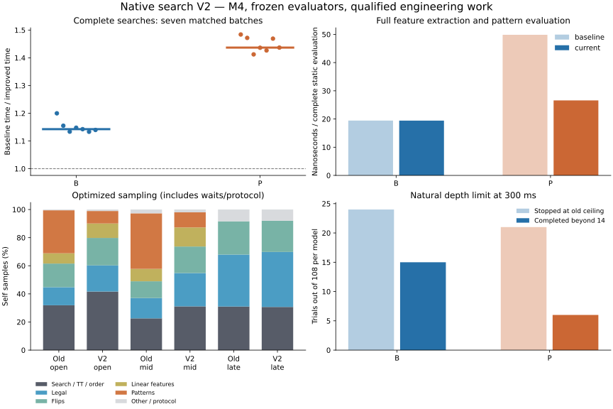
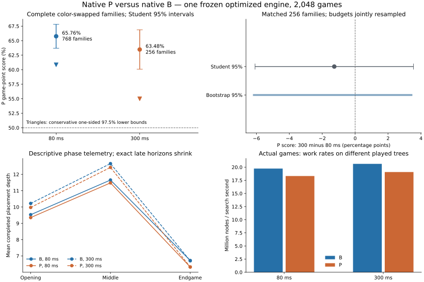

# Native search V2: engineering results and registered P versus B comparison

The qualified engine completes the disclosed fixed-search batch **1.14× faster
for B and 1.44× faster for P** than the previous native production engine.
A separately rotated nine-repetition history measures 1.18× and 1.47×.
The depth-14 timed ceiling is removed: controlled 300 ms trials complete depth
15, including exact solutions that the capped search cannot certify.
**All 2,048 games are complete. Native P scores 65.76% at 80 ms and 63.48% at
300 ms against native B.** Paired Student, bootstrap and conservative bounded
criteria favor P at both controls. However, one played board matches an old
direct development query, and 48 historical keys retain unresolved roles: the
stronger independent-confirmation claim is restricted. All games remain in the
analysis. B remains production; no B/L/P coefficient or old result changed.

[Prospective scientific contract](NATIVE_SEARCH_V2_PROTOCOL.md) ·
[complete compact engineering evidence](data/native-v2-engineering-20261030.json) ·
[evidence reproduction](data/native-v2-engineering-20261030.mjs) ·
[pre-play registration](data/native-v2-registration-20261030.json) ·
[full paired results](data/native-v2-results-20261030.json) ·
[every legal game and per-move metric](data/native-v2-games-20261030.json).



## Retained changes

1. Ordinary native timed requests use the number of empty squares as their
   iterative placement-depth limit. Deadline interruption returns the last
   completed iteration; an exact result stops early. Passes retain placement
   depth, and terminal checks still precede horizon evaluation. Explicit fixed
   depths 1–64 and qualification windows 0–64 preserve their specified horizons;
   a fixed search may also have an independent diagnostic node budget. Protocol
   version 1 is retained; timed depth 0 requests the natural limit. Omitting
   depth in Node/Python timed calls and ordinary native playing selects it.
   JavaScript/browser search is unchanged. TT placement depth is now unsigned
   with explicit 0–64 validation; 64 is the board's natural maximum, not another
   arbitrary timed ceiling. Recursion has at most 64 placements with intervening
   passes and no heap allocation per node. Already terminal boards need only
   terminal detection, regardless of their requested fixed horizon.
2. Depth-zero nodes bypass hashing and TT probes. They still generate legal
   moves, distinguish forced pass from double-pass termination, and count actual
   static evaluations and heuristic horizons. They never stored useful entries.
   The full fixed trees, scores, evaluations, hits and bound cutoffs are unchanged.
3. Pattern occupancy is gathered into a three-by-three corner region or an edge
   byte. Small constexpr integer contribution tables encode ternary weights;
   file bytes use masked unsigned multiplication. The 16 geometry tables total
   at most 12 KiB before compiler merging. These are integer geometry tables,
   not changed evaluation weights. All original Float32 cells, phase boundaries,
   color coding, normalization, symmetry order and ordered double summation
   remain exact. No incremental state or evaluator redesign was introduced.
4. Added cheap TT stores/rejected-stores and first-move-cutoff counters. All
   score reuse still requires full board/turn identity, same placement horizon
   and current generation. Requested TT capacity remains 16 MiB, allocating
   262,144 forty-byte entries, exactly 10 MiB. No replacement policy was tuned.

Parallel-prefix directional fills and branchless propagated flips passed the
reference checks but failed to produce a worthwhile overall gain. They were
reverted. The simpler original directional rule kernels remain. Reproducible
patches for every tried variant are under `scripts/native-v2/variants/`; the
history runner rebuilds them from commit b05e903 without altering that commit.

## Correctness and integration qualification

All **160 JavaScript tests and 38 Python tests pass**. Fifteen native regression
groups pass ASan/UBSan. The broad qualification checks 2,007 legally replayed
positions, **12,042 static queries**, **96,720 independent legal children**,
96 fixed-depth JavaScript comparisons, and twelve independently solved endgames.
Observed maximum feature, B/L/P static and minimax error is **zero**; the declared
cross-language regression tolerance remains absolute 1e-10.

New checks enumerate every occupancy of each of the 16 pattern geometries at
all phases: **174,960 complete ordered pattern-sum comparisons** against the
original digit-by-digit formulation. Additional arbitrary-board and long-ray
fixtures exercise all directions, masks, wraps and flipping lengths. Tests cover
fixed depths 15, 16 and 64; every legal alternative of independent exact fixtures;
zero-horizon forced passes; terminal empties; actual depth above 14; interrupted
iterations; independent fixed node budgets; model/horizon changes; one-slot TT
collisions; narrow/full bounds; generation rollover; cancellation and restart.
Existing bit-for-bit exports verify all 21,870 Float32 cells and 63 double weights.

A real coordinator exit after a durable move, fresh processes, independent replay
and corrupt-prefix rejection qualify the new B/P pipeline. Competitors have
separate processes/TTs within each game; both restart and receive symmetric
model-specific warmup before every game. No cross-game TT history is inherited.
Checkpoints fsync the file, rename it and fsync its directory. All full game and
per-move metrics are retained locally; source/model/build identities are checked.

Two earlier engineering test invocations failed while preparation code was still
being written, including a legacy frozen-source mismatch and two nested smoke
failures. The standalone legacy smoke then passed; the complete unchanged-source
suite subsequently passed all 38 tests. Test-only restart probes now use 5 ms,
so millisecond deadline quantization does not make a 1 ms probe unreliable.
No scientific game or old result was changed. Legacy Python launcher tests retain
their known nonfatal subprocess ResourceWarnings and expected argument-rejection
messages. Native macOS ARM64 execution is tested; no new Intel, WSL2 or native
Windows execution is claimed. The dependency-free browser implementation and
its UI regressions pass; this work does not add browser/Wasm acceleration.

Frozen models are B `original-production`, L
`ecf3fd376c680ced77d0b002ea2efb9fa4385737c4fffff734b901ab2968d97f`, and P
`de4b84745589b0384ea3639f879e3c98990e802d176298ff8ef54f681520067f`.
The qualified production executable SHA-256 is
`0a0e1f0d92e5a6540a2c533eb673930f80d94b5385deaae5c19843ca61efc720`;
previous-engine production SHA-256 is
`57292de408d2b2cd34babe176af01a495b4e514001102c054c2f306292912451`.
Complete source/header/build fingerprints, compiler and flags are in the evidence.

## Complete-search benchmarks

M4 iMac, 24 GiB, Apple Clang 21.0.0, optimized C++17 with contraction and fast-math
disabled. Thirty-six fixed disclosed roots cover opening, middle, 12–20-empty
late positions, forced pass and terminal empties. Both models use fixed depth
8 in opening, 7 in middle and min(10, empties) in the endgame. Seven rotated
repetitions alternate implementation order; hints are disabled so previous
requests cannot change tree size. All 504 matched searches have identical
scores, nodes and evaluation counts. CPU and interface times accompany every row.

| Complete batch / metric | Previous B | V2 B | Previous P | V2 P |
| --- | ---: | ---: | ---: | ---: |
| Median search ms | 75.705 | 66.331 | 165.990 | 115.030 |
| Seven-batch min–max ms | 74.573–79.612 | 65.786–66.603 | 162.456–174.527 | 113.867–118.585 |
| Nodes per batch | 1,230,233 | 1,230,233 | 2,027,718 | 2,027,718 |
| Static evaluations per batch | 841,839 | 841,839 | 1,438,599 | 1,438,599 |
| Search million nodes/s | 16.25 | 18.55 | 12.22 | 17.63 |
| Complete static evaluation ns | 19.44 | 19.43 | 49.84 | 26.59 |
| Static million evaluations/s | 51.44 | 51.47 | 20.06 | 37.61 |
| TT probes per batch | 1,230,233 | 385,040 | 2,027,718 | 585,424 |
| TT bound hits / cutoffs | 43,196 / 37,614 | same | 67,658 / 56,267 | same |
| Alpha-beta cutoffs | 242,249 | same | 376,542 | same |

Median elapsed reductions are **12.4% B / 30.7% P**, corresponding to the
1.14×/1.44× throughput increases. Static times include all features and legal
mobility, averaged over position medians. They are repeated-position microbenchmarks, not whole-game rates.
V2 B stores/rejects 339,954/5,280 entries; P 513,737/13,362. Replacement counts
are 275,534 and 429,383. First-move cutoffs are 180,520/242,249 for B and
236,937/376,542 for P. No new inference about playing strength follows from them.
Median warmed empty round trip is **13.50 μs previous / 12.92 μs V2**. Per-request
startup, CPU, observed transport and deadline data are published. Tiny solved
queries remain dominated by the boundary; ordinary 80/300 ms searches amortize it.

A second nine-repetition rotation tests all intermediate sources under identical
production flags. Median batch ms:

| Variant | B | P | Decision |
| --- | ---: | ---: | --- |
| Previous engine | 77.269 | 165.346 | Reference |
| Skip depth-zero TT | 64.880 | 146.692 | Retained |
| Plus geometry tables | 64.500 | 110.794 | Retained |
| Plus parallel legal fills | 64.240 | 111.811 | Reverted: no useful overall gain |
| Plus propagated flips | 66.596 | 113.987 | Reverted |
| Final, including extra counters | 65.459 | 112.673 | Frozen |

P's static cost is now about 1.37× B in this panel, versus 2.56× before.
Different evaluators still generate different trees, so this does not predict the
winner. Small B differences between pattern/no-pattern code are layout/noise,
not mathematical work saved for B. Early candidate screens used a frame-pointer
baseline; their raw local evidence remains, but the tables above use matched
production flags. No gain is attributed to profiling instrumentation.

## Quantitative CPU profiles

Four-second macOS sampling captures roughly 3,350–3,440 self samples per workload.
Opening/middle are complete P searches; endgame repeatedly solves the same
12-empty root, reducing the IPC dominance of the earlier six-empty microquery.
The optimized sample build adds symbols/frame pointers; final throughput above
uses separate uninstrumented production builds.

| Work / self sample share | Old opening | V2 opening | Old middle | V2 middle | Old exact endgame | V2 exact endgame |
| --- | ---: | ---: | ---: | ---: | ---: | ---: |
| Search / TT / ordering combined | 31.9% | 41.7% | 22.6% | 31.1% | 31.0% | 30.7% |
| Legal moves | 12.8% | 18.6% | 14.5% | 23.7% | 36.9% | 39.1% |
| Flips | 16.8% | 19.5% | 11.9% | 18.9% | 23.7% | 22.2% |
| Linear features and evaluator wrapper | 7.3% | 10.3% | 8.8% | 13.6% | ~0 | ~0 |
| Patterns | 30.6% | 8.9% | 39.5% | 10.7% | ~0 | ~0 |
| Other / protocol / waits | 0.6% | 1.1% | 2.7% | 2.0% | 8.4% | 8.0% |

Fractions are workload-dependent self samples, include waits, and are **not**
additive CPU-cycle guarantees. A growing legal/search fraction after removing
pattern work does not show a slowdown there. Separate exclusive instrumentation
splits legal, flips, seven features, patterns, TT and ordering, with call counts
and nanoseconds retained. It substantially perturbs this fast core and is used
for attribution only. TT's share of instrumented spans falls from 18.9% to 13.2%
in opening and 16.8% to 9.9% in middle; these percentages must not be substituted
for production speedups. Uninstrumented sampling cannot cleanly separate inlined
hashing, alpha-beta and ordering. Pattern spans combine integer extraction,
lookup and accumulation; their finer split is unresolved. Those resolution
limits are explicit.

An eight-second Instruments `CPU Counters` recording succeeded. Its local trace,
status and log are retained. No unsupported raw cache-miss or allocation-rate
numbers are inferred from the guided counters. The recursive core still allocates
no heap memory; parsing and result formatting allocate outside search.

## Removing the ceiling: controlled effects

Three repetitions, both models, both budgets and all 36 roots yield 432 matched
conditions, each measured with old code capped at 14, new code capped at 14 and
new code using the natural maximum. Every variant starts a fresh process and
identical disclosed depth-three warmup, avoiding inherited ordering histories.

| Model / budget | Trials stopped by old-style V2 cap, unsolved | Natural search completed above 14 | Newly exact among cap-stopped trials |
| --- | ---: | ---: | ---: |
| B / 80 | 3 / 108 | 0 | 0 |
| P / 80 | 3 / 108 | 0 | 0 |
| B / 300 | 24 / 108 | 15 | 6 |
| P / 300 | 21 / 108 | 6 | 6 |

Maximum completed depth is 15 in this panel. All above-14 results add one placement;
remaining time does not always suffice to complete another iteration. At 300 ms,
mean depths old/V2-capped/V2-natural are B **10.630/10.648/10.796**, P
**10.333/10.361/10.417**. At 80 ms they are B **9.889/9.935/9.926** and P
**9.583/9.750/9.750**; millisecond quantization and scheduling produce small
marginal differences. Late depth averages include solved positions with few
empties and cannot be treated as pure strength measurements. Independent fixed
endgames and explicit deep-horizon regressions qualify the depth semantics.
A prior warm-history timing pilot remains local and is not mixed into this panel.
Actual-game depths and their distinct interpretation are reported below.

## Complete native P versus native B results

The full fixed schedule uses 768 color-swapped families at 80 ms, with the
predetermined cycle-modulo-three 256-family subset also played at 300 ms.
The 80 ms comparison is primary; 300 ms is separate durability. The same frozen
executable, one search thread, elapsed deadline, natural depth limit, ordering
and 16 MiB TT ceiling serve both players. Separate B/P processes persist within
a game; both restart and receive symmetric warmup before every game. There is
no shared TT or cross-game history, no competing scientific worker, no model
selection from scores, and no optimization after play began.

| Budget | Families / games | P W–D–L | P points | Paired Student 95% | Whole-family bootstrap 95% | Hoeffding 97.5% lower | Mean P disc margin |
| --- | ---: | --- | ---: | --- | --- | ---: | ---: |
| 80 ms | 768 / 1,536 | 979–62–495 | **65.76%** | 63.70–67.81% | 63.70–67.81% | **60.85%** | +7.268 |
| 300 ms | 256 / 512 | 313–24–175 | **63.48%** | 60.09–66.87% | 60.16–66.89% | **54.99%** | +6.209 |

One-sided Student p-values are **2.8803e-45** and **6.6591e-14**; Bonferroni
adjusted values are 5.7607e-45 and 1.3318e-13. Both one-sided 97.5% Student
lower bounds exceed .5, as do both bootstrap lower endpoints and both conservative
bounded-score lower bounds. The positive survival integral avoids rounded-CDF
cancellation. Family score variances are **.084337 / .075885**. Paired disc-margin
95% intervals are **+6.474 to +8.063 / +4.995 to +7.423**. Alternative registered
bootstrap seeds give 80 ms intervals 63.67–67.81% and 63.67–67.74%; 300 ms
60.06–66.89% and 60.06–66.80%. No extra superiority hypotheses were introduced.

On the **same 256 families**, scores are 64.75% at 80 ms and 63.48% at 300 ms.
The 300-minus-80 difference is **−1.27 percentage points**, paired 95% interval
**−6.08 to +3.55 pp**, joint bootstrap **−6.15 to +3.42 pp**. This does not establish
an increase or decrease in P's advantage with thinking time. Differencing the
two full-sample means as independent observations would ignore their shared
families and different sample composition.



These are conventional and distribution-free numerical conclusions conditional
on their sampling assumptions. Student intervals are approximate; bootstrap is
sensitivity analysis. Hoeffding assumes independent bounded family scores and
stable conditions. Historical/mutual ancestry exclusions condition admission,
and OS timing is not deterministic. Moves, color-swapped games and shared-budget
families are not additional independent samples. Numerical verification does
not clear a failed provenance restriction.

## Search depth, work, cost and strategic diagnostics

| Budget / player | Moves | Mean / median depth | Nodes | Static evaluations | Million nodes/s | Mean / median observed ms | Exact moves | Above depth 14 |
| --- | ---: | --- | ---: | ---: | ---: | --- | ---: | ---: |
| 80 / B | 38,867 | 9.911 / 10 | 44,130,151,241 | 27,250,864,360 | 19.737 | 57.602 / 79.403 | 11,439 | 2,108 |
| 80 / P | 39,987 | 9.595 / 10 | 41,183,653,003 | 25,796,041,549 | 18.320 | 56.292 / 79.377 | 12,387 | 1,757 |
| 300 / B | 12,924 | 10.581 / 11 | 55,921,398,364 | 34,905,143,567 | 20.636 | 209.775 / 299.368 | 4,103 | 1,258 |
| 300 / P | 13,235 | 10.226 / 10 | 52,031,127,069 | 32,913,190,434 | 19.077 | 206.162 / 299.373 | 4,339 | 1,108 |

**6,231 of 105,013 played searches (5.93%) complete beyond depth 14.** Maximum
completed depths are B/P **19/20 at 80 ms** and **20/20 at 300 ms**: up to six
additional placements are observed. These are actual-game opportunities beyond
the old limit, not a matched estimate of how every old capped game would unfold.
The fixed-root capped/uncapped panel above provides the cleaner counterfactual.
Do not attribute the playing-score advantage specifically to removing the cap;
this experiment compares both evaluators using the same completed engineering work.

| Budget / phase | B mean depth | P mean depth | B / P million nodes/s | B / P exact moves |
| --- | ---: | ---: | --- | --- |
| 80 / opening | 9.529 | 9.353 | 19.340 / 17.892 | 0 / 0 |
| 80 / middle | 11.653 | 11.478 | 20.023 / 18.623 | 2,817 / 2,677 |
| 80 / endgame | 6.723 | 6.323 | 22.326 / 22.425 | 8,622 / 9,710 |
| 300 / opening | 10.220 | 9.973 | 20.049 / 18.484 | 0 / 0 |
| 300 / middle | 12.659 | 12.425 | 21.087 / 19.528 | 1,208 / 1,149 |
| 300 / endgame | 6.705 | 6.329 | 22.137 / 22.085 | 2,895 / 3,190 |

Every endgame-phase search is exact in these games. Early solving already begins
in middle game. Different played paths and remaining empties explain much of
the late mean-depth difference; it is not evidence that a lower late depth is
weaker. B searches modestly deeper and completes more nodes per second in
opening/middle, yet P earns more points at both budgets. Thus the *whole frozen P
evaluator's* positional knowledge outweighs its extra evaluation cost on this
panel. This does not isolate patterns from L's learned linear corrections,
attribute a particular move to an immediate feature, or establish a causal
phase-specific strength effect. No equal-depth playing tournament was added.

TT bound hits/probes are 8.74% B / 8.51% P at 80 ms and 7.58% / 7.59% at 300 ms;
93.7–96.4% of those bound hits cut off search. Complete stores, rejected stores,
collisions, replacements and first-move cutoffs are in the public telemetry.
Leaf-probe removal changes the denominator, so old/new raw hit percentages are
not directly comparable. Frequent replacement/rejection at 300 ms supports
investigating TT layout/locality next; it is not evidence of incorrect bounds.

Policy means at 80 ms are P **63.48% B1/12% / 68.03% B4/2%**, and at 300 ms
**63.09% / 63.87%**. Occupied-12/13 means are **65.63% / 65.89%** at 80 ms and
**61.72% / 65.23%** at 300 ms. Actual-turn and all 16-cell summaries are published.
These are descriptive subdivisions with no registered subgroup superiority tests;
they do not establish sharp class/phase differences. The overall advantage
persists at the longer control, but the matched uncertainty does not establish
that deeper search changes its magnitude.

There are **zero depth-zero fallbacks or incomplete games**. The only observed
>1 ms overrun is one B move at 80 ms, **1.203 ms**; P's maximum there is .575 ms.
At 300 ms the maxima are .161 ms B / .197 ms P. There are no >5 ms overruns.
Normal interrupted iterations number 27,428/27,600 at 80 ms B/P and 8,821/8,896 at
300 ms; only completed iteration values are published. Solved moves finish early.

## Registration, provenance and the independence limitation

Engineering/results checkpoint **5a74f47** was committed and pushed before play,
followed by complete registration and independent admission audit **3636006**.
Registration checksum is
`5d107dccbae7b7687371ac47073685d13f498b0637ce254001795bc466c7c95e`.
All 768 families, 2,048 conditions, source/build identities, statistical tests,
bootstrap seeds, warmup, capacity, natural limit and stopping rules were frozen.
Source admission used 4,219 ascending attempts, with 3,451 pre-outcome rejections.
Separate Python independently replayed 48,542 source-state occurrences and checked
89,419 distinct both-turn keys against every verified index digest. Previous
confirmation games are exclusions, not reused observations.

The [outcome-blind role audit](data/native-v2-provenance-20261030.json) scanned
33,724,618 historical occurrence rows and found 152 played overlap occurrences
representing 80 historical keys. The new declared source families and their
admitted ancestry are disjoint under the verified available indices. Actual
played native P/B paths can subsequently depart from the generated B1/B4 source
trajectories, so source admission does not guarantee every later board is novel.

**One 18-disc played board has two conservative turn keys matching a verified
old direct development query.** Game 1444, family 156, step 6 reaches parent 1 of
`residual-frontier-v1r2-20261028/frontiers/development-50.json`. The
[focused proof](data/native-v2-overlap-proof-20261030.json) verifies the old archived
frontier against its previously registered hash, validates both D10/D12 label
receipts and independently replays the new path. This is a direct old
**development/selection-panel** encounter, not merely an unrelated internal node
or terminal convergence. It is not proof of gradient-training reuse, but it
restricts the stronger independent-confirmation claim under the user's contract.

Another 48 keys retain unresolved historical-role restrictions; 16 are classified
as incidental played/ancestral/internal convergence and 14 as terminal convergence.
All role evidence and new locations remain public. No known previously proved
older gradient-training target was encountered. Cross-family played convergence
has 24 both-turn occurrences, all terminal at occupied 64; no nonterminal new
cross-family convergence was found. Earlier prefixes below occupied 12 remain
shared by design. Finite indices cannot certify novelty of every unreturned
historical internal search node.

No family, game, move or unfavorable result was removed, replaced or rerun.
The prospective source-family claim remains supported, while broader direct-state
novelty is restricted. This does **not** retroactively clear the old confirmation's
failed provenance gate. The strongest conclusion is substantial native-P playing
advantage on the complete registered panel, conditional on sampling and provenance
limitations; it is not an unrestricted independent production-confirmation claim.

## Verification repair, runtime and resources

All frozen source/snapshot/executable/model identities remain unchanged after
play. Independent Python replay verifies all 2,048 games, their outcomes, complete
family pairing, covariance, Student tails, bounds, registered bootstrap seed
sensitivities and **105,013 individual move records**. The same audit passes
against the compact public evidence. A supplementary read-only qualification
solves disclosed 15- and 16-empty roots independently, checking **every legal
alternative** for B/L/P, and directly verifies that every TT entry clears at
artificial generation rollover. The two independent solves take about .30 and
1.47 seconds; this supplement does not change the engine or scored settings.

The first Python result audit stopped because its modulo-32-bit RNG port differs
from the registered JavaScript generator after roughly 4.9 million draws.
`seededRandom` uses `a += constant` in a JavaScript binary64 Number; beyond 2^53,
rounding changes low state bits. The 768-family bootstrap consumes 7.68 million
draws. The registered JavaScript outputs were preserved exactly. An
[analysis-only verifier wrapper](data/native-v2-verification-repair-20261030.py)
permits one exact in-memory replacement of the Python RNG and reproduces the
actual frozen binary64 accumulation. It verifies source/snapshot hashes and
checks real JavaScript output before and after the precision threshold through
7.68 million draws. Every interval and sensitivity then reproduces exactly.
No bootstrap draws, statistical source, search, model, game or protocol changed.
The [repair certificate](data/native-v2-verification-repair-20261030.json) and
original failure remain preserved. Future fresh studies should use explicitly
bounded RNG state; that correction was not applied retrospectively here.

An extra post-run rollover-test compilation initially used the executable-only
snapshot directory as its header include path. The reporting-only probe was
corrected to the verified generated-header directory and passed. No production
binary or original source was modified. Both failure logs and completed reference
measurements remain local.

Eight disclosed native B/P cost games measured maximum complete times of
3.495 seconds at 80 ms and 11.499 seconds at 300 ms. The final full-work forecast
was **446.71 minutes**, including all possible remaining placements, twice high-tail
checkpoint overhead, warmup, 30-minute audit allowance, **35% contingency** and
a **separate 20-minute reporting reserve**, against 480 minutes. No sample reduction
or extension was needed. Actual serial games took **184.24 minutes**; through
blind audit and original analysis the cumulative recorded measurement work was
about **199.1 minutes**, before final reporting/verification. Total charged work
through final publication preflight is **211.27 minutes (3.52 hours)**, including
**12.21 minutes** of final verification/reporting within the protected 20-minute
reserve. The [execution audit](data/native-v2-execution-20261030.json) retains
every stage and subtracts separately metered probes inside that reporting window
to avoid double counting. The ceiling was a maximum, not a target.

Across **326** tournament resource samples, physical headroom stayed above
**7.55 GiB**, swap use stayed .38 MiB, and swap-in/out deltas were **zero**. Sampled
coordinator RSS peaked at **85.4 MiB**. Between-game resource samples intentionally
run with no active search; they do not measure native peak RSS. Native sampling
profiles report **11.3M** process footprint in `sample` output, consistent with
the 10 MiB TT.
Scored native search CPU totals **165.34 minutes**; that excludes coordinator,
protocol, warmup and reporting CPU. Full search CPU/elapsed and interface metrics
are retained rather than conflated. Local artifacts were about **404 MiB** after
play, excluding the read-only historical corpus. No sustained swapping, competing
scientific search, saved OS setting change or scored-game crash occurred. Bounded
caffeinate ended when the runner exited.

## Decision and next evidence

1. **Speed:** matched complete searches improve about 14% B / 44% P; the separate
   production history gives 18% / 47%. Static P evaluation is about 1.88× faster.
2. **Depth:** controlled roots add a completed placement beyond 14; actual games
   reach 20, six above the old ceiling, with 6,231 above-14 moves retained.
3. **Useful engineering:** leaf TT removal and integer geometry tables help;
   broad propagated rule kernels do not justify retention.
4. **Playing strength:** native P outperforms native B on this full registered
   panel at both controls despite B's modest depth/work-rate advantage. All
   registered numerical inference methods agree. The direct development overlap
   and unresolved roles restrict the stronger independence claim.
5. **Thinking time:** P's advantage persists at 300 ms; the common-family contrast
   does not establish a change in advantage. Neither moves nor shared families
   are pooled as independent observations.
6. **Next performance work:** prioritize a modest TT layout/locality experiment,
   followed by targeted endgame rule specializations, with fresh qualification
   and a separately registered comparison if strength is to be claimed.

P warrants a **separate production-promotion review**, not automatic promotion.
That review must address the prospective independence contract and direct old
development encounter, test broader opening distributions and independent
opponents, and qualify the intended runtime/browser integration and coaching
model coherence. This study alone supplies neither a human rating nor Windows/
Intel/browser native-strength acceptance. More training and another tournament
were not automatically started. B remains the production default.

## Ranked remaining opportunities

These are estimates from measured bottlenecks, **not promised speedups**.

| Priority | Evidence and possible work | Potential complete-search gain | Complexity / correctness risk |
| --- | --- | --- | --- |
| 1 | Search/TT/order is 31–42% of V2 opening/middle samples. Test a compact bucket layout and replacement/locality policy, keeping full identity and exact horizon rules. | Approximately 3–15%; pruning changes may matter more than NPS | Medium; bound/generation/collision risk requires full requalification |
| 2 | Legal/flips together are about 38–43% early/middle and 61% in exact endgames. Investigate well-targeted final-empty specializations; the broad propagation trials here did not help. | Approximately 0–10% early, potentially 5–20% exact workloads | Medium; edge masks, terminal empties and passes are principal risks |
| 3 | Cheap ordering or principal-variation search could reduce visited nodes; present static corner ordering leaves many non-first cutoffs. | Unmeasured and tree-dependent, plausibly 0–20% | Medium/high; window re-search and exactness must preserve minimax |
| 4 | Patterns now occupy only 9–11% of sampled early/middle work. Further grouped/incremental gathers have less headroom. | Likely 0–5% overall | Medium; update cost and summation/index correctness can erase benefit |
| 5 | Linear feature math/wrapper is 10–14%, with mobility counted separately. Reuse mobility where callers truly already know it. | Roughly 1–4% | Low/medium; exact normalization and phase rules stay fixed |
| 6 | Empty round trips are ~13 μs; tiny exact queries show transport overhead. Batch research reference requests if a pipeline needs them. | Negligible timed-game gain; useful tiny-query throughput possible | Low for batching; no protocol expansion justified for ordinary play |
| Separate | Browser still uses JavaScript. Qualify a worker/Wasm ABI and matching mutable-model/coaching semantics separately. | Browser benefit unmeasured | Medium/high integration risk; native numbers are not Wasm measurements |

## Reproduction

Use a fresh ignored output directory for new measurements; never overwrite the
retained run or describe this disclosed panel as new independent evidence.

```bash
npm test
NATIVE_SANITIZE=1 node --test tests/native-search.test.mjs tests/native-v2.test.mjs
TMPDIR=/private/tmp python3 -m unittest discover -s tests -p 'test_*.py'
NATIVE_RUN=.local-research/native-v2-repeat node scripts/native-v2/history-benchmark.mjs
node docs/data/native-v2-engineering-20261030.mjs .local-research/native-v2-20261030
.local-research/frozen-player-screen-v1-20261029/plot-venv/bin/python \
  docs/data/native-v2-engineering-figure-20261030.py
git diff --check
```

The history runner reconstructs the previous source from Git, so the original
baseline binary is unnecessary. Primary matched benchmarking/timing additionally
requires the explicitly preserved baseline build receipt; profiling uses macOS
`sample` and optional Instruments. Normal build/play remains Python 3 plus a modern
browser, with Node 20+ for tests/research and C++17 only for the opt-in native core.

Final numerical/public verification and focused evidence commands:

```bash
python3 docs/data/native-v2-verification-repair-20261030.py check-only
python3 docs/data/native-v2-verification-repair-20261030.py final
python3 docs/data/native-v2-verification-repair-20261030.py public
node docs/data/native-v2-overlap-proof-20261030.mjs
node docs/data/native-v2-deep-verify-20261030.mjs
.local-research/frozen-player-screen-v1-20261029/plot-venv/bin/python \
  docs/data/native-v2-playing-figure-20261030.py
```

The public audit requires only committed evidence, Python and Node. Local receipt,
source-index and supplementary deep audits require the retained ignored directory.
Never rerun creation/admission/tournament commands over that completed directory.
The new report/figures and analysis-only verification emulation are publication
artifacts; every frozen scientific input remains byte-identical to registration.

Commits were made with `git commit -m "Qualify native search V2 and publish profiling and benchmark results"`
and `git commit -m "Register full native P versus B sample and independent admission audit"`,
each followed by `git push origin main`. Final publication uses
`git commit -m "Publish complete native P versus B results and verified provenance limits"`
and `git push origin main`; the exact final hash is reported in the completion reply.
