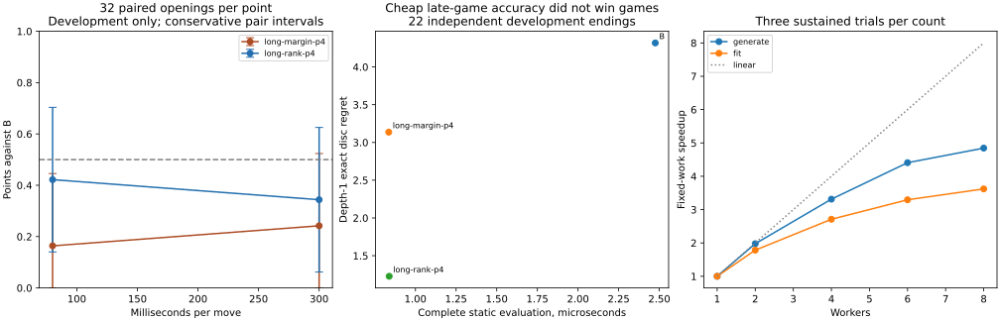

# Next evaluator round: measured results and disposition

**Keep B. The frozen long-pattern models did not justify a new training campaign.** The margin model lost badly; the preference model was substantially less weak but still scored below B at both time controls. Its faster static evaluation and better shallow late-game rankings did not translate into stronger play. The prepared [six-hour configuration](../configs/long-pattern-six-hours.json) is **inactive**, and no six-hour or 24–72-hour experiment was started.

The original completed campaign, source snapshot, all 14 best models, raw results and pre-extension backup remain local and unchanged. The publication audit checks the original published artifact/model SHA-256 values, independently replays all new games, and solves every alternative in all 22 new exact references. [Compact audited evidence](data/next-evaluator-20261028.json) contains paired scores, depth/work distributions, identities and engineering measurements. Full trajectories, models, CPU profiles and receipts remain Git-ignored.

## Frozen development protocol

Before games, the screen fixed **32 fresh opening pairs per model at each of 80 and 300 ms**, plus **eight pairs per model at depth four**, with a **45-minute active-time cap**. There are two candidates, hence 144 admitted pairs / 288 games. Openings are paired with colors reversed; first color and condition order alternate. The models are exact frozen copies of the previous campaign's best margin and preference checkpoints; neither was retrained before or during comparison.

Fresh seed: `2026102819`. Reserved eight-ply opening roots exclude D4/color-equivalent historical/disclosed roots. Complete previous-run trajectories and labeled alternatives are loaded for collision exclusion; the entire proposed pair is rejected on canonical trajectory collision without consulting its outcome. New development diagnostic trajectories and their reference alternatives are also excluded from the games. Six pairs were rejected and replaced using reserved backups. Timed games run serially in one worker, with no research fitting/data generation in parallel. Ordinary OS/user activity is not controlled by changing applications, affinity or saved settings.

This is **development screening**, not fresh final confirmation or a human-strength/Elo claim. The bounded quality sample admitted 22 of 64 proposed diagnostic trajectories: 966 positions, 22 independently solved eight-empty references, and 48 depth-five B-search estimates. Twenty-two exact positions offered multiple legal moves. The small sample and policy-dependent admission limit generalization.

Source SHA-256: `692a67b486ffc748b0471aeeacc5d00ab111fc6233ceefa71e6c847c04023dd6`.

- Margin model: `d46f45d3f713b3afb1010b7688678801e38f7e2164d428a730e1c681d837cccb`.
- Preference model: `7eddc49e68fed476e041790bc9090f0b44524851d4fe88f192c549cfb80eaaa3`.

## Equal-time and equal-depth play

Intervals below are conservative Hoeffding bounds on independent opening-pair means, with Bonferroni over the four timed model/control comparisons: radius `sqrt(log(160)/(2*n))`. Cross-condition dependence from shared roots does not invalidate the union bound. Depth-four rows are descriptive; their broad intervals are not a six-condition simultaneous claim. All targets finished; no outcome-dependent sample changes or extensions occurred.

| Candidate | Per-move budget | Pairs | W / D / L | Points | Interval | Median depth, candidate / B |
|---|---|---:|---:|---:|---:|---:|
| Long margin | 80 ms | 32 | 10 / 1 / 53 | 16.41% | 0–44.57% | 7 / 6 |
| Long margin | 300 ms | 32 | 14 / 3 / 47 | 24.22% | 0–52.38% | 8 / 8 |
| Long preferences | 80 ms | 32 | 25 / 4 / 35 | 42.19% | 14.03–70.35% | 7 / 7 |
| Long preferences | 300 ms | 32 | 21 / 2 / 41 | 34.38% | 6.21–62.54% | 8 / 8 |
| Long margin | Depth 4 | 8 | 3 / 0 / 13 | 18.75% | 0–75.07% | 4 / 4 |
| Long preferences | Depth 4 | 8 | 6 / 0 / 10 | 37.50% | 0–93.82% | 4 / 4 |

The margin model's 80-ms upper bound is below 50% even under the four-comparison adjustment. The other timed intervals include 50%; do not claim established inferiority for every model/control. Nevertheless, the actual scores, depth-four results and lack of a positive timed condition provide no reason to start another large long-pattern campaign automatically.

| Condition | Candidate static evaluations/s | B static evaluations/s |
|---|---:|---:|
| Margin, 80 ms | 228,527 | 195,208 |
| Margin, 300 ms | 220,058 | 183,842 |
| Preferences, 80 ms | 224,797 | 190,193 |
| Preferences, 300 ms | 219,181 | 184,324 |

Full node totals, histograms, elapsed times, fallback counts and deadline-overrun distributions are in the evidence. Different move ordering/pruning and visited positions contribute to those rates. Baseline search also supplies known mobility to its evaluator, so a threefold standalone-cost ratio cannot be applied directly to complete search. Most of the speed advantage disappears into rule scanning, TT keys, sorting and search overhead. An occasional extra completed ply did not rescue the margin model.

## Independent positional quality

| Model | Complete static µs | Exact regret, depth 1 | Exact pair accuracy, depth 1 | Exact regret, depth 3 | Earlier B-search pair accuracy, depth 1 |
|---|---:|---:|---:|---:|---:|
| B | 2.475 | 4.318 | 60.53% | 1.182 | 76.39% |
| Long margin | 0.836 | 3.136 | 72.93% | 1.636 | 67.08% |
| Long preferences | 0.839 | 1.227 | 78.20% | 1.364 | 74.04% |

Late shallow regret favors patterns, especially preferences. At depth three, B's regret is lower on this set. The margin model's earlier estimated rankings are worse in every one of the first three phase buckets; those labels share B's biases, so this is a diagnostic, not independent minimax truth. Preferences improve some top-choice approximate regrets without producing stronger full games. Better final-margin MSE or all-pair accuracy is insufficient to select a player.

The screen supplied no training calibration shards for B's regression-only phase gains. Its raw regression prediction was consequently zero-scaled. **B's prediction MSE is omitted from published comparisons**; games, static speed, search scores and move rankings all used the original B correctly. Future screen code supplies original training-only calibration paths. No new game results were generated to repair this unused diagnostic. Likewise, `ranking.byPhase` combines exact-disc and heuristic-search regrets; do not interpret that combined regret as a common-unit phase metric. Exact/search aggregate metrics above remain separate.



## Framework changes and measured benefits

- **Cost-aware screening:** retain a guarded quality/cost frontier, protect the fastest candidate, and preserve family representatives. Clear domination requires materially lower cost and no worse quality, with a meaningful quality/cost separation; tiny approximate-ranking differences cannot eliminate a fast family. Frontier, retained, played and unplayed IDs are audited. Frontier retention is not a strength claim, and not every retained model is automatically entered into a large tournament.
- **Decision-based checkpoints:** when development exact labels exist, fit/checkpoint selection uses top-move exact regret first, with regression MSE only as a tie criterion. The previous linear preference model was chosen in cycle one by MSE; this does not establish that later data were unhelpful. The revised rule requires fresh playing validation and may still overfit a small late-game development set.
- **Logging/profiling:** named task/model/batch/epoch events, 45-second heartbeats, new-versus-processed data, task age, resource use, durable-checkpoint time, and separate JSONL detail. Unknown ETAs remain unknown. The completed screen exposed an inherited-condition ETA label; the final implementation resets it and estimates only the active condition. The frozen screen log is preserved unchanged.
- **Checkpoints:** full histories move to immutable chunks/receipts; the manifest retains bounded scalar summaries. On the completed-size fixture, rewritten bytes fell 96.6%, serialization was about 39× faster and atomic writing about 28× faster. File/directory fsync and atomic rename remain. Crash/restart checks preserve accepted receipts and avoid double-counting.
- **Encoding reuse:** bounded worker-local raw features are reused while applying current counts afresh. The balanced six-trial fitting benchmark reduced elapsed fitting by about 22%, with exactly matching trained weights and counts. This is a measured local fitting gain, not a claim that the whole previous campaign becomes 22% faster.
- **Parallel independent work:** generation/label partitions now run concurrently; admission stays deterministic. Six workers gave roughly 4.4× generation and 3.3× independent-fit throughput versus one, with less memory than eight. Only two dependent model fits can run concurrently in the two-model configuration. Resource checks may cap the count below six.
- **Native prototype:** C++ matched complete search batches were about 2.75–2.95× faster including startup/loading/IPC at meaningful depths, with unchanged values and node counts in the matched kernels. Keep JavaScript as the reference and orchestration language; test a batched native backend before any engine rewrite.

See [PERFORMANCE_PROFILING.md](PERFORMANCE_PROFILING.md), [LANGUAGE_COMPARISON.md](LANGUAGE_COMPARISON.md), and [RESOURCE_SCALING.md](RESOURCE_SCALING.md) for workloads, limitations and reproduction commands.

## Runtime, useful work and the unused six-hour configuration

The screen's predeclared allowance was 45 minutes; actual monotonic active time was **34.73 minutes**, retaining **10.27 minutes / 22.8% of the allowance**. No separate point completion forecast was frozen; do not relabel a retrospective calculation as a prospective prediction. The first integrated scaling sweep was followed by a 227-second sustained sweep because its tiny tasks were too startup-sensitive. The corrected labeling sweep took another 162 seconds. Engineering tests, audits and profiling are separate from the 45-minute screen cap. UTC clock adjustments were observed on this WSL host; active duration is authoritative, not subtracting displayed timestamps.

**Zero percent of screen computation was training**, intentionally: the request required comparing frozen models first. No substantial training campaign followed the negative result. In the pre-cache sustained fitting benchmark, gradient arithmetic consumed about 6–7% of total fitting-process CPU; encoding and development scoring were much larger. This round reduced measured overhead, but does not claim that a new six-hour campaign has already achieved a high useful-training fraction. The original campaign's 103-minute fitting-category time remains distinct from pure optimization.

The prepared configuration limits itself to long margin/preferences, preserves old training/development roles, reserves fresh confirmation, uses three timing repetitions at each budget on distinct development openings, and budgets from the **slowest** observed pair costs. It reserves **35% confirmation overhead, three audit minutes and a final 15-minute safety margin**. Fixed confirmation targets are 64 pairs at 80 ms, 32 at 300 ms and eight descriptive 20-ms pairs, declared before any final outcomes. Infeasible targets cause refusal rather than an outcome-dependent extension. A successful current-source long-pattern smoke and fresh preflight are mandatory before a real launch. The smaller confirmation targets have wide uncertainty; moderate improvement could remain inconclusive.

The continuation gate required at least one frozen model to score at least 50% at **both** timed controls after completing the screen. Neither passed. The configuration is retained for review as an **inactive template**; there is no launch command to execute now. No experimental rule changed after independent confirmation—the round conducted no final confirmation at all.

## What to do next

B remains the strongest demonstrated choice. The previously confirmed linear preference evaluator remains the most credible learned alternative already tested at substantial sample size, but it also failed to beat B. Its historical 44.43% / 47.07% scores and this round's long-pattern scores come from different openings; they are not a direct statistical comparison between learned families.

The single most promising strength improvement is **better opening/middlegame move supervision on positions where B and the preference evaluator disagree**, validated by a small new paired game screen before scaling training. A cheap late-game regression advantage has now failed to predict full-game strength twice. Earlier data coverage, teacher accuracy, objective alignment and phase behavior need targeted diagnosis. Native search could make stronger reference labels affordable; adding more patterns or blindly extending training is not justified.

## Reproduce and inspect

```bash
python3 scripts/summarize-next-research.py \
  .local-research/next-frozen-screen-20261028 --check
node --test tests/*.test.mjs
python3 -m unittest discover -s tests -p 'test_*.py'
```

To run another bounded screen after making a deliberate new protocol/seed decision, use a **new** output directory and `python3 scripts/strong-launch.py --screen --output ...`; its default frozen-model source is the preserved completed campaign. The current script's seed is recorded in source: repeating it is reproducibility, not fresh confirmation. To inspect this completed run, read `results.json` or `launcher.log`; resuming a completed output starts no new games.

Actual WSL2 research, Windows resource interrogation, detached launch and temporary keep-awake were exercised. No browser-facing behavior changed. Current macOS Intel/Apple Silicon hardware and browser WebAssembly remain untested.
