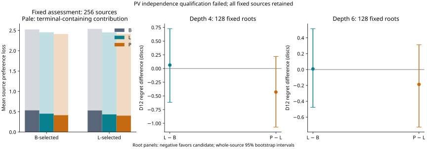
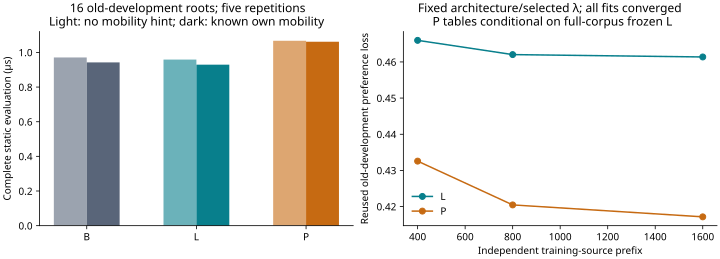
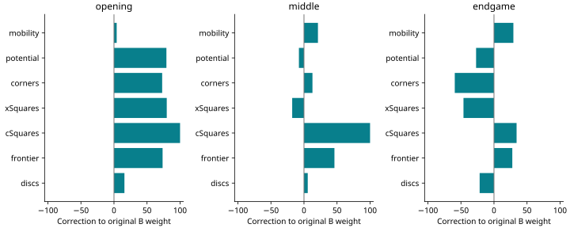

# Relaxed linear weights versus a compact pattern residual

**The expanded experiment stopped at its predefined positional gates. L did not qualify for games; no stronger equal-time player was demonstrated.** Production B, the original search engine and the completed residual experiment remain unchanged.

**The strict independence audit also failed:** newly revealed teacher PVs collided with historical boards in four reserved sources. All 256 sources and original gates are retained; there was no replacement or repaired confirmation. Numerical integrity passed, but this is not a successful fresh-independent confirmation.

[Frozen scientific protocol](NEXT_RESIDUAL_PROTOCOL.md) · [audited numerical evidence](data/next-residual-results-20261029.json) · [all fitted coefficients and support counts](data/next-residual-coefficients-20261029.json)

## What the constraint correction changed

The original λ=1e-4, ±25 fit reproduced its published training/development losses exactly. Relaxed L used λ=0 and ±100 with the same 21 coefficients, seven features, phases, temperature, source weighting and terminal utility. Old-development loss fell from 0.55419 for B to 0.46137: 16.75% improvement, compared with the old fit’s 1.80%. This confirms excessive shrinkage constrained the old development result. It does not retroactively improve the old independent experiment or show that regularization alone explains playing strength.

L’s maximum correction is 100.00; 2 coordinates hit ±100. This remains a bounded optimum, not the unrestricted seven-feature optimum. The compiled L calls the existing evaluator with corrected weights, adding no feature scan or favorable evaluator rewrite to the L-versus-B contrast.

P selected λpattern=0 by old-development loss among exactly 0, 1e-6 and 1e-5, starting every table fit at zero and freezing L. Its old-development improvement over L was 9.58%, with regret change -0.36375; it passed the old-development admission test. This reused evidence selected one challenger and supplies no fresh superiority claim.

| Model / λ | Training loss | Old development loss | Converged |
| --- | --- | --- | --- |
| B | 0.53487 | 0.55419 | — |
| Old λ=1e-4 / bound 25 | 0.52325 | 0.54423 | yes |
| L λ=0 / bound 100 | 0.43496 | 0.46137 | yes |
| P λ=0 | 0.33508 | 0.41716 | True |
| P λ=1e-06 | 0.40246 | 0.43524 | True |
| P λ=1e-05 | 0.42902 | 0.45634 | True |

The earlier old-development controls separate the measured path: λ=1e-4/±25 loss 0.544226 → λ=0/±25 loss 0.484996 → λ=0/±100 loss 0.461374. Removing shrinkage at the original bound accounts for 0.059230 of the 0.082852 additional loss reduction (about 71.5% along this path); wider bounds account for the remaining 0.023622. This is an ordered sensitivity decomposition on reused development data, not a unique attribution of playing-strength failure.

## Fixed assessment results and the failed independence qualification

The complete expanded design reserved 256 accepted full source trajectories, 128 transfer roots and 384 separate game openings jointly before the first fresh label. All 16 occupied-stratum/policy/source-depth cells and turn/parity marginals retain their fixed balance. The fallback was not selected. Each source has separately reconstructed B and L continuation frontiers; all models use the same external-teacher union labels. Parents/preferences are correlated within sources and are never counted as independent replicates.

| Selector | Sources / informative | Supported preferences | B loss | L loss | P loss | L gain over B | P gain over L |
| --- | --- | --- | --- | --- | --- | --- | --- |
| B | 256 / 249 | 6887 | 2.52495 | 2.45420 | 2.41278 | 2.80% | 1.69% |
| L | 256 / 247 | 6841 | 2.53757 | 2.45199 | 2.41740 | 3.37% | 1.41% |

Intervals below are absolute reference-minus-candidate preference-loss improvements from 10,000 complete-source stratified resamples shared across panels and contrasts. The one-sided 97.5% lower bound is the lower endpoint shown. Both panels must clear the ≥5% point-estimate and positive lower-bound gates. Intervals describe the fixed admitted sample and omit systematic teacher error; they cannot repair the failed PV-independence qualification.

| Selector | Contrast | Loss improvement | 95% interval |
| --- | --- | --- | --- |
| B | L-B | 0.07075 | 0.0362 to 0.1016 |
| B | P-B | 0.11217 | 0.0774 to 0.1451 |
| B | P-L | 0.04142 | 0.0223 to 0.0607 |
| L | L-B | 0.08559 | 0.0480 to 0.1224 |
| L | P-B | 0.12017 | 0.0852 to 0.1560 |
| L | P-L | 0.03459 | 0.0149 to 0.0547 |



| Search placements | Sources | B D12 regret | L D12 regret | P D12 regret | L−B (95% interval) | P−L (95% interval) |
| --- | --- | --- | --- | --- | --- | --- |
| 4 | 128 | 1.8750 | 1.9375 | 1.5078 | 0.0625 (-0.6172 to 0.7266) | -0.4297 (-1.0703 to 0.2188) |
| 6 | 128 | 1.6172 | 1.6250 | 1.4375 | 0.0078 (-0.4766 to 0.5156) | -0.1875 (-0.7266 to 0.3125) |

These are independently labeled root alternatives after actual full-window depth-four/six alpha-beta search. Regret is estimated Edax D12 discs, not B heuristic units. The depth-six gate uses mean regret; it is not a statistical noninferiority guarantee. Depth four is diagnostic. Immediate feature changes do not explain deeper minimax scores without continuation evidence.

### Why the frozen preference gate was dominated by terminal utility

A read-only post-outcome decomposition found that five supported terminal-containing preferences per selector panel in `assessment-174` favor a future +64 Edax win over an immediate terminal +62 awarded-empty win. Production gives that immediate win a fixed score of +10,054; the competing nonterminal child has B score about +144. Even granting every linear/pattern correction its maximum declared bound leaves the preferred-minus-other margin below −9,500. These preferences are impossible to satisfy within the permitted models while preserving production terminal utility. They were retained exactly as preregistered.

| Selector | B nonterminal contribution | B terminal contribution | L nonterminal contribution | P nonterminal contribution | Terminal share of B loss |
| --- | --- | --- | --- | --- | --- |
| B | 0.53465 | 1.99030 | 0.45324 | 0.41567 | 78.83% |
| L | 0.53116 | 2.00641 | 0.43483 | 0.40411 | 79.07% |

These are additive contributions using the original per-source pair masses and all retained sources, not a replacement objective or reduced sample. Nonterminal contributions improve by B-selector: L/B 15.23%, P/L 8.29%, L-selector: L/B 18.14%, P/L 7.06%. The terminal component contributes about 79% of baseline loss, diluting the full-loss relative gains. No gate was recomputed, no source removed and no model refitted. This exposes an objective/utility compatibility problem; it does not turn a failed gate into success.

Independently, L’s depth-six regret increased by 0.0078125 discs on the fixed sample, so it also missed the original mean-based root gate. Its confidence interval spans improvement and deterioration. P’s favorable root point estimates have intervals spanning zero too. Neither result demonstrates a stronger player.


| Candidate | Both preference panels pass | Depth-six mean gate | Independent | Eligible for games |
| --- | --- | --- | --- | --- |
| L | False | False | False | False |
| P | False | True | False | False |

### B-selected frontier diagnostics

| Model | Source-mean D12 top-choice regret | Nonpositive supported-preference mass |
| --- | --- | --- |
| B | 5.1035 | 25.72% |
| L | 4.3828 | 21.52% |
| P | 3.8164 | 19.38% |

| Child phase | Informative sources | B loss | L loss | P loss |
| --- | --- | --- | --- | --- |
| opening | 77 | 0.40602 | 0.35233 | 0.32325 |
| middle | 110 | 0.55645 | 0.48908 | 0.42505 |
| endgame | 62 | 8.64903 | 8.55109 | 8.53448 |

| Group | B loss | L loss | P loss |
| --- | --- | --- | --- |
| byPhase=0 | 0.40834 | 0.35988 | 0.33226 |
| byPhase=1 | 0.44683 | 0.40016 | 0.33574 |
| byPhase=2 | 0.65048 | 0.55096 | 0.48795 |
| byPhase=3 | 9.04496 | 8.95414 | 8.94540 |
| byPolicy=B1-12% | 0.52740 | 0.43657 | 0.40514 |
| byPolicy=B4-2% | 4.50652 | 4.45569 | 4.40436 |
| byDepth=4 | 4.46898 | 4.42867 | 4.38224 |
| byDepth=6 | 0.56525 | 0.46381 | 0.42745 |

| Contrast | Disagreements | Changes ≥4 D12 discs | D10/D12 reversals |
| --- | --- | --- | --- |
| L-B | 146 | 103 | 0 |
| P-B | 184 | 130 | 0 |
| P-L | 118 | 75 | 0 |

Exact-feature ties: 7 supported pairs; P distinguished 5 and gave the supported direction in 3. This narrow subset establishes extra information only where the aggregate seven-feature inputs are exactly identical; it cannot attribute all remaining loss to representation.

| Independent terminal convention | Parents | B W/D/L errors | L W/D/L errors | P W/D/L errors |
| --- | --- | --- | --- | --- |
| raw | 95 | 8 | 1 | 0 |
| awarded | 95 | 8 | 1 | 0 |

### L-selected frontier diagnostics

| Model | Source-mean D12 top-choice regret | Nonpositive supported-preference mass |
| --- | --- | --- |
| B | 5.1250 | 24.09% |
| L | 4.1328 | 21.05% |
| P | 3.8262 | 18.79% |

| Child phase | Informative sources | B loss | L loss | P loss |
| --- | --- | --- | --- | --- |
| opening | 77 | 0.40433 | 0.33981 | 0.28777 |
| middle | 110 | 0.50633 | 0.44709 | 0.39104 |
| endgame | 60 | 8.99918 | 8.83827 | 8.86541 |

| Group | B loss | L loss | P loss |
| --- | --- | --- | --- |
| byPhase=0 | 0.40601 | 0.33468 | 0.28334 |
| byPhase=1 | 0.42599 | 0.38233 | 0.31153 |
| byPhase=2 | 0.56527 | 0.49545 | 0.46085 |
| byPhase=3 | 9.44712 | 9.28130 | 9.30621 |
| byPolicy=B1-12% | 0.49652 | 0.41829 | 0.39046 |
| byPolicy=B4-2% | 4.49763 | 4.40498 | 4.36391 |
| byDepth=4 | 4.47685 | 4.42460 | 4.38085 |
| byDepth=6 | 0.55061 | 0.43087 | 0.40567 |

| Contrast | Disagreements | Changes ≥4 D12 discs | D10/D12 reversals |
| --- | --- | --- | --- |
| L-B | 143 | 100 | 0 |
| P-B | 178 | 124 | 0 |
| P-L | 101 | 63 | 0 |

Exact-feature ties: 9 supported pairs; P distinguished 8 and gave the supported direction in 7. This narrow subset establishes extra information only where the aggregate seven-feature inputs are exactly identical; it cannot attribute all remaining loss to representation.

| Independent terminal convention | Parents | B W/D/L errors | L W/D/L errors | P W/D/L errors |
| --- | --- | --- | --- | --- |
| raw | 98 | 8 | 3 | 2 |
| awarded | 98 | 8 | 3 | 2 |

| Root search / convention | Independent exact sources | B W/D/L errors | L W/D/L errors | P W/D/L errors |
| --- | --- | --- | --- | --- |
| 4 / raw | 7 | 0 | 0 | 0 |
| 4 / awarded | 7 | 0 | 0 | 0 |
| 6 / raw | 7 | 0 | 0 | 0 |
| 6 / awarded | 7 | 0 | 0 | 0 |

## Equal-time playing strength

L failed its frozen positional gate, so no confirmation games were played. The 256 pairs per primary control and 128 optional shadow pairs remain unused reservations. Their identities remain excluded from future fresh research. Neither evaluator demonstrated stronger equal-time play in this experiment. No extra games were added to obtain a favorable result.

## Evaluation cost and data scaling

| Evaluator | Static µs | Known-mobility µs | 16 depth-six roots ms | Nodes/s | Static calls/s |
| --- | --- | --- | --- | --- | --- |
| B | 0.971 | 0.942 | 901.9 | 197349 | 140966 |
| L | 0.959 | 0.929 | 919.5 | 201165 | 143062 |
| P | 1.067 | 1.062 | 1123.0 | 193717 | 139268 |
| Bzero | 1.067 | 1.046 | 919.3 | 193605 | 138291 |
| Lzero | 1.071 | 1.039 | 944.2 | 195895 | 139314 |

Five rotated-order repetitions on 16 old-development roots gave matched zero-pattern throughput ratios 98.59% against B and 96.77% against L, with exact moves/scores/nodes/calls. This passed the predefined ≥90% speed gate. Actual learned P static cost was 14.28% above L with known mobility and 11.32% without it. Learned-tree nodes/s and total search time also reflect different trees, not just evaluator overhead. These short repeated timings are engineering measurements, not confidence intervals or playing results.

| Development probe | Moves | Median completed depth | Nodes | Static calls | Mean move ms | Evaluator ms / total ms | >budget+1 ms |
| --- | --- | --- | --- | --- | --- | --- | --- |
| B / 80 ms | 32 | 6.5 | 621788 | 362908 | 75.84 | 544.9 / 2426.7 | 0 |
| B / 300 ms | 32 | 7.5 | 2078723 | 1195346 | 261.30 | 1795.2 / 8361.5 | 0 |
| L / 80 ms | 32 | 6.0 | 622146 | 364300 | 75.78 | 541.7 / 2425.0 | 0 |
| L / 300 ms | 32 | 7.5 | 2102329 | 1200404 | 261.89 | 1803.2 / 8380.6 | 0 |
| P / 80 ms | 32 | 6.0 | 617025 | 364360 | 75.93 | 582.5 / 2429.8 | 0 |
| P / 300 ms | 32 | 7.0 | 2060768 | 1182626 | 261.79 | 1905.9 / 8377.4 | 0 |

These 80/300-ms development probes stop background label/fitting workers and instrument each static call. They measure complete search/evaluator throughput, completed depth and deadline behavior, and are not game outcomes. Full depth histograms and per-position counters are in the evidence.



| Training-source prefix | L old-development loss | P old-development loss | L / P converged |
| --- | --- | --- | --- |
| 400 | 0.46597 | 0.43257 | True / True  |
| 800 | 0.46203 | 0.42046 | True / True  |
| 1600 | 0.46137 | 0.41716 | True / True  |

P prefix curves fit tables on each prefix with the same full-corpus frozen L. They describe incremental representation/data scaling conditional on L, rather than a completely prefix-trained pipeline. Training losses across changing prefixes are not pure learning curves.

From 800 to 1,600 sources, relative old-development improvement was 0.14% for L and 0.78% for P. Neither reached the predefined 1% threshold for recommending a larger same-objective training campaign, even if game evidence were favorable.

## Fitted weights, pattern specification and convergence

| Phase | Feature | Original B | Correction | L weight |
| --- | --- | --- | --- | --- |
| opening | mobility | 55.000 | 4.097537 | 59.097537 |
| opening | potential | 12.000 | 79.347203 | 91.347203 |
| opening | corners | 115.000 | 72.918296 | 187.918296 |
| opening | xSquares | 90.000 | 79.855783 | 169.855783 |
| opening | cSquares | 35.000 | 100.000000 | 135.000000 |
| opening | frontier | 20.000 | 73.564764 | 93.564764 |
| opening | discs | -20.000 | 15.810716 | -4.189284 |
| middle | mobility | 45.000 | 21.128322 | 66.128322 |
| middle | potential | 8.000 | -7.675115 | 0.324885 |
| middle | corners | 120.000 | 12.824744 | 132.824744 |
| middle | xSquares | 80.000 | -17.849245 | 62.150755 |
| middle | cSquares | 30.000 | 100.000000 | 130.000000 |
| middle | frontier | 12.000 | 46.081998 | 58.081998 |
| middle | discs | -8.000 | 5.693661 | -2.306339 |
| endgame | mobility | 12.000 | 29.351435 | 41.351435 |
| endgame | potential | 0.000 | -27.080053 | -27.080053 |
| endgame | corners | 120.000 | -59.339026 | 60.660974 |
| endgame | xSquares | 65.000 | -46.158041 | 18.841959 |
| endgame | cSquares | 15.000 | 34.200621 | 49.200621 |
| endgame | frontier | 0.000 | 27.731348 | 27.731348 |
| endgame | discs | 75.000 | -21.696545 | 53.303455 |



| Pattern | Ordered squares (A1=0) | Ternary entries / phase | Independent pairs / phase | Coefficient offset |
| --- | --- | --- | --- | --- |
| Corner six | 0,1,2,8,9,16 | 729 | 364 | 0 |
| Edge eight | 0,1,2,3,4,5,6,7 | 6561 | 3280 | 1092 |

Coefficient index is `offset + phaseIndex × independentPairsPerPhase + min(code, size−1−code)`, with phase order opening/middle/endgame. Below-center codes use the coefficient; above-center codes negate it; center codes are zero. `code = Σ(board[square]+1) × 3^j` in the stated square order. The runtime table divides each entry by eight.

P adds exactly the six-square corner and eight-square edge templates in the protocol, all eight D4 transforms, color antisymmetry, original three phases and 1/8 normalization. It freezes every L coefficient. The complete 10,932 independent coefficients, their phase/template coordinate specification and distinct-source support are linked above; reverse-color centers are zero. Compiled tables use 87,480 Float32 bytes; L uses Float64. No pattern family, bound, phase, temperature or fresh-data selection changed.

3152 of 10,932 independent pattern coordinates have informative training-source support. Old-development sparse pair differences contain 1259 unseen-coordinate occurrences of 57327 nonzeros. Counts reflect unique trajectories, never optimizer passes. Unobserved coefficients remain exactly zero. This pair-difference coverage metric does not measure all deployment board-cell visits.

| Selector coverage | Static nonterminal children | D4 table lookups | Structural centers | Unseen lookups | Source-mean unseen noncenter rate |
| --- | --- | --- | --- | --- | --- |
| B | 4062 | 64992 | 25028 | 2130 | 4.86% |
| L | 4021 | 64336 | 25502 | 1862 | 4.57% |

Coverage is a read-only deployment diagnostic using distinct old-training-source support. It counts all 16 raw D4 lookups per nonterminal child, including repeated geometries; self-complement centers are structural zeroes. Unseen visits can cancel under symmetry, so raw lookup coverage is distinct from the sparse pair-difference metric and from learned predictive value. No assessment observation is added to support counts or fitting.

| Fit | Iterations | Original-unit projected gradient |
| --- | --- | --- |
| linear-fit | 114 | 7.58e-09 |
| curve-L-400 | 93 | 9.99e-09 |
| curve-L-800 | 95 | 8.1e-09 |
| pattern-fit-0 | 66 | 9.72e-09 |
| pattern-fit-0.000001 | 10 | 6.78e-09 |
| pattern-fit-0.00001 | 4 | 7.1e-09 |
| curve-P-400 | 94 | 9.87e-09 |
| curve-P-800 | 88 | 5.79e-09 |

The audit independently recomputed all accepted fit losses/KKT residuals, sparse support and selected model identities. Zero corrections reproduce B; zero tables reproduce L; full-window and production searches, finite differences, sparse/compiled tolerance, symmetry, color transforms, passes, phase boundaries, terminal utilities and real crash/restart receipts passed regression checks.

## Resources, runtime, integrity and limitations

| Design forecast | Actual pool used in forecast | Hours including 35% allowance and separate reporting reserve |
| --- | --- | --- |
| expanded | 1 | 6.704 |
| fallback | 1 | 4.052 |

Chosen design: expanded. Actual accumulated pipeline time: **0.307 hours**. Engineering fit/encoding/curves: 7.89 seconds; integrated old-data pilot: 151.2 seconds; statistical analysis: 2.09 seconds. All eligible game costs were forecast before fresh outcomes, including the optional shadow. Reporting and final checks use the separately reserved time.

Configured workers: 2. The safe cap and actual pool differ; actual pools follow the timeline below. Fresh replay scaling qualified a conservative 1.881× two-worker label speedup. Minimum sampled Windows/WSL free memory: 1.832 / 5.622 GiB. Maximum sampled active WSL swapping: 0 pages/s. Peak event-reported Node process RSS (including worker threads): 798.3 MiB. Native peak: 57.2 MiB. The separate historical-index extension peaked at 743.7 MiB and took 31.6 seconds. Maximum sampled Windows paging reads/writes were 7 / 0 pages/s; these include host activity and are distinct from WSL swap counters. Total receipt-audited native CPU, including engineering queries: 1037.7 seconds. Final-manifest Node CPU excludes the preceding resource-paused process; it is not presented as total pipeline CPU.

| UTC | Previous pool | Actual pool | Safe cap | Windows-limited free GiB | Reason |
| --- | --- | --- | --- | --- | --- |
| 2026-10-29T02:25:20.589Z | 0 | 1 | 1 | 2.193 | Physical-memory reserve and measured throughput |
| 2026-10-29T02:29:43.324Z | 0 | 1 | 1 | 2.119 | Physical-memory reserve and measured throughput |
| 2026-10-29T02:32:18.053Z | 0 | 2 | 2 | 2.773 | Physical-memory reserve and measured throughput |

Independent 15-second occupancy samples: pool histogram `{'0': 4, '1': 12, '2': 59}`, active native-search histogram `{'0': 31, '1': 23, '2': 21}`. Slots can be idle between queries. Temporary one/two-worker engineering scaling pools are separately recorded; the scientific pool is drained during those benchmarks. These samples are occupancy counts, not CPU utilization. After completion the actual pool is zero. No applications were closed or saved settings changed; the bounded temporary keep-awake request was released.

The runner paused once during reservation, before fresh labels, because its extra 0.6-GiB dispatch calculation duplicated the preflight reserve for an already resident worker. A separately hashed scheduling-only execution repair kept the 1.5-GiB physical-free reserve, swap/CPU blockers and conservative two-worker admission, and added coordinator collection before measurement. It preserved all 34 accepted roots and completed receipts. The original snapshot, original repair draft and final narrow certificate remain archived; the validator rejects numerical/gate changes. No scientific input, sample, label, model or outcome was replaced.

The audit verified 5701 scientific and 286 engineering task receipts, the joint reservation checksum, teacher identity, continuation witnesses, model checksums, all source-level statistics and any complete game pairs. All **41,519 files / 1,719,627,293 bytes** inventoried in the previous completed experiment remain byte-identical. Original source `a719ad494fa7e10ac67aa4502c6a5c3c81e990211b2b552761b2bbc4522fcee5`; execution source `b2bcaaa6be15c4b3b7bcfd8acf7f4a3cdb1b4e34bcb0c37ac0e5f59de570bf97`; run `361277f1de3bd638fe29250a15e9fe6f54cf6fafac2a2f2db9c4cbf1a991b1c2`; reservation `72f95d130f9478f7cf99778c1d17e0bf9262a8e10a48811b8e1bd5254fec13c4`. First fresh label committed at 2026-10-29T02:34:22.186Z, after identities froze at 2026-10-29T02:34:21.844Z.

Forbidden PV collisions: 50 flagged occurrences / 18 canonical board/turn keys in sources assessment-99, assessment-108, assessment-174, assessment-236. The revealed collisions occur at occupied counts 22, 23, 53, 62, 63 and 64. The root/trajectory admission checks had passed; the later PV audit correctly blocked the independence claim. Retaining the complete sample avoids post-outcome selection, but cannot restore the planned independent-confirmation status.

New teacher-PV independence audit: FAILED; affected claims blocked, with 50 retained collision records. No post-outcome identity replacement was allowed. Complete local receipts, raw teacher transcripts, source snapshots and checkpoints stay ignored at `/home/rharris/git/reversi/.local-research/residual-constraint-pattern-screen-v1-20261029`.

WSL2 execution and real Windows memory/power measurements were made on this host. macOS Apple Silicon/Intel hardware was unavailable, so no Mac execution is claimed. Production browser interaction code did not change. The current Windows Chrome/156.0.8078.48 integration test passed from WSL2: rendered initial alternatives, verified continuation, playing-worker reply, and the real PowerShell default-browser launch route. Full interactive acceptance was not repeated. The application remains dependency-free Python/browser; this research adds no runtime package. Automated checks: 128 JavaScript tests and 30 Python tests; final exact commands and Git status are recorded in the completion response.

## Interpretation and one next direction

Relaxing shrinkage materially improved old-development fit, but the complete independent gates did not establish the requested transfer to a stronger searched player. The separate frontier panels, terminal-utility decomposition and root tables identify distinct problems; historical PV collisions additionally block the strict independent-confirmation claim. Neither a seven-feature expressive ceiling nor a universal failure of compact patterns follows. P’s additional terms may encode real geometry while also proxying corrections beyond L’s active bounds; B-generated source policies, teacher horizon uncertainty and preference-loss/minimax alignment remain plausible limitations.

**Recommend one next direction: utility-consistent root-choice preference learning with the same linear architecture.** First define targets/gates compatible with the preserved terminal win utility, then test whether improvements survive minimax and equal-time games. A future protocol must also resolve PV-exclusion failures prospectively; the current sample cannot be retroactively repaired. The present evidence does not justify a larger same-objective weight or pattern campaign. Do not start one automatically.

## Reproduce the audit and publication

```bash
node scripts/next-residual/audit.mjs '/home/rharris/git/reversi/.local-research/residual-constraint-pattern-screen-v1-20261029'
python3 scripts/next-residual/publish.py '/home/rharris/git/reversi/.local-research/residual-constraint-pattern-screen-v1-20261029' .
python3 scripts/next-residual/plots.py docs/data/next-residual-results-20261029.json docs
npm test
python3 -m unittest discover -s tests -p 'test_*.py'
git diff --check
```

Completed runs reject repetition. If an interrupted run needs the remaining original allowance, use `python3 scripts/next-residual/launch.py --resume --workers 2 --output <same-run-directory>`; this retains the frozen execution certificate, elapsed budget, models and receipts. No further resume is needed for this completed run.
