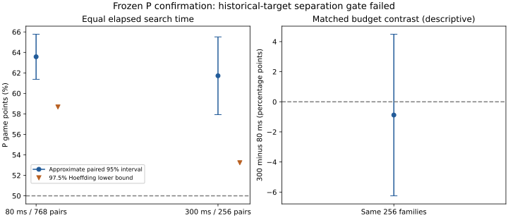

# Independent confirmation of frozen P

**P scored 63.57% at 80 ms and 61.72% at 300 ms. Both registered statistical gates, bootstrap sensitivities and Hoeffding lower bounds clear 50%. However, a verified historical direct-target overlap blocks the requested independent-confirmation claim.** P is promising but not convincingly confirmed under this contract. B remains production; no promotion occurred.

[Prospective protocol](P_CONFIRMATION_PROTOCOL.md) · [registration and frozen sample](data/p-confirmation-registration-20261029.json) · [compact numerical evidence and independent audit](data/p-confirmation-results-20261029.json). All 2,048 games completed, using 768 newly reserved families at 80 ms and the fixed nested 256 at 300 ms. Each statistical observation is a complete color-swapped pair.

| Budget | Pairs | W–D–L | P points | Effect above 50% | One-sided p | 97.5% t lower | Bootstrap 95% sensitivity | Hoeffding 97.5% lower | Mean disc margin |
| --- | ---: | --- | ---: | ---: | ---: | ---: | --- | ---: | ---: |
| 80 ms | 768 | 948–57–531 | 63.57% | +13.57 pp | 2.6387e-31 | 61.37% | 61.39 to 65.79% | 58.67% | +7.557 |
| 300 ms | 256 | 310–12–190 | 61.72% | +11.72 pp | 2.1573e-09 | 57.92% | 57.91 to 65.43% | 53.23% | +6.533 |

The predeclared 80 ms primary passes its one-sided α=.025 conventional test. The separate 300 ms durability test passes. Bonferroni protects simultaneous two-budget claims at familywise .05 despite the shared openings. Conventional two-budget evidence: **True**; bootstrap support at both: **True**; both conservative distribution-free bounds positive: **True**. These are statistical conclusions conditional on their sampling assumptions; the failed provenance gate prevents an unconditional independent-confirmation claim. The paired and conservative methods agree on the direction here. A favorable 300 ms result cannot rescue a failed primary.

On the same 256 families, the scores are 62.60% at 80 ms and 61.72% at 300 ms. Their 300-minus-80 difference is **-0.88 percentage points**, paired approximate 95% interval -6.25 to 4.49 pp; joint-family bootstrap sensitivity -6.15 to 4.39 pp. Both budgets remain together in each resample. This descriptive contrast does not treat the overlapping samples as independent.



The figure displays statistical uncertainty, not a passed provenance gate.

The original floating-point implementation returned a tiny negative 80 ms p-value (`-2.220446049250313e-16`) from subtraction of a CDF rounded slightly above one; the separate Python CDF calculation rounded it to zero. Neither is a valid precise tail probability. The table uses the **same prespecified Student test**, independently evaluated by positive survival-density quadrature: 2.6387263e-31 and 2.1573013e-09. Three grids and a known analytic reference were checked. Raw values remain in the original summary and the correction is explicit in the evidence supplement. No confidence bound, statistical gate or observation changed.

| Budget | Pair variance | Pair SD | SE | Standardized effect above .5 | Pair-mean disc-margin 95% interval |
| --- | ---: | ---: | ---: | ---: | --- |
| 80 ms | 0.096527 | 0.3107 | 0.01121 | 0.437 | 6.55 to 8.56 |
| 300 ms | 0.095037 | 0.3083 | 0.01927 | 0.380 | 4.77 to 8.29 |

Student inference is approximate, based on the reserved source-family units and disclosed synthetic null calibration; it is not a finite-sample universal theorem. Bootstrap uses 10,000 tested complete-family resamples and is a sensitivity analysis. Hoeffding assumes independent bounded [0,1] family scores and stable playing conditions. Admission conditions on historical and mutual trajectory exclusions, and serial timed searches experience OS variability; universal independence of every internal position is neither established nor required by the source-family claim. The conservative radii and any disagreement with conventional evidence are retained.

| Budget | Evaluator | Phase | Moves | Mean / median completed depth | Nodes | Evaluations | Search seconds | Incomplete iterations | Exact moves |
| --- | --- | --- | ---: | --- | ---: | ---: | ---: | ---: | ---: |
| 80 | B | opening | 11904 | 5.494 / 5.0 | 244145543 | 181721783 | 952.4 | 11904 | 0 |
| 80 | B | middle | 18408 | 6.969 / 7.0 | 513503261 | 317673173 | 1471.0 | 18331 | 71 |
| 80 | B | endgame | 8564 | 6.667 / 7.0 | 55197755 | 13778202 | 93.1 | 395 | 8169 |
| 80 | P | opening | 11904 | 5.400 / 5.0 | 238671623 | 180335169 | 952.4 | 11904 | 0 |
| 80 | P | middle | 18451 | 6.770 / 6.0 | 499666675 | 315850648 | 1475.2 | 18396 | 51 |
| 80 | P | endgame | 9789 | 6.195 / 6.0 | 64323948 | 18371339 | 112.8 | 601 | 9188 |
| 300 | B | opening | 3968 | 6.487 / 6.0 | 307461356 | 226067629 | 1190.4 | 3968 | 0 |
| 300 | B | middle | 6135 | 8.347 / 8.0 | 651282586 | 381429337 | 1811.2 | 5894 | 228 |
| 300 | B | endgame | 2896 | 6.692 / 7.0 | 24275057 | 5350146 | 40.2 | 4 | 2892 |
| 300 | P | opening | 3968 | 6.342 / 6.0 | 300382141 | 223695046 | 1190.4 | 3968 | 0 |
| 300 | P | middle | 6153 | 8.130 / 8.0 | 637772050 | 383174050 | 1824.8 | 5968 | 180 |
| 300 | P | endgame | 3231 | 6.340 / 6.0 | 30929088 | 7390526 | 52.1 | 10 | 3221 |

Fresh standalone complete evaluation with known own mobility costs median B 0.849 μs and P 0.949 μs (+11.75%). No per-leaf clocks were used during scored play. Tree shape and pruning also differ; evaluation cost alone is not a causal explanation of the game results.

| Budget | Player | >1 ms overruns | >5 ms | Maximum overrun | Depth-zero fallbacks | Incomplete iterations |
| --- | --- | ---: | ---: | ---: | ---: | ---: |
| 80 ms | B | 1 | 0 | 1.098 ms | 0 | 30630 |
| 80 ms | P | 0 | 0 | 0.905 ms | 0 | 30901 |
| 300 ms | B | 2 | 0 | 1.431 ms | 0 | 9866 |
| 300 ms | P | 0 | 0 | 0.803 ms | 0 | 9946 |

Ordinary incomplete iterative-deepening iterations are expected deadline telemetry. All depth histograms, fallbacks, >1 ms and >5 ms overruns and maxima are in the evidence. Move/phase observations describe search work, not independent strength samples. Exact late moves and shrinking remaining depth make late mean depths especially hard to compare.

| Opening factor | Category | 80 ms score / pairs | 300 ms score / pairs |
| --- | --- | --- | --- |
| policy | B1-12% | 64.26% / 384 | 64.06% / 128 |
| policy | B4-2% | 62.89% / 384 | 59.38% / 128 |
| occupied | 12 | 64.19% / 384 | 58.79% / 128 |
| occupied | 13 | 62.96% / 384 | 64.65% / 128 |
| turn | -1 | 64.19% / 384 | 63.87% / 128 |
| turn | 1 | 62.96% / 384 | 59.57% / 128 |

Both opening-policy means exceed 50% at both controls. The 16-cell score ranges are 51.56–71.35% at 80 ms (48 pairs/cell) and 51.56–78.13% at 300 ms (16 pairs/cell). These are descriptive subdivisions: cell differences and the weaker B4/2% 300 ms point estimate do not establish a systematic strategic weakness. No additional superiority tests or post-hoc sample removal were performed. No game positions were retrospectively labeled. Phase telemetry cannot establish a phase-specific strategic weakness or attribute minimax choices to immediate features.

Source admission excluded the verified 15,158,601-key historical index, engineering index and 316,430 additive keys covering the completed exploratory screen and new qualification. The fixed allocation used 3,771 ascending attempts with 3,003 pre-outcome rejections. No scored opening was replaced. The archived PC data and original screen remain read-only. Reused archive-preservation evidence is bound by checksum; a fresh complete 21 GiB rehash was deliberately not repeated.

The outcome-blind provenance audit replayed every game before score summaries, scanned 33,724,618 historical occurrence records, and found 65 prohibited/unresolved keys. Admission source/ancestry separation: **verified**. Full requested independent-confirmation claim: **blocked**. Complete classifications, occurrence paths, direct-state checks and exceptions are in the evidence. Played-path convergence across families: 8 nonterminal both-turn key occurrences; these are incidental convergence, not additional source samples. Shared admitted ancestry was forbidden. Terminal convergence is retained. A serious provenance failure blocks independent superiority irrespective of means.

The [focused raw-target audit](data/p-confirmation-historical-target-audit-20261030.json) verified **one distinct two-empty board under the declared symmetry identity, represented by two conservative turn keys**, reached by `games-337` in `game-395` at occupied 62. It is `states[42]` of accepted historical training game `train-22614-1035056215`, shard 2826, included in applied fit `cycle-36-fit-linear-margin-p4-2823`. The original archived learner samples even state indices, the fit receipt is complete, and final fit cursors pass the shard. This is actual direct-target use in an **older different evaluator experiment**, not just a rejected generator's intended training role. No intersection with the verified direct L/P training/development panels was found. The historical match does not show that P trained on this board or that it caused its advantage, but it violates the user's broader separation requirement.

The other 63 flagged identities retain their conservative restrictions or unresolved roles; they are not all established training leaks. They include historical sampled/ancestral positions, student-search internal observations, encoded exclusion-only keys, an unused reserved-opening child and engineering/PV locations. No favorable relabeling was used to clear the gate. All 65 original classifications remain published. The original audit and the focused proof were completed and committed before new score summaries were opened. No affected family was deleted or replaced, and no independence gate was weakened.

Four one-empty state identities (eight both-turn/pass occurrences) also converged across two pairs of independently admitted families. They are disclosed as late played-path convergence; sampled source ancestry was disjoint, and these convergences were not counted as additional observations.

Independent Python verification passed all 2048 games and 768 reservations, checking its own rules, symmetry keys, outcomes, source separation, paired variance, numerically integrated Student probabilities, bounds and separate resampling. Receipt/source checksums and immutable snapshots were verified. Real interruption/restart and tamper rejection succeeded during qualification; resumed scored prefixes, if any, are recorded in the event log. No original search/evaluation source changed.

The original post-game audit stopped on signed zero after all games had completed. A [separate verification wrapper](data/p-confirmation-audit-repair-20261030.mjs) allows exactly one expected-board normalization, tests both signs of zero and rejection of genuinely different discs, verifies every original frozen source/snapshot byte, and imports the patched audit in memory. The original `audit.mjs`, failure log, models, search, game receipts and statistical source remain unchanged. Its [certificate](data/p-confirmation-verification-repair-20261030.json) binds the exact repair. A first wrapper check used a flag as its output-directory argument and failed before reading scientific data; argument parsing was corrected before the wrapper was committed or run on the audit.

One earlier user-requested pause retained 12 completed games and a 29-step prefix. After unrestricted permissions became effective, the runner legally replayed that prefix and continued without replaying any completed search. Idle time during the explicit pause is excluded. Game 13's receipt `wallMs` covers its resumed segment; the complete move-search times and cumulative active budget retain work before the pause. The old pause error was preserved as an exception; no scientific subprocess remains running after completion.

The complete qualified forecast was 340.42 raw minutes ×1.35 plus a separate 20-minute reporting reserve = **479.57 minutes** against the eight-hour ceiling. Qualification took 1.17 minutes outside that allowance. Preparation plus games used 209.60 active minutes. Completion through independent audits used 210.51 minutes (about 3.51 hours), well below eight hours; the protected 20-minute reporting reserve remained available. Both the latest and earlier retained qualifications took about 1.17 minutes each, outside that allowance. Games were serial with zero competing scientific workers; fresh resource samples, memory/swap, disk and process evidence remain local. The new-artifact disk ceiling is 75 GiB. Temporary caffeinate changes no saved settings.

Across 197 logged samples, physical headroom stayed above 8.67 GiB, sampled swap activity stayed below 0.065 pages/s (no sustained pressure), and active Edax searches remained zero. New scientific artifacts were about 218.5 MiB at the last game sample, well below 75 GiB. All ordinary processes/settings were left intact. The complete conservative forecast included source admission, checkpoint/startup overhead, all possible placements, warmup and 25 minutes of audit/analysis before contingency.

The point estimates test whether P’s exploratory advantage reproduces on genuinely fresh openings under the registered distribution and exclusions. They do not establish universal strength, performance against other opponents, or broader openings. B is the sole opponent. The original generator uses a fully random prefix while occupied <12; for a 12-occupied start, B1/B4 policy affects the future source trajectory and exclusion conditioning, while a 13-occupied start includes only one post-12 policy placement. The policy labels do not denote long expert opening books. Board-color/actual-turn reversals are the declared symmetry balance, not extra independent replicas. Source selection, a fixed compact model, ordinary elapsed-time nondeterminism and this M4 runtime limit external validity. Intel macOS and Windows/WSL2 were not rerun in this experiment.

**Final decision: P is promising but not convincingly confirmed under the requested independence contract.** Its playing advantage clearly reproduces in the complete fresh admitted opening sample, and conventional, bootstrap and conservative numerical criteria agree. The strongest supported conclusion is favorable paired playing evidence against B on this distribution, conditional on inference assumptions; the failed historical-target separation blocks the stronger independent-confirmation claim. Statistical power is not the missing gate. This supports preserving P for scientific review, while withholding an independent production-promotion recommendation until the provenance contract and unresolved roles are reviewed. B remains production. No sample extension or new evaluator training was started.

Reproduce from the retained local run (read-only audits):

```bash
node docs/data/p-confirmation-audit-repair-20261030.mjs --check-only
python3 scripts/p-confirmation/verify.py
python3 scripts/p-confirmation/verify.py --evidence docs/data/p-confirmation-results-20261029.json
npm test
python3 docs/data/p-confirmation-final-evidence-20261030.py
git diff --check
```

Source and reservation hashes in the prospective registration bind the exact scientific inputs. Large historical corpora, task receipts, source snapshots and per-move checkpoints remain Git-ignored. Compact public games preserve complete legal move paths, final boards, outcomes, per-game telemetry and receipt digests. Full per-move search telemetry remains in the audited local receipts.

Final checks passed 143 JavaScript tests and 38 Python tests, plus the independent public-evidence replay/statistical audit and stable-tail numerical reference. Python launcher tests retain their known nonfatal subprocess ResourceWarnings. The original user-request ledger prefix is preserved. Rebuild the figure with the retained plotting environment (Matplotlib is an analysis-only dependency):

```bash
.local-research/frozen-player-screen-v1-20261029/plot-venv/bin/python3 docs/data/p-confirmation-figure-20261030.py
```

Original audit/summary receipts are immutable and include creation timing: do not rerun their creation commands over the completed directory. The check-only wrapper verifies the exact source repair without rewriting those outputs; the standalone Python audits replay all raw or compact public games and recompute the statistical evidence. Full forensic rescanning requires a separate scratch output rather than overwriting the recorded audit.
