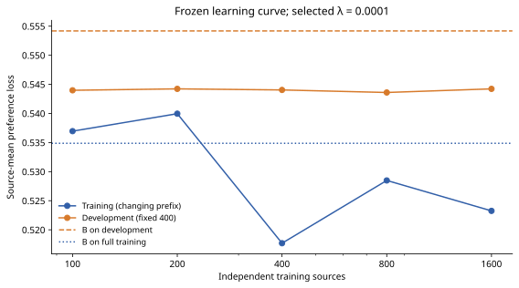
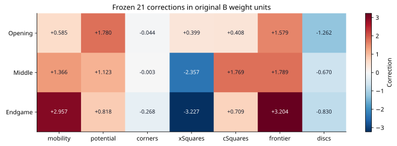
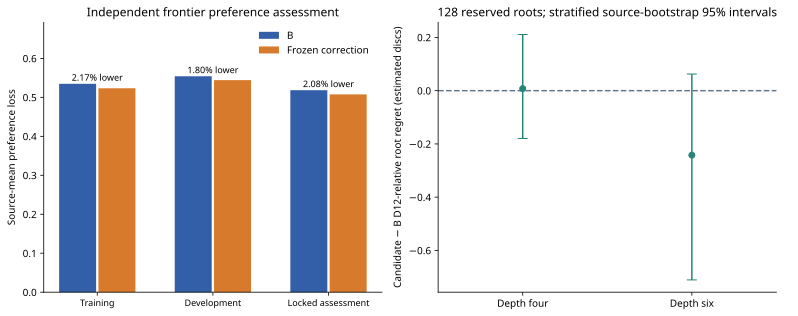

# Frozen residual-learning experiment: continuation and outcome

**Status: positional-gate-failed.** The predefined experiment is finished. The preference gate failed and the depth-six root-regret gate passed. Production evaluator B and production search remain unchanged.

[Audited final numerical evidence](data/residual-frontier-final-20261028.json) · [first-session report](RESIDUAL_FRONTIER_SESSION_ONE.md) · [unchanged protocol](RESIDUAL_FRONTIER_PROTOCOL.md)

## Scheduling authorization and preserved evidence

The user authorized a new session of at most eight active hours and raised the cumulative scientific ceiling from eight to ten active hours. This changes scheduling only. The original protocol file and source snapshot retain their original eight-hour value. The separately hashed scheduling certificate supplies the effective ten-hour guard; session and cumulative clocks are checked separately. The original three-hour session ledger is archived, not reset.

Original numerical source: `aee8f5f9f6c073771754ab589a34747390b6d2aeaf4e717ceca9d7bd09c08d1b`. Run identity: `601ea969f0a43fbbe5d0ac87e805e0fbb08a4fde976121ed2d7fe7753397bfe0`. Joint split digest: `c86d121af8f1209b9b58341dc5cc83fed296b46d0b82410518c5a0c98867c212`.

Previous execution source: `a9439fede8348add9ade5424a6bdb65f6955b8dfed25d4778e427c828dd168c5`; previous certificate: `6fa653d1026ef02566db0dea6f9841e96f5826a163b0a9f64e7da19d6233e5f6`. Ceiling-amended execution source: `b3afdf23efcd13578caddd33bc742954754e798ee807b654ca038fa2d9090030`; certificate: `80410458f1d9bee0d01844e5952860d5a1c0b382c8c995148729d93bdc71f836`.

Only these execution files changed relative to the preceding scheduling snapshot:

- `scripts/residual/diagnostics.mjs`: `f7ea5bf89feddf5c2743efb9347336b76e335036715fb3dcc87aa81b80d6bd62` → `611d3cc6bf074f41ccd17799a894a125b2263a1f2478566357310209f3d6f53a`.
- `scripts/residual/planning-source.mjs`: `edbf9171a9aed00ae0e03d96364131e8c76309a1a674943bedc34b4fb57354a3` → `c0c44eec5aa51e84e6b121a842979bf8f21ae203b7d20b7d69b4a0ed9da851f6`.
- `scripts/residual/run.mjs`: `a168ee9a9f85022ce2867ffe644ca00d32d320bd047683f9af1c2a773b42f1d2` → `962fb8e9c6e56fcfc8a41ae6de059ff7ef897076dff9dae86cfd032532385835`.

The installer and regression tests also changed in the repository, outside the frozen execution snapshot. The certificate verifies the complete source inventory and byte-identical non-forecast diagnostics, including statistical gates. No numerical, sampling, teacher, evaluator, optimizer, assessment or promotion rule changed. All **25,723** files inventoried before continuation, including all 1,600 training sources and their labels, retain their exact SHA-256 bytes. The final audit verified **23,445** task receipts, all reservations, continuation witnesses, teacher identities, model checksums and historical exclusions.

### Checkpoint serialization recovery

After all labels, transfer searches and 224 ablation searches completed, the assembled assessment exceeded V8’s single-string limit: it duplicated large static-board observation arrays inside its root and mismatch records. This was an engineering serialization failure, not an invalid teacher result. No incomplete computation was accepted.

The failed manifest and source snapshot remain archived. A separate operational certificate `bcdb3be00d9a194eb18aa8e55fa0f1bc1e4425a83555a2f94806fe45aab071b5` registers execution source `45a40b61745303188fe23dbae2bda6571c167b927074058dda4ff9d3c66321d4`. Relative to the ceiling-amended snapshot, only `run.mjs` and `planning-source.mjs` changed. The verifier accepts exactly the observation-reference replacement and rejects any further run-code change. Complete observed-board arrays remain in their original immutable search task receipts; the assessment retains every numerical result and references the corresponding receipt with its observation count.

Recovery reused all completed native queries and searches in the same run and same session allowance. All **30,979** files inventoried after the failure, including the finalist, fit results, learning curve, splits and every completed task, retain identical SHA-256 bytes. The candidate checksum remained unchanged. Bootstrap/report assembly was recomputed deterministically because its failed aggregate write was not a valid checkpoint. A further cross-check verified all 256 source/depth records against their original search receipts, teacher-relative regrets, frozen model and original gate function.

## Development selection and learned weights

All 400 predetermined development sources were labeled. Selection included zero-correction B and all three frozen regularizations. Selected λ: **0.0001**. Finalist checksum: `3191ae32e09f6c4ac90fdea5bc7e88a16271bf3c0caf0aa9123c0299f4080c52`. Temperature 10, correction bounds ±25 and the deterministic projected/backtracking optimizer are unchanged. No selection or tuning used locked data.

| Corpus | Sources | Preferences | B loss | Candidate loss | Relative improvement |
| --- | ---: | ---: | ---: | ---: | ---: |
| Training | 1600 (1576 informative) | 44790 | 0.534869 | 0.523254 | 2.17% |
| Development | 400 (393 informative) | 11278 | 0.554185 | 0.544226 | 1.80% |
| Locked assessment | 400 (393 informative) | 11473 | 0.518372 | 0.507607 | 2.08% |

Loss is averaged over informative independent source trajectories, each with unit total preference mass. Siblings and preferences are correlated and are not independent sample sizes.

| λ | Training preference loss | Development preference loss |
| --- | ---: | ---: |
| 0 (B control) | 0.534869 | 0.554185 |
| 0.0001 | 0.523254 | 0.544226 |
| 0.001 | 0.533510 | 0.553031 |
| 0.01 | 0.534731 | 0.554068 |

| Phase | Feature | Original B | Learned correction | Corrected weight |
| --- | --- | ---: | ---: | ---: |
| opening | mobility | 55 | 0.585160 | 55.585160 |
| opening | potential | 12 | 1.780056 | 13.780056 |
| opening | corners | 115 | -0.044214 | 114.955786 |
| opening | xSquares | 90 | 0.399092 | 90.399092 |
| opening | cSquares | 35 | 0.407507 | 35.407507 |
| opening | frontier | 20 | 1.579084 | 21.579084 |
| opening | discs | -20 | -1.261788 | -21.261788 |
| middle | mobility | 45 | 1.365593 | 46.365593 |
| middle | potential | 8 | 1.123392 | 9.123392 |
| middle | corners | 120 | -0.003234 | 119.996766 |
| middle | xSquares | 80 | -2.356538 | 77.643462 |
| middle | cSquares | 30 | 1.768646 | 31.768646 |
| middle | frontier | 12 | 1.789055 | 13.789055 |
| middle | discs | -8 | -0.670223 | -8.670223 |
| endgame | mobility | 12 | 2.956736 | 14.956736 |
| endgame | potential | 0 | 0.818057 | 0.818057 |
| endgame | corners | 120 | -0.268130 | 119.731870 |
| endgame | xSquares | 65 | -3.227119 | 61.772881 |
| endgame | cSquares | 15 | 0.709022 | 15.709022 |
| endgame | frontier | 0 | 3.203570 | 3.203570 |
| endgame | discs | 75 | -0.830045 | 74.169955 |





The learning curves use the single development-selected λ at the frozen source counts. They describe data scaling, not a further selection opportunity. Optimizer convergence and histories are in the compact evidence.

| Training sources | Training preference loss | Fixed development preference loss |
| --- | ---: | ---: |
| 100 | 0.536957 | 0.543981 |
| 200 | 0.539959 | 0.544227 |
| 400 | 0.517695 | 0.544041 |
| 800 | 0.528483 | 0.543604 |
| 1600 | 0.523254 | 0.544226 |

## Locked positional assessment and search transfer



Assessment used all 400 reserved sources and all 128 predetermined root-transfer positions at depths four and six. Relative held-out preference improvement: **2.08%**, against the fixed 5% minimum. Candidate-minus-B loss difference: -0.010765; source-stratified 95% bootstrap interval **-0.0127 to -0.0089**. These intervals condition on the admitted source distribution and exclude systematic teacher bias.

| Root search depth | Sources | B mean D12 regret | Candidate mean D12 regret | Candidate − B (95% interval) | Disagreements |
| --- | ---: | ---: | ---: | --- | ---: |
| 4 | 128 | 2.7344 | 2.7422 | 0.0078 (-0.1797 to 0.2109) | 6 |
| 6 | 128 | 2.2969 | 2.0547 | -0.2422 (-0.7109 to 0.0625) | 8 |

Both searched-root uncertainty intervals include zero. Depth four was slightly worse on the point estimate; depth six was better, with most of that gain in the 48–55 occupied source stratum. Passing the depth-six point-estimate gate is not evidence of a reliably improved searched player.

Immediate frontier mean D12-relative regret: B 4.6692, candidate 4.4486 estimated discs. Frontier disagreements: 36; significant changes: 25; D10/D12 reversals: 0. Immediate-frontier improvement with a worse searched root occurred in 0 depth/source cases. Better sibling preferences and better backed-up root decisions are separate outcomes.

Frontier candidate-minus-B regret has a source-stratified 95% interval of -0.3997 to -0.0677 estimated discs. Independent exact frontier checks cover 137 parents from 70 sources. W/D/L errors under raw scoring: B 6, candidate 7; under awarded-empty scoring: B 6, candidate 7. Exact-root results for both conventions are in the compact evidence. These exact subsets do not calibrate earlier Edax estimates as game-theoretic truth.

### Locked loss by child phase

| Group | B loss | Candidate loss | Relative improvement |
| --- | ---: | ---: | ---: |
| opening | 0.396960 | 0.391120 | 1.47% |
| middle | 0.504932 | 0.498734 | 1.23% |
| endgame | 0.686198 | 0.662144 | 3.51% |

### Locked loss by source policy

| Group | B loss | Candidate loss | Relative improvement |
| --- | ---: | ---: | ---: |
| B1-12% | 0.517405 | 0.505408 | 2.32% |
| B4-2% | 0.519324 | 0.509772 | 1.84% |

### Locked loss by source search depth

| Group | B loss | Candidate loss | Relative improvement |
| --- | ---: | ---: | ---: |
| 4 | 0.498309 | 0.487932 | 2.08% |
| 6 | 0.538744 | 0.527584 | 2.07% |

### Frozen feature diagnostics

Each row removes one feature’s corrections in all three phases without refitting. Positive loss damage means that removal worsens the frozen candidate. Root diagnostics use the predetermined every-fourth subset (32 roots) at depth six. These conditional ablations do not identify independently optimal feature weights.

| Removed correction | Loss damage when removed | Mean root regret change when removed |
| --- | ---: | ---: |
| mobility | 0.002335 | 0.0000 |
| potential | 0.001112 | 0.0000 |
| corners | 0.000036 | 0.0000 |
| xSquares | 0.002155 | 0.0000 |
| cSquares | 0.000666 | 0.0000 |
| frontier | 0.003551 | 0.0000 |
| discs | 0.000630 | 0.0000 |

Frontier-disc, mobility and X-square corrections provided the largest conditional preference-loss gains; corner-weight changes contributed very little. Removing any single correction worsened locked preference loss, but none of the seven feature removals changed teacher-relative regret on the 32-root diagnostic subset. This does not attribute the full-sample root improvement to a particular feature.

All 21 coefficient loss ablations, phase/policy/depth regret diagnostics, source-level root rows, exact-root conventions and frontier/root mismatch cases are included in the compact evidence or the immutable local assessment artifact.

## Equal-time playing strength

The predefined positional gates failed, so no confirmation games were played. Equal-time playing strength remains unmeasured for this candidate. The experiment stopped as specified; weights, samples and hyperparameters were not changed to rescue the result.

## Resource utilization and forecast versus actual

Preflight: Windows available 3.504 GiB; WSL available 6.169 GiB; no duplicate research process. Configured workers: **2**. The safe cap, actual pool and actively executing native-query counts are distinct. Independent 15-second samples record pool histogram `{"0":2,"1":46,"2":60}` and active-query histogram `{"0":30,"1":52,"2":26}`. A slot can be idle between queries; these are sampled occupancy counts, not CPU utilization. After stopping, actual pool and active native queries are zero.

During continuation, limiting available memory reached 1.344 GiB; maximum measured WSL swapping was 0 pages/second. Resource reductions and their times/reasons are in the complete worker timeline. No applications were closed and no saved settings changed. The existing bounded temporary Windows keep-awake mechanism was used. WSL2 execution was measured; macOS hardware was unavailable and no macOS test is claimed.

| UTC reduction time | Actual pool | Windows available GiB | Reason |
| --- | --- | ---: | --- |
| 2026-10-29T00:48:42.975Z | 2 → 1 | 2.605 | Available physical memory fell below the free-headroom reserve for the previous pool; two-worker reserve 2.7 GiB |
| 2026-10-29T01:02:08.768Z | 2 → 1 | 2.602 | Available physical memory fell below the free-headroom reserve for the previous pool; two-worker reserve 2.7 GiB |

Native queries peaked near 57 MiB each. Retained root-observation arrays drove the larger coordinator memory footprint and the serialization failure; the receipt-reference repair removed their duplication from the aggregate assessment. The low-headroom sample occurred during that diagnostic stage, with no active WSL swapping measured.

| Label stage | Completed sources | Stage seconds | Sustained sources/second |
| --- | ---: | ---: | ---: |
| development | 400 | 533.1 | 0.750 |
| assessment | 400 | 605.2 | 0.661 |

| Collection interval | Actual pool | Sources | Sustained sources/second |
| --- | ---: | ---: | ---: |
| development | 2 | 400 | 0.750 |
| assessment | 2 | 258 | 0.736 |
| assessment | 1 | 142 | 0.558 |

Rates for each constant-pool interval (excluding clean pauses) are retained in the compact evidence; throughput is never inferred from the safe cap. The earlier first-session training replay is receipt verification, not new scientific throughput.

Before continuation, the conservative full remaining forecast was 7.037 hours at one worker (8.602 cumulative), or 5.582 hours at two (7.147 cumulative). Both used complete training-task costs, cell maxima, measured parallel speedup capped by actual pool, at least 35% allowance, and a separate 20-minute reporting reserve. The forecast reserves games even though gate failure can eliminate them.

Actual charged pipeline time: **2.015 cumulative hours**, including **0.450 continuation hours**. Separate native Edax CPU: 4748.4 seconds; Node CPU including worker threads: 2115.7 seconds. Native and Node RSS high-water: 57.2 / 2058.6 MiB. Historical-builder CPU/RSS remains separately audited. Report generation and final checks occur within the separately reserved reporting time.

## Interpretation and next research direction

Independent Edax supervision changed the 21 weights and reduced training loss by 2.17%, development loss by 1.80%, and locked loss by 2.08%. The depth-six point-estimate no-deterioration gate passed. There is no evidence from confirmation games of stronger equal-time play.

Converged convex fits, training/development learning curves, coefficient bounds and the fixed ablations distinguish limited gain within this seven-feature, phase-fixed, regularized objective from optimizer instability. They do not prove that every possible use of seven features is inadequate. Residual teacher disagreement may reflect representational limits, frontier sampling, irreducible horizon instability or failure to transfer through minimax. Supported preferences already exclude D10/D12 ordering disagreements, but agreement is not proof of exact early-game truth.

The selected convex fit converged in 13 iterations, with maximum absolute correction 3.227 against the ±25 bound. Development loss was 0.543981 at 100 sources and 0.544226 at 1,600; more sources did not produce monotonic improvement. The flat curve and similar small training/held-out gains suggest that merely collecting more of this same supervision for these seven linear features is less promising than adding limited positional information. Regularization and the frontier distribution still constrain that inference.

The single most promising next direction is a separately preregistered compact corner/edge pattern residual, tested for independent positional gain and equal-time search cost. This experiment adds no such model and starts no new campaign.

## Reproduction and continuation

Run directory: `/home/rharris/git/reversi/.local-research/residual-frontier-v1r2-20261028`. Large data, raw teacher transcripts, models, optimizer histories, task receipts and checkpoints remain local and ignored. Original first-session numerical evidence and figures remain preserved.

```bash
node scripts/residual/audit.mjs .local-research/residual-frontier-v1r2-20261028
node scripts/residual/publish-continuation.mjs .local-research/residual-frontier-v1r2-20261028 .
python3 scripts/residual/plots-continuation.py .local-research/residual-frontier-v1r2-20261028 .
npm test
```

No further resume is required. The launcher rejects repeating a completed experiment.
