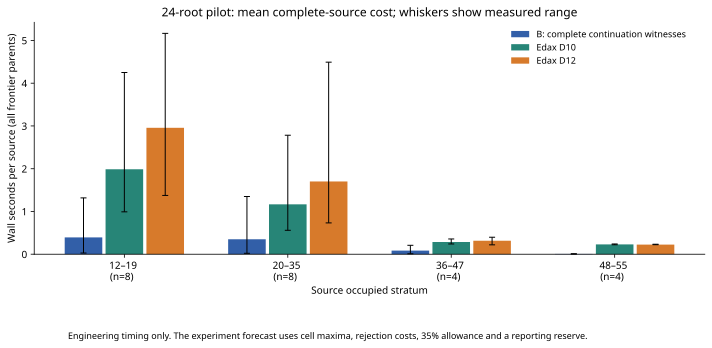
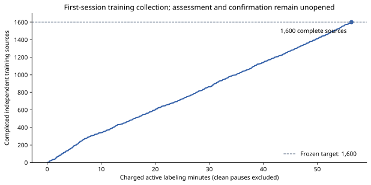
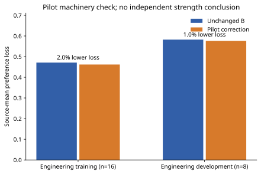

# B-preserving residual learning: first session

**Status: paused.** Full fixed experiment forecast exceeds scientific eight-hour ceiling at the actual pool size; no locked assessment opened. The full scientific experiment is unfinished. Production evaluator B, original weights, search, browser and coaching remain unchanged. This session makes no independent strength claim.

[Frozen implementation protocol](RESIDUAL_FRONTIER_PROTOCOL.md) · [compact audited numerical evidence](data/residual-frontier-v1-20261028.json)





## Implemented and verified

A separate 21-correction model, stable convex source-normalized preference fitter with analytical gradients and deterministic projected/backtracking optimization; fresh full-window continuation witnesses; independent legal child/phase/pass checks; qualified patched Edax D10/D12 all-alternative labels; independent raw/awarded exact checks on small frontiers; canonical historical and cross-role exclusions; frozen split identities; atomic task/optimizer/game checkpoints; bounded resumable sessions and detached keep-awake launch. Locked assessment and confirmation are barred in session one.

The integrated pilot passed on all 24 reserved engineering roots. Receipt audit: **18994** completed tasks verified. Worker recovery tests used actual SIGKILL and immutable-receipt reuse, with changed protocol/result rejection. Historical index contains 2950423 full canonical SHA-256 keys and occupies 90.040 MiB in compact binary form. The temporary historical rebuild high-water is reported separately from steady research RSS.

## Completed supervision

| Role | Source roots | Informative | Frontier parents | Supported preferences | D10/D12 queries | Alternative values |
| --- | ---: | ---: | ---: | ---: | ---: | ---: |
| pilot | 24 | 24 | 48 | 736 | 96 | 858 |
| training | 1600 | 1576 | 3164 | 44790 | 6328 | 51640 |

Scientific training has **1600/1,600** source roots labeled, covering **3164 frontier parents**, with **44790** supported sibling preferences. Development has 0/400 labeled. Locked queries: **0**. Confirmation pairs: **0**. No sample target was reduced. Alternative values count both horizons; preferences and correlated children are not independent sample sizes.

Joint split digest: `c86d121af8f1209b9b58341dc5cc83fed296b46d0b82410518c5a0c98867c212`. The audit checked 4848 continuation witnesses: 3 terminate early, 3 reach fixed terminal utility exactly at the frontier, and 4842 reach a static evaluation. There are 170 pass steps. 4841/4842 static endpoints were observed by the original B evaluator callback. The 1 unobserved static endpoint has independently verified continuation ties (1 checked), full-window backed-up scores and final static equality; it is not claimed as an original callback visit. Terminal endpoints are kept separate and never fitted as heuristic evaluations.

The visible training corpus contains 1109/1600 sources with at least one stable useful alternative to B's immediate frontier choice. Source-mean D12-relative frontier regret is 4.826 estimated discs. 593 frontier parents from 302 sources were independently solved under both terminal conventions. These describe the collected training signal; they do not measure learned corrections or root transfer.

| Child weight phase | Training sources | Frontier parents | B frontier D12 regret | Sources with useful correction |
| --- | ---: | ---: | ---: | ---: |
| opening | 470 | 934 | 3.640 | 331 |
| middle | 699 | 1383 | 5.076 | 480 |
| endgame | 431 | 847 | 5.712 | 298 |

In the independently solved subset, B's immediate frontier choice makes 54 exact W/D/L errors among 593 parents under both raw and awarded-empty conventions. Parents share 302 source trajectories. These are shallow frontier choices, **not** independently measured errors of B's depth-four/six root decisions. Policy and source-depth breakdowns are retained in the compact evidence.

## Pilot observations

Pilot training preference loss: B 0.471 → selected 0.462. Engineering development: 0.582 → 0.577. Selected λ: 0.0001. These small development observations validate machinery and are not the locked 5% gate. The pilot model is never substituted for the eventual scientific fit.

All three pilot optimizer fits converged in 0.154 combined seconds. With only 21 parameters, reference-label collection dominates fitting cost; repeated optimization after convergence would not add useful learning.



Pilot original weights, selected corrections and resulting weights (B score weight units):

| Phase | Feature | B | Correction | New |
| --- | --- | ---: | ---: | ---: |
| opening | mobility | 55 | -2.191 | 52.809 |
| opening | potential | 12 | -0.211 | 11.789 |
| opening | corners | 115 | 0.543 | 115.543 |
| opening | xSquares | 90 | 0.114 | 90.114 |
| opening | cSquares | 35 | 0.003 | 35.003 |
| opening | frontier | 20 | 1.341 | 21.341 |
| opening | discs | -20 | -1.768 | -21.768 |
| middle | mobility | 45 | 0.299 | 45.299 |
| middle | potential | 8 | 0.815 | 8.815 |
| middle | corners | 120 | 0.000 | 120.000 |
| middle | xSquares | 80 | 0.345 | 80.345 |
| middle | cSquares | 30 | 1.032 | 31.032 |
| middle | frontier | 12 | 1.607 | 13.607 |
| middle | discs | -8 | -1.335 | -9.335 |
| endgame | mobility | 12 | 4.792 | 16.792 |
| endgame | potential | 0 | 0.187 | 0.187 |
| endgame | corners | 120 | 0.000 | 120.000 |
| endgame | xSquares | 65 | 1.390 | 66.390 |
| endgame | cSquares | 15 | -0.024 | 14.976 |
| endgame | frontier | 0 | 1.242 | 1.242 |
| endgame | discs | 75 | -0.864 | 74.136 |

## Resources and useful computation

Recorded active pipeline time: **93.915 minutes**. Node process CPU: 1794.648 seconds; separate native Edax CPU: 3172.651 seconds. Node high-water RSS: 700.160 MiB; native per-query high-water: 57.156 MiB. Worker thread CPU overlaps Node totals and is not added twice. 6468 teacher queries produced 52914 alternative values, including distinct engineering repetitions.

The short-lived historical-index builder used 43.017 CPU seconds and peaked at 1351.141 MiB RSS; it exited before workers started. Its CPU is separate from the coordinator total. Earlier engineering-run computation remains preserved and charged in elapsed time; those old runs are not silently counted as fresh scientific data.

Latest Windows/WSL limiting available memory: 3.152 GiB. Measured pilot scaling and complete task costs are in the compact evidence. Unrelated applications and saved settings were left unchanged. Actual Windows 11 Home 10.0.26300 / Chrome 156.0.8078.48 passed WSL2 localhost loading, four analyzed moves, verified continuation, computer reply and default-browser launch. Current macOS hardware was unavailable.

### Safe cap versus actual pool

The manifest resource field `workers` is the current **safe cap**, not the configured or active worker count. The actual pool was reduced to one and stayed there even when later samples again permitted two or three. Automatic checks reduce concurrency; a checkpoint/resume can restore the previously benchmarked count. Active native queries can be fewer than pool slots. After the clean pause there are **zero active research workers**; one was the last configured pool size.

| UTC | Eastern | Actual pool | Safe/launch cap | Windows available GiB | Recorded reason |
| --- | --- | --- | ---: | ---: | --- |
| 22:27:24 | 18:27:24 | resume → 2 | 3 | — | Pool initialization takes the smaller of launch cap and the saved measured-worker limit |
| 22:36:17 | 18:36:17 | 2 → 1 | 1 | 2.693 | Available physical memory fell below the free-headroom reserve for the previous pool |
| 22:48:10 | 18:48:10 | resume → 2 | 3 | — | Pool initialization takes the smaller of launch cap and the saved measured-worker limit |
| 23:01:33 | 19:01:33 | 2 → 1 | 1 | 2.317 | Available physical memory fell below the free-headroom reserve for the previous pool |
| 23:23:12 | 19:23:12 | resume → 2 | 2 | — | Pool initialization takes the smaller of launch cap and the saved measured-worker limit |
| 23:24:24 | 19:24:24 | 2 → 1 | 1 | 2.601 | Available physical memory fell below the free-headroom reserve for the previous pool |

The reductions to one worker were triggered by Windows physical-memory headroom falling below **2.7 GiB**, the policy reserve of 1.5 GiB plus 0.6 GiB per worker for a two-worker pool. WSL still had substantially more available memory. These were reserve-policy decisions; the corresponding samples show no active WSL swapping and low CPU load. The threshold describes required free headroom, not measured worker consumption. My interim updates mistakenly read the safe cap as the actual pool; the table corrects that distinction using the original resource receipts and pool-adjustment events.

## Forecast and continuation

Conservative complete remaining computation forecast: **7.037 hours**, plus 1.565 hours already charged at that forecast. Includes 35% allowance and a separate 20-minute reporting reserve. Projected total: **8.602 hours** against the unchanged eight-hour scientific ceiling. Feasible under that test: **false**. This is distinct from the three-hour first-session allowance. Sparse pilot tails and future background load remain uncertainty; refresh the forecast from completed scientific costs before opening assessment.

Run directory: `/home/rharris/git/reversi/.local-research/residual-frontier-v1r2-20261028`. Source checksum: `aee8f5f9f6c073771754ab589a34747390b6d2aeaf4e717ceca9d7bd09c08d1b`. Run identity: `601ea969f0a43fbbe5d0ac87e805e0fbb08a4fde976121ed2d7fe7753397bfe0`. All large trajectories, raw labels, models and checkpoints stay local and ignored.

The collected data retain their original frozen numerical source and receipt identities. A separately registered scheduling-only repair uses execution source `a9439fede8348add9ade5424a6bdb65f6955b8dfed25d4778e427c828dd168c5`, certificate `6fa653d1026ef02566db0dea6f9841e96f5826a163b0a9f64e7da19d6233e5f6`. The original source remains intact. Four changed files implement actual-pool forecasting, bounded stale-heartbeat charging, scheduling lineage and stricter reentry guards; search, evaluation, sampling, preference filtering, optimizer, teacher and scientific gate code remain unchanged. The certificate verifies every other source file and all non-forecast diagnostics byte-for-byte. The verification dispatch reused completed receipts and issued no new teacher queries.

At one worker the conservative remaining forecast is **7.037 hours**, or **8.602 total**, exceeding eight hours. A realistic rounded alternative is **nine total computational hours**, requiring later explicit authorization; no extension was taken. With sustained two-worker capacity, the conditional forecast is **5.582 additional hours**, **7.147 total**. A later six-hour session could cover that case, subject to fresh preflight and the corrected actual-pool forecast. If capacity falls and the full plan cannot fit, the program pauses before opening locked results.

To resume within this same still-valid session allowance:

```bash
python3 scripts/residual/launch.py --output .local-research/residual-frontier-v1r2-20261028 --resume --mode session-one
```

After the user separately authorizes a later six-hour allowance and fresh resources support the feasible forecast:

```bash
python3 scripts/residual/launch.py --output .local-research/residual-frontier-v1r2-20261028 \
  --resume --new-session --session-hours 6 --mode continue --open-assessment
```

That command preserves scientific inputs and receipts, labels development, freezes the candidate, and proceeds to assessment and gated games only if the actual-pool forecast permits it. Omit `--open-assessment` to stop after candidate selection. The first session cannot use it. A one-worker continuation currently needs a separately authorized total-budget revision before locked assessment; this command does not raise the eight-hour ceiling. Do not change sample sizes.

Progress and a graceful pause:

```bash
tail -f .local-research/residual-frontier-v1r2-20261028/launcher.log
kill -TERM "$(python3 -c 'import json; print(json.load(open(".local-research/residual-frontier-v1r2-20261028/manifest.json"))["pid"])')"
```

## Scientific questions remain open

1. Independent supervision has exercised fitting; improvement to the final 21 weights is not established.
2. Depth-four/six transfer awaits the reserved independent root tests.
3. Equal-time superiority awaits both complete gated tournaments.
4. Pilot coefficient changes are descriptive; beneficial/harmful feature attribution awaits fixed ablations.
5. Additional-source learning awaits the frozen development learning curves.
6. Seven-feature expressive sufficiency cannot be inferred from engineering data.
7. Next step: continue this same frozen experiment from its receipts; do not launch a new architecture or campaign.

Any normal session pause is neither a scientifically failed experiment nor a completed one. Assessment gates, diagnostic comparisons and strength conclusions remain pending.
