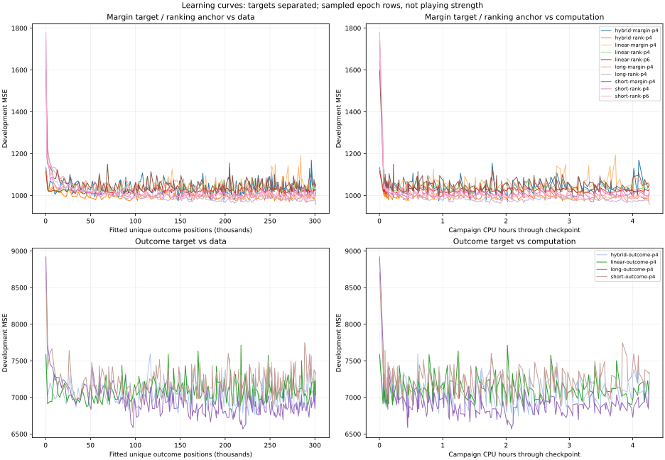
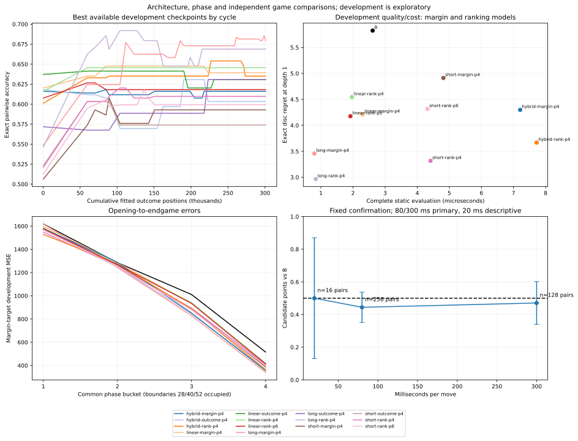

# Completed strong-evaluator campaign — 28 October 2026

**All planned tests finished. Keep B as production.** The frozen learned linear preference model scored **44.43% at 80 ms** and **47.07% at 300 ms** against B. Neither primary condition passed the declared promotion rule. Both simultaneous intervals include 50%, so this is also not a statistically established inferiority claim under that rule.

The major positive result is a useful training/data system and a promising **fast long-pattern family**, not a demonstrated stronger player. The next review should examine why that family was screened out of game tests before allocating another long training run. See [the review prompt](STRONG_EVALUATOR_REVIEW.md).

[Compact audited evidence](data/strong-evaluator-20261028.json) includes every condition's paired outcomes, uncertainty, work/depth summaries, all 14 candidate summaries, sampled learning curves, checkpoint hashes, phase diagnostics and independently checked examples. Complete models, trajectories, labels and logs remain local and Git-ignored.

## Completion, recovery and protocol

| Item | Result |
|---|---|
| Final state | `complete`, stage `done`, all 11 conditions complete |
| Final checkpoint | 2026-10-28 02:39:41 UTC, about 10:40 p.m. Eastern on 27 October |
| Active wall time | 6 h 16 min 50 s |
| Process CPU time | 6 h 14 min 18 s, including coordinator and worker threads |
| Allowance | Six hours, then an explicitly authorized 30-minute extension |
| Framework commit | `4f8c9da550546b48f51995a1199c0f30cb9bf42c` |
| Frozen source SHA-256 | `936872bf20d1aa1306943f818254ce730f06f94d6dfc4e963947c7906ed2ccc4` |
| Seed | `2026102807` |
| Platform | WSL2 on the user's Windows PC; Node v24.16.0 at launch |
| Configured workers | Two; timed games serial, other research workers terminated |
| Local artifacts | `.local-research/strong-six-hour-20261027/` |
| Failed tasks | Zero; one expected interrupted pair at the original time cap was retried |

The first session checkpointed at the six-hour limit. Before resumption, a durable backup and audit increased only the time allowance, from 360 to 390 active minutes. The original model, data, openings, completed pairs, statistical rule and fixed sample sizes were verified unchanged. The extension completed the original experiment; it did not restart training. The model and selection-freeze hashes still match the pre-extension record. Temporary keep-awake was released automatically at 02:40:46 UTC, and the writer lock is gone. No applications or saved system settings were changed.

Durations use monotonic counters. WSL wall-clock adjustments were observed, so subtracting displayed UTC timestamps is not a reliable active-duration measurement. The manifest's `stoppingReason` still contains the first session's timeout text; this is stale historical metadata. Its final status, stage and complete task counts establish completion. Do not resume this finished run.

## What was learned and how much computation was used

| Work | Completed |
|---|---:|
| Accepted training games | 13,754 |
| Distinct retained training positions | 600,885 |
| Distinct subsampled outcome positions fitted per model | 300,876 |
| Training exact labels at 8 / 10 / 12 empties | 7,289 / 2,865 / 1,252 |
| Deeper-search training labels | 26,595 |
| Development games / exact labels / search labels | 163 / 63 / 64 |
| Final quality games / exact labels / search labels | 19 / 19 / 32 |
| Candidates / learning cycles / fitting tasks | 14 / 50 / 6,132 |
| Recorded epoch rows | 25,532 |
| Position-epoch / preference-pair-epoch exposures | 27,819,685 / 6,360,797 |
| Selection plus confirmation opening pairs / games | 432 / 864 |
| Final confirmation pairs / games | 400 / 800 |
| Rejected generated trajectories, all roles | 13,176 of 27,112 attempts |

An exact label includes every legal alternative's solved margin, not merely one scalar target. Earlier search labels remain B estimates in B units and are used for preferences, not calibrated disc regression. Exact references were produced by independent mailbox rules/search and cross-checked with production search during generation. Forty bounded training exact solves were skipped; none were reported as solved.

| Category | Active wall minutes | Process CPU minutes | Wall share |
|---|---:|---:|---:|
| Calibration | 0.68 | 0.69 | 0.2% |
| Games and expensive labels | 150.98 | 139.32 | 40.1% |
| Fitting category | 102.96 | 109.86 | 27.3% |
| Development comparison | 4.11 | 4.11 | 1.1% |
| Selection games | 6.41 | 6.45 | 1.7% |
| Independent quality assessment | 0.44 | 0.39 | 0.1% |
| Final confirmation games | 108.45 | 111.08 | 28.8% |

These category wall times do not overlap. Remaining startup/report overhead accounts for the difference from total active time. The earlier campaign's near-total tournament allocation was avoided: substantial new data and repeated fitting occupied most of this run.

**The 103-minute fitting category is not 103 minutes of gradient arithmetic.** Summed worker fit spans total **18.87 minutes**, including encoding, updates and development prediction; those spans overlap between workers. Summed complete fitting-task wall times are **77.35 minutes**, also overlapping. Loading, packing, serialization, checkpointing and other coordinator work add further overhead. No pure optimizer CPU counter was recorded. This distinction is material: the final manifest and results JSON are each approximately **200 MB**, largely from repeated policy-stratified epoch metrics. Before scaling, profile these costs and move repeated history out of frequently rewritten checkpoints. Do not claim the entire category as useful optimization CPU.

The observed combined data/fitting/development throughput was about **140,000 retained positions per active learning hour**, far below the short pilot's optimistic extrapolation. At that rate an additional 100,000–1,000,000 positions would take roughly **0.7–7.2 learning wall hours**, before allowing for slower deeper teachers, larger indices or changed fitting schedules. These are throughput estimates, not promises of strength gains. The evidence favors a bounded screening/engineering round before a 24-hour commitment; 72 hours is not justified yet.

## Fixed independent playing confirmation

The finalist was `linear-rank-p4`, a four-phase seven-feature model trained with preference updates, outcome-margin anchoring and exact targets. It was frozen before confirmation. Every opening pair swaps candidate colors; game order alternates by pair. All counts below were fixed in advance and completed. The 30-minute extension changed no count or outcome-based stopping rule.

| Time per move | Pairs | Candidate W / D / L | Points | Reported interval |
|---|---:|---:|---:|---:|
| 20 ms, descriptive | 16 | 16 / 0 / 16 | 50.00% | 12.99–87.01% |
| 80 ms, primary | 256 | 217 / 21 / 274 | 44.43% | 35.18–53.68% |
| 300 ms, primary | 128 | 117 / 7 / 132 | 47.07% | 33.99–60.15% |

For each primary condition, the two-sided Hoeffding interval on independent opening-pair means has radius `sqrt(log(80)/(2*n))`, using Bonferroni over the two actual primary controls, family alpha .05. It covers neither hundreds of hypothetical models nor optional prefixes. The 20-ms row is descriptive. The promotion rule required lower bounds above 50% at both primary controls. It failed. Observed scores favor B at both primary budgets; wider bounds do not prove equal strength or inferiority. No human-strength or Elo claim is supported.

Seven 80-ms and five 300-ms pairs were rejected by the declared trajectory-collision filter and replaced from reserved backup roots, without using outcomes to make admission decisions. The population is therefore conditional on those exclusion rules. Development/selection results remain exploratory.

| Budget / side | Median completed depth | Nodes | Static evaluations | Evaluations/s |
|---|---:|---:|---:|---:|
| 80 ms, learned | 7 | 273,800,520 | 170,587,457 | 201,950 |
| 80 ms, B | 7 | 265,392,870 | 165,146,560 | 193,953 |
| 300 ms, learned | 8 | 479,193,517 | 294,909,813 | 193,683 |
| 300 ms, B | 8 | 463,616,296 | 283,251,878 | 184,894 |

The learned player searched somewhat more leaves per second but did not earn promotion. Its median completed depth matched B at both primary budgets. There were no depth-zero fallbacks. Deadline overruns were small at the 95th percentile (roughly 0.06 ms), with occasional maxima around 9 ms learned and 19 ms B. Full histograms and timing totals are in the evidence. Different visited positions/pruning still prevent attributing these counts solely to evaluator speed.

## Positional quality and architecture tradeoffs

Development exact comparisons below use the same **57 multiple-choice positions** from 63 accepted 8-empty exact references. Prediction MSE uses fixed-Black `100 * margin / 64`; B's prediction-only gains were fitted on training data. These gains never alter its search scores. Outcome models have another target and are kept separate in the evidence/plots.

| Development checkpoint | Margin MSE | Exact disc regret d1 | Exact pair accuracy | Complete static µs |
|---|---:|---:|---:|---:|
| B | 1,065.36 | 5.825 | 57.28% | 2.612 |
| Linear margin | 1,012.61 | 4.211 | 63.92% | 2.299 |
| Linear preferences, selected | 1,009.39 | 4.544 | 64.56% | 1.965 |
| Short-pattern margin | 981.83 | 4.912 | 59.28% | 4.815 |
| Short-pattern preferences | 981.60 | 3.316 | 60.97% | 4.414 |
| Long-pattern margin | **955.77** | 3.456 | **67.93%** | **0.797** |
| Long-pattern preferences | 962.27 | **2.965** | 66.88% | 0.839 |
| Hybrid margin | 970.99 | 4.298 | 61.60% | 7.207 |
| Hybrid preferences | 970.90 | 3.667 | 63.50% | 7.719 |

The long-pattern models are encouraging **development evidence**: roughly three times cheaper than B, with better exact ranking/regret. They received **no selection or final game condition**, so no independent playing-strength result exists for them. Their cells are learned; this is not just timing an empty table.

The screen ranked models by exact pair accuracy plus B-search pair accuracy, using speed only for ties. Hybrid preferences scored approximately **1.3644**, linear preferences **1.3477**, and long-pattern margin **1.3441**. Thus a difference of only **0.0036** excluded the much faster long-pattern model from the two-candidate game shortlist. This is a clear reason to review cost-aware/family-diverse screening. It is not proof the omitted model would have won.

The selected linear checkpoint came from the **first learning cycle**, at 119,346 accumulated generated positions but only **41,420 fitted outcome positions** for that preserved checkpoint. All candidates eventually processed 300,876 sampled positions. Checkpoints for preference models were chosen on **development regression MSE**, not preference loss or top-move regret. Later data/updates did not replace that early linear checkpoint under this rule. In contrast, long-pattern margin's best checkpoint was from the final cycle. Review objective/checkpoint alignment, replay composition and learning-rate behavior before assuming all families have converged.

On the untouched final positional set, only 19 of 64 attempted quality games were admitted, producing 19 exact labels and **18 multiple-choice exact positions**. This is smaller than intended because generation stopped at a raw shard count, rather than an accepted-sample target.

| Untouched positional assessment | B | Frozen linear preferences |
|---|---:|---:|
| Completed-outcome MSE, 19 games | 1,183.71 | 1,148.93 |
| Exact regret d1, 18 positions | 5.111 | 5.444 |
| Exact regret d3, same positions | 4.889 | 4.889 |
| Exact pair accuracy d1 | 52.94% | 61.44% |
| Exact pair accuracy d3 | 65.03% | 74.84% |
| Complete static µs | 2.109 | 1.961 |

Improved all-pair ranking did not imply a better top choice: d1 regret was slightly worse and d3 regret equal on this small sample. These descriptive metrics cannot establish a positional superiority claim. Approximate earlier search labels share B's biases. The final quality trajectories also used a different policy mixture than the B/C development games; do not interpret their MSE difference as a chronological learning curve.




Learning plots sample 2,882 of 25,532 epoch rows, preserving minima and all cycle ranking checkpoints. Regression curves describe attempted fits; cycle ranking points describe the best available checkpoints at that budget. They are not an epoch-by-epoch strength curve. Opening random prefixes remain excluded from fitting; richer earliest-opening supervision is still missing.

## Independently checked better and worse moves

The publication audit replayed all 864 recorded condition games with an independent Python rules implementation and verified final margins, color order and points. It also independently solved every alternative in the three saved diagnostic positions and replayed both constrained optimal continuations. These examples concern depth-1 choices, not feature explanations of deeper minimax scores. Margins are for Black after exact subsequent play.

One better learned choice, Black to move:

```text
..W..WWW
B.WWWW..
BBWWWWW.
BBWBBWWW
BBWBBBWW
BBWBWBBW
BBBBBBBW
BBWWWWWW
```

B chooses **H3**, exact margin **−8**; learned chooses **B2**, exact **+6**. Independent continuations:

- H3: `H3 B2 E1 G2 H2 D1 pass B1 pass A1`.
- B2: `B2 A1 E1 D1 B1 pass G2 H3 H2`.

One worse learned choice, Black to move:

```text
..BBBB.W
.WWBWWW.
WWBWBWWW
WWWBBBWW
WBWWWWWW
WBWWWWWW
WWBBWW.W
WBBBBB..
```

B chooses **A1**, exact **+8**, while learned chooses **H2**, exact **−4**. Their verified lines are `A1 G8 G1 B1 H2 pass H8 pass G7 pass A2` and `H2 G1 A1 B1 H8 G8 G7 pass A2`. A third saved position has B choose A7 for **−24** versus learned G7 for **−32**.

## Reproduce the publication and preserve the data

```bash
python3 scripts/summarize-strong-research.py .local-research/strong-six-hour-20261027 --plots
python3 scripts/summarize-strong-research.py .local-research/strong-six-hour-20261027 --check
node --test tests/*.test.mjs
python3 -m unittest discover -s tests -p 'test_*.py'
```

Auditing requires only Python's standard library; optional plot rendering uses matplotlib, already available on this host. Browser play remains dependency-free. The exporter audits recorded games and references; it does not generate new research games, fit models or modify raw artifacts. It verifies the extension and hashes, checks all fixed sample counts and uncertainty against raw pairs, and exports compact summaries. An independent exact solve is repeated only for the three small diagnostic boards.

Publication verification passed: **13 JavaScript test files, 17 Python tests**, the full raw-evidence `--check`, frozen-source digest verification, report-board comparisons against the verified diagnostics, and SVG parsing/visual inspection. The three new Python publication tests reject wrong game outcomes/points, illegal passes, and altered or incomplete fixed targets. The completed-run inputs and trained weights were not rewritten. Changes outside documentation/reporting are limited to adding the newly published exclusion file to future historical-key loading, with a regression assertion.

Do not delete the local data/model/source directories or the pre-extension backup. Future data generation must exclude this new publication and, where available, the complete current local run; use `--exclude-run .local-research/strong-six-hour-20261027` for a new independent campaign, or preserve role separation through `--continue-from` for an explicitly authorized continuation. The historical loader now includes this publication's disclosed roots/reference keys. Current macOS Intel/Apple Silicon hardware and a strong external-engine benchmark remain untested. No new long run has started.
