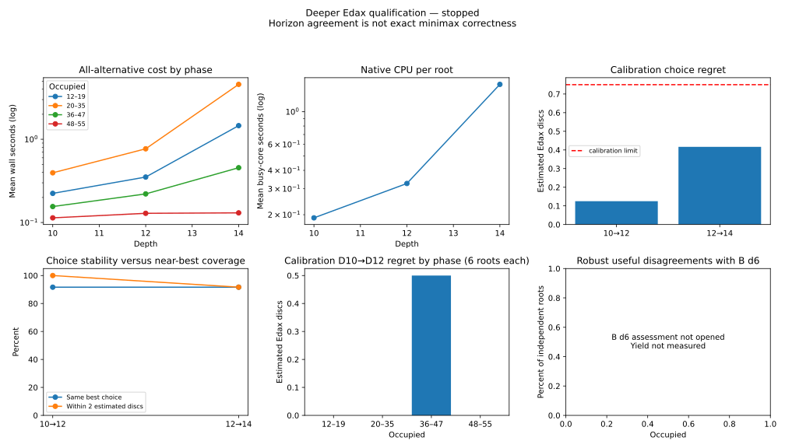

# Deeper Edax qualification: calibration stopped at the independent-solver limit

28 October 2026. **Qualification is incomplete. No teacher has been approved for training, and the locked assessment was not opened.** The required independent solver exceeded its ten-second combined-convention cap on a reserved 12-empty cost position. The runner stopped after 127.87 active seconds. It did not replace that position, relax the cap, start training or change production B/search.

This is a reference-computation failure, not a demonstrated failure of Edax's reliability gates. Completed D10/D12/D14 cost searches suggest that stronger labels are affordable and promising. Their 24-root sample cannot substitute for the prescribed 256-root assessment or the missing exact calibration.

## What was implemented

The separate [qualification driver](../scripts/teacher/qualification.mjs) implements the [frozen strategy](ASTRA_TEACHER_STRATEGY.md), with machine-readable protocol, separate source snapshot, deterministic namespace-derived seeds, immutable input-bound receipts, writer lock, source/binary/evaluation identity checks, stage/total caps, and feasibility before assessment. It supports full and calibration-only modes, depths specified by the frozen protocol, all-alternative labeling, and at most two concurrent native searches. No production source file changed.

The existing Edax adapter retains its coordinate, perspective, pass normalization, depth/window and selective-output rejection checks. Its optional POSIX resource wrapper now measures actual child user/system CPU and maximum RSS using `wait4`; timeout kills the wrapper/native process group. Linux parent-death handling prevents an orphaned native search after a coordinator crash. macOS uses POSIX accounting with its different RSS units, but current Intel/Apple Silicon hardware was unavailable for verification.

Readable logs identify stages, depth batches, active expensive queries and elapsed age, counts, throughput and durable checkpoint. Separate JSONL records contain resource/operation detail. Native CPU is labeled separately from Node CPU. Checkpoints persist active elapsed time every five seconds and completed root/depth receipts individually; interrupted work can resume from the frozen snapshot. After an unclean crash, recovery conservatively charges the elapsed boot-clock gap (including downtime), or a whole interrupted-stage allowance if the boot identity changed; it can decline a resume rather than exceed the budget. A hard required-query failure is distinct from an interruption and must not be automatically retried as another experiment.

The publication audit replays accepted PV prefixes, verifies every legal alternative is present, checks full-window/depth/score semantics and receipt/source identities, recomputes metrics, and checks cross-trajectory reservation separation. A separate historical re-audit tested 44,470 board/perspective entries against 2,650,417 historical keys without a collision. The exclusions included 15,248 prior local trajectories and all 1,128 old teacher root/anchor receipts, with zero missing historical inputs. Full trajectories and queried root children remain local. Admission accepted 352 trajectories in 998 attempts. Future historical loading also recognizes qualification reservations, so these data cannot silently reappear as fresh learning/assessment evidence.

## Frozen samples and execution

The new namespace is `teacher-v2-20261028`. All samples were reserved jointly before expensive labels:

| Role | Fixed reservation | Completed work |
|---|---:|---|
| Cost | 24 roots, six per occupied-count phase | All alternatives at D10/D12/D14 on all 24; D13 on the fixed eight |
| Exact cost | Eight roots, four at each of 10/12 empties | Six combined raw/awarded independent references completed; one capped; one not started |
| Reliability assessment | 256 roots, 64 per phase | **No queries opened** |
| Odd assessment | Fixed 32 of the 256 | **No queries opened** |
| Exact assessment | 64 roots, 32 at each of 10/12 empties | **No queries opened** |

Cost and ordinary assessment reservations split each phase equally between the declared legacy B-d1/12%-exploration and stronger B-d4/2%-exploration policies. Exact roots use the declared seeded random trajectories. Every root has its own full source trajectory; cross-role canonical collisions are rejected from 12 occupied squares onward. Common earlier prefixes remain a disclosed dependency.

Native adapter validation completed first: 35 fixtures, all alternatives, forced pass, terminal-with-empties and two transformation checks. No adapter correctness mismatch occurred. The run reached the exact-cost stage before its optional D16 decision, final conservative forecast, or depth-selection freeze. Consequently **D16 was not attempted and no assessment depth pair was selected**. This report reconstructs completed calibration statistics read-only from immutable receipts; it does not manufacture a successful decision receipt.

## Depth, cost and label quality

Every figure below describes the 24 development cost roots. All values are from completed full-window searches at selectivity 5, one native task per executable, hash bits 16, with the previously pinned Edax 4.6 binary and evaluation data. Approximate scores are estimated Edax discs. “Exact window” distinguishes a completed horizon value from a search bound; it does not establish exact minimax truth.

| Root depth | Mean wall seconds | Median | p95 | Maximum | Native CPU seconds, 24 roots | Nodes, 24 roots |
|---|---:|---:|---:|---:|---:|---:|
| 10 | 0.222 | 0.154 | 0.416 | 0.608 | 4.569 | 83,501,462 |
| 12 | 0.368 | 0.244 | 0.727 | 2.110 | 7.819 | 191,509,516 |
| 14 | 1.654 | 0.703 | 3.143 | 17.734 | 36.814 | 1,188,444,296 |

Wall costs include Python/native startup and adapter handling. They exclude historical admission, B probes, exact solving and reporting. The D14 maximum is over five times p95: forecasting only from average cost would be unsafe. Later strata can reach terminal search at these horizons, while early/middle roots remain heuristic; pooled stability therefore benefits from an easier late-game component.

The deterministic shallow choice uses the lowest row-major index among tied maxima. Regret is the deeper best value minus the deeper value of that choice:

| Horizon pair | Same chosen best move | Entire tied-best set retained | Mean estimated regret | Regret ≤2 | Regret ≥4 | Maximum |
|---|---:|---:|---:|---:|---:|---:|
| D10→D12 | 22/24 | 22/24 | 0.125 | 24/24 | 0/24 | 2 |
| D12→D14 | 22/24 | 21/24 | 0.417 | 22/24 | 2/24 | 6 |

Both pairs pass the **cost-sample horizon filter alone**: mean ≤0.75, at least 90% within two, and no regret ≥8. D10/R12 would therefore be the first candidate under the lowest-depth rule if all remaining calibration and feasibility requirements succeeded. It was not frozen or qualified.

For D10→D12 the histogram is 22 zero, one one-disc and one two-disc loss. D12→D14 has 22 zero, one four-disc and one six-disc loss. Thus the same 91.7% choice-stability rate conceals different consequences. Neither pair had a four-to-minus-four reversal among the defined near-best alternatives, or a robust estimated win/loss sign error. These observations cannot prove correctness against optimal opposition. In particular, the D12/R14 result shows why agreement at a closer horizon is insufficient.

The 95% Wilson interval for 22/24 choice stability is approximately 74–98%; for 24/24 within-two coverage its lower bound is about 86%. A favorable 24-root calibration is not a precise population estimate. Formal bootstrap and Wilson implementations are available for the locked assessment; no assessment interval is reported from absent data.

| Occupied phase, six cost roots each | D10→D12 mean regret | D12→D14 mean regret |
|---|---:|---:|
| 12–19 | 0 | 0 |
| 20–35 | 0 | 0 |
| 36–47 | 0.500 | 1.667 |
| 48–55 | 0 | 0 |

Source-policy means also differ. Legacy B1 trajectories give 0.250/0.500 for the two pairs; B4 trajectories give 0/0.333. Each policy has only 12 cost roots. These small conditional samples do not establish performance on ordinary or expert games. Absolute changes in near-best pair score gaps averaged about 1.44 discs at D10→D12 and 2.43 at D12→D14, despite identical chosen-move stability. Relative scores require their own validation before regression training.

The eight odd-depth probes compare D12 choices under D13: seven zero regret, one two-disc loss. They are diagnostics on the fixed subset, not the unperformed H+1 assessment gate. No conclusion about odd/even behavior across the population follows.



The cost/CPU curves use the same 24 roots at each even depth. D13 subset measurements are reported separately rather than joined into a misleading same-sample curve. The graph explicitly marks unavailable B-disagreement assessment data instead of plotting missing values as zero.

## Exact calibration bottleneck

The independent reference uses separate mailbox rules and alpha-beta search, without a transposition table. Each cost root must finish both actual occupied-disc scoring and Edax's winner-awarded-empty convention within **one combined ten-second deadline**. Edax exact-depth values are checked against the latter, and future assessment would retain both conventions and their W/D/L mistakes separately.

Four ten-empty cost roots finished combined reference solving in approximately 0.079, 0.680, 0.088 and 0.116 seconds. Two twelve-empty roots finished in **8.484 and 3.803 seconds**. The next required twelve-empty reference exceeded the cap; the remaining root was never started. Successful roots are not a random replacement for the fixed eight-root sample.

On the completed references, every checked exact Edax alternative matched. Truncated D6/D8 choices had identical exact regrets on these six roots: `0, 0, 0, 2, 2, 0`. On the two completed twelve-empty references, D10 also retained regrets 2 and 0. This subset demonstrates neither improvement nor deterioration with deeper truncated searches. Selection by solver completion and the small sample make stronger generalization inappropriate.

The ten-second limit behaved correctly: the runner admitted no approximate solution as exact and did not retry with a larger cap. Exact-reference computation, rather than native Edax labeling, prevented qualification in this run. There was no opportunity to apply the full exact-calibration monotonicity gate or to establish actual early-game decision accuracy.

## Resources, concurrency and accounting

The launch preflight allowed two workers with approximately **4.11 GiB** of limiting available Windows/WSL physical memory. Periodic checks found no memory/swap blocker. The coordinator's recorded RSS approached one GiB while maintaining historical keys; measured native child maximum RSS was **57.13 MiB**. No application was closed and no saved system setting changed. The bounded temporary Windows keep-awake request released after the stopped status.

Eight matched D10 roots measured serial and two-worker operation. The original benchmark's outer serial span included a resource-check delay, producing an inflated **4.36×** ratio. Do not use that ratio as a parallel speedup claim. Summing actual serial query spans gives **1.829 seconds** versus **0.938 seconds** for the parallel batch, about **1.95×**. This is evidence for keeping two on this workload, with startup/noise qualifications; it does not justify increasing beyond two. Post-run hardening excludes the serial preflight delay and conservatively declines to infer speedup from partially reused benchmark receipts.

Auditing all completed native receipts gives **57.55 native CPU seconds**, maximum RSS 59,904,000 bytes and approximately **1.617 billion nodes**. Node process CPU was **75.52 seconds**, including admission, orchestration and independent solver threads. These tracked process totals sum to about **133.06 CPU seconds = 0.0370 core-hours**; they exclude Python wrapper/launcher and Windows PowerShell overhead, so they are not an exhaustive whole-host CPU total. Successful independent references accounted for 12.41 thread CPU seconds **inside** the Node total; do not add them again. The failed solver's CPU is also inside the process total, but its original frozen error receipt did not isolate that CPU separately. Node checkpoint/accounting and child completion have small timing-boundary differences; the native totals are recomputed from receipts.

The active runner duration was **2.13 minutes**, including its initial preflight. It stopped during the 20-minute calibration allowance, well before the 100-minute compute cutoff protecting the final 20-minute report reserve. Assessment, exact assessment and training consumed zero time. Audit/report generation and regression verification followed within the reserved reporting allowance. No extension was requested or used.

## Decision gates and disposition

| Predeclared requirement | Disposition |
|---|---|
| Complete 24-root D10/D12/D14 cost sample and eight D13 checks | Complete |
| Complete eight independent exact-cost references under the cap | **Incomplete: one capped, one unstarted** |
| Optional D16 complete sample | Not reached; no D16 claim |
| Frozen lowest eligible pair plus conservative full forecast | Not reached |
| Integrity of fixed 256/32/64 assessment | Not assessed; no locked queries opened |
| Mean/coverage/significant-error/sign/reversal gates | Not assessed |
| Odd-horizon assessment gate | Not assessed |
| Exact assessment agreement and monotonicity | Not assessed |
| Useful disagreements with B, including early subset | Not measured |

**Do not begin learning from a claim that this teacher passed.** The appropriate scientific result is incomplete qualification due to an independent-reference cost bottleneck. The cost-sample horizon filters passed, but cannot substitute for the other prerequisites.

## Answers and one next direction

1. **Worthwhile depth:** D10 with D12 reference is the lowest promising candidate on the measured cost sample. D14 is affordable for many roots but has a substantial tail and exposed additional meaningful reversals. No depth is qualified yet.
2. **Reliable enough for the learning experiment:** not established. The locked assessment and exact-calibration requirements remain outstanding.
3. **Useful independent disagreements per CPU hour:** **not estimable from this run**. The early/middle B-d6 assessment was never opened, so there is no representative numerator. The 0.0370 measured CPU hours must not be paired with disagreements from the earlier audit or interpreted as zero yield.
4. **Best next model:** B plus linear corrections remains the conditional first modeling choice because it preserves strategic features, speed and interpretability. This run supplied no evidence to promote a different model or start fitting.
5. **Smallest informative training experiment:** after qualification, retain the strategy's 1,000 training source roots, 250 selection roots and 500 independent quality roots, with training checkpoints at 250/500/1,000 and at most two independently labeled frontier parents per training trajectory. Require searched-regret transfer before a small paired equal-time screen. These are conditional plans; no training configuration was activated.
6. **Model for the next implementation:** Sol High is appropriate for focused reference-solver engineering and tests. Another Astra strategy review is warranted if a complete qualification later reveals irreducible teacher instability or an objective/representation problem; this engineering timeout alone does not require one.

**Choose reference-search engineering as the next direction.** Improve the independent mailbox solver's ordering and transposition reuse, with separate correctness checks for raw versus awarded terminal conventions. This directly addresses the measured bottleneck and preserves the strict ten-second cap and original player. Do not infer that a production C++ rewrite is needed. The capped board can become a disclosed engineering fixture, never an undisclosed independent test. A subsequent qualification needs an explicitly frozen source/protocol and preserved independence; do not silently resume this scientifically stopped run with changed code.

Suggested next prompt:

> Read the user requests, strategy and `docs/TEACHER_DEPTH_QUALIFICATION.md`. Improve only the optional independent exact-reference solver so difficult twelve-empty cases can finish within the unchanged combined ten-second cap. Preserve separate raw-disc and Edax-awarded conventions, pass semantics and all-alternative values. Use the capped cost board as a disclosed engineering fixture; verify against exhaustive small endings and the already verified native teacher, with fresh independent timing cases. Measure nodes, time and memory before/after and test cancellation and crash recovery. Do not change production B/search, lower any qualification gate, fit a model, or automatically launch another qualification. Prepare a reviewed continuation protocol that preserves the untouched assessment reservations and makes source changes explicit. Commit and push verified improvements and measured results.

## Reproduction, audit and verification

Run directory: `.local-research/teacher-qualification-v2-20261028/`. It preserves frozen executable source, protocol, reservations, full source trajectories, immutable tasks, raw native transcripts, resource history, manifest and error record. The [compact audited evidence](data/teacher-depth-qualification-20261028.json) includes all completed cost scores, receipt hashes, source/binary/data identities, exact-cost references and reconstructed statistics. The old completed audit is unchanged. Raw evidence and third-party binaries/data remain Git-ignored and separately licensed; no Edax code or weights are bundled in the browser.

For a **new separately authorized** qualification, the implemented launch modes are:

```bash
python3 scripts/teacher/qualification-launch.py \
  --output .local-research/teacher-qualification-new --mode calibration
python3 scripts/teacher/qualification-launch.py \
  --output .local-research/teacher-qualification-new-full --mode full
```

Those commands create new runs with this protocol's namespaces; repeating a namespace is reproduction, not fresh independent evidence. Do not execute them automatically. A fresh experiment must deliberately reserve a new namespace or document receipt/data reuse before accessing outcomes. Interrupted runs use the same output with `--resume`; required-query failures are preserved and refused by the hardened launcher. No restart command for this capped run is recommended.

Read-only reproduction of this publication:

```bash
node scripts/teacher/qualification-publish.mjs \
  .local-research/teacher-qualification-v2-20261028 \
  /tmp/reversi-teacher-depth-qualification.json
cmp docs/data/teacher-depth-qualification-20261028.json \
  /tmp/reversi-teacher-depth-qualification.json
python3 scripts/teacher/qualification-plots.py \
  docs/data/teacher-depth-qualification-20261028.json \
  /tmp/reversi-teacher-depth-qualification.svg
node --test tests/*.test.mjs
REVERSI_NATIVE_TEST=1 node --test tests/teacher-qualification.test.mjs
python3 -m unittest discover -s tests -p 'test_*.py'
```

Plotting uses optional developer matplotlib, not a runtime dependency. WSL2/Windows resource interrogation, native CPU/RSS and temporary power handling were exercised. No browser interaction changed; Windows-browser and current macOS hardware acceptance were not repeated.

Baseline JavaScript tests passed 65/65; the prelaunch expanded suite passed 70/70; final suite passed 74/74. Native integration verified exact all-alternative values, measured accounting and timeout rejection. Eighteen Python tests passed, with the two existing subprocess-lifecycle warnings. A process-crash test verifies committed receipt bytes remain unchanged and resumed work executes only the unfinished task; input/source identity changes are rejected. An exact-worker cap test verifies that failure admits no approximate reference. A full coordinator interruption/resume during the scientific run was not exercised because calibration stopped first; this is a stated integration-test limitation.

Post-run hardening improves concurrency accounting, failed-query disposition, failed-solver metadata, resume/preflight accounting and future exclusion of qualification evidence. It does not edit the frozen run source, raw results, samples, gate thresholds or native labels, and no second run followed. Repeated publication reproduced the same compact evidence. Publication checks passed on 131 receipts and 42,348 distinct reserved trajectory/child keys. Final whitespace, source-default preservation and Git checks are recorded with completion.
