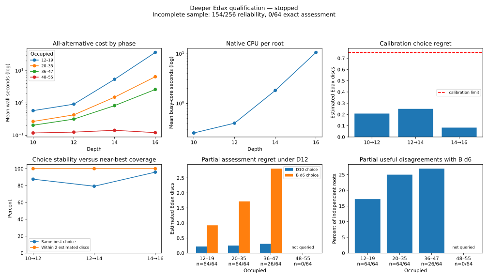

# Independent Edax qualification V3: stopped on a native bound

28 October 2026. **Qualification remains incomplete. D10/R12 was selected, but a required D12 query returned `>+63` instead of a completed full-window value.** The adapter rejected it and the frozen experiment stopped. No query was retried with different semantics, no assessment position was replaced, and no evaluator was trained. Production B, browser code and ordinary search are unchanged.

This failure concerns the native teacher/adapter value contract. It does **not** demonstrate excessive computational cost, inadequate useful disagreements, or failed population reliability. The completed early assessment is encouraging, but cannot substitute for the prescribed complete assessment. No teacher is approved for residual learning.

## Fixed protocol and reservation import

The [original strategy](ASTRA_TEACHER_STRATEGY.md) supplies all gates, samples and budgets. V3 changes the source identity, engineering namespace and reservation provenance; it does not change thresholds. The [optimized independent solver](EXACT_SOLVER_OPTIMIZATION.md) was already connected to `qualification-exact.mjs` and validation. V3 explicitly identifies it in the protocol, retains `reference-exact.mjs`, and exercises its combined ten-second deadline and outer worker safeguard. Neither solver imports Edax or production search code.

The verified importer preserves **all 256 reliability roots, all 64 exact-assessment roots and the original 32 odd-depth IDs**, in their original order. It checks the published reservation/receipt hashes and stopped-result hash, frozen source identity, absence of old assessment tasks/transcripts, every board/turn/canonical key, seed and target, legal complete trajectory with passes/terminal state, and deterministic source-policy replay. Production source is byte-identical to the old snapshot before policy replay. The provenance says **previously reserved, never previously evaluated**; that describes their state before V3, not their state after this run.

Each phase retains 32 B1/12%-exploration and 32 B4/2%-exploration roots, following eight random placements. Exact roots retain the original seeded random policy and 32/32 empty-count split. These are behavior-policy samples, not expert positions. Historical and newly admitted trajectories and root children are excluded under D4/color/perspective canonical identities from 12 occupied squares onward. Earlier common prefixes remain a dependency.

Only the imported roles are exempted from their own old reservation. Old cost trajectories, all 44 solver-engineering fixtures and historical research remain excluded. Admission checked against **2,658,443** canonical historical keys before importing the untouched roles, with zero missing local inputs; 15,284 historical trajectories and 1,128 old teacher tasks were loaded. The 24 new depth-cost and eight new exact-cost roots use `teacher-v3-20261028` seeds. All 352 final trajectories passed publication replay/separation checks, covering 42,396 distinct reserved trajectory/child keys. The original stopped run is unchanged.

| Identity | SHA-256 |
|---|---|
| Original reservation | `380ec247b80087296a993e6d2925bd1a81735b8b4291e93da68c1040f920242b` |
| Original source | `3493f27b4cdbb43749c67cbd48847932f43109c0af04c011aa7b1da034f349da` |
| V3 reservation | `dbe8bc953c1eb8110e91be3b0ea669260c0617d6ef67309c5dc022efe857bf43` |
| V3 frozen source | `5d55a86303241f6319563b2c908381dacb50a3db7a293c686b9df1347d74d5da` |
| V3 source/protocol/teacher identity | `11314b5c9199d1335ae7422efc9df0d123028d512eacd12d190be614b5e8fa76` |

Raw final results SHA-256: `a372581846323adfece6b766c675115ce6a0aa920f9e6652e6c64c5ae9ae06a2`. Compact publication SHA-256: `a3a8c640fb77b9641f7b54b6c2dc838a43147aa404a8c097c56b24c453e1742a`.

The [compact audited evidence](data/teacher-depth-qualification-v3-20261028.json) includes both complete protocols/identities, import proof, trajectory hashes, artifact/receipt hashes, calibration labels, partial assessment metrics, exact-cost alternatives, illustrative disagreements and the rejected transcript. Edax remains the pinned separate GPL-3.0 executable/evaluation data described in [the teacher audit](TEACHER_AUDIT.md); no third-party implementation or weights are distributed here.

## Calibration and selected depths

All 24 fresh cost roots completed D10/D12/D14, and the fixed eight completed D13. Every alternative uses the same placement depth and its own full window. The optional **complete 24-root D16 sample** was admitted by the original growth forecast: 208.37 serial seconds, or 281.30 with 35% allowance, against 1,148.98 remaining calibration seconds. Its actual summed query wall time was 276.09 seconds, within that allowance. Concurrent elapsed time is different from summed task wall time.

| Depth, 24 roots each | Mean wall s | Median s | p95 s | Maximum s | Native CPU s | Nodes |
|---|---:|---:|---:|---:|---:|---:|
| 10 | 0.293 | 0.201 | 0.837 | 0.928 | 6.08 | 132,483,762 |
| 12 | 0.448 | 0.304 | 1.327 | 1.393 | 9.59 | 247,660,637 |
| 14 | 1.973 | 0.831 | 8.046 | 8.275 | 43.82 | 1,406,320,710 |
| 16 | 11.504 | 3.234 | 51.738 | 58.132 | 256.79 | 8,643,080,880 |

These include adapter/native startup and concurrent contention. Repeated concurrency probes are excluded from this table. The D16 tail justifies bounded forecasting rather than extrapolating median throughput.

| Calibration pair | Mean estimated regret | Regret histogram | Within 2 | Maximum | Eligible |
|---|---:|---|---:|---:|---|
| D10→D12 | 0.208 | 21×0, 1×1, 2×2 | 24/24 | 2 | Yes |
| D12→D14 | 0.250 | 19×0, 4×1, 1×2 | 24/24 | 2 | Yes |
| D14→D16 | 0.083 | 23×0, 1×2 | 24/24 | 2 | Yes |

The fixed D12→D13 checks had six zero regrets and two regrets of three, mean 0.75. They are calibration diagnostics; assessment uses D10→D11 on its original 32-root subset.

**Selected teacher H=10, reference R=12.** All measured pairs passed the fixed calibration filter; the lowest eligible horizon was selected. The immutable selection receipt was written at **19:07:49 UTC**, before any locked query. The conservative serial forecast itemized 344.06 seconds for reliability/odd/B work and 100.87 seconds for exact assessment: **7.42 minutes**, or **30.01 minutes including 35% allowance and the final 20-minute reserve**. Both stage and total feasibility checks passed.

## Required-query failure and assessment coverage

At `assessment-154`, White to move with 41 occupied squares, the first native child in the D12 all-alternative request printed:

```text
1|   11  >+63 ... 163392 ... f1
```

The native process exited successfully, at selectivity 5 and the requested depth, but one row remained a bound. **The entire D12 result was rejected; no partial D12 receipt exists.** A D10 receipt for this root remains as incomplete work. The frozen non-resumable failure guard refused restart. Computation stopped; exact assessment was not opened.

Read-only inspection of pinned Edax `search.c`, `result_print`, confirms that `>` is printed when the lower bound equals the score and the upper bound is greater. It is an **inclusive lower bound**, despite the glyph: `>+63` does not prove +64. It can describe an unresolved value at 63 or 64. The existing exception for an actual bound at the absolute ±64 limit therefore does not apply. No parser rule was weakened and no value was inferred for the rejected row. The OBF “missing best score” warnings refer to absent expected annotations in query inputs; the blocking rejection was the bound.

| Predetermined work | Required | Completed |
|---|---:|---:|
| Fresh even-depth calibration | 24 at each D10/D12/D14 | All |
| Fixed odd calibration | 8 at D13 | All |
| Optional calibration, once attempted | 24 at D16 | All |
| Exact calibration, both conventions | 8 | All |
| Reliability assessment | 256 | **154**, plus one incomplete root |
| Fixed odd assessment | 32 | **24** |
| Independent exact assessment | 64 | **0** |

The 102 incomplete reliability roots were not dropped or replaced. The 154 completed roots are a prefix of the predetermined order, not a new smaller assessment design. Their pooled results below are descriptive; completion-based censoring prevents a complete-sample qualification inference. The two early strata are individually complete.

## Descriptive reliability and useful corrections

All following scores/regrets are **horizon-limited estimated Edax discs**, not mathematical values or calibrated win probabilities. Ties use the lowest row-major index. Regret is the R-best value minus the R-value of H's deterministic choice.

| Occupied / phase | Complete / fixed | H mean regret | B d6 mean regret under R | H within 2 | H choice remains best | Useful H/B disagreements |
|---|---:|---:|---:|---:|---:|---:|
| 12–19, opening | 64/64 | 0.219 | 0.922 | 63/64 | 55/64 | 11/64 |
| 20–35, middlegame | 64/64 | 0.250 | 1.719 | 63/64 | 54/64 | 16/64 |
| 36–47, later middle | 26/64 | 0.308 | 2.808 | 25/26 | 23/26 | 7/26 |
| 48–55, late | 0/64 | Unmeasured | Unmeasured | Unmeasured | Unmeasured | Unmeasured |

Across the completed 154, mean regret is **0.247**, median 0, p90 1, p95 2, maximum 4. The histogram is **132×0, 10×1, 9×2, 2×3, 1×4**. Choice stability is 132/154; entire tied-best-set retention is 128/154. Worst-tied-choice mean regret is 0.305. Near-best coverage is 151/154. None of these replaces the fixed 256-root gate.

The complete early sample has mean regret **0.234**, 126/128 within two, maximum three, and **27/128 useful disagreements**: 21.1%, Wilson 95% interval **14.9–29.0%**, conditional on the declared sampling/admission distribution. Opening yield is 17.2% (9.9–28.2%); middlegame yield is 25.0% (16.0–36.8%). “Useful” requires H to beat B d6 by at least two at both H and R, and H's R regret at most two. These meet the early count floor descriptively, but do not prove that the seven features can learn the correction or that games improve.

The partial mixture contains 77 roots from each policy. Both have mean H regret 0.247. Useful counts are 14/77 for B1/12% and 20/77 for B4/2%; B d6's mean R regrets are 1.468 and 1.675 respectively. This is not evidence about expert-play distributions.

Four illustrative early disagreements are retained with boards, every alternative and legally replayed PVs in the evidence:

| Root / occupied | B d6 move | H move | H scores: H move / B | R scores: H move / B |
|---|---|---|---:|---:|
| 62 / 19 | a5 | b6 | +15 / +11 | +17 / +10 |
| 61 / 12 | c5 | f6 | +8 / 0 | +8 / +2 |
| 72 / 31 | g2 | a2 | +5 / −15 | +3 / −12 |
| 120 / 27 | h6 | h7 | +36 / +25 | +36 / +25 |

Each H choice has zero R regret. Root 72 is an estimated favorable/unfavorable choice change for B, not a proven win/loss change. Across completed roots there were **zero robust H→R sign errors**, zero small positive-to-negative H-choice errors, and zero ≥4-to-≤−4 near-best/B pair reversals. Pair-score differences still move: initial gap bins 0–1, 2–3 and ≥4 had mean absolute changes 1.24, 1.29 and 2.24 discs, with 24/202, 9/159 and 1/59 pair-sign changes. These correlated pairs are not independent observations.

The 24 completed fixed odd checks have mean maximum regret **0.292**, maximum three. Eight checks remain missing, so the odd gate is unassessed. No additional branch re-search was performed after the stop; PV legality is not causal proof of an opening error.



## Independent exact calibration

All eight fresh exact-cost roots completed raw-disc and winner-awarded-empty minimax under the unchanged **combined ten-second cap**. Combined times ranged **13.35–94.10 ms**, median 31.38 ms. All **56 legal-alternative awarded-empty values** matched native exact-depth Edax. Raw values were independently computed, not obtained by adjusting approximate Edax scores. Forced passes, terminal empties, convention separation and timeout/no-partial-result behavior also passed the independent reference/exhaustive regression tests and 35-fixture native validation.

| Exact-cost group | Roots | D6 mean exact regret | D8 | D10 | Exact W/D/L errors at measured horizons |
|---|---:|---:|---:|---:|---|
| 10 empties | 4 | 0.50 | 0.50 | Not queried | 0, both conventions |
| 12 empties | 4 | 1.50 | 0 | 0 | 0, both conventions |
| Pooled comparable D6/D8 | 8 | 1.00 | 0.25 | — | 0, both conventions |

This development diagnostic is monotone, including raw and awarded W/D/L. **The independent 64-root exact-assessment gate was not performed.** Do not reinterpret eight successful calibration roots as that assessment.

## Every gate and the disposition

| Original gate | Evidence / disposition |
|---|---|
| Integrity: complete fixed samples and accepted common-depth full-window alternatives | **Blocked:** rejected native bound; 154/256, 24/32 and 0/64 complete. No invalid label admitted. |
| Mean regret, overall and early; per-early-phase limits | **Not assessed overall.** Complete early mean 0.234; phase means 0.219/0.250. |
| At least 231/256 and 116/128 within two | **Not assessed overall.** Early 126/128; partial overall 151/154. |
| At most 12 significant errors overall / six early; none ≥8 | **Not assessed overall.** Partial one ≥4, none ≥8; early zero ≥4. |
| At most two robust sign errors / five major reversals | **Not assessed:** partial counts zero/zero. |
| Fixed 32-root odd mean ≤1, maximum <8 | **Not assessed:** only 24 checks. |
| Exact agreement and monotone exact regret/WDL on 64 roots | **Not assessed:** zero assessment roots; eight cost roots passed their diagnostic. |
| At least 32 useful overall, 12 early, with complete samples | **Not qualified:** partial 34 useful, including 27 early; fixed-sample integrity is missing. |

Every gate did **not** pass. Failure is a measured incomplete native-value contract, not a measured deficit in useful early corrections. The sample contains meaningful stable *estimated* corrections, but reliable independent training information has not yet been fully qualified.

## Resources, accounting and recovery

The main run used **382.71 active seconds (6.38 minutes)**: 72.73 seconds in admission/resource handling, 193.82 in calibration and 109.61 in assessment, plus launcher/preflight overhead. Initial resource waits are excluded from active search time. A separate superseded startup stopped after 4.93 seconds with no completed tasks. The entire session finished well below the 120-minute ceiling; the reporting reserve was protected, not consumed by further searches.

Windows physical memory fluctuated near the one-worker threshold. The first startup and a later pre-calibration checkpoint stopped safely; a fresh process reused the same immutable validation/reservation receipts. Admission used one reduced-priority worker. After its large index was released and memory recovered, resume admitted **two** independent teacher workers, with about 3.03 GiB limiting memory available at launch. During native work the periodic available-memory readings were 2.82–3.67 GiB. WSL swap traffic stayed at zero; sampled Windows CPU reached 20% and sampled WSL aggregate CPU 3.7%. These samples include other applications, not just this job. Free Linux disk space was about 885 GiB.

Accepted native receipts account for **502.50 CPU seconds**, **15.354 billion nodes**, and **57.15 MiB native process high-water RSS**. Retained admission and final-process snapshots account for approximately **71.76 Node CPU seconds**, including B probes and independent worker CPU; do not add the latter again. Combined tracked usage is approximately **0.160 core-hours**, or 1.50 busy cores averaged over active runner time. This excludes Python/PowerShell overhead, uninstrumented validation child CPU, the first resource-only process, and the rejected query's unavailable wait4 record. Its transcript separately reports 0.023 native CPU seconds. These are not exhaustive whole-host CPU totals.

Node process high-water RSS reached **1.37 GiB** during historical admission; the final search process peaked at 243 MiB. The earlier high-water/CPU snapshot is retained and hash-checked separately because process counters reset on resume. Final-process counters alone would undercount admission. No applications were closed, no unrelated processes terminated, and no saved setting changed. The bounded temporary Windows keep-awake request was confirmed **released** after the stop.

Actual D16 serial cost was 32.5% higher than forecast, within its retained 35% allowance. The full-assessment forecast cannot be scored for accuracy because execution was censored by a parser rejection: 109.61 seconds for 154 complete roots is not a completion time for 256/32/64 targets. Partial reliability throughput was 1.40 complete roots/second; extrapolating it is not a completed feasibility validation.

Readable logs now separate stages/depths, counts, measured durations, live query age/slow tasks, throughput/ETA, CPU/memory and checkpoints from JSONL telemetry. During synchronous historical/policy replay, event-loop logging can be delayed for about a minute; counts resume afterward. Completion-based native CPU rates can spike when long tasks finish; they are labeled accordingly, not instantaneous native utilization. The initial resource pauses exercised actual receipt reuse; the suite additionally tests SIGKILL recovery, changed-input/source rejection, duplicate prevention, worker bounds and exact cancellation.

## One next action

**Resolve saturated native bounds in a standalone adapter engineering regression before another qualification.** Use the now-disclosed 41-occupied fixture and its saved transcript to establish how the pinned native search can deliver a genuinely completed common-depth value near ±63. Keep inclusive bounds distinct from exact values; do not accept `>+63` by treating `>` as strict, and do not silently increase depth or replace an alternative. Verify the resolution against independent small endings and unchanged full-window parsing requirements, then propose a fresh frozen qualification protocol. Do not resume this hard-stopped experiment or selectively reuse its favorable completed roots.

The reason to fix this specific integration problem is the complete early sample's 27 stable useful corrections and low measured regret. A different teacher depth, lower gate, larger learner or more weak self-play is not justified by this stop. Residual training on B's existing 21 weights remains conditional on successful qualification and was not started.

## Reproduction and verification

Main evidence: `.local-research/teacher-qualification-v3-20261028-qualified/`, including frozen source, immutable tasks, full trajectories, transcripts, resource history, stopped manifest, and separate interruption audit. `.local-research/teacher-qualification-v3-20261028/` preserves the earlier zero-task resource stop. Full data and third-party assets remain Git-ignored.

Read-only publication, valid in WSL bash and macOS shells with the preserved local evidence:

```bash
node scripts/teacher/qualification-publish.mjs \
  .local-research/teacher-qualification-v3-20261028-qualified \
  /tmp/reversi-teacher-v3.json
cmp docs/data/teacher-depth-qualification-v3-20261028.json \
  /tmp/reversi-teacher-v3.json
python3 scripts/teacher/qualification-plots.py \
  /tmp/reversi-teacher-v3.json /tmp/reversi-teacher-v3.svg
cmp docs/teacher-depth-qualification-v3-20261028.svg \
  /tmp/reversi-teacher-v3.svg
npm test
REVERSI_NATIVE_TEST=1 node --test \
  tests/teacher-qualification.test.mjs tests/exact-solver.test.mjs
python3 -m unittest discover -s tests -p 'test_*.py'
```

The V3 namespace/reservations are now spent assessment evidence. These are reproduction commands, not a recommendation to launch another directory with the same import. Hard-failure launcher guards were verified to refuse both stopped qualification runs without changing their files. Publication rejects an active/stale checkpoint, checks source and actual teacher binary/data hashes, all 679 receipt identities, trajectory separation, exact-cost alternatives/metrics, frozen selection and complete or explicitly partial assessment reconstruction. The original V2 compact publication still reproduces byte-for-byte.

Baseline JavaScript: **82/82**. Final JavaScript: **86/86**. Explicit native/solver integration: **21/21**. Final Python: **18/18**, with the two existing subprocess-lifecycle warnings. An earlier Python invocation correctly rejected changing source while edits were in progress; its stable-source rerun and final run passed. Added parser fixtures retain rejection of both `>+63` and `<−63`; no adapter search semantics changed after examining assessment data. Post-run publication hardening reconstructs incomplete samples explicitly, preserves an interrupted process resource snapshot, and refuses active/stale results; future admission logging also prints its final complete count. These edits do not change frozen search results. Evidence and graph reproduction, whitespace, request-ledger prefix preservation, source preservation and Git checks accompany the commit.

Actual execution verified Windows 11 WSL2 resource interrogation, native searches/accounting and temporary power release. Browser interaction was unchanged and not retested; current Intel/Apple Silicon macOS hardware was unavailable. Linux/WSL success is not macOS hardware verification. Plotting requires optional developer matplotlib; ordinary play retains its dependency-free Python/browser runtime.
