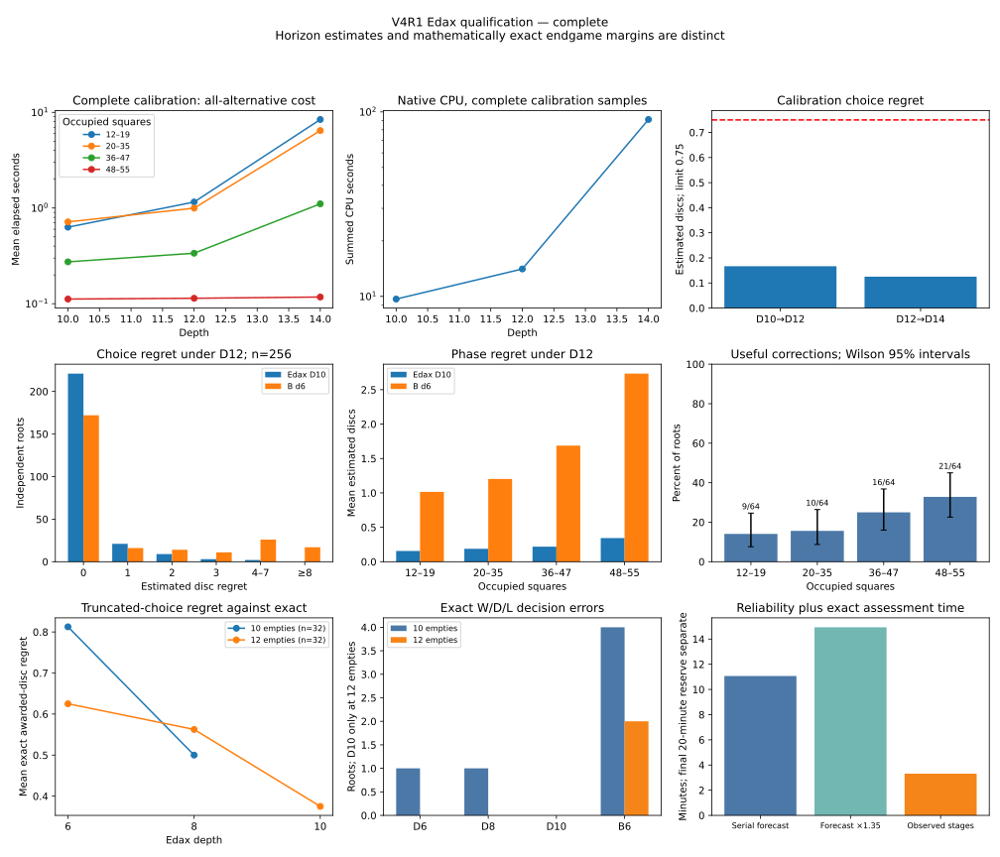

# Independent Edax teacher qualification V4 / V4R1

28 October 2026. **The completed V4R1 qualification passed every predefined scientific gate. Select Edax D10 as teacher and D12 as reference.** All 256 reliability roots, 32 predetermined odd checks and 64 independent exact-assessment roots completed. D10 remained within two D12-estimated discs on **251/256** roots. There were **56 useful stable corrections to B**, including **19/128 opening/middlegame roots**. This justifies the proposed small residual-learning experiment; it does not demonstrate a learned improvement or promotion over B.

The original V4 attempt remains stopped and unqualified. After its optional D16 query timed out, the user authorized a fix and rerun. **V4R1 is a new frozen run**, with fresh calibration and verified import of V4's completely unopened assessment reservations. No partial V4 assessment results were reused; there were none. No training, production-B change, browser change or ordinary-engine change occurred.

Evidence: [completed V4R1 audit](data/teacher-depth-qualification-v4r1-20261028.json), [preserved stopped V4 audit](data/teacher-depth-qualification-v4-20261028.json), [specific next-experiment plan](RESIDUAL_FRONTIER_EXPERIMENT_PLAN.md). Large receipts, complete trajectories, native executables and evaluation data remain local.



## Search definition and selected depths

Both runs use the separately hashed experimental `edax-fixed-window-v2` executable from [the bound-resolution study](EDAX_BOUND_RESOLUTION.md). Every legal alternative receives its own full window at a common remaining placement depth, with nonselectivity 5, one native thread, hash bits 16 and no book. There is no iterative aspiration warm-up or PV depth extension. Positive-depth passes preserve placement depth; terminal detection precedes static cutoff evaluation. The declared root-conditioned stable-score clamp is retained; internal terminal stability cuts do not prune heuristic horizons. Bounds and malformed/wrong-depth results remain rejected, except correctly directed bounds at a mathematically proven global endpoint.

V4R1 completed 24 fresh D10/D12/D14 roots and its fixed eight D13 checks. D16 was disabled **before any new calibration or assessment outcomes**, following the authorized scheduling repair below. Both eligible measured pairs passed; the unchanged rule selected the lowest teacher depth, **H10/R12**. No H14/R16 qualification is claimed.

| Calibration pair, 24 roots | Mean estimated regret | Histogram | Within 2 | Maximum |
| --- | ---: | --- | ---: | ---: |
| D10→D12 | 0.167 | 22×0, 2×2 | 24/24 | 2 |
| D12→D14 | 0.125 | 22×0, 1×1, 1×2 | 24/24 | 2 |

All eight fixed D12→D13 calibration regrets were zero. All eight independent exact-calibration roots completed both conventions, with 56 awarded-empty alternatives matching Edax. Combined reference time ranged 15.5–163.7 ms, well below ten seconds.

| Complete calibration depth | Roots | Mean elapsed s | Median s | p95 s | Maximum s | Native CPU s | Nodes |
| --- | ---: | ---: | ---: | ---: | ---: | ---: | ---: |
| D10 | 24 | 0.433 | 0.290 | 0.948 | 1.202 | 9.67 | 225,571,996 |
| D12 | 24 | 0.651 | 0.409 | 1.849 | 2.306 | 14.08 | 352,670,045 |
| D13 | 8 fixed | 1.910 | 1.367 | 5.165 | 5.165 | 14.35 | 398,868,627 |
| D14 | 24 | 4.026 | 1.641 | 13.010 | 16.253 | 90.99 | 2,631,709,152 |

These are complete all-alternative queries, including native startup, with concurrent contention. Repeated concurrency probes are excluded from this table. The measured two-worker probe speedup was 2.07×; the assessment forecast assumed serial cost rather than that speedup. The immutable selection receipt precedes the first assessment dispatch; its recorded wall timestamp is 21:21:35 UTC. Stage timing uses monotonic clocks because host wall time can adjust.

## Reliability and B's mistakes

Unless explicitly solved, scores below are **horizon-limited estimated Edax discs**, not mathematical game values or calibrated win probabilities. Deterministic ties choose the lowest row-major square. Choice regret is the D12 best value minus the D12 value of D10's selected alternative. B is the unchanged production evaluator searched six placements with the ordinary independent engine.

| Occupied / phase | Roots | H mean regret | H within 2 | H maximum | B mean R regret | B regret ≥4 | Useful stable corrections |
| --- | ---: | ---: | ---: | ---: | ---: | ---: | ---: |
| 12–19, opening | 64 | 0.156 | 64/64 | 2 | 1.016 | 8/64 | 9/64 |
| 20–35, middlegame | 64 | 0.188 | 62/64 | 3 | 1.203 | 7/64 | 10/64 |
| 36–47, later middle | 64 | 0.219 | 63/64 | 4 | 1.688 | 12/64 | 16/64 |
| 48–55, late | 64 | 0.344 | 62/64 | 6 | 2.734 | 16/64 | 21/64 |
| All | 256 | **0.227** | **251/256** | **6** | **1.660** | **43/256** | **56/256** |

These sampling strata differ from B's unchanged feature-weight boundaries at 28 and 52 occupied. Every stratum has 32 roots from each declared source policy. They represent randomized B1/B4 behavior trajectories, rather than expert play or all possible Reversi positions.

The complete H-regret histogram is **221×0, 21×1, 9×2, 3×3, 1×4, 1×6**. Median is zero, p90 one, p95 two. D10's chosen move remains D12-best on 221/256 (86.3%); its entire tied-best set remains best on 213/256 (83.2%). Worst-shallow-tie mean regret is 0.293. Thus qualification means low observed consequential regret, not 100% identical choices.

Near-best coverage is **98.0%**, Wilson 95% interval **95.5–99.2%**. Mean H regret has corrected stratified-bootstrap 95% interval **0.148–0.316**. The complete early sample has mean **0.172** (interval **0.086–0.266**), 126/128 within two, maximum three and zero ≥4 errors. No early phase exceeds its mean limit.

B loses at least four reference-estimated discs on **43/256 = 16.8%** (Wilson **12.7–21.9%**), including **15/128 = 11.7% early** (7.2–18.4%). B's median regret is zero, p90 six, p95 nine, maximum 26. Its mean excess regret over H is **1.434 estimated discs** (paired, stratified-bootstrap interval **1.000–1.910**); early excess is **0.938** (0.516–1.398). These are teacher-relative comparisons, structurally favorable to a teacher judged by its own deeper evaluator. They are not a measured playing-strength gain.

Useful corrections require H to beat B by at least two discs at **both H and R**, while H's R regret is at most two. Yield is **56/256 = 21.9%** (Wilson **17.2–27.3%**), including **19/128 = 14.8% early** (9.7–22.0%). Opening yield is 9/64 (14.1%; 7.6–24.6%), middlegame 10/64 (15.6%; 8.7–26.4%), later middle 16/64 (25.0%; 16.0–36.8%), and late 21/64 (32.8%; 22.6–45.0%). The early signal is smaller than the late signal but exceeds its predeclared floor. V3's disclosed results were not pooled into these counts.

The B1/12% sample has mean H regret 0.227, 126/128 within two and 30/128 useful corrections; B4/2% has the same mean, 125/128 within two and 26/128 useful corrections. B mean R regret is 1.719 and 1.602 respectively. Agreement and useful signal are present under both source policies.

Four representative early corrections, retained with boards, all alternatives and legally replayed PVs in the evidence:

| Root / occupied | B d6 | H | D10: H / B | D12: H / B |
| --- | --- | --- | ---: | ---: |
| 58 / 18 | b6 | a3 | +29 / +19 | +31 / +20 |
| 16 / 17 | e1 | g6 | −21 / −32 | −23 / −33 |
| 119 / 30 | e1 | g2 | −15 / −28 | −15 / −29 |
| 121 / 34 | a6 | b4 | −6 / −14 | −7 / −17 |

All four H choices have zero R regret. Negative scores can still contain useful relative corrections; the learner should not discard them merely because both moves look unfavorable.

## Significant reversals and outcome severity

There are **zero** H-choice robust sign errors and zero small positive-to-negative H-choice errors under R. One near-best/B pair has a ≥4-disc preference reversal: at root 161, 44 occupied, D10 scores e1/b3 as −11/−6, whereas D12 scores them −6/−10. This is a real five-disc-to-four-disc reversal, retained in the count; it is within the permitted five-root ceiling.

Three H-versus-B choices cross the R estimated ±2 sign band: root 21 (+2 versus −2), root 150 (+8 versus −4), and root 246 (+6 versus −4). Earlier signs are not game-theoretic wins/losses. Native horizons reach terminal depth on 14 H roots and 28 R roots in the primary sample; independent mathematical agreement is established on the separate exact sample below.

Across correlated competitive/B alternative pairs, initial gap bins 0–1, 2–3 and ≥4 have mean absolute gap changes **1.34, 1.67 and 2.93 discs**, and sign-change counts **46/312, 27/208 and 5/103**. These pairs are not independent samples. Low choice regret does not make every score difference stable.

All 32 predetermined odd checks completed: maximum regret under R and H+1 has histogram **24×0, 7×1, 1×2**, mean **0.281**, maximum two. No odd-depth outcome was substituted for an even-depth failure.

## Independent exact assessment

All **64** predetermined roots completed independent raw-disc and winner-awarded-empty minimax: 32 each at ten/twelve empties. Every one of **449 legal-alternative awarded-empty values** matched Edax's terminal-depth search. Raw margins were independently solved, not manufactured by adjusting approximate Edax scores. The independent solver contains no Edax implementation.

| Exact group | Roots | D6 mean awarded regret | D8 | D10 truncated | Exact W/D/L mistakes |
| --- | ---: | ---: | ---: | ---: | --- |
| 10 empties | 32 | 0.8125 | 0.5000 | D10 is terminal search | 1 at D6, 1 at D8 |
| 12 empties | 32 | 0.6250 | 0.5625 | 0.3750 | 0 at D6/D8/D10 |
| Pooled comparable D6/D8 | 64 | 0.7188 | 0.5313 | — | 1 → 1 |

Mean exact regret and W/D/L error counts do not worsen at any immediately subsequent measured truncated horizon, pooled or within either group. The ten-empty errors change identity/severity: D6 misses a win as a draw, while D8 turns a draw into a loss on a different root. The gate permits this count plateau; it is not evidence of perfection.

Raw-disc mean regrets are 0.7813→0.5000 in the ten-empty group and 0.6250→0.5625→0.3750 in the twelve-empty group. Raw and awarded W/D/L error counts agree. At the selected D10 horizon, ten-empty searches are exact; combined with the truncated twelve-empty D10 results, selected-teacher mean awarded regret is **0.1875** across 64, with **zero W/D/L errors**.

B d6's mean exact awarded regret is **3.5938** across the same 64 roots (3.6250 at ten empties, 3.5625 at twelve). It makes six exact W/D/L mistakes: **four win→loss, one win→draw and one draw→loss**. Its pooled raw regret is 3.5781. These are mathematically supported late-game errors, distinct from the primary sample's estimated sign changes.

Both-convention solving took **11.1–119.8 ms**, median **29.4 ms**, totaling 2.62 recorded wall seconds across the independent 64. The combined per-root cap remained ten seconds. The eight calibration references and all independent forced-pass/terminal/extrema/timeout regressions also passed. Exact late-game accuracy does not establish opening evaluation accuracy.

## Every predefined gate

| Gate | Requirement | Complete V4R1 evidence | Result |
| --- | --- | --- | --- |
| Integrity | 256 reliability, 32 odd, 64 exact; correct identities/windows/depths; zero exact mismatch | All complete; 449/449 exact alternatives match; legal PVs; no rejected query | Pass |
| Mean regret | Overall and early ≤0.75; each early phase ≤1 | 0.227 overall; 0.172 early; phases 0.156/0.188 | Pass |
| Small-error coverage | ≥231/256 and ≥116/128 early within 2 | 251/256; 126/128 | Pass |
| Significant errors | ≤12 overall, ≤6 early with regret ≥4; maximum <8 | 2 overall; 0 early; maximum 6 | Pass |
| Sign/reversal | ≤2 robust H-choice sign errors; ≤5 major pair reversals | 0; 1 | Pass |
| Odd horizon | 32 checks; mean ≤1; maximum <8 | 32; mean 0.281; maximum 2 | Pass |
| Exact calibration | Exact agreement; no worsening truncated mean regret/WDL count | All alternatives agree; monotone/plateau results in every required group | Pass |
| Useful signal | ≥32 overall and ≥12 early | 56; 19 | Pass |

These observed-sample gates, scoring conventions and the lowest-depth selection rule were unchanged. No bootstrap interval is a pass criterion.

## Scheduling repair and preserved independence

The originally prepared V4 completed all 24 D10/D12/D14, eight D13 and eight exact-calibration roots, then admitted optional D16 from an aggregate forecast. `cost-3` D16 timed out at **180.04 seconds** with 13 of 14 child rows printed. The native wrapper records `expired=true`, killed status −9 / exit 137 and 170.32 native CPU seconds. The entire label was rejected. Nine D16 roots completed before dispatch stopped. There were **zero** reliability/odd/exact-assessment queries and no depth-selection receipt. This was a computation-cap failure, not another unresolved bound or an observed teacher-quality failure.

The scheduler had checked aggregate calibration time without checking projected individual query time. V4's slowest D14 query, 30.07 seconds, times its measured 6.55 growth predicts about 197 seconds at D16, already beyond the 180-second cap before allowance. The repaired scheduler requires both full-sample and individual-query forecasts to fit. V4R1 additionally predeclared D16 **off**, based on this disclosed engineering cost, before collecting fresh outcomes. D10/D12/D14, D13, exact checks, statistical gates and assessment targets were preserved. No query cap was raised.

The user authorized the repair and rerun. The stopped V4 remains immutable and non-resumable. A verified importer checks its stopped-result/reservation hashes, frozen source, absence of any assessment task/transcript, every board/turn/seed/canonical identity and complete source-policy trajectory. It copies exactly the 256 reliability roots, 64 exact roots and original 32 odd IDs in their original order, recording **previously reserved, never evaluated** and both source/protocol identities. All 32 disclosed V4 engineering trajectories stay excluded. Fresh V4R1 cost roots use a new namespace; all roles are jointly checked against historical and cross-role collisions. No position was selectively replaced for difficulty or disagreement.

Admission used 2,714,269 historical/excluded canonical keys before the unopened import, including the old engineering trajectories, with zero missing local inputs; 119 attempts supplied the 32 fresh roots. Publication replays all 352 complete source trajectories and their deterministic policies and checks 42,464 distinct reserved trajectory/child keys for role separation. Earlier shared prefixes below 12 occupied remain a disclosed dependency.

| Identity | SHA-256 |
| --- | --- |
| Original V4 source | `4397bc71347c373905cae64e06db2d7c343e1733f10a17c83661fb26b36e6f89` |
| Original V4 reservation | `77efd57b14b5c4289b63c1bad204b048c2defe7311342056456716bc0f00519a` |
| V4R1 source | `3dc7d719ec86efbeb2034c875600bd9f35fe06a4f230c05e15f67ba5dacaeb64` |
| V4R1 source/protocol/teacher identity | `01fef9d192bfca31cb0c24b3cc257b2dda6c458b14bb7c75cc43164359ef4fa7` |
| V4R1 reservation | `8b88a3f228ca9053434c4254ade8dc06eb7845037d7f6f92ec924446098cd237` |
| V4R1 protocol file | `1ee798d2f88d4b85e33d906edcd5519580d74d963c6a84f705e27c8f47b2a702` |
| Patched executable, both attempts | `fe7d2c6ad3db0bf57f1a15d99de141b0527b02aadd65b8301104543c96236921` |
| Evaluation data | `f8b2299612d9fa4414157e70e932636e33111c2602d0c2fc382a7d90ef21b792` |

Raw V4R1 results hash: `420b063f1cfeb5383f80cbce1bc1047e4cdeef8fcdaafce57ce560688e76e2bf`. Source/build/patch/preflight identities, all 1,320 receipt hashes, 892 accepted native transcript hashes, 7,400 alternative rows across all stages, eleven normalized-pass alternatives, imported provenance and trajectory hashes are retained in the compact evidence. Those alternative rows are correlated; they do not increase the independent sample sizes.

## Processing cost, forecasts and reporting audit

V4R1 used **359.09 active seconds (5.98 minutes)**: 65.37 admission/resource/import seconds, 90.28 calibration, 180.02 reliability and 18.69 exact assessment, plus launcher/checkpoint overhead. The original stopped attempt used 421.49 seconds. **Both attempts together used 13.01 active minutes.** V4R1's cap was reduced to 6,778.51 seconds to charge the original attempt against the original 120-minute allowance; the final 20-minute reserve and 35% forecast allowance remained intact. The authorized extra time was unnecessary.

The frozen remaining-work forecast was **663.77 serial seconds**, or **896.09 with 35% allowance**, plus the separate 1,200-second reserve. Recorded task costs summed to **373.43 serial-equivalent seconds**, excluding filesystem/coordinator overhead: the forecast was 77.8% higher. Actual concurrent assessment stages took **198.71 seconds** (180.02 reliability, 18.69 exact), 29.9% of the serial forecast. These are different timing quantities; the difference is not a claimed 3.34× engine speedup. The censored original D16 sample cannot establish its full-sample forecast accuracy.

V4R1 receipts measure **455.60 native CPU seconds** and **11.134 billion nodes**. Across preparation/resume, Node process counters add **76.56 CPU seconds**, including independent-worker CPU; do not add its separate thread counter again. Tracked total is **532.16 CPU seconds / 0.148 core-hours**, averaging 1.48 busy cores over active runner time. Including the original timeout and stopped run gives **1,192.95 tracked CPU seconds / 0.331 core-hours**. This excludes Python/PowerShell overhead, uninstrumented validation children and post-run audits/tests, rather than claiming exhaustive whole-host accounting.

Native high-water RSS was **57.2 MiB per process**; coordinator process high-water was **1.36 GiB** during historical admission, with the final search process around 256 MiB. Existing Windows/WSL checks permitted two reduced-priority workers; launch headroom was about 2.79 GiB and periodic limiting-memory readings were 3.01–3.92 GiB. Sampled Windows CPU peaked at 9%, WSL aggregate busy at 3.64%, with no swap-page traffic. Samples include other applications. An earlier resource-only startup waited for the reserve to recover; it collected no labels. Both bounded keep-awake requests were confirmed released. No application, unrelated process or saved setting was changed.

The reporting audit found that the frozen LCG sampler's `% 32` indexing permuted each 32-root stratum instead of resampling with replacement, producing false zero-width bootstrap intervals. **Native results, means, Wilson intervals and every gate are unaffected.** Frozen manifests retain their original interval fields. The report's intervals are independently recomputed from immutable root records using all 32 random bits, 10,000 stratified resamples and seed 91845; both the original field and correction are disclosed in the artifact. The future runner sampler is fixed and regression-tested. No threshold or model choice was changed from these intervals.

## Scientific conclusion and next experiment

The remaining teacher interface and scheduling barriers are resolved on the completed qualification. The teacher supplies low-regret independent information and a useful, separately demonstrated early strategic signal. **Proceed to a separately authorized B-preserving residual experiment using the existing 21 feature weights**, as specified in [the implementation plan](RESIDUAL_FRONTIER_EXPERIMENT_PLAN.md). Independently label actual B-search frontier parents/children at D10/D12, fit corrections initialized at zero, retain the seven features and boundaries at 28/52, and validate transfer through fresh equal-time searched games. Do not train on the qualification sample or merely weak self-play outcomes. No such training was started here.

Remaining uncertainty is substantive: H/R share Edax's evaluator and systematic horizon bias; the 64 solved late roots cannot calibrate opening estimates; robust preferences may not fit B's seven features; collection policies and earlier common prefixes limit generalization; frontier-label yield may differ from root yield; and improved static preferences may not improve equal-time play. Qualification permits that small learning test, rather than certifying exact strategic truth or promising stronger games.

## Reproduction and final verification

Completed local run: `.local-research/teacher-qualification-v4r1-20261028`. Original V4 remains at its original path. Do not resume the stopped attempt or launch another experiment with spent assessment outcomes.

```bash
node scripts/teacher/qualification-v4-publish.mjs \
  .local-research/teacher-qualification-v4r1-20261028 /tmp/reversi-v4r1.json \
  .local-research/teacher-qualification-v4r1-20261028-prelaunch.json
cmp docs/data/teacher-depth-qualification-v4r1-20261028.json /tmp/reversi-v4r1.json
python3 scripts/teacher/qualification-v4-plots.py \
  /tmp/reversi-v4r1.json /tmp/reversi-v4r1.svg
cmp docs/teacher-depth-qualification-v4r1-20261028.svg /tmp/reversi-v4r1.svg
npm test
REVERSI_NATIVE_TEST=1 REVERSI_BOUND_TEST=1 node --test \
  tests/teacher-bound.test.mjs tests/teacher-qualification.test.mjs \
  tests/exact-solver.test.mjs tests/teacher-publication.test.mjs
python3 -m unittest discover -s tests -p 'test_*.py'
```

The publication audit verifies frozen source, executable/data/build hashes, original reservation and imported identities, common-depth/full-window alternatives, raw transcripts, perspective/PV/pass legality, both exact conventions, fixed denominators, reconstructed gates and deterministic source policies. It preserves the original interval fields while correcting reporting uncertainty. Tests cover the per-query optional-depth forecast, unsafe native bounds/depths/terminal labels, power-of-two bootstrap resampling, import/leakage safeguards, exact cancellation and crash/receipt recovery.

Final checks pass: **97 JavaScript tests, 32 explicit native/exact/publication tests, and 18 Python acceptance tests**. The Python suite retains its two nonfatal detached-subprocess resource warnings. All **3,959 inventoried prior files** remain byte-identical, including the previous qualification and bound-engineering runs and pinned installations. The stopped V4 guard refused resumption with exit 2 without changing any of its 816 files; the completed V4R1 guard returned without computation or changing any of its 2,747 files. Earlier V2/V3 compact publications reproduce byte for byte. Source/receipt/data/figure reproduction, preserved request-ledger prefix, production/browser diff and Git whitespace checks accompany publication.

Native execution was tested on this Windows 11 WSL2/Linux x86-64 host; no macOS hardware or browser-launch acceptance was exercised for these offline changes. Playing remains Python/browser dependency-free; matplotlib is optional offline figure tooling.
