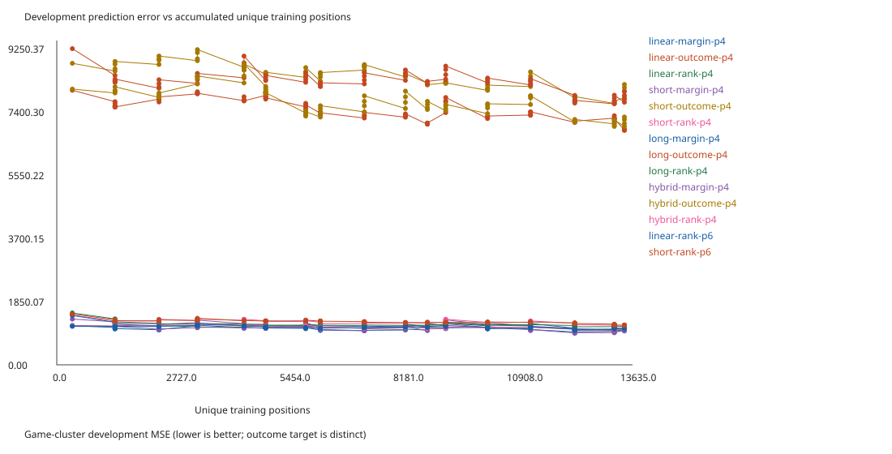
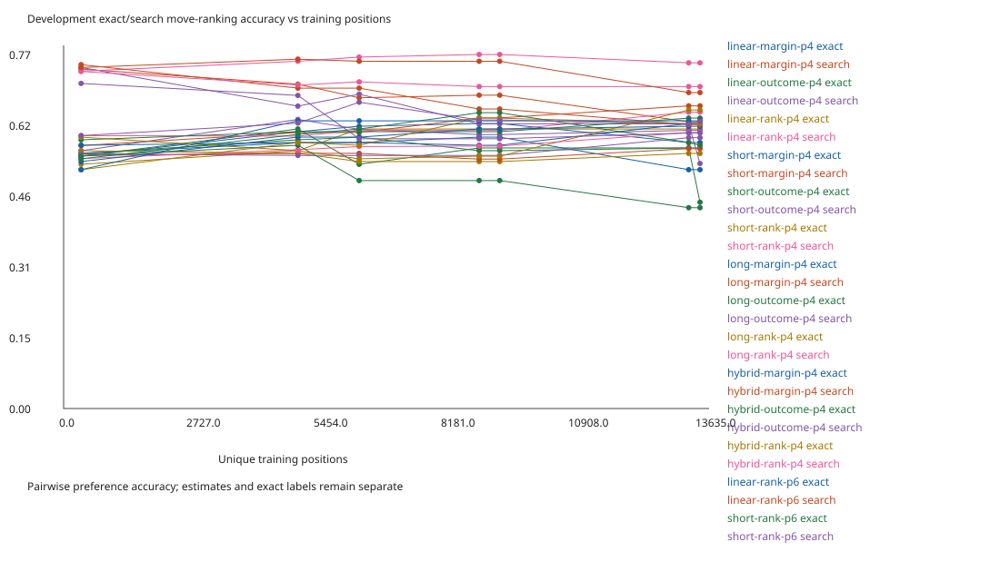
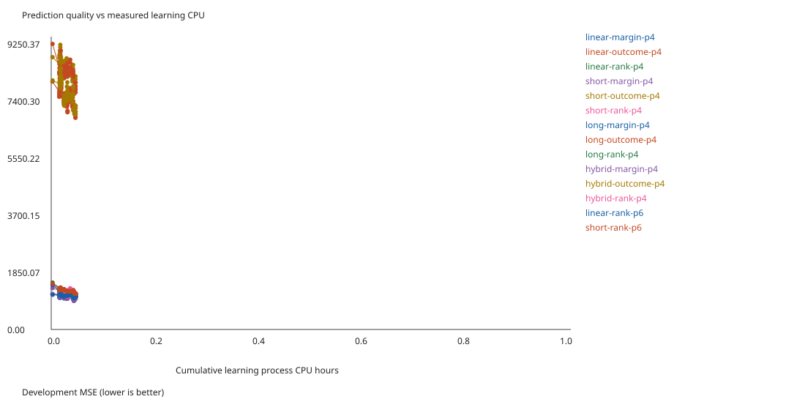
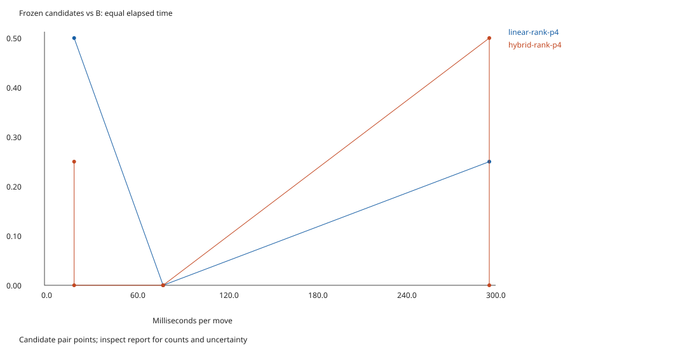
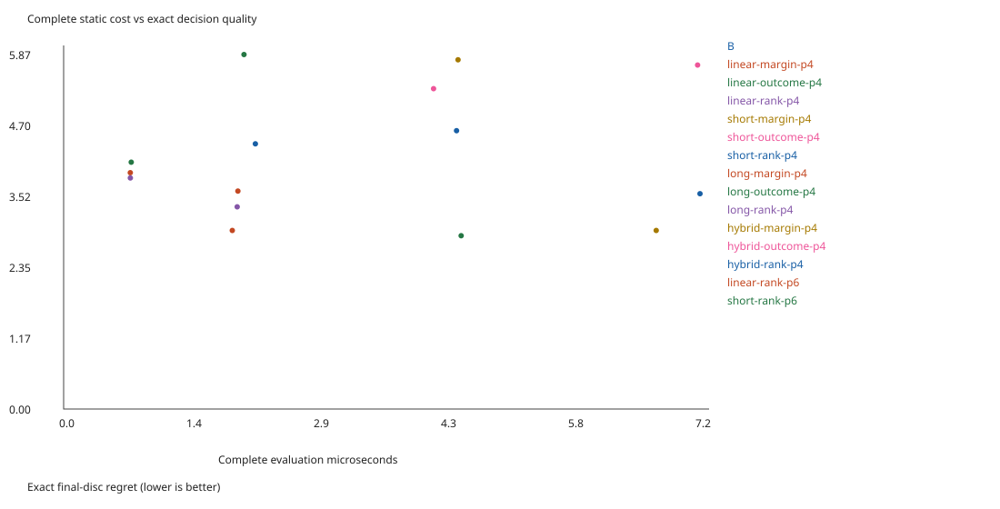
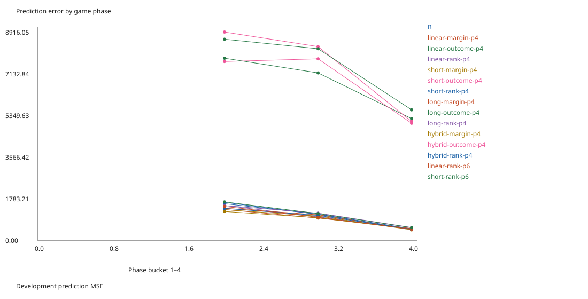
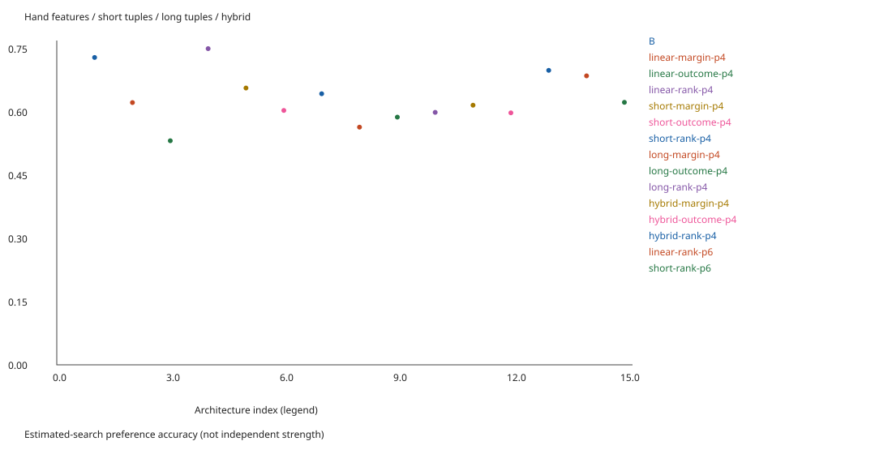

# Strong evaluator training: implementation and pilot

**B remains the production evaluator.** The six-hour campaign and the short correctness/calibration experiments must be distinguished. This report will record the launch and bounded pilot evidence; a launched run is not a completed strength result.

## Previous failure: measured representation cost

An additional historical diagnostic used 644 disclosed development positions from the retained v1 run. Generic versus compiled versions of the exact same frozen linear/stable weights differed by at most **1.42e-14**. All 24 matched depth-3 searches retained their moves and minimax scores.

| Complete static evaluator | Median µs over five samples |
|---|---:|
| Production B | 2.271 |
| Historical learned generic vector path | 3.768 |
| Identical learned weights, compiled linear/stable path | 2.227 |

This local result demonstrates substantial avoidable representation overhead (about 1.69× generic-to-compiled). It does not establish that faster old weights beat B at equal time. The old learned candidate also lost its fixed-depth point comparison; cost alone cannot explain the prior result.

Historical game-cluster development prediction MSE by original opening/middle/endgame phase was **1,551.6 / 1,120.6 / 376.4** for learned stable versus calibrated B's **1,753.8 / 1,201.5 / 476.0**. These mixed-policy outcome targets favor the learned model in all three phases. That fails to support a simple claim that its early-phase outcome MSE was worse, but does not establish early minimax accuracy. Prior approximate depth-4 B references favored B's decisions; they also share its heuristic biases. Independent late exact regret improved while playing strength did not. This motivates the new objective, policy-diversity, phase-control and cost diagnostics rather than selecting one explanation prematurely.

Reproduce the historical measurement with the command in STRONG_EVALUATOR_PLAN.md. Exact times vary with CPU load/JIT; no macOS timing claim is made.

## Completed implementation

The v2 framework implements systematic short ternary tables, 6–10-square corner/edge patterns, diagonal patterns, D4/color sharing, four phases and six-phase controls, typed runtime compilation, independent margin/outcome/preference fits, streamed trajectories and replay, disagreement/coverage label selection, independent bounded exact solves, immutable checkpoints, fixed finalist confirmation, source snapshots, and resource-checked launch/resume. It generates seven standalone SVGs for the requested learning, computation, strength, cost, phase and architecture comparisons. Large weights and datasets stay local.

The initial integrated smoke exercise completed generation, fitting, selection, independent exact quality assessment and a tiny frozen-candidate game comparison. Such tiny samples exercise the pipeline and **cannot establish stronger play**. Tests additionally cover value-preserving compilation, D4/color equivariance, quantization error, full changed-square incremental indices, independent rules/exact continuations, target perspective and preference-learning direction.

## Completed short calibration, 27 October 2026

The bounded calibration finished in **299.3 wall seconds / 288.1 process CPU seconds**, with **six learning cycles**, one worker, seed `2026102793`, and no failed tasks. Output is `.local-research/strong-calibration-20261027/`. Its source digest was `701605ff9bfaaeaa1b57076179f31d44dc66cd575e9b64a56ae4c61a9b5a8ee9`. Final framework changes after this completed pilot add policy-version metadata, amortize model loading across a game shard, strengthen continuation/reboot bookkeeping, and use monotonic times for freeze auditing. They do not change its fitted model mathematics. The six-hour launcher freezes the final executable and repeats calibration for sizing.

**A calibration finding changed the next experiment:** the original four equal phases from 4–64 occupied squares had zero fitting examples in phase one, because deliberately randomized prefixes were omitted. This can cause opening mistakes and confounds interpretation of the pilot's losses. New models use boundaries **28/40/52**, with six-phase controls also guaranteed post-prefix coverage. The old serialized model specification is retained; its pilot metrics are not relabeled as results of the corrected architecture. A test verifies actual game-state coverage of every configured phase. The full campaign also generates 256 development games instead of the pilot's 32, retaining admission/rejection evidence.

Reproduce the short configuration in a new directory (timed outcomes and sizing can differ):

```bash
node scripts/strong/run.mjs --pilot --seconds 360 --workers 1 --seed 2026102793 --output .local-research/strong-calibration-replication
python3 scripts/strong/publish.py .local-research/strong-calibration-20261027
```

The second command audits saved pair outcomes, interval arithmetic and freeze ordering before publishing [compact evidence](data/strong-evaluator-pilot.json) and graphs. The disclosed seed is replication, not fresh confirmation. Raw models, full trajectories, source-specific artifacts and logs remain local.

| Work | Completed result |
|---|---:|
| Accepted training games / distinct retained positions | 626 / 27,228 |
| Distinct subsampled outcome positions fitted per model | 13,635 |
| Development games / independent quality games | 29 / 46 |
| Admitted exact training labels, 8 / 10 / 12 empties | 319 / 80 / 16 |
| Admitted deeper search training labels | 848 |
| Model families/objective variants / epoch records | 14 / 1,217 |
| Rejected generated trajectories across all splits | 259 |
| Untouched exact assessment positions | 45 |

| Category | Active wall seconds | Process CPU seconds |
|---|---:|---:|
| Calibration, including pilot games | 38.8 | 38.7 |
| Data and expensive labels | 64.8 | 59.1 |
| Fitting and feature encoding | 54.0 | 50.2 |
| Development model comparison | 20.0 | 20.3 |
| Selection games | 66.0 | 65.3 |
| Independent positional assessment | 6.6 | 6.6 |
| Tiny frozen-candidate confirmation games | 40.7 | 40.1 |

Category wall times do not overlap. Startup/report overhead accounts for the small difference from overall wall time. This five-minute calibration intentionally has very small tournament samples; its larger relative tournament share does not set the six-hour allocation. Unlike v1's 48 fitting seconds over 4.4 hours, this pilot spent about 50 CPU seconds fitting within five minutes and repeatedly obtained new data between fits. Early convergence did not expand its tournament targets.

Bare generation measured **136 / 89 / 26 games/s at depths 1/2/3**, respectively, before learned-policy loading. These are eight-game measurements, not sustained campaign throughput. The initial eight depth-5 labels took about 48 ms of search and four 8-empty independent solves about 13 ms of solver work, excluding selection, checking and serialization. Combined learning stages produced **about 707,000 retained positions, 22,000 search labels and 10,800 exact labels per wall hour** when extrapolated from only 139 measured seconds. These rates are provisional: deeper 12-empty solves, identity-index growth and more accumulated data can reduce them substantially. The runner records actual timing instead of assuming those rates continue.

Measured pair costs were **1.78 / 6.80 / 23.72 seconds at 20/80/300 ms**. At that rate the requested 256/128 primary confirmation pairs cost roughly **80 minutes**, plus selection and quality assessment. The full campaign reserves measured costs with headroom before confirmation.

### Quality and cost

Latest development checkpoints, on the same 23 independently solved 8-empty development positions:

| Family/checkpoint | Margin-target development MSE | Exact disc regret at depth 1 | Complete static µs |
|---|---:|---:|---:|
| B, prediction-calibrated on training only | 1,109.3 | 4.391 | 2.166 |
| Linear margin | 962.2 | 3.609 | 1.968 |
| Short-pattern margin | 973.5 | 5.783 | 4.455 |
| Long-pattern margin | 1,021.9 | 3.913 | 0.753 |
| Hybrid margin | 926.9 | 2.957 | 6.693 |
| Hybrid preferences | 1,009.4 | 3.565 | 7.188 |

This is exploratory development screening. Outcome models use a different target and their raw MSE is not comparable with the margin column. All target-specific results, four/six-phase controls, search ranking, phase/boundary errors, nodes and completed-depth probes are in local results and compact evidence. Long patterns are particularly promising as a representation: complete evaluation is cheaper than B, while the larger hybrid remains costly. No claim of stronger long-pattern play follows from this small quality set.

The frozen finalist was `hybrid-rank-p4`, selected only on development/selection data. On **45 untouched exact positions**, mean disc regret was **6.178 vs B's 6.578 at depth 1**, and **1.906 vs 4.656 at depth 3**. Exact pairwise preference accuracy was **66.4% vs 55.1%**. Full static cost on those boards was **6.747 vs 2.302 µs**, so the learned evaluator was about 2.9 times as expensive. The independent tiny game comparison lost all eight games: two opening pairs at 80 ms, one at 300 ms and one at 20 ms. Every pair interval is [0,1]; **this is no strength evidence or promotion**, and B stays production. It usefully reproduces the quality/cost tension before the substantial new learning run.









### Independently verified better and worse choices

All margins below are for Black, assuming exact play after the chosen move. These are depth-1 evaluator decisions, not explanations of a deeper minimax score. The independent mailbox solver supplied every alternative's margin and the continuation after each choice; full boards/lines for six positions are in the evidence JSON.

One worse learned decision, Black to move:

```text
W.BBBBBB
WWBBWWWB
WWWWBWWB
WBWBWWWB
WBBWWWWB
.BBBBBBB
..BWWWWB
..WBBW..
```

B chooses **H8**, exact **−4**; learned chooses **B1**, exact **−14**. Verified continuations are `H8 B1 G8 A6 B8 A7 B7 A8` and `B1 A6 B8 A7 B7 A8 G8 H8`.

One better learned decision, Black to move:

```text
..BBW...
W..BBWW.
WBWBWWWB
WWBWWWWB
WWWWWWWB
WWWWWWWB
WWBWWWWB
WWWWWWWB
```

B chooses **C2**, exact **−28**; learned chooses **B2**, exact **−14**. Verified continuations are `C2 B1 F1 G1 B2 A1 H2 H1` and `B2 B1 F1 G1 A1 C2 H2 pass H1`.

A third position in the JSON has B choose F8 for **+24** and learned choose G7 for **+34**; a fourth reverses that lesson, **+38 for B vs +26 learned**. The examples show both improvements and mistakes.

### How much more local computation looks useful

At the best margin checkpoints, **5,816 / 6,358 observed short-table coordinates** had at least 32 observations, versus just **6,946 / 40,860 observed long-table coordinates**. Most observed long states still have sparse coverage; total table size includes unreachable/redundant configurations, so unobserved entries are not all missing knowledge. This supports increasing distinct data before expanding model complexity.

A useful next scale is **100,000–1,000,000 additional distinct retained positions**, with better-depth labels concentrated on disagreements. The pilot's combined rate would imply roughly 0.15–1.4 learning wall hours, but that is an optimistic extrapolation from a tiny run. Reserve **several CPU hours**, as the six-hour campaign does, to measure the slowdown from deeper exact labels, larger replay and real fitting. A subsequent 24-hour allocation is worth considering only if the chronological development curves or fresh equal-time assessment improve; there is no evidence yet that 72 hours will be worthwhile. Do not automatically start either longer run.

## Remaining limits

The initial run does not have an external Egaroucid/Edax teacher; both were investigated through primary documentation, and neither executable is installed. Our own deeper B estimates retain teacher bias, while only independent exact labels provide verified disc regret. The canonical identity index still grows in coordinator memory; very large multi-million-position campaigns need measured memory headroom and may eventually warrant an on-disk index.

Current macOS Apple Silicon/Intel and actual Windows-browser acceptance are not rerun by the offline tests; game interaction behavior is unchanged. Windows reboot recovery preserves completed local files, but it cannot continue computing while Windows/WSL is down. Manual WSL resume or the generated Windows recovery command is required unless the user independently installs a login task. No saved settings or application state are changed. Freeze/confirmation auditing uses monotonic elapsed time because WSL wall-clock adjustment made timestamp-only test assertions unreliable; the v1 regression test now uses its already recorded monotonic event times as well.

## Six-hour launch status: blocked by available Windows memory

**The six-hour run has not started; there is no research PID.** Framework and compact calibration evidence were committed and pushed in `31e4101`. All 13 JavaScript test files and 14 Python tests passed. The four strong-runner integration tests were rerun successfully after the final Windows recovery-PATH adjustment. The generated Windows recovery command preserves the concrete Node location, including nvm installations, without changing saved PATH/settings.

Fresh host checks at **20:16 and 20:19 UTC on 27 October** found Windows physical memory falling from **0.91 to 0.58 GiB available**, below the predefined **1.25 GiB launch floor even for one worker**. The last Windows CPU sample was 35%; WSL had 88 MiB swap allocated with no active swap-page traffic, about 903 GiB virtual-filesystem space, and Windows C: about 363 GiB free. No duplicate research coordinator was found. Memory Compression and multiple Chrome processes were prominent Windows consumers. The earlier 1.75-GiB check was superseded by these newer measurements. Raw resource evidence is local at `.local-research/strong-resource-check/preflight.json`.

The launcher correctly refused to start. No application was closed, no existing process terminated, and no saved power/startup setting changed. Free some Windows memory before launching; closing unneeded Chrome tabs/windows is one possible local action. No further AI session is needed:

```bash
cd /home/rharris/git/reversi
python3 scripts/strong-launch.py --hours 6 --seed 2026102797 --output .local-research/strong-six-hour-20261027
```

That command repeats the resource checks, chooses at most two workers (one with limited headroom), freezes the executable, launches detached, renews the already-approved temporary keep-awake request, and prints the actual PID. The six-hour budget begins when the coordinator starts; this resource-blocked state consumes none of it.

Once started:

```bash
tail -f .local-research/strong-six-hour-20261027/launcher.log
less .local-research/strong-six-hour-20261027/report.md
```

After interruption or reboot, use the saved frozen source/configuration:

```bash
python3 scripts/strong-launch.py --resume --output .local-research/strong-six-hour-20261027
```

Use `--resume` only after a first successful start created the manifest. The generated `resume-after-reboot.cmd` is the Windows convenience alternative. The 24–72-hour configuration in STRONG_EVALUATOR_PLAN.md remains prepared and **not started**.

Verification and publication commands used:

```bash
node --test tests/*.test.mjs
python3 -m unittest discover -s tests -p 'test_*.py'
python3 -m unittest discover -s tests -p 'test_strong_runner.py'
python3 scripts/strong/publish.py .local-research/strong-calibration-20261027
git diff --check
git commit -m "Build learning-first pattern evaluator research with crash recovery"
git push origin main
```
