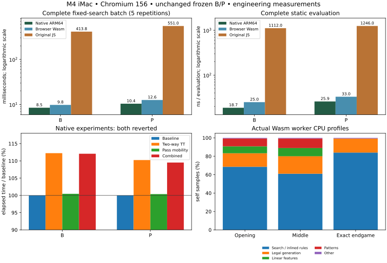

# Shared C++ WebAssembly engine: engineering results

The qualified C++ engine runs locally in an ordinary browser, including frozen
P playing, full-window all-move P coaching and model-consistent P game review.
One principal C++ search/evaluator implementation serves native and Wasm.
On the disclosed M4/Chromium panel, Wasm completes the fixed-search batch
**42.2× faster than original JavaScript B and 43.7× faster than JavaScript P**.
It takes **15.4% more time than native B and 21.0% more than native P**.
These are measured engineering results, not assumed native-equivalent performance
or another independent P-versus-B strength confirmation. Saved/custom weights
remain the initial browser selection; P is opt-in.



## Architecture and shared source

`native/engine.cpp`/`engine.hpp` retain the original inspectable bitboard negamax,
alpha-beta, ordering, bounded direct TT and B/L/P evaluation. No PVS, selective
pruning, threads, replacement engine or new evaluator was introduced. Native
`main.cpp` owns process stdin/stdout. Browser `browser.cpp` owns a small C ABI
with explicit engine handles, compact bitboards, model/build verification,
structured errors, inspect, complete searches, all-move/PV operations and release.
There are no per-node or per-evaluation JavaScript callbacks. Timed searches use
the existing runtime clock checks every 64 nodes.

Shared `Engine::analyze` obtains every legal alternative through an independent
full window at one placement horizon. It verifies each continuation reply by
full-window score equality at the remaining depth; bounds are never presented
as exact root-alternative values. Passes preserve depth. Terminal detection
precedes horizon evaluation. Solved metadata is conservative and distinct from
an exact depth-limited TT bound. A failed verification returns an error.

Playing keeps the cheaper best-root path. Ordinary timed play deepens to the
natural empty-square limit, returning only its last completed iteration.
Depth-zero fallback has a legal move, null score and no solved claim. Explicit
fixed horizons remain available through depth 64.

## Native experiments: neither retained

[Checkpoint report](NATIVE_FINAL_OPTIMIZATIONS.md),
[complete compact trials](data/native-final-experiments-20261030.json) and
[before/candidate profiles](data/native-final-profiles-20261030.json) preserve
both unsuccessful experiments and executable/source identities. Reproducible
patches and runners are under `scripts/native-final/`.

A pairs adjacent forty-byte full-identity entries into two-way eighty-byte
buckets, preferring empty/older-generation/shallower replacements. Both designs
allocate exactly 10 MiB. B avoids duplicate legal generation at zero-depth forced
passes; ordinary leaves already reused their own mobility mask. It cannot reuse
a parent mask after changing the board. Feature normalization, coefficients,
Float32 cells, phase boundaries and summation order remain unchanged.

Nine rotated repetitions × 36 disclosed phase/pass/terminal roots × B/P:

| Median complete batch ms | Existing V2 | Two-way TT | Pass mobility | Combined |
| --- | ---: | ---: | ---: | ---: |
| B | 63.827 | 71.642 | 64.118 | 71.529 |
| P | 110.851 | 122.208 | 111.265 | 121.401 |

TT hits improve, but nodes fall only 0.16% B / 0.24% P and elapsed time rises
12.2% / 10.2%. Mobility reuse changes neither tree and has no useful timing gain
(about 0.4% slower, within small trial variation). Both are reverted. All 648
matched conditions have identical minimax scores across four variants. Each
candidate passes all 15 native regression groups under ASan/UBSan, including
independent rules, exact endings, bounds/collisions, generation rollover,
model/horizon changes and interrupted deepening. This rejects these candidates,
not every possible compact bucket or mobility strategy. The engine entering
Wasm work is the unchanged qualified V2 engine.

## Toolchain and reproducible compilation

Developer-only `scripts/wasm/setup.sh` installs user-scoped emsdk/compiler
**4.0.22**, without shell startup edits or saved system-setting changes.
`node scripts/wasm/build.mjs` reconstructs frozen data through the same generator
as native and compiles shared C++17 with `-O3 -ffp-contract=off -fno-fast-math`.
Exceptions are explicitly supported. The module is single-threaded, without
shared memory, SIMD or a filesystem. Function names are retained for profiling.
Initial linear memory is 32 MiB, maximum 128 MiB, stack 1 MiB. The default TT is
10 MiB, exactly matching native; browser handles bound nominal capacity at 32 MiB.

The committed generated ES module, Wasm and manifest live in `src/wasm/`.
The manifest includes full flags, compiler version, every source/header hash,
artifact SHA-256, ABI/build identity and all frozen model identities. Two
successive production builds produce identical bytes. Ordinary Python/browser
startup installs nothing and performs no remote computation.
See [build/interface documentation](WEBASSEMBLY_BUILD.md) and the official
[Emscripten SDK](https://emscripten.org/docs/getting_started/downloads.html) /
[settings reference](https://emscripten.org/docs/tools_reference/settings_reference.html).

## Numerical and functional qualification

[Qualification report](WEBASSEMBLY_QUALIFICATION.md) and
[certificate](data/wasm-qualification-20261030.json) record **zero observed
numerical difference** across 2,250 comparisons, including 600 static queries,
all B/L/P models, both turns, representative phase roots and arbitrary occupancies.
Tolerance is absolute 1e-10; no expected cross-runtime drift or relaxed tolerance
is needed. Independent sentinel-board rules validate every returned child.
Native fixed minimax scores, every tested alternative and subsequent optimal PV
reply agree with independent JavaScript minimax.

Actual Wasm, not merely native compilation, exercises forced passes, terminal
empties, zero-horizon pass semantics, exact alternatives, depth 15/16/64,
tiny-TT collisions, upper/lower/full windows, changing models/horizons,
interrupted iterations, null-score fallback, invalid parameters, repeated calls,
close/lifetime and fail-closed version/model errors. The standalone assertion
suite is additionally compiled to Wasm: 174,960 ordered pattern-sum comparisons,
generation rollover, independent all-move/PV comparisons and interruption checks.
The shared core's native sanitizer regression also passes.

The actual-browser benchmark independently repeats all static checksums and
fixed scores for both B and P: **maximum score and accumulated checksum error
are both zero**. Native and Wasm fixed node counts match exactly. A final adapter
guard also checks model identity in returned search/analysis rows before tagging
them for display; an injected wrong-model response is rejected.

## Worker integration, playing and coaching

The existing opponent, analyzer and reviewer workers each lazily own a private
Wasm module and TT. Initialization is asynchronous inside the worker, reuses one
promise and serializes arriving requests. The trainer never allocates Wasm.
Existing IDs/revisions/view/model checks reject obsolete replies. Cancellation
terminates/recreates a busy worker, releasing its whole module lifetime. There
are no additional computational pools and no main-thread search/initialization.

Choose **B**, **L** or **P** in Evaluator; choose fixed computer depth or **80 ms /
300 ms**. Playing reports the last computer search's evaluator/backend, completed
depth, nodes, elapsed time and exact/heuristic/fallback classification. The coach
uses that same selected evaluator for all legal moves and historical positions,
with arbitrary comparisons, verified lines and move-by-move factual evidence.
Review evaluates every recorded decision with the selected model. P's immediate
linear contributions and pattern correction are static evidence, never a causal
decomposition of its deeper minimax value.

Saved/custom weights, model versions, training and JSON export retain their
original storage/format and JavaScript implementation. Training/export/inspection
labels explicitly refer to saved/custom weights. Frozen selection/time preference
uses a separate key and is persisted only through an explicit user choice. P
has not been promoted and does not overwrite existing weights.

Initialization failure visibly falls back to equivalent JS B only for a B
request. P/L fail with an explanation instead of substitution; selecting custom
or B restores supported JS behavior. Browser tests abort Wasm loading, inject
an incompatible manifest ABI and verify recovery after a normal reload. Content
versioned artifact names plus ABI/full-build/model checks protect mixed caches.
Python explicitly serves Wasm and module JavaScript MIME types. See
[integration details](WEBASSEMBLY_INTEGRATION.md).

## Matched native / browser Wasm / original JavaScript measurements

M4 iMac, 24 GiB, macOS ARM64, Chromium **156.0.8078.4**, Apple Clang 21 native,
pinned Emscripten 4.0.22 Wasm. Eight disclosed roots cover opening, middle,
endgame, forced pass and terminal empties. Five repetitions alternate backend
order; work runs serially after warming each path. Fixed depth is 7 before
occupied 28, 6 before occupied 52, otherwise min(9, empties), at least one.
Root boards, seeds, exact build identities, all timings/counters and raw profiles
are published in [benchmark evidence](data/wasm-browser-benchmarks-20261030.json).
These are a different panel/horizon from the 36-root native experiment above.

The browser benchmark exports the *original* `compile(P).evaluate` function body
and frozen Float32 tables into ignored test storage, then runs the original
`src/search.js` in a real browser worker. It does not substitute an invented
JavaScript P evaluator. Static/native checksums must agree before accepting data.
No benchmark dependency or reference-table export is needed for ordinary play.

| Fixed complete batch | Native B | Wasm B | JS B | Native P | Wasm P | JS P |
| --- | ---: | ---: | ---: | ---: | ---: | ---: |
| Median ms | 8.493 | 9.800 | 413.800 | 10.416 | 12.600 | 551.000 |
| Nodes | 148,636 | 148,636 | 148,004 | 169,532 | 169,532 | 168,301 |
| Million nodes/s | 17.50 | 15.17 | .358 | 16.28 | 13.45 | .305 |
| Median static ns/evaluation | 18.74 | 25.00 | 1,112.00 | 25.88 | 33.00 | 1,246.00 |

Thus Wasm fixed-search speedups are 42.2× B / 43.7× P versus JS; native is
1.15× / 1.21× faster than Wasm in this panel. Static Wasm is about 44.5× / 37.8×
faster than JS, while taking about 33% / 27% longer than native. Different model
trees are never pooled to infer evaluator cost or playing strength. JS has
slightly different trees because its reference TT stores/probes leaves and uses
its own hint/replacement policy. Equal scores and optimal choices are preserved;
NPS and nodes saved are reported separately. Wasm/native trees match.

Three repetitions × six nontrivial roots × both models × both budgets produce
72 matched timed conditions. Mean completed placement depths:

| Model/budget | Native | Browser Wasm | Original JS |
| --- | ---: | ---: | ---: |
| B / 80 ms | 9.50 | 9.00 | 6.17 |
| B / 300 ms | 10.33 | 9.83 | 7.00 |
| P / 80 ms | 8.83 | 8.67 | 6.17 |
| P / 300 ms | 9.50 | 9.44 | 7.33 |

The original JS timed reference retains its old depth-14 ceiling. Both C++ targets
use their natural limit; explicit beyond-14 and exact fixtures are qualified
separately. Maximum Wasm core overrun in this timed panel is .3 ms. Browser
non-isolated timer resolution is about .1 ms; sub-resolution differences are not
significant. Worker queuing, cold loading and result delivery add time beyond
core search. In the final visible app, complete worker-request overrun reaches 25.3 ms
including startup/import and UI delivery. Delivery/conversion overhead above core
time is median .2 ms, p95 16.5 ms, maximum 25.2 ms; the tail is about one UI frame
plus cold loading. These values are not hidden behind the .3-ms core bound.
Native CPU time accompanies every row; browser process CPU is
separately scoped rather than mislabeled as exact per-search thread CPU.

## Boundary, initialization and profiles

The complete inspect/JSON adapter boundary costs about **14–20 μs per request**
for 1,000-query batches; this includes conversion, static work, child formatting
and parsing, not just the bare ABI call. Search makes one boundary crossing per
complete operation. P coaching additionally queries immediate static pattern
values once per legal alternative, never per search node. This is a possible
small batching improvement for shallow coaching, not a timed-play bottleneck.

A first browser-worker module initializes in 8.1 ms in the benchmark. Five fresh
worker/context trials in the same browser process measure module initialization
6.9–12.1 ms and complete navigation/worker/module readiness 24.8–74.4 ms. This
separates module cost from worker/import/navigation overhead. Python→browser→
worker single-inspect round trips are mostly .5–1 ms warmed, with higher cold
outliers; they include test automation transport and are not bare worker latency.
A separate 2.509-second warmed Wasm workload consumes 2.523 aggregate browser
process CPU seconds, including messaging/browser work. Neither CPU nor wall time
is confused with native process CPU during search (`std::clock`).

Actual worker CDP CPU profiles use 100-μs sampling during 2.5-second P workloads:

| Self-sample share | Opening | Middle | Exact endgame |
| --- | ---: | ---: | ---: |
| Negamax / inlined flips, TT and ordering | 68.6% | 61.0% | 84.0% |
| Separately visible legal generation | 14.7% | 19.0% | 15.3% |
| Linear features | 7.5% | 9.0% | ~0 |
| Pattern gathers/lookups/sum | 8.5% | 10.3% | ~0 |
| Other, including boundary/formatting/idle | <1% | <1% | <1% |

These are actual Wasm worker samples, with symbol names retained. Inlining folds
flips, much ordering and TT operations into negamax; the data do not resolve their
separate cycle/cache costs. Native sampling exposes more flips as separate
symbols, so its search-only percentage cannot be compared directly with Wasm's
combined percentage. Both show search/rules dominating after V2's pattern-table
optimization. No hardware cache-miss, memory-bandwidth or fine pattern-lookup
claim is invented. Raw `.cpuprofile` and UI timeline traces remain locally;
compact function counts and reproduction scripts are public.

## Acceptance, memory and cancellation

Final acceptance measurements and complete replayable game evidence are recorded
in [results](data/wasm-engine-results-20261030.json) and
[games](data/wasm-acceptance-games-20261030.json). The fixed engineering schedule
crosses B/P, 80/300 ms, both human colors and six deterministic random-human seeds
per cell: 48 complete visible-browser games. Independent Python sentinel rules
replay every move, forced pass, terminal board and raw disc outcome. Coaching
checks compare every legal row with native full-window values at selected roots;
all continuations are independently checked for legal placements/passes and
horizon accounting. These games are acceptance tests, not independent strength
observations or a new P/B tournament.

The final 48-game pass completed in **283.6 seconds**, including **408 forced
passes**, **eight terminals with empty squares**, **348 native-matched coach
scores**, 1,647 computer searches and **zero page errors or depth-zero fallbacks**.
Both colors and both budgets have twelve completed games per evaluator/budget
cell. Maximum completed depth is 20. Core overruns are at most .3 ms. An uncapped
visible-frame probe records a maximum gap of **18.8 ms** (maximum per-game p95
18.7 ms). No prior-game reply overwrote current state.

| Final actual-app condition | Games | Computer searches | Mean depth | Max depth |
| --- | ---: | ---: | ---: | ---: |
| B / 80 ms | 12 | 408 | 9.515 | 17 |
| B / 300 ms | 12 | 409 | 10.355 | 20 |
| P / 80 ms | 12 | 421 | 9.648 | 19 |
| P / 300 ms | 12 | 409 | 10.098 | 20 |

These depths describe different random-human paths; they are not matched
playing-strength or evaluator-quality comparisons. The earlier 48-game pass
completed in 284 seconds, including 405 forced passes and
nine terminals with empties, with zero page errors and 348 native-matched coach
scores. Linear memory stayed exactly 32 MiB per engine. Aggregate Chromium
process RSS rose from about 1.17 GiB to 1.22 GiB, then levelled off; summing process
RSS double-counts shared pages and is not a precise browser allocation measure.
Swap stayed .38 MiB throughout. This finite stability check is not a proof against
every future leak. Terminating workers discards their module memory; close frees
the TT, while a live Wasm instance retains its linear-memory high-water mark.

A follow-up visible cancellation trace repeatedly cancels 300-ms P requests
20 times. Its unrestricted RAF probe reports p95 16.8 ms / maximum 71.5 ms,
no main-thread long tasks, and no main trace event above 20 ms. The first
full-game probe recorded p95 per game at most 17.6 ms and occasional 383-ms
startup/render/compositor gaps; that initial probe excluded >=1-second gaps.
The final 48-game rerun removes that exclusion and uses the final defensive
model-response guard. Both runs and their test-only seeds are retained; no games
were selected or deleted to improve an outcome. No claim of perfectly hitch-free rendering is made.
Actual Wasm work is in workers, and UI cancellation remains responsive.
The final full suites pass **169 Node tests and 38 Python tests**.
All 15 native sanitizer groups and
the actual-Wasm standalone assertion executable pass. The final numerical
probe records 2,302 explicit comparisons with maximum error zero. An independent
[public audit](data/wasm-public-verification-20261030.json) replays all 48 games,
checks 1,647 applied computer replies, independently solves 143 small exact
searches, verifies all 80 fixed benchmark rows and checks source/artifact hashes. Additional actual-Wasm
checks explicitly traverse the preserved independent 15/16-empty references,
verify every exact alternative for B/L/P and complete timed depth above 14.
All directed one-to-six-disc rays and edge masks agree with the independent rules.
Every entry in a deliberately filled multi-entry TT clears at generation rollover
in the standalone native and Wasm builds.

## Compatibility, problems and limits

Chromium on the M4 is actually tested, both headless diagnostic workers and
visible complete-game/UI acceptance. Safari WebDriver could not create a session
because **Allow remote automation is disabled**. That setting was not changed;
Safari has not passed these tests. No current Intel, WSL2-to-Windows, Firefox,
Edge or native Windows execution is newly claimed. Previous platform/scientific
reports remain intact. Python/browser deployment remains dependency-free and
uses portable local static resources.

Development failures are retained and explained: HEAPU8 needed explicit export;
the first PV test wrongly demanded global optimality of every alternative;
a benchmark wait expression accidentally invoked its function; typed geometry
arrays needed explicit array serialization for the benchmark-only JS closure.
Those harness issues were repaired before accepted numerical measurements.
New public engineering boards and game paths must be treated as historical
evidence in any future freshly registered learning/strength study.
A publication-only summary initially duplicated its player keyword; the exporter
was corrected and the public audit verifies its final replay/index mapping.
The reproduction runner also now fingerprints the actual copied baseline sources
for each native candidate rather than inheriting current-build metadata.
Legacy research-runner tests needed larger *test-only* cumulative allowances
because their correctness startup now includes actual Wasm. Diagnostics also
exposed an older one-millisecond native test that incorrectly forbade a legal
depth-zero fallback after transport/clock quantization consumed the deadline.
The test now checks null score, legal move and unsolved status, as the API requires;
the engine and its elapsed-time contract are unchanged. Failure diagnostics also
wait for runner lock release and preserve the underlying correctness log. No old scientific
protocol, model, result or computational allowance was changed.

The prior native P-versus-B result and provenance qualification are preserved:
P's substantial registered-panel advantage at both time controls remains evidence
under its stated direct-development-overlap and unresolved-role limitations.
This browser work neither repairs those historical independence limitations nor
claims fresh independent playing-strength confirmation. Frozen coefficients and
historical scientific artifacts are unchanged.

## Ranked next work

| Rank | Candidate | Measured reason | Unmeasured benefit / risk |
| --- | --- | --- | --- |
| 1 | Small final-empty move/flip specializations | Search/rules dominate exact solving; broad earlier kernels did not help | Potentially useful exact-endgame gains; medium pass/edge risk. Qualify against independent endings. |
| 2 | A truly packed/aligned TT experiment, with equal memory | This two-way eighty-byte candidate gains hits but loses elapsed time | 0–10% plausible, not established. Medium identity/bound/generation risk; retain only measured wins. |
| 3 | Batch immediate P coaching facts into one response | Per-alternative inspect boundary remains in shallow coach work | Small UI/coaching gain, negligible playing gain; low/medium ABI and explanation-consistency risk. |
| 4 | Cheap ordering or separately qualified PVS | Much remaining work is alpha-beta/control; current ordering is simple | Tree-dependent and unmeasured. Medium/high window/re-search risk; separate reviewable project. |
| 5 | Finer Wasm memory and inlined-rule attribution | Current CPU profiles cannot separate TT/cache/flips inside negamax | Measurement first; no speedup promised. Avoid new required runtime toolchains. |

More training or another strength tournament is not the next automatic action.
The immediate deliverable is usable P playing and accurate P coaching in a normal
browser while preserving the shared engine for future qualified improvements.

## Reproduction and checkpoints

Use Node 20+ and a test-only Python Playwright **1.64.1** environment with
Chromium revision 1248 (156.0.8078.4); these
are developer dependencies, not application startup dependencies. To prepare it:

```bash
python3 -m venv .local-research/browser-venv
.local-research/browser-venv/bin/pip install playwright==1.64.1
.local-research/browser-venv/bin/playwright install chromium
source .local-research/browser-venv/bin/activate
```

Then run serially:

```bash
scripts/wasm/setup.sh
node scripts/wasm/build.mjs
npm test
node scripts/wasm/internals.mjs
NATIVE_SANITIZE=1 node --test tests/native-search.test.mjs tests/native-v2.test.mjs
python3 -m unittest discover -s tests -p 'test_*.py'
python tests/wasm_browser_check.py
python tests/browser_check.py
node scripts/wasm/fixtures.mjs
python scripts/wasm/benchmark.py
python scripts/wasm/acceptance.py
python scripts/wasm/lifecycle.py
python scripts/wasm/safari.py
python scripts/wasm/ui-stress.py
python scripts/wasm/summarize.py
python3 scripts/wasm/verify.py
# Optional matplotlib developer environment:
python scripts/wasm/figure.py
git diff --check
```

Engineering output is under ignored `.local-research/wasm-20261030`; old native
research directories are read-only. Public JSON contains disclosed roots,
replications, counters, models, source/binary identities, resources and complete
acceptance games. Compact evidence and figures are committed; native executables,
SDK, caches, large traces and personal exports are not.

Checkpoint 1: `f4443cc0fbc21cb0e16ae0c47e0a3780fb459300`.
Checkpoint 2: `d6397c58c0bf1ec920315cb802e4360c072d9cce`.
Checkpoint 3: `7527c2af7e4b95bca5f8e95440b77df8c8a3cd59`.
Each used `git commit -m <checkpoint message>` followed by `git push origin main`,
with remote `refs/heads/main` verified before starting the next stage. The final
checkpoint's exact hash is reported after commit/push and remote verification.
